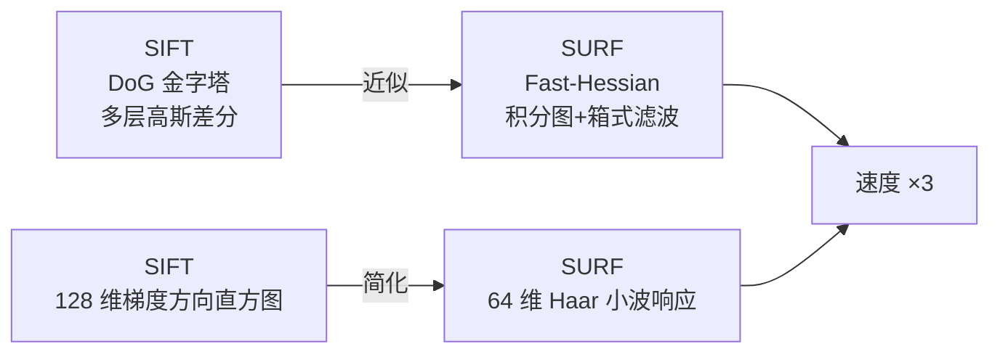
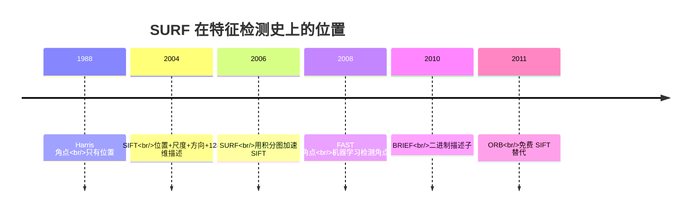

# SURF 加速稳健特征

## 🧪 原理互动演示

<AlgoVisualizer type="surf" />


## 🚀 动手体验

> 🧪 **先懂原理**：翻到下一节「核心概念」，页面里直接嵌入了可拖动滑块的原理动画（SIFT高斯金字塔、FLANN KD树、GrabCut迭代、KCF响应峰、ICP配准等），拖一拖就懂。

> 🎮 **再跑真机**：跳到第5页「源码实现」，底部有真机实验室（OpenCV.js 浏览器本地运行），选图调参即可看到真实效果与三语代码。

---

<AlgorithmCard
  name="SURF"
  enName="Speeded Up Robust Features"
  chapter="第4章 · 基元检测"  chapterLink="/chapters/ch04-primitives"
  branch="feature-detection"
  year="2006"
  author="Herbert Bay / Tinne Tuytelaars / Luc Van Gool"
  paper="https://www.vision.ee.ethz.ch/~surf/eccv06.pdf"
  level="mid"
  tagline="SIFT 的快车版本，速度三倍、精度相当"
  analogy="SIFT 像走盘山公路的老司机，绕路但稳；SURF 直接修了一条高速公路，几乎一样能到，但快三倍"
  scene="当你需要实时做局部特征匹配，又觉得 SIFT 太慢，还能接受它专利受限的前提"
  :pros="['速度约为 SIFT 的 3 倍','描述子 64 维，匹配更快','尺度、旋转、光照都稳','OpenCV 一行调用']"
  :cons="['专利保护（2006 年起）','描述子区分度略逊 SIFT','箱式滤波近似在高精度任务略差','OpenCV 主分支将其移到 xfeatures2d（专利）']"
/>

## 一句话理解

**SURF 就是用两个"偷懒"把 SIFT 加速了 3 倍**：

1. **检测阶段**：SIFT 用 DoG（多层高斯差分），SURF 用**箱式滤波近似 Hessian**，配合**积分图**让每个卷积都是 O(1)
2. **描述阶段**：SIFT 用 128 维梯度直方图，SURF 用 **Haar 小波响应**做 64 维描述子，匹配时还快一倍



## 生活类比：把"仔细算"换成"快速看"

**SIFT 的做法**：像一个认真的质检员，对每个像素都做高斯拉伸+差分，慢但精确。

**SURF 的做法**：像一个老练的快递分拣员——

- 不是逐个称重，而是把包裹**按区域**快速归类（积分图）
- 不是精细测量每个边，而是用"格子里左边多还是右边多"这种**粗判断**（Haar 小波）
- 结果：**判断准确率差不多，但分拣速度快了三倍**

代价：这个分拣员的"专业方法论"**申请了专利**，商业使用要谨慎。

## 算法时间线



## 你会在这里看到什么

| 页面 | 内容 |
|---|---|
| [论文精读](/algorithms/surf/paper) | Bay 等人 ECCV 2006 原文，为什么他们觉得 SIFT 还能更快 |
| [核心概念](/algorithms/surf/concepts) | 积分图、Fast-Hessian、箱式滤波、Haar 小波，四样东西讲清楚 |
| [算法流程](/algorithms/surf/architecture) | 五步走：积分图 → 尺度金字塔 → 关键点定位 → 方向分配 → 描述子生成 |
| [源码走读](/algorithms/surf/source) | OpenCV `xfeatures2d.SURF_create` 调用，以及 numpy 手写近似版 |
| [实战踩坑](/algorithms/surf/painpoints) | 专利问题、U-SURF 无方向模式、与 SIFT/ORB 选型 |
| [调参技巧](/algorithms/surf/tricks) | hessianThreshold 设多大、extended 参数、upright 模式 |

## 快速上手

```python
import cv2
# ⚠️ SURF 在 OpenCV contrib 模块（专利算法）
# pip install opencv-contrib-python
surf = cv2.xfeatures2d.SURF_create(hessianThreshold=400)
kp, des = surf.detectAndCompute(img, None)
print(f"关键点: {len(kp)} 个，描述子形状: {des.shape}")  # des: (N, 64)
```

::: warning 专利提醒
SURF 的专利归 ETH 与 KU Leuven 所有（US 专利号至 2026 年左右陆续到期，但欧洲更长）。**商业产品建议优先用 ORB**。
:::

## 适用/不适用场景

| ✅ 适用 | ❌ 不适用 |
|---|---|
| 需要尺度+旋转不变但算力有限 | 对精度要求极高、不缺算力的场景（用 SIFT） |
| 学术研究、个人项目 | 商业化闭源产品（专利风险） |
| 图像拼接、目标识别原型 | 移动端实时 SLAM（用 ORB 更合适） |
| 对比 SIFT 做速度/精度 trade-off 实验 | 嵌入式/超轻量设备（用 ORB/AKAZE） |
