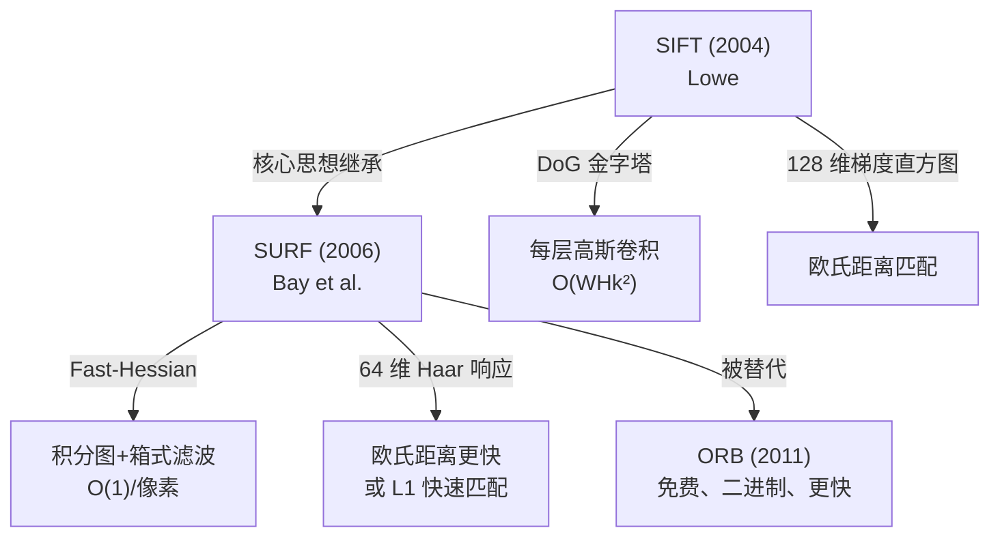

# SURF 论文精读：Speeded Up Robust Features (ECCV 2006)

## 论文信息

| 字段 | 内容 |
|---|---|
| 标题 | SURF: Speeded Up Robust Features |
| 作者 | Herbert Bay, Tinne Tuytelaars, Luc Van Gool |
| 机构 | ETH Zürich / KU Leuven |
| 会议 | ECCV 2006 |
| 引用量 | ~18000+ |
| DOI | 10.1007/11744023_32 |
| 代码 | OpenCV `xfeatures2d.SURF_create` |

## 写作背景：2006 年的痛点

> In this paper, we present a novel scale- and rotation-invariant interest point detector and descriptor, coined SURF. It approximates or even outperforms previously proposed schemes with respect to repeatability, distinctiveness, and robustness, yet **can be computed and compared much faster**.

作者开门见山：**SIFT 已经很好了，但是——慢**。

2006 年的痛点：
1. **SIFT 检测阶段**：每层 DoG 都要算完整高斯卷积，一幅 800×600 图要在 PC 上跑几十毫秒
2. **SIFT 描述阶段**：128 维向量用欧氏距离匹配，在大规模图像检索里慢
3. 工业落地（比如实时目标识别、AR）希望**至少能到 10 fps 以上**

## 两大核心创新

### 创新 ①：Fast-Hessian 检测器（积分图 + 箱式滤波近似）

**SIFT 的做法**：反复对图像做不同 σ 的高斯模糊，再相邻相减得到 DoG，在 DoG 尺度空间里找极值点。每次高斯卷积都是 O(WHk²)。

**SURF 的做法**：

**Step 1：用 Hessian 矩阵的行列式作为角点/斑点响应**

Hessian 矩阵 H(x, σ) = [[Lxx, Lxy], [Lxy, Lyy]]，其中 Lxx 是图像在 x 方向上二阶高斯导数的卷积。**det(H) = Lxx·Lyy − Lxy²** 值大的地方既是"角点"也是"斑点"。

**Step 2：用箱式滤波（Box Filter）近似高斯二阶导数**

- 高斯二阶导数是一个"平滑过的钟形"，计算贵
- **箱式滤波**就是一个简单矩形块（全 1 或全 -1），积分图一算就是 O(1)

```
高斯二阶导（光滑的钟形）:    箱式滤波近似（矩形块）:
   ~ ~ ~                     ■ ■ ■
  ~+++++~                    ■++++■
  +-----+      →近似→        +-----+
  ~+++++~                    ■++++■
   ~ ~ ~                     ■ ■ ■
```

**Step 3：积分图（Integral Image）让任意矩形和 O(1)**

积分图 I_Σ(x,y) = Σ_{x'≤x, y'≤y} I(x', y')，任意矩形区域和 = 4 次查表 + 3 次加减。

**结果**：不管箱式滤波多大（9×9 还是 99×99），**计算时间完全一样**——这就是 SURF 速度快的根本原因！

### 创新 ②：SURF 描述子（Haar 小波响应 + 64 维）

**SIFT 描述子**：在关键点周围 16×16 区域划分成 4×4 子块，每块算 8 方向梯度直方图，总共 4×4×8 = 128 维。

**SURF 描述子**：

**Step 1：Haar 小波响应替代梯度方向**

在关键点周围，用简单的 Haar 小波（dx = 右边 - 左边，dy = 下边 - 上边）代替精细的梯度方向直方图。**Haar 小波响应同样可以用积分图快速计算**。

**Step 2：64 维向量（标准版）**

把关键点周围 20s×20s 区域（s 是尺度）分成 4×4 子块，每块统计 Σdx、Σ|dx|、Σdy、Σ|dy|，共 4 个值，所以 4×4×4 = **64 维**。比 SIFT 的 128 维少一半，**匹配时距离计算也快一倍**。

**可选**：extended=1 时扩展到 128 维（dx>0、dx<0、dy>0、dy<0 分开统计），区分度略好但慢。

### 方向分配：不用 SIFT 的 36 bin 直方图

SURF 也给关键点分配主方向，但是：
- 在关键点周围 6s 半径内，用 π/3 扇形滑动窗口（步进 π/9）
- 窗口内所有 Haar 小波响应按高斯加权求和
- 最长方向向量作为主方向

## 实验结果（论文原表摘要）

| 任务 | SIFT | SURF |
|---|---|---|
| **速度（检测+描述）** | 基准 1× | **~3× 更快** |
| 重复率（repeatability） | 高 | **略优** 或相当 |
| 召回率 | 高 | 相当 |
| 描述子维度 | 128 | **64** |
| 光照鲁棒性 | 好 | 好 |

## 论文的两个关键 takeaway

1. **"Approximation can be better than exact"**：箱式滤波近似 Hessian 不仅更快，在某些图像上反而因为数值稳定，**重复率还略高一点**
2. **"Haar wavelets are enough"**：不需要精细的梯度方向直方图，粗粒度的 Haar 响应已经能把特征区分开，还能借积分图加速

## 局限

1. **专利**：作者团队申请了专利，这直接导致 OpenCV 把 SURF 放到 `xfeatures2d` 专利模块，商业使用受限
2. **近似损失**：在精细匹配（比如 3D 重建的稠密对应）上，SIFT 仍占优
3. **被 ORB 超越**：2011 年 ORB 出现后，免费、更快、实时，SURF 在工业上被迅速替代

## 与 SIFT 的关系


