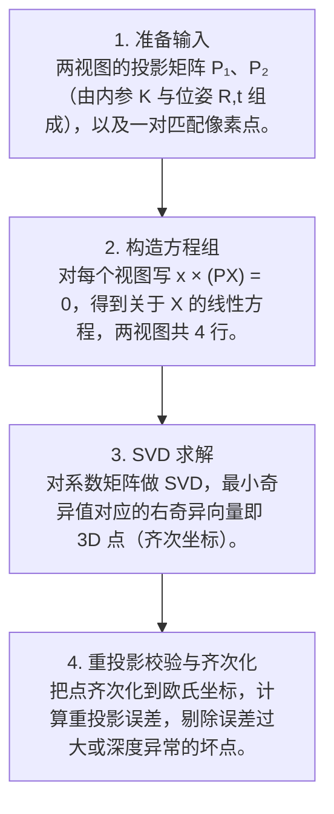

# 第 4 页 · 算法架构

## 完整流程图

## 每一步在做什么

### 步骤 1：准备输入

两视图的投影矩阵 P₁、P₂（由内参 K 与位姿 R,t 组成），以及一对匹配像素点。

### 步骤 2：构造方程组

对每个视图写 x × (PX) = 0，得到关于 X 的线性方程，两视图共 4 行。

### 步骤 3：SVD 求解

对系数矩阵做 SVD，最小奇异值对应的右奇异向量即 3D 点（齐次坐标）。

### 步骤 4：重投影校验与齐次化

把点齐次化到欧氏坐标，计算重投影误差，剔除误差过大或深度异常的坏点。

## 在整体视觉管线中的位置

## 复杂度分析

时间复杂度 O(1) 每对点（4×4 SVD）；批量 N 对点 O(N)。空间复杂度 O(N)。

## 参数总览（论文建议 vs OpenCV 默认 vs 实战推荐）

| 参数 | 含义 | 论文建议 | OpenCV 默认 | 实战推荐 |
|------|------|----------|-------------|----------|
| method | 三角化方法 | DLT | — | ****DLT 或 midpoint**** |
| normalize | 是否坐标归一化 | 是 | — | **是（提升数值稳定）** |
| reproj_thresh | 重投影误差阈值 | — | — | **1~3 像素** |
| min_depth | 最小深度过滤 | — | — | **剔除近简并的远点** |

## 边界情况与失败模式

- **小基线导致深度发散**：两相机几乎重合时，微小像素误差被放大成巨大深度误差。
- **误匹配产生离群点**：错误对应点三角化出飞到很远处的坏点。
- **未做坐标归一化**：DTL 解法数值不稳定，结果抖动。
- **忽略重投影误差**：不剔除误差大的点，点云里全是飞点。
