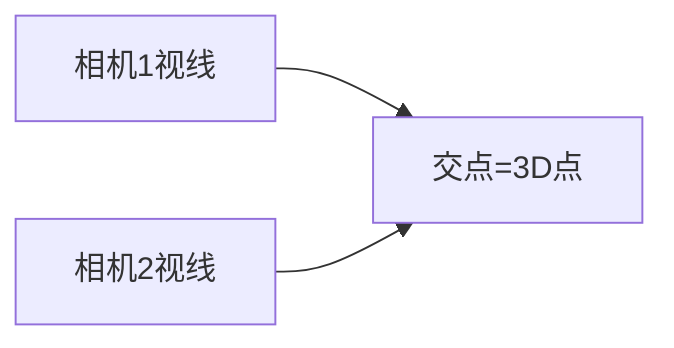

# 第 3 页 · 核心概念

🧪 公式看不懂？去 <a href="/math-lab/">原理实验室</a> 拖动滑块直观体验卷积/梯度/高斯/霍夫/角点/RANSAC/光流等核心概念；看完原理再去本页底部 <a href="./source">源码/真机实验室</a> 亲手调参数。

## 先用生活直觉理解

你和朋友站在两个位置，各自用手指指向同一只鸟。两条视线在空间里理论上交于鸟的位置。三角测量就是：已知你们俩的位置和各自的指向，算出鸟到底在哪。

**典型应用**：SfM 建点云、双目立体恢复深度、SLAM 地图点生成、AR 锚点定位

## 概念逐个拆解

### 概念 1：两条视线的交点

每个相机对空间点有一条视线。理论上两线相交于该点，但噪声让它们错开，于是求「最接近两线」的点。

### 概念 2：DLT 线性解法

用投影矩阵构造齐次线性方程组，其最小二乘解（SVD 最后一列）即 3D 点坐标，快速且无需迭代。

### 概念 3：基线决定深度精度

两台相机相距越远（基线越长），深度估计越准。基线接近 0（纯旋转）时，深度几乎不可解。

### 概念 4：重投影误差做质检

把三角化出的 3D 点重新投回两幅图，与原始像素比偏差。误差大的点判为坏点剔除。

## 和其他算法的关系

| 关系 | 算法 | 说明 |
|------|------|------|
| 前置依赖 | 相机位姿（R,t）+ 内参 K + 匹配点 | 通常先做这些再做本算法 |
| 同类对比 | PnP、本质矩阵估计 | 解决同类问题，各有取舍 |
| 下游常用 | 光束法平差、深度图融合、点云滤波 | 本算法结果常交给它们处理 |

::: tip 记忆锚点
记住「基线越长、深度越准；基线≈0 时三角化彻底失效」。
:::
