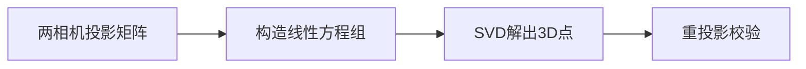

# 第 2 页 · 论文溯源

## 论文名片

| 项目 | 内容 |
|------|------|
| 标题 | **Triangulation** |
| 作者 | Richard Hartley / Peter Sturm（多视图三角化） |
| 年份 | 1987 |
| 发表 | Computer Vision and Image Understanding, 1997（Hartley & Sturm）；相关思想早至 1980s |
| 原文 | [https://users.cecs.anu.edu.au/~hartley/Papers/triangulation/triangulation.pdf](https://users.cecs.anu.edu.au/~hartley/Papers/triangulation/triangulation.pdf) |
| 一句话贡献 | 系统比较多种三角化方法，指出带归一化的 DLT 与最优法在精度与稳定性上各自的取舍。 |

## 1. 当时的问题

两条视线因噪声一般不会精确相交，简单求交点没有唯一解；不同三角化方法在误差分布与数值稳定性上差异巨大，实践中难以选择。

## 2. 核心思想

把三角化写成「寻找 3D 点 X，使其在两幅图中的投影与观测点的偏差最小」。可用线性 DLT 快速求解，也可用迭代的最优法最小化重投影误差。研究表明：先做坐标归一化能显著提升稳定性。

## 3. 关键贡献

- 系统比较 DLT、中点法、最优法等三角化方法
- 指出**坐标归一化**对数值稳定性的决定性作用
- 给出重投影误差作为三角化质量的度量
- 成为多视图几何的标准参考

## 4. 核心公式（看懂思路即可）

对每个视图 i：x_i × (P_i X) = 0，为 X 的两个线性方程。两视图共 4 个方程（3 独立）解 3 个未知数，用 SVD 求最小二乘解。

## 5. 实验结果

在含噪声合成数据上，归一化 DLT 与最优法精度接近，而最优法迭代开销更大；未归一化的 DLT 在退化配置下明显不稳。

## 6. 局限与争议

深度误差与基线长度成反比，小基线时极不稳定；对误匹配无免疫力；需要准确位姿。

## 7. 历史影响

成为 SfM、SLAM、双目立体、多视图重建的核心步骤；OpenCV 的 triangulatePoints、COLMAP 等均基于此。

## 8. 一句话总结

> 两步求解、一步归一化，把「两条视线求交点」做成了稳定可靠的 3D 定位。
