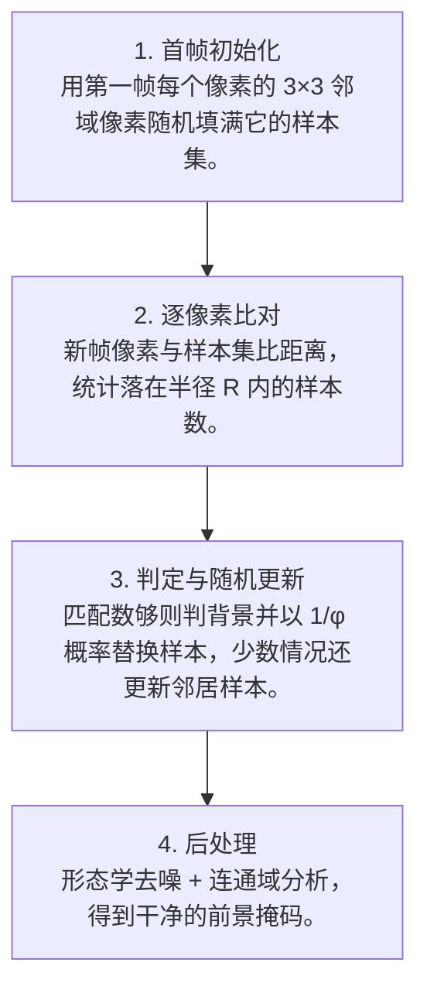

# 第 4 页 · 算法架构

## 完整流程图

## 每一步在做什么

### 步骤 1：首帧初始化

用第一帧每个像素的 3×3 邻域像素随机填满它的样本集。

### 步骤 2：逐像素比对

新帧像素与样本集比距离，统计落在半径 R 内的样本数。

### 步骤 3：判定与随机更新

匹配数够则判背景并以 1/φ 概率替换样本，少数情况还更新邻居样本。

### 步骤 4：后处理

形态学去噪 + 连通域分析，得到干净的前景掩码。

## 在整体视觉管线中的位置

## 复杂度分析

时间复杂度 O(W·H·N)，但常数极小（N=20 的整数比较）；空间复杂度 O(W·H·N)。相比 MOG2 常数小得多。

## 参数总览（论文建议 vs OpenCV 默认 vs 实战推荐）

| 参数 | 含义 | 论文建议 | OpenCV 默认 | 实战推荐 |
|------|------|----------|-------------|----------|
| N | 样本集大小 | 20 | 20 | ****20**** |
| R | 颜色距离半径 | 20 | 20 | **20~30** |
| minMatch | 判定背景的最少匹配数 | 2 | 2 | **2** |
| φ | 随机更新概率倒数 | 16 | 16 | **16** |

## 边界情况与失败模式

- **鬼影问题**：第一帧里有运动物体时，该物体被当成背景，之后离开留下「鬼影」。
- **缓慢移动被吸收**：移动很慢的物体颜色会被样本集逐渐接纳，成为「背景」。
- **无 OpenCV 现成接口**：OpenCV 未内置 ViBe，需自实现或用 opencv-contrib/第三方库。
- **光照突变误检**：全局亮度突变后需要若干帧重新适应。
