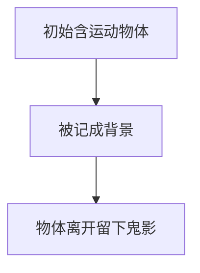

# 第 3 页 · 核心概念

🧪 公式看不懂？去 <a href="/math-lab/">原理实验室</a> 拖动滑块直观体验卷积/梯度/高斯/霍夫/角点/RANSAC/光流等核心概念；看完原理再去本页底部 <a href="./source">源码/真机实验室</a> 亲手调参数。

## 先用生活直觉理解

ViBe 像一个「随手抓阄」的门卫：开门第一秒，他就记住每个位置附近 20 个邻居的颜色当「正常档案」。之后有人颜色对不上就报警。档案更新也随性——每次随机换掉一条旧记录。就这么简单，却能实时处理几十路监控。

**典型应用**：嵌入式/低功耗监控、多路视频实时检测、无人机图传前端、FPGA/SoC 视觉

## 概念逐个拆解

### 概念 1：样本集

每个像素存 20 个历史颜色值（从首帧的邻域随机抽取）。判断新像素时，看它离样本集里多少个样本足够近。

### 概念 2：匹配半径与匹配数

半径 R 内算「匹配」。至少 2 个样本匹配才算背景——很宽松，所以抗噪。

### 概念 3：随机更新

每帧以固定小概率替换一个样本，还有更小概率更新邻居的样本。无需参数，背景自动缓慢漂移。

### 概念 4：时空一致性与鬼影

因为更新邻居样本，前景扩散会形成鬼影；解决办法是对可疑前景延迟判定或二次确认。

## 和其他算法的关系

| 关系 | 算法 | 说明 |
|------|------|------|
| 前置依赖 | 灰度化、降采样 | 通常先做这些再做本算法 |
| 同类对比 | MOG2、KNN、帧差法 | 解决同类问题，各有取舍 |
| 下游常用 | 形态学、连通域、目标跟踪 | 本算法结果常交给它们处理 |

::: tip 记忆锚点
记住「ViBe = 邻域样本集 + 随机更新 + 无参数」，快是它的命根子。
:::
