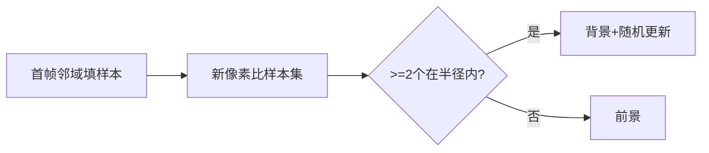

# 第 2 页 · 论文溯源

## 论文名片

| 项目 | 内容 |
|------|------|
| 标题 | **ViBe: A Universal Background Subtraction Algorithm for Video Sequences** |
| 作者 | Olivier Barnich / Marc Van Droogenbroeck |
| 年份 | 2011 |
| 发表 | IEEE Transactions on Image Processing, 2011 |
| 原文 | [https://ieeexplore.ieee.org/document/5674058](https://ieeexplore.ieee.org/document/5674058) |
| 一句话贡献 | 用邻域样本集与随机更新策略实现极简、极快的通用背景减除。 |

## 1. 当时的问题

GMM 类方法需要为每个像素估计高斯参数，计算与内存开销大，难以在嵌入式设备上跑多路高清视频；且参数需按场景调，不够「通用」。

## 2. 核心思想

每个像素不存分布，只存一个 20 个历史颜色的样本集。新像素与样本集比较，若足够多（≥2）在半径内则判背景。样本集更新用随机替换，更新概率恒定——无需任何参数估计。第一帧就用邻域像素填充样本集。

## 3. 关键贡献

- 提出用**邻域样本集**代替概率分布做背景建模
- 提出**随机更新**策略，无需参数、天然自适应
- 实现极低的计算与内存开销，适合嵌入式与多路视频
- 在多个公开数据集上与 GMM 相当或更好，速度却快数倍

## 4. 核心公式（看懂思路即可）

若样本集 S(x) 与当前值 v(x) 距离小于 R 的样本数 ≥ minMatch，则 x 为背景；每次更新以概率 1/φ 随机替换 S(x) 中一个样本。

## 5. 实验结果

在 ChangeDetection.net 等基准上，ViBe 的 F1 与 GMM 相当，处理 1080p 视频耗时仅为 GMM 的 1/3~1/5。

## 6. 局限与争议

初始帧含运动物体时产生鬼影；缓慢移动物体会被吸收为背景；对光照突变不鲁棒；OpenCV 无内置实现。

## 7. 历史影响

成为嵌入式背景减除的事实标准之一，衍生出 ViBe+、PBAS、SubSENSE 等改进；「样本集 + 随机更新」思想被广泛借鉴。

## 8. 一句话总结

> 没有公式、没有参数估计，只靠一袋样本和随机替换，就成了最快的背景减除之一。
