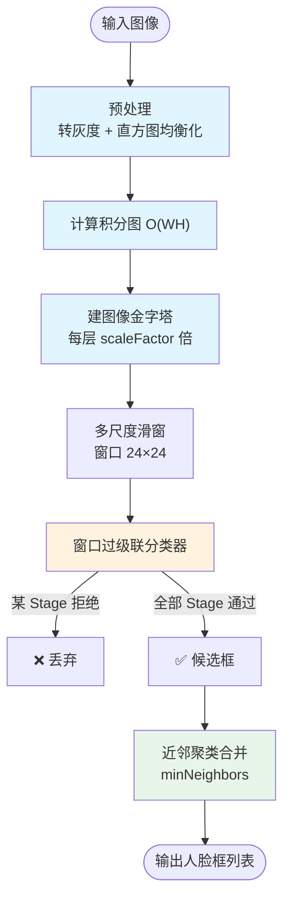
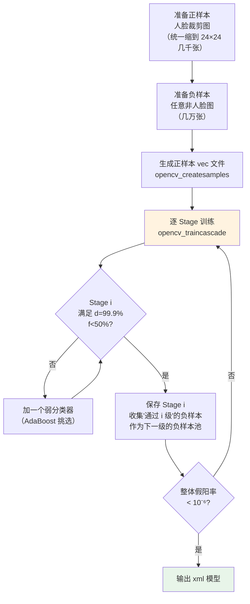

# Viola-Jones 算法流程

Viola-Jones 分**检测阶段**（实时推理）和**训练阶段**（离线，耗时几天到几周）。两阶段共用同一套数据结构。

## A. 检测流程（实时，运行时）



---

### A.1 预处理

```python
gray = cv2.cvtColor(img, cv2.COLOR_BGR2GRAY)
gray = cv2.equalizeHist(gray)  # 直方图均衡化，对抗光照不均
```

直方图均衡化是 Viola-Jones 实战中**必须加**的一步，Haar 特征对整体光照敏感（亮度差的绝对值受光照影响），均衡化后让不同光照下的局部亮度差更稳定。

### A.2 计算积分图

```python
ii = cv2.integral(gray)  # 比原图大 1 像素，首行首列为 0
```

### A.3 图像金字塔

从原图开始，每层**缩小 scaleFactor 倍**（默认 1.1，即每次小 10%）：

| 层 | 图像尺寸 | 能检测的人脸大小（对应 24×24 窗口） |
|---|---|---|
| 0 | W × H | 24 px（最小人脸） |
| 1 | W/1.1 × H/1.1 | 24 × 1.1 ≈ 26 px |
| 2 | W/1.21 × H/1.21 | ≈ 29 px |
| ... | ... | ... |
| k | W/1.1ᵏ × H/1.1ᵏ | 24 × 1.1ᵏ px |

**minSize**（默认没设，即 24×24）和 **maxSize**（默认没设，即图像大小）控制检测人脸的尺寸范围。

### A.4 多尺度滑窗

在每个金字塔层上，窗口以 24×24 大小**逐像素滑动**（步长由 scaleFactor 和模型决定，OpenCV 默认自动），每个位置的窗口都送进级联。

```python
# 伪代码
faces = []
for scale in scales:
    img_scaled = resize(gray, scale)
    ii = integral(img_scaled)
    for y in range(0, img_scaled.h - 24, stride):
        for x in range(0, img_scaled.w - 24, stride):
            if cascade_predict(ii, x, y, 24, 24):
                # 通过级联，记录候选框（映射回原图坐标）
                faces.append((x/scale, y/scale, 24/scale, 24/scale))
```

### A.5 级联分类器判断（核心，最关键）

对一个窗口，按 stage 顺序：
1. 从第 1 级开始，计算该级所有 Haar 特征
2. 加权求和（Σ α_t h_t(x)），与 stage 阈值比较
3. **不通过 → 立即拒绝，不进下一级**（early rejection）
4. 通过 → 进下一级
5. 所有级都通过 → 该窗口是人脸候选

```python
# 伪代码
def cascade_predict(ii, x, y, w, h):
    for stage in stages:
        score = 0
        for weak in stage.weak_classifiers:
            f = haar_feature(ii, x, y, w, h, weak.rects)  # 积分图 O(1)
            h = 1 if weak.polarity * f < weak.polarity * weak.threshold else 0
            score += weak.alpha * h
        if score < stage.stage_threshold:
            return False  # 早拒！
    return True  # 全通过
```

### A.6 近邻聚类（Group Rectangles）

同一个脸附近往往被检测出多个重叠框，OpenCV 用以下规则合并：
- 对检测框按重叠度分组
- **每组内框数 ≥ minNeighbors**（默认 3~5）才保留
- 最终框 = 该组所有框的平均位置/尺寸（或加权平均）

```python
# OpenCV 内部实现：cv::groupRectangles
# detectMultiScale 最后一步自动调用
```

---

## B. 训练流程（离线，OpenCV 提供 `opencv_traincascade` 工具）



### B.1 数据准备

- **正样本**：已经裁剪好的人脸图，统一归一化到 24×24，含各种光照/表情/微小旋转。数量 **1000~10000** 张
- **负样本**：任何不包含人脸的图片，分辨率不限。数量 **几千到上万**，训练时从中随机抠 24×24 块当负窗
- **样本比例**：正:负 ≈ 1:3 ~ 1:10

### B.2 训练参数（每 stage）

| 参数 | 典型值 | 含义 |
|---|---|---|
| minHitRate | 0.999 | 每级最低检测率（高！） |
| maxFalseAlarmRate | 0.5 | 每级最高假阳率 |
| numStages | 20~38 | 总 stage 数 |
| weightTrimRate | 0.95 | 权重裁剪（加速 AdaBoost） |
| maxDepth | 1 | 弱分类器深度（Haar 就是 1，即决策树桩） |

### B.3 Bootstrap（难负样本挖掘）

训练完第 i 级后，把负样本池里**通过了前 i 级**的那些"看起来像人脸"的负样本（Hard Negatives）作为下一级的主要训练样本——这就是为什么级联**后几级越来越精准**：每级都在专门对付"上一级没杀死的难负样本"。

### B.4 训练产物

最终得到一个 XML 文件（如 `haarcascade_frontalface_default.xml`），内容包括：
- 所有 stage 的 stage 阈值
- 每个 stage 下每个弱分类器的权重 α、阈值 θ、极性 p
- 每个弱分类器对应的 Haar 特征矩形组（位置、大小、权重）

加载后就能直接检测。

---

## 关键参数对应

| detectMultiScale 参数 | 作用 | 默认 |
|---|---|---|
| scaleFactor | 金字塔每层缩放比 | 1.1 |
| minNeighbors | 一个候选框周围至少需要几个检测框才保留（聚类阈值） | 3 |
| minSize | 最小人脸尺寸（比这个小的忽略） | (30,30) 推荐设，可省时间 |
| maxSize | 最大人脸尺寸 | 不设 |
| flags | 兼容老接口（CV_HAAR_* 标志），一般不用 | 0 |
