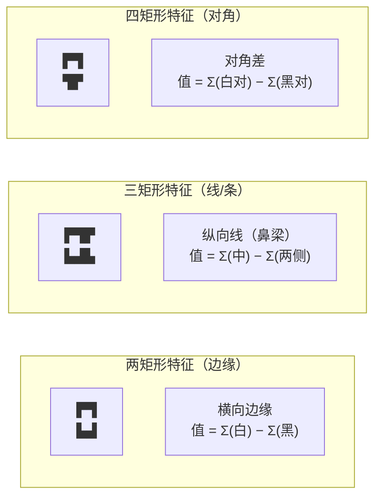
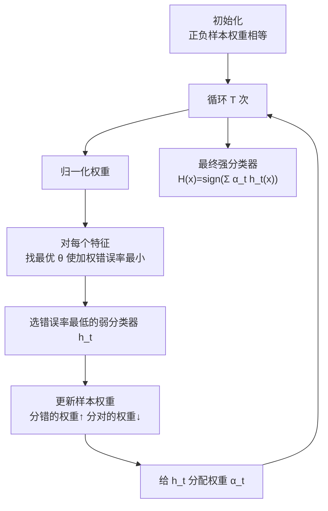
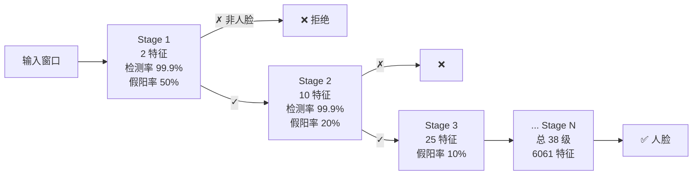
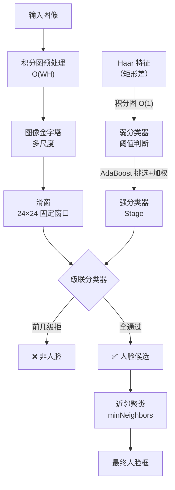

# Viola-Jones 核心概念

理解 Viola-Jones，要搞懂五样东西：**Haar-like 特征**、**积分图**、**AdaBoost 特征选择**、**级联分类器**、**多尺度滑窗**。

<div class="tip custom-block"><p>🧪 公式看不懂？去 <a href="/math-lab/">原理实验室</a> 拖动滑块直观体验卷积/梯度/高斯/霍夫/角点/RANSAC/光流等核心概念；看完原理再去本页底部 <a href="./source">源码/真机实验室</a> 亲手调参数。</p></div>


## ① Haar-like 特征

### 一句话

**用相邻矩形块的亮度差来描述简单视觉模式**（眼睛比脸颊暗、鼻梁比两侧亮、嘴比周围暗）。

### 三种典型 Haar 特征



### 特征值怎么算

对任意一个 Haar 模板，特征值 = **白色矩形像素和 − 黑色矩形像素和**：

$$
f = \sum_{\text{白区}} I(x,y) - \sum_{\text{黑区}} I(x,y)
$$

- 当白区真的比黑区亮时，f 很大（正值）
- 当白区比黑区暗时，f 很小（负值）
- 阈值 θ 可以判断"这是人脸模式吗"

### 为什么 24×24 窗口有 16 万特征

一个 24×24 检测窗口内，每个 Haar 模板可以放在**任意位置**、取**任意尺寸**——所有可能组合加起来大约 **16~18 万**个候选特征。这在没有积分图前根本算不动。

### 生活类比
Haar 特征就像"问题卡片"——每张卡片问一个非常具体的问题，比如"这块区域左边比右边暗吗？""中间比两边亮吗？"。**每张卡片单独看都很弱，但组合起来很强**。

## ② 积分图（Integral Image）

### 一句话

**预处理一次，任意矩形区域像素和 = 4 次查表 + 3 次加减法，O(1)**。

### 公式

定义积分图（原点在左上角，首行首列 0）：

$$
I(x,y) = \sum_{x'\le x,\, y'\le y} i(x',y')
$$

递推：

$$
I(x,y) = i(x,y) + I(x-1,y) + I(x,y-1) - I(x-1,y-1)
$$

任意矩形 R = (x1,y1) ~ (x2,y2) 的和：

$$
\text{sum}(R) = I(x_2,y_2) - I(x_1-1,y_2) - I(x_2,y_1-1) + I(x_1-1,y_1-1)
$$

**这个公式就是整个 Viola-Jones 速度的灵魂**——不管矩形多大（2×2 还是 24×24），算起来都是 4 次查表。Haar 特征由 2/3/4 个矩形组成，每个特征最多 4×4 = 16 次查表，完全是常数时间。

```python
# 代码级理解
def rectangle_sum(ii, x1, y1, x2, y2):
    """ii 是积分图，比原图大 1 像素（首行首列 0）"""
    a = ii[y2+1, x2+1]
    b = ii[y1,   x2+1]
    c = ii[y2+1, x1]
    d = ii[y1,   x1]
    return int(a - b - c + d)
```

## ③ AdaBoost（自适应提升）

### 一句话

**从十几万个弱分类器（单个 Haar 特征+阈值）里，自动挑出最有用的 T 个，加权组成一个强分类器**。

### 弱分类器（Weak Classifier）

每个 Haar 特征就是一个弱分类器：

$$
h_j(x) = \begin{cases} 1 & p_j \cdot f_j(x) < p_j \cdot \theta_j \\ 0 & \text{其他} \end{cases}
$$

- f_j(x) = 图像在窗口 x 上第 j 个 Haar 特征的特征值
- θ_j = 阈值
- p_j = 极性（+1 或 −1，决定不等式方向）

单个弱分类器错误率可能只比瞎猜好一点（比如 40% 错误率），但 AdaBoost 能把它们组合起来错误率指数级下降。

### AdaBoost 训练流程



### 关键性质

- **前几个挑到的特征就是最具判别力的**（比如"眼眶黑"），它们单独就能过滤大量非人脸
- **训练过程同时完成了"特征选择"和"分类器训练"**——这是 AdaBoost 在此任务上的经典用法

## ④ 级联分类器（Cascade of Classifiers）

### 一句话

**把多个强分类器串成漏斗，前级简单、快、高召回，后级复杂、精、高精度**——99% 的负窗在前几级就毙掉。

### 级联结构



### 级联的数学性质

- **整体检测率** D = Π d_i ≈ 0.999³⁸ ≈ **96%**（每级都几乎不漏真脸）
- **整体假阳率** F = Π f_i ≈ 0.5 × 0.2 × 0.1 × ... ≈ **10⁻⁶**（百万窗口几个误报）
- **平均特征数** ≈ Σ F₁...Fᵢ₋₁ × nᵢ ≈ **8~10 个特征/窗口**（实际平均代价极低）

### 训练级联的策略

每一级：
1. 设定目标检测率 d（如 99.9%）和假阳率 f（如 50%）
2. 不断往当前 stage 加特征（用 AdaBoost），直到该 stage 达到目标 d 和 f
3. 把**通过当前 stage 的负样本**传给下一级继续训练（下一级看到的是"更像人脸但不是"的难负样本）
4. 直到整体假阳率 < 目标（比如 10⁻⁶）

## ⑤ 多尺度滑窗检测

### 一句话

**把检测窗口（24×24）按不同尺度在图像上滑动，每个窗口都过一遍级联分类器**，检出的框按重叠度聚类合并成最终结果。

### 图像金字塔

人脸大小不固定（可能 30px 也可能 300px），通过**不断缩小图像**（scaleFactor 默认 1.1，每次缩 10%），让固定大小的 24×24 窗口能检测到不同大小的脸。

### 合并检测（NMS 雏形：近邻聚类）

同一个人脸周围往往会检测出多个框（相邻尺度、相邻位置都命中），OpenCV 用 `minNeighbors` 参数做"近邻聚类"——**一个位置必须至少有 N 个检测框支持才输出**（默认 minNeighbors=3~5），这就是 NMS 的原始版本。

## 概念关系图


