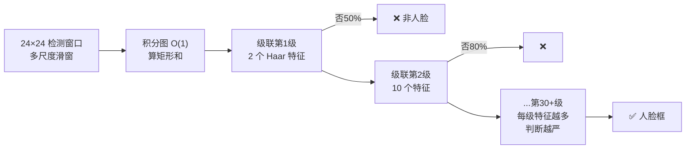
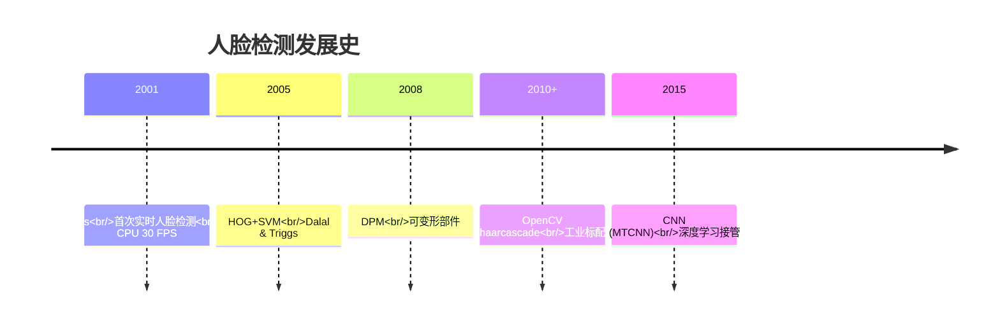

# Viola-Jones 人脸检测器

<AlgorithmCard
  name="Viola-Jones"
  enName="Viola-Jones Object Detection Framework"
  chapter="第12章 · 景物识别"  chapterLink="/chapters/ch12-recognition"
  branch="detection"
  year="2001"
  author="Paul Viola / Michael Jones"
  paper="https://ieeexplore.ieee.org/document/990517"
  level="high"
  tagline="CV 历史上第一个实时人脸检测器——三级组合拳打出 30 FPS"
  analogy="像漏斗式招聘：HR 先用学历一秒刷掉一半，再用笔试刷三成，最后才面试剩下的人。大部分窗口在第一关就被毙，整体飞快"
  scene="相机取景框实时人脸框、数码相机笑脸快门、门禁考勤机人脸定位、早期人脸解锁"
  :pros="['2001 年就在 700MHz CPU 上做到 30 FPS','无需 GPU、模型几百 KB、嵌入式友好','积分图思想影响了后续所有快速特征计算','级联早退成为工业工程范式','OpenCV 开箱即用，预训练模型齐全']"
  :cons="['只擅长刚性正脸，侧脸/俯仰/遮挡差','Haar 特征过浅，行人等复杂形状不行','训练新类别需要完整 AdaBoost 管线','对光照敏感，必须配直方图均衡','已被 HOG/DPM/深度学习超越']"
/>

## 一句话理解

**Haar 特征 + 积分图 + AdaBoost 级联**三板斧：
1. **Haar 特征**：用"黑白矩形块的亮度差"捕捉"眼睛比脸颊暗、鼻梁比两侧亮"这种简单模式
2. **积分图**：预处理一次，任何矩形区域和都是 O(1)——这是"16 万特征都算得完"的关键
3. **级联分类器**：多级漏斗，前 2 个特征毙 50% 负窗、前 10 个再毙 80%，**99% 的背景窗口前几关就出局**，平均代价极低



## 生活类比：漏斗式面试

招一个岗位，有 10 万份简历。你不会对每份简历都做 1 小时面试——
1. **第一关**：学历门槛（HR 看一眼，10 秒），刷掉 50%
2. **第二关**：笔试（半小时），再刷 40%
3. **第三关起**：多轮技术面、主管面，只面剩下的 ~1000 人
4. **最后**：offer 几个人

Viola-Jones 就是这个逻辑：**每一级都是一道筛子，前级代价极低但淘汰率极高，真正花大代价"细看"的只有极小部分窗口**。

## 算法时间线



## 你会在这里看到什么

| 页面 | 内容 |
|---|---|
| [论文精读](/algorithms/viola-jones/paper) | Viola & Jones CVPR 2001 原文，三个创新点如何协同 |
| [核心概念](/algorithms/viola-jones/concepts) | Haar-like 特征、积分图、AdaBoost、级联分类器、滑窗金字塔 |
| [算法流程](/algorithms/viola-jones/architecture) | 训练流程 + 检测流程双视角 |
| [源码走读](/algorithms/viola-jones/source) | OpenCV CascadeClassifier 调用、摄像头实时检测、自己训练 |
| [实战踩坑](/algorithms/viola-jones/painpoints) | scaleFactor/minNeighbors 怎么选、侧脸漏检、侧脸/误检、误检、多次检测 |
| [调参技巧](/algorithms/viola-jones/tricks) | detectMultiScale 参数详解、正脸侧脸模型选择、与 HOG/MTCNN 选型 |

## 快速上手

```python
import cv2
face_cascade = cv2.CascadeClassifier(
    cv2.data.haarcascades + 'haarcascade_frontalface_default.xml'
)
gray = cv2.cvtColor(img, cv2.COLOR_BGR2GRAY)
faces = face_cascade.detectMultiScale(gray, scaleFactor=1.1, minNeighbors=5)
for (x, y, w, h) in faces:
    cv2.rectangle(img, (x, y), (x+w, y+h), (0,255,0), 2)
```

## 适用/不适用场景

| ✅ 适用 | ❌ 不适用 |
|---|---|
| 正脸实时检测（相机/门禁/考勤） | 侧脸、俯仰脸、遮挡脸 |
| 低算力嵌入式设备（无 GPU） | 行人、车辆等复杂形状（用 HOG/DPM） |
| 作为多阶段检测的粗筛第一关 | 高精度人脸（用 MTCNN/RetinaFace） |
| 笑脸快门、人脸定位、人眼/嘴检测 | 人脸姿态估计、表情识别（需要后续 CNN） |
| 教学演示（最直观的"检测 = 特征+级联"） | 复杂场景多姿态人脸 |
