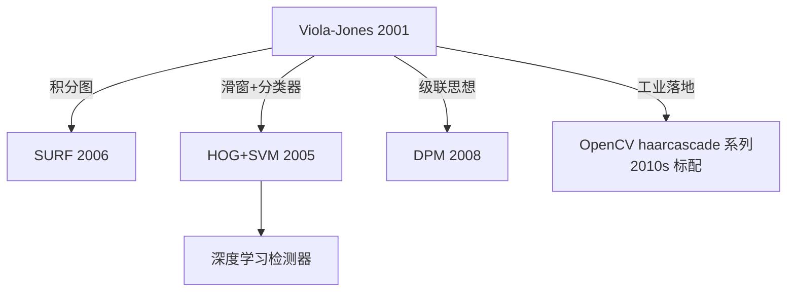

# Viola-Jones 论文精读：Rapid Object Detection using a Boosted Cascade of Simple Features (CVPR 2001)

## 论文信息

| 字段 | 内容 |
|---|---|
| 标题 | Rapid Object Detection using a Boosted Cascade of Simple Features |
| 作者 | Paul Viola, Michael J. Jones |
| 机构 | Mitsubishi Electric Research Labs / Compaq CRL |
| 会议 | CVPR 2001 |
| 引用量 | ~45000+ |
| DOI | 10.1109/CVPR.2001.990517 |
| 代码 | OpenCV `cv2.CascadeClassifier`（内置 haarcascade 预训练模型） |

## 写作背景：CVPR 2001 的"不可能"

2001 年主流人脸检测系统：
- 基于神经网络/SVM，处理一张 320×240 图像需要几秒到十几秒
- 研究界最好的系统（Rowley-Baluja-Kanade 1998）大约 **2-3 FPS**，还不够实时
- 民用数码相机、Webcam 开始普及，急需"实时人脸框"

Viola 和 Jones 的论文标题很直白——**"Rapid Object Detection"**，目标就是**让检测跑起来**。他们在一台 Pentium III 700 MHz 机器上做到了 **15 FPS**（后来的 IJCV 扩展版达到 30 FPS），检测率 ~90%，误检率 ~10⁻⁶，直接把人脸检测从"研究问题"变成了"消费电子标配"。

## 三大核心创新

### 创新 ①：积分图（Integral Image）

**前置问题**：Haar 特征是"矩形区域亮度差"，每个特征都涉及算矩形和。一个 24×24 检测窗口有大约 **16 万**（=180k）个潜在 Haar 特征，如果每个特征都遍历像素求和，根本算不完。

**解决方案**：预处理一次积分图，任意矩形和 O(1)：

$$
I(x,y) = \sum_{x'\le x,\, y'\le y} i(x',y')
$$

任意矩形 (x1,y1)~(x2,y2) 的和：

$$
\text{sum} = I(x_2,y_2) - I(x_1-1,y_2) - I(x_2,y_1-1) + I(x_1-1,y_1-1)
$$

无论这个矩形是 2 像素宽还是 20 像素宽，**计算代价都是 4 次内存读取 + 3 次加减法**——这让 16 万特征计算成为可能。

> 这一发明的影响力超出人脸检测，后来被 SURF（2006）等几乎所有"快速块特征"算法沿用。

### 创新 ②：用 AdaBoost 挑选最佳特征 + 训练弱分类器

**前置问题**：16 万个特征太多，不能全用。怎么选出最有用的？

**解决方案**：**AdaBoost**——从海量弱分类器（每个 Haar 特征就是一个"弱分类器"，判断"特征值 > θ？"）中，迭代挑出判别力最强的特征，加权重组成强分类器。

**训练过程**（以 200 个特征的强分类器为例）：
1. 初始：所有正样本（人脸）和负样本（非人脸）等权
2. 循环 T=200 次：
   - 对每个 Haar 特征，找到最优阈值 θ 和极性 p，让加权分类错误率最小
   - 选出错误率最低的弱分类器 h_t
   - 更新样本权重：**分错的样本权重增加、分对的减少**（让下一个分类器关注难样本）
   - 给 h_t 一个权重 α_t（错误率越低权重越大）
3. 最终强分类器：H(x) = sign(Σ α_t h_t(x))

**关键洞察**：AdaBoost 不仅用来"组合弱分类器"，**还承担了"特征选择"的职责**——16 万个特征里自动挑出最有用的 200 个，前几个挑到的特征非常符合直觉：

- **第 1 个特征**：眼睛区域比鼻梁两侧暗（眼眶特征）
- **第 2 个特征**：眼睛比脸颊暗

这两个特征就能毙掉近 50% 的非人脸窗口！

### 创新 ③：Attentional Cascade（级联注意力结构）

**前置问题**：即使只有 200 个特征，一个窗口要过 200 次判断也太贵。一张图按金字塔+滑窗大约要扫 **1800 万**个子窗口。

**解决方案**：**级联（Cascade）**——把强分类器拆成多个**阶段（stage）**，从简单到复杂串起来：

- **第 1 级**：只用 2 个特征，就能毙掉 50% 非人脸，但几乎不杀正脸（检测率 ~100%，假阳率 ~50%）
- **第 2 级**：10 个特征，再毙 80% 剩余负窗
- **第 3 级**：25 个特征，再毙 90%
- ...
- **第 30+ 级**：几百个特征，做最终精细判断

**核心原则**：**每一级都保证高检测率（宁可多放几个非人脸过去，也不能漏掉真脸），但允许较高误检率**。整体组合后：

$$
D = \prod_{i=1}^{K} d_i \approx 0.9^{30} \approx 0.04? \quad \text{（错误直觉）}
$$

实际上每一级检测率都很高（99.9%+），30 级后整体检测率仍 ~90%；而假阳率 = 0.5 × 0.2 × 0.1 × ... ≈ **10⁻⁶**（百万窗口只误报几个）。

**平均复杂度**：**99% 的背景窗口在第 1~2 级就被毙掉**，平均每个窗口只需要算 ~10 个特征——这是实时性的根本来源。

## 实验结果（原论文）

| 指标 | 数值 |
|---|---|
| 测试集 | MIT+CMU 正面人脸集（130 图，507 张脸） |
| 检测率 | 89.7%（95.2% in IJCV 扩展版） |
| 误检数 | 31 个（后处理后更少） |
| 速度 | 15 FPS（700MHz Pentium III，384×288） |
| 级联层数 | 38 级 |
| 总特征数 | 6061（平均每个窗口只用 ~10） |

## 论文的 3 个关键 takeaway

1. **"Simple features computed quickly"**：单个特征简单没关系，只要算得极快，数量大也不怕
2. **"Attention cascade is the real-time secret"**：级联早退（early rejection）才是实时的关键，而不是特征本身多强。这一思想后来被所有级联式检测（DPM、甚至 CNN 级联）沿用
3. **"Boosting does feature selection for free"**：AdaBoost 不只是训练分类器，还自动从 16 万候选里挑出最判别特征——这让"特征工程 + 分类器"耦合了起来

## 局限

1. **只对正面刚性脸好用**：侧脸、俯仰、遮挡、夸张表情效果骤降
2. **Haar 特征表达能力弱**：黑白矩形差只能描述"块与块的亮度差"，对曲线、纹理、复杂形状不行
3. **训练数据和时间成本高**：需要几千正样本、几十亿负样本，训练要几周到几个月
4. **多尺度靠图像金字塔滑窗**：尺度离散，速度与尺度覆盖有 trade-off
5. **Haar 特征专利**：2000 年代部分特征（如某些矩形组合）有专利争议，但 OpenCV 的实现避开了最敏感的部分

## 与后续算法的关系

