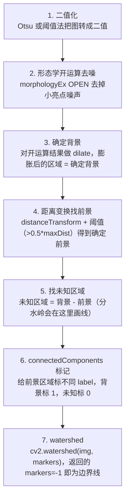

# 分水岭分割 · 算法流程

<AlgorithmCard
  name="分水岭分割"
  enName="Watershed Transform"
  chapter="ch-10-image-segmentation"
  branch="segmentation"
  year="1991"
  author="Luc Vincent / Pierre Soille"
  paper="—"
  level="mid"
  tagline="把灰度图当地形图灌水，两个水坑汇合的地方就是分界线，专门切粘连物体"
  analogy="想象你在一块凹凸的地形上，从每个谷底开始慢慢灌水。当两个湖的水面要汇合时，你在汇合处修一道水坝——这些水坝就是分割线"
  scene="分离粘连硬币/细胞/颗粒、医学影像分割细胞、工业检测数零件、重叠物体分割"
  :pros='["闭合连续边界", "分离粘连物体", "速度较快", "支持种子点控制"]'
  :cons='["直接用会过度分割", "必须先做标记", "对噪声敏感", "需要形态学预处理"]'
/>

## 完整算法流程

分水岭分割算法可以分解为以下关键步骤：

## 步骤详解

### 步骤 1：二值化

Otsu 或阈值法把图转成二值

### 步骤 2：形态学开运算去噪

morphologyEx OPEN 去掉小亮点噪声

### 步骤 3：确定背景

对开运算结果做 dilate，膨胀后的区域 = 确定背景

### 步骤 4：距离变换找前景

distanceTransform + 阈值（>0.5*maxDist）得到确定前景

### 步骤 5：找未知区域

未知区域 = 背景 - 前景（分水岭会在这里画线）

### 步骤 6：connectedComponents 标记

给前景区域标不同 label，背景标 1，未知标 0

### 步骤 7：watershed

cv2.watershed(img, markers)，返回的 markers=-1 即为边界线

## 在整体视觉 pipeline 中的位置

### 关键复杂度

| 维度 | 复杂度 |
|---|---|
| 时间 | 详见各实现 |
| 内存 | 与图像尺寸线性相关 |

