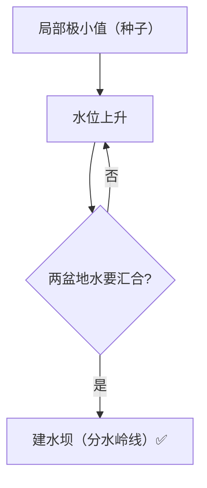

# 分水岭分割 · 核心概念

<AlgorithmCard
  name="分水岭分割"
  enName="Watershed Transform"
  chapter="ch-10-image-segmentation"
  branch="segmentation"
  year="1991"
  author="Luc Vincent / Pierre Soille"
  paper="—"
  level="mid"
  tagline="把灰度图当地形图灌水，两个水坑汇合的地方就是分界线，专门切粘连物体"
  analogy="想象你在一块凹凸的地形上，从每个谷底开始慢慢灌水。当两个湖的水面要汇合时，你在汇合处修一道水坝——这些水坝就是分割线"
  scene="分离粘连硬币/细胞/颗粒、医学影像分割细胞、工业检测数零件、重叠物体分割"
  :pros='["闭合连续边界", "分离粘连物体", "速度较快", "支持种子点控制"]'
  :cons='["直接用会过度分割", "必须先做标记", "对噪声敏感", "需要形态学预处理"]'
/>

## 分水岭分割的核心思想

把灰度图当地形图灌水，两个水坑汇合的地方就是分界线，专门切粘连物体。想象你在一块凹凸的地形上，从每个谷底开始慢慢灌水。当两个湖的水面要汇合时，你在汇合处修一道水坝——这些水坝就是分割线

**生活类比**：想象你在一块凹凸的地形上，从每个谷底开始慢慢灌水。当两个湖的水面要汇合时，你在汇合处修一道水坝——这些水坝就是分割线

**典型应用**：分离粘连硬币/细胞/颗粒、医学影像分割细胞、工业检测数零件、重叠物体分割

## 核心概念详解

### 概念1：地形模型

把灰度图看作地形图：**像素越亮海拔越高，越暗海拔越低**。局部极小值就是「谷底」（盆地），局部极大值是「山峰」。

### 概念2：灌水模拟

从每个谷底开始向水平面里灌水。水位慢慢升高，水从盆地漫出来。当两个不同盆地的水即将汇合时，在那里建一道「坝」——**这些坝就是分水岭线**。

### 概念3：过度分割问题

真实图像里局部极小值极多（噪声就会产生很多假谷底），直接分水岭会把图碎成几百上千个没用的小区域。这就是分水岭最大的坑——**过度分割（over-segmentation）**。

### 概念4：标记分水岭（Marker-controlled）

解决过度分割的关键：**只允许用户标记的「确定前景」和「确定背景」位置作为灌水起点**，其他地方不允许自发灌水。这就是 OpenCV 的 `cv2.watershed` 用的版本，工程上唯一可用的分水岭。

### 概念5：距离变换

标记分水岭常用**距离变换**自动找前景种子：对二值前景图做距离变换（每个前景像素到最近背景的距离），距离变换的局部峰值就是「确定前景中心」（硬币圆心、细胞中心）。

