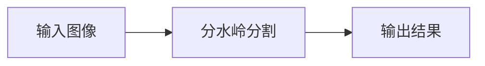

# 分水岭分割

<AlgorithmCard
  name="分水岭分割"
  enName="Watershed Transform"
  chapter="第5章 · 目标分割"  chapterLink="/chapters/ch05-segmentation"
  branch="segmentation"
  year="1991"
  author="Luc Vincent / Pierre Soille"
  paper="https://ieeexplore.ieee.org/document/1702885"
  level="mid"
  tagline="把灰度图当地形图灌水，两个水坑汇合的地方就是分界线，专门切粘连物体"
  analogy="想象你在一块凹凸的地形上，从每个谷底开始慢慢灌水。当两个湖的水面要汇合时，你在汇合处修一道水坝——这些水坝就是分割线。这就是「分水岭」"
  scene="分离粘连硬币/细胞/颗粒、医学影像分割细胞、工业检测里数零件个数、重叠物体分割"
  :pros='["能得到闭合连续的边界", "可分离粘连物体", "速度较快", "支持种子点控制", "经典稳定"]'
  :cons='["直接用会过度分割（碎成几百块）", "必须先做标记（marker）", "对噪声敏感", "需要形态学预处理"]'
/>

## 一句话理解

把灰度图当地形图灌水，两个水坑汇合的地方就是分界线，专门切粘连物体。想象你在一块凹凸的地形上，从每个谷底开始慢慢灌水。当两个湖的水面要汇合时，你在汇合处修一道水坝——这些水坝就是分割线。这就是「分水岭」。

## 生活类比

想象你在一块凹凸的地形上，从每个谷底开始慢慢灌水。当两个湖的水面要汇合时，你在汇合处修一道水坝——这些水坝就是分割线。这就是「分水岭」

## 它解决什么问题

分离粘连硬币/细胞/颗粒、医学影像分割细胞、工业检测里数零件个数、重叠物体分割。

在传统 CV 的六分支体系中，分水岭分割 属于 **segmentation** 分支，主要解决的是该分支中把灰度图当地形图灌水，两个水坑汇合的地方就是分界线，专门切粘连物体的问题。

## 核心优点

- ✅ **能得到闭合连续的边界**
- ✅ **可分离粘连物体**
- ✅ **速度较快**
- ✅ **支持种子点控制**
- ✅ **经典稳定**

## 它的短板

- ⚠️ 直接用会过度分割（碎成几百块）
- ⚠️ 必须先做标记（marker）
- ⚠️ 对噪声敏感
- ⚠️ 需要形态学预处理

## 本算法档案包含 7 个页面

| 页面 | 内容 |
|---|---|
| [论文故事](/algorithms/watershed/paper) | 作者、发表时间、核心贡献、为什么它会被提出 |
| [核心概念](/algorithms/watershed/concepts) | 用生活比方讲清它依赖的关键概念 |
| [算法流程](/algorithms/watershed/architecture) | 一步步走通算法全流程，配 mermaid 图 |
| [源码实现](/algorithms/watershed/source) | OpenCV 调用 + NumPy 手写最小实现 |
| [踩坑清单](/algorithms/watershed/painpoints) | 新手最常犯的 N 个错误 |
| [调参口诀](/algorithms/watershed/tricks) | 参数怎么选、实战技巧、性能优化 |

## 相关链接

- 返回 [六大分支总览](/branches/)
- [分水岭分割所在分支](/branches/segmentation/)
- [算法档案总览](/algorithms/)
