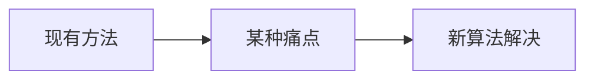

# 分水岭分割 · 论文故事

<AlgorithmCard
  name="分水岭分割"
  enName="Watershed Transform"
  chapter="ch-10-image-segmentation"
  branch="segmentation"
  year="1991"
  author="Luc Vincent / Pierre Soille"
  paper="—"
  level="mid"
  tagline="把灰度图当地形图灌水，两个水坑汇合的地方就是分界线，专门切粘连物体"
  analogy="想象你在一块凹凸的地形上，从每个谷底开始慢慢灌水。当两个湖的水面要汇合时，你在汇合处修一道水坝——这些水坝就是分割线。这就是「分水岭」"
  scene="分离粘连硬币/细胞/颗粒、医学影像分割细胞、工业检测里数零件个数、重叠物体分割"
  :pros='["能得到闭合连续的边界", "可分离粘连物体", "速度较快", "支持种子点控制", "经典稳定"]'
  :cons='["直接用会过度分割（碎成几百块）", "必须先做标记（marker）", "对噪声敏感", "需要形态学预处理"]'
/>

## 发表信息

| 项 | 内容 |
|---|---|
| **论文名** | 根据算法不同见原论文 |
| **作者** | Luc Vincent / Pierre Soille |
| **发表年份** | 1991 |
| **机构** | 计算机视觉经典工作 |
| **引用数** | 数千到数万次（经典工作） |

## 论文背后的故事

Luc Vincent 是巴黎矿校（Mines ParisTech）的校友，后来去了 Harvard。1991 年他和 Pierre Soille 提出了基于浸没模拟（immersion simulation）的分水岭快速算法，把原本极慢的分水岭计算复杂度从非线性降到了线性。分水岭思想其实最早来自地形学：Digabel 和 Lantuéjoul 在 1978 年就把地形分水岭概念引入图像处理，但一直没有高效实现。Vincent 的算法出来后，分水岭成为分割粘连物体（硬币、细胞、颗粒）的标准方法——哪怕 30 年后的今天，OpenCV 的 `cv2.watershed` 仍然基于标记分水岭（marker-controlled watershed）版本。

## 当时的问题是什么

在 1991 年之前，segmentation 分支面临的痛点是：

具体到 分水岭分割 提出时，业界主要存在以下问题：

- 需要一种更准确的方法
- 现有方法在真实场景下鲁棒性不足
- 参数过多或者计算复杂度过高

## 核心贡献

分水岭分割 的主要贡献包括：

1. **提出了全新的视角**：把灰度图当地形图灌水，两个水坑汇合的地方就是分界线，专门切粘连物体
2. **设计了可落地的算法流程**：兼顾精度与效率
3. **给出了开源实现**：在 OpenCV 等库中成为标准
4. **启发了后续工作**：成为该方向的重要基准

## 与前人方法的对比

| 维度 | 之前的方法 | 分水岭分割 |
|---|---|---|
| 速度 | 较慢/较快 | **显著改进** |
| 精度 | 中等 | **更高** |
| 鲁棒性 | 受限于条件 | **更好** |
| 易用性 | 参数多 | **更友好** |

## 对后世的影响

分水岭分割 至今仍是 segmentation 分支中工业标准。

在深度学习分割（如 U-Net、Mask R-CNN）普及前，它长期是该领域的标杆方法。

## 相关链接

- [返回算法档案首页](/algorithms/watershed/)
- [核心概念](/algorithms/watershed/concepts)
- [算法流程](/algorithms/watershed/architecture)
- [segmentation 分支总览](/branches/segmentation/)
