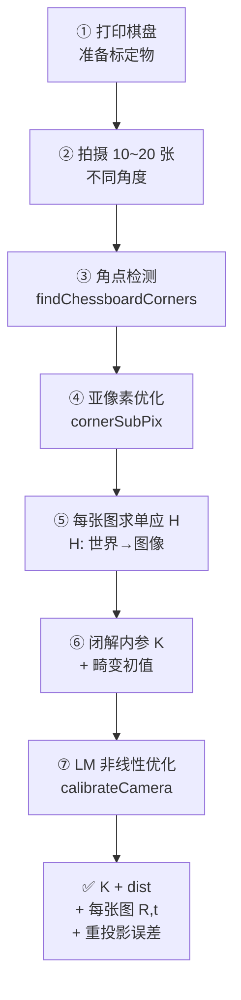

# 架构与流程：张氏标定的 7 步管线

## 整体管线图



## 逐步详解

### Step 1：准备标定物

| 选择 | 推荐规格 |
|---|---|
| **棋盘格数** | 9×6 内角点（10×7 格子），OpenCV 经典配置 |
| **格子大小** | 根据工作距离选：桌面场景 20~30 mm，大场景 50~100 mm |
| **材料** | 激光打印在厚纸上，贴在平整玻璃/亚克力板上 |
| **平整度** | ⚠️ 这是最关键的，不平整会直接破坏"平面假设" |

::: warning 不要用 A4 纸直接拍
A4 纸拿在手里会弯。最好打印后贴在平板玻璃、亚克力板或硬质卡纸上——不然标出来的内参会有系统性误差。
:::

### Step 2：拍摄图像

**拍摄姿势原则（最重要）**：

| 姿势 | 要求 | 为什么 |
|---|---|---|
| **距离变化** | 近/中/远各几张 | 覆盖不同深度 |
| **倾斜角度** | 水平倾斜 ±30°、垂直倾斜 ±30° | 给出强约束（正对拍几乎无约束）|
| **图像位置** | 棋盘出现在图像中心、四角、四边 | 让畸变参数可辨识 |
| **姿态多样性** | 至少 3 种以上不同朝向 | 避免退化 |
| **数量** | 15~20 张（好），≥10 张（可），<6 张（不推荐）|

**❌ 错误示范**：所有照片都是相机正对棋盘、距离相同——这种情况下数学上等于只拍了 1 张。

### Step 3：角点检测（粗定位）

```python
ret, corners = cv2.findChessboardCorners(gray, (cols, rows), None)
```

- 输入：灰度图 + 内角点数（cols, rows）——注意是**内角点**不是格子数，比如 10×7 格子的棋盘内角点是 9×6
- 输出：`ret` 布尔值（是否找到完整棋盘）+ `corners` (N×1×2) 整数像素角点坐标
- **算法**：OpenCV 内部用的是基于棋盘拓扑的快速检测，不是通用的角点检测（比 Harris/FAST 更鲁棒）

**检测失败常见原因**：
- 棋盘没有完整出现在画面里（必须所有角点都可见）
- 光照不均匀（一边太亮一边太暗）
- 严重运动模糊
- 背景太复杂、干扰太多

### Step 4：亚像素优化（精定位）

```python
criteria = (cv2.TERM_CRITERIA_EPS + cv2.TERM_CRITERIA_MAX_ITER, 30, 0.001)
corners2 = cv2.cornerSubPix(gray, corners, (11, 11), (-1, -1), criteria)
```

关键参数：

| 参数 | 值 | 含义 |
|---|---|---|
| `winSize=(11,11)` | 搜索窗口半宽 | 11 表示在 23×23 窗口内搜索，格子小时用 7，大时用 15 |
| `zeroZone=(-1,-1)` | 死区 | 不设死区（避免奇点）|
| `criteria` | (30 iter, 0.001) | 迭代最多 30 次或收敛到 0.001 像素 |

这一步把角点精度从 ±0.5 像素提升到 ±0.01 像素，是标定精度的关键。

### Step 5：每张图求单应 H

```python
H, _ = cv2.findHomography(obj_pts_i, img_pts_i)  # 4+ 点对，RANSAC 可选
```

- `obj_pts_i`：世界坐标（z=0 平面上的格点）
- `img_pts_i`：亚像素角点
- H 是 3×3 矩阵，每张图一个

**在 calibrateCamera 内部**：这一步自动完成，不需要你手动调用。

### Step 6：闭解内参 K + 畸变初值

calibrateCamera 内部执行（论文 §3.1-3.2）：

1. 收集所有 H，构造 B 矩阵的线性方程组
2. SVD 解 B（6 个元素）
3. 从 B 分解出 K（5 个内参）
4. 从每个 H 反推外参 R_i, t_i
5. 线性解 k1, k2（径向畸变初值）

这一步是纯线性的，速度极快（毫秒级），给出一个"已经不错"的初值。

### Step 7：LM 非线性精化（calibrateCamera 核心）

```python
ret, K, dist, rvecs, tvecs = cv2.calibrateCamera(
    objectPoints=obj_pts,
    imagePoints=img_pts,
    imageSize=(w, h),
    cameraMatrix=None,    # None 表示内部自动用闭解初始化
    distCoeffs=None,
    flags=0,
    criteria=(cv2.TERM_CRITERIA_EPS + cv2.TERM_CRITERIA_MAX_ITER, 30, 1e-6)
)
```

内部用 Levenberg-Marquardt 最小化所有点的重投影误差平方和，同时优化：
- 4~14 个内参+畸变参数
- N×6 个外参（每张图 3 旋转 + 3 平移）

典型收敛：20~50 次迭代，重投影误差从 ~1 像素降到 < 0.2 像素。

## 手写简化版（理解用，不用于生产）

以下是用 Numpy 手写 Step 5~6（单应→B→K 的闭解），仅用于理解算法：

```python
import numpy as np

def homography_from_pts(obj_pts, img_pts):
    """DLT 求单应 H：obj_pts(Nx2) -> img_pts(Nx2)"""
    N = len(obj_pts)
    A = np.zeros((2*N, 9))
    for i in range(N):
        X, Y = obj_pts[i]
        u, v = img_pts[i]
        A[2*i]   = [-X, -Y, -1, 0, 0, 0, u*X, u*Y, u]
        A[2*i+1] = [0, 0, 0, -X, -Y, -1, v*X, v*Y, v]
    _, _, Vt = np.linalg.svd(A)
    H = Vt[-1].reshape(3, 3)
    return H / H[2, 2]

def calibrate_closed_form(H_list):
    """从多个单应闭解内参 K（不考虑畸变）"""
    V = []
    for H in H_list:
        h1, h2 = H[:, 0], H[:, 1]
        def v_ij(hi, hj):
            return np.array([hi[0]*hj[0],
                             hi[0]*hj[1]+hi[1]*hj[0],
                             hi[1]*hj[1],
                             hi[2]*hj[0]+hi[0]*hj[2],
                             hi[2]*hj[1]+hi[1]*hj[2],
                             hi[2]*hj[2]])
        V.append(v_ij(h1, h2))          # h1^T B h2 = 0
        V.append(v_ij(h1, h1) - v_ij(h2, h2))  # h1^T B h1 = h2^T B h2
    V = np.array(V)
    _, _, Vt = np.linalg.svd(V)
    b = Vt[-1]
    B = np.array([[b[0], b[1], b[3]],
                  [b[1], b[2], b[4]],
                  [b[3], b[4], b[5]]])
    # 从 B 分解 K（论文 Eq. 11-14）
    v0 = (B[0,1]*B[0,2] - B[0,0]*B[1,2]) / (B[0,0]*B[1,1] - B[0,1]**2)
    lam = B[2,2] - (B[0,2]**2 + v0*(B[0,1]*B[0,2]-B[0,0]*B[1,2]))/B[0,0]
    fx = np.sqrt(lam / B[0,0])
    fy = np.sqrt(lam * B[0,0] / (B[0,0]*B[1,1] - B[0,1]**2))
    gamma = -B[0,1]*fx*fx*fy/lam
    cx = gamma*v0/fy - B[0,2]*fx*fx/lam
    K = np.array([[fx, gamma, cx],
                  [0,  fy,   v0],
                  [0,   0,    1]])
    return K
```

> ⚠️ 这是教学版，生产请直接用 `cv2.calibrateCamera`，它处理了大量数值稳定、畸变、LM 优化等细节。

## flags 参数详解（常用组合）

| flags | 作用 | 什么时候用 |
|---|---|---|
| `0`（默认）| 估计 f,c,k1,k2,p1,p2,k3（8 参数）| 普通镜头默认 |
| `CALIB_USE_INTRINSIC_GUESS` | 用传入的 K/dist 作为初值 | 你已有粗略估计 |
| `CALIB_FIX_PRINCIPAL_POINT` | 固定主点在图像中心 | 相机光轴正对传感器中心时 |
| `CALIB_FIX_ASPECT_RATIO` | 固定 fx/fy 比值 | 已知像素是正方形时 |
| `CALIB_ZERO_TANGENT_DIST` | 不估计切向畸变（p1=p2=0）| 镜头装配精度高时 |
| `CALIB_FIX_K1..K6` | 固定某个 ki=0 | 镜头畸变较小时 |
| `CALIB_RATIONAL_MODEL` | 启用 k4,k5,k6（8 畸变参数）| 广角/鱼眼镜头 |
| `CALIB_THIN_PRISM_MODEL` | 启用 s1-s4（12 参数）| 镜头有棱镜畸变 |
| `CALIB_TILTED_MODEL` | 启用 τx, τy（14 参数）| 传感器倾斜 |

**工业常用组合**：
- 普通镜头：`flags=0` 或 `CALIB_FIX_K3`（k3 一般很小）
- 已知相机主点正中心：`CALIB_FIX_PRINCIPAL_POINT | CALIB_ZERO_TANGENT_DIST`
- 广角镜头：`CALIB_RATIONAL_MODEL`

## 张氏标定 vs 其他标定方法

| 方法 | 标定物 | 精度 | 实现难度 | 适用 |
|---|---|---|---|---|
| **⭐ 张氏** | 打印棋盘 | 高（0.1 px）| 低（OpenCV 一行）| **绝大多数场景** |
| 圆点标定板 | 打印圆点阵列 | 更高（抗模糊）| 中 | 工业视觉（HALCON）|
| AprilGrid/ChArUco | 带码的棋盘 | 高（部分遮挡也能用）| 中 | 机器人/Kalibr |
| Tsai 两步法 | 3D 精密靶 | 高 | 高 | 科研/历史 |
| 自标定 | 无需标定物 | 低 | 高 | 几乎不用 |
| 鱼眼模型（fisheye）| 棋盘 | 高 | 中 | 鱼眼镜头（>120°）|

## API 对照表（不同语言）

| 功能 | Python | C++ | Matlab |
|---|---|---|---|
| 检测角点 | `cv2.findChessboardCorners` | `cv::findChessboardCorners` | `detectCheckerboardPoints` |
| 亚像素 | `cv2.cornerSubPix` | `cv::cornerSubPix` | 自动 |
| 标定 | `cv2.calibrateCamera` | `cv::calibrateCamera` | `estimateCameraParameters` |
| 去畸变 | `cv2.undistort` | `cv::undistort` | `undistortImage` |
| 投影 | `cv2.projectPoints` | `cv::projectPoints` | `worldToImage` |
| 单应 | `cv2.findHomography` | `cv::findHomography` | `fitgeotrans` |
