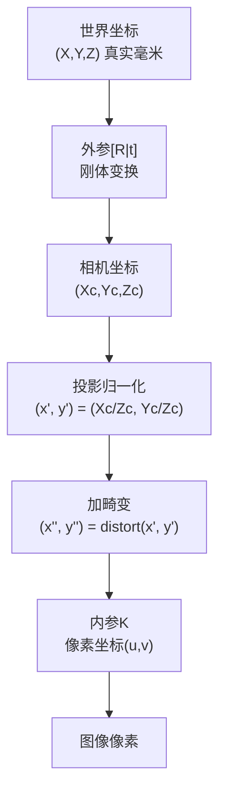
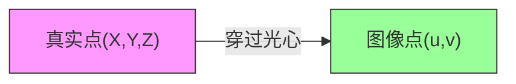
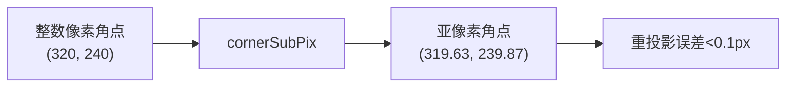
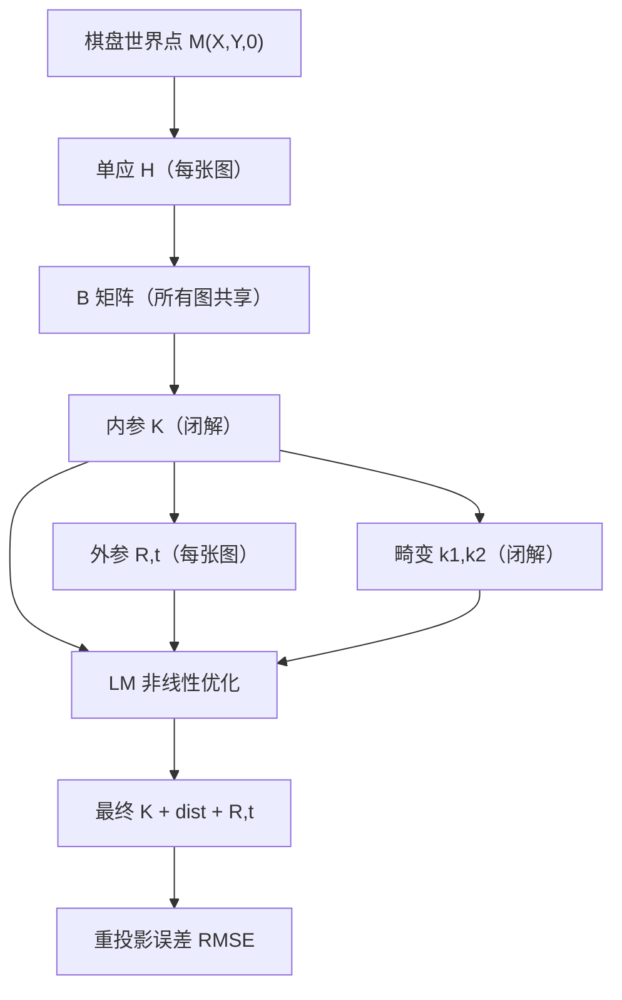

# 核心概念：张氏标定到底在算什么

> 张氏标定看起来参数很多（f, c, k1, k2, R, t），但本质上就是解决**三件事**：
> 1. 针孔模型的内参（镜头是什么）
> 2. 镜头畸变系数（镜头歪了多少）
> 3. 每张照片的外参（相机在哪）

🧪 公式看不懂？去 <a href="/math-lab/">原理实验室</a> 拖动滑块直观体验卷积/梯度/高斯/霍夫/角点/RANSAC/光流等核心概念；看完原理再去本页底部 <a href="./source">源码/真机实验室</a> 亲手调参数。

## 概念全景图

## 概念一：针孔相机模型

### 从 3D 世界到 2D 像素

针孔相机模型说的就是一句话：**真实世界的一个点，穿过光心，在图像平面上投下一个点**。

数学上分成三步：

| 步骤 | 数学表达 | 生活理解 |
|---|---|---|
| ① 外参变换 | $P_c = R \cdot P_w + t$ | 把"世界坐标"转到"相机坐标"（相机在什么位置看过去）|
| ② 投影 | $x' = X_c/Z_c, y' = Y_c/Z_c$ | 除以深度，得到归一化平面坐标（从光心看过去的方向）|
| ③ 内参映射 | $u = f_x x' + c_x, v = f_y y' + c_y$ | 把方向映射到像素坐标（传感器的格子）|

### 内参 K 的四个数字

$$
K = \begin{bmatrix} f_x & 0 & c_x \\ 0 & f_y & c_y \\ 0 & 0 & 1 \end{bmatrix}
$$

| 参数 | 含义 | 单位 | 典型值（1080p）|
|---|---|---|---|
| $f_x$ | x 方向焦距 | 像素 | ~1000~2000 |
| $f_y$ | y 方向焦距 | 像素 | ≈ $f_x$（像素正方形时）|
| $c_x$ | 主点 x（光轴落点）| 像素 | ≈ 图像宽/2 = 960 |
| $c_y$ | 主点 y | 像素 | ≈ 图像高/2 = 540 |

**生活理解**：$f$ 决定"看得多远"——焦距越大，视野越窄、拉得越近；$c_x, c_y$ 决定"图像中心在哪"——理想情况在图像正中心，但实际会偏几个像素。

### 为什么要 5 个参数而不是 4 个？

OpenCV 的 K 矩阵里其实还允许一个 **$\gamma$（skew 倾斜系数）**，对应 $K[0][1]$，表示传感器 x/y 轴不垂直的情况。现代相机传感器都是矩形像素，$\gamma \approx 0$，`calibrateCamera` 默认不估计它（需要 `CALIB_FIX_SKEW` 或反之）。

## 概念二：外参——相机在世界的位置

外参每张图都不一样（因为你拍每张照片时相机位置不同），包含：

| 参数 | 维度 | 含义 |
|---|---|---|
| $R$ | 3×3 旋转矩阵（或 3×1 旋转向量 rvec）| 相机朝向 |
| $t$ | 3×1 平移向量 | 相机位置（单位与棋盘格一致）|

::: tip OpenCV 里用的是旋转向量 rvec
`calibrateCamera` 返回的是 `rvecs`（3 元素）而不是 R（3×3），用 `cv2.Rodrigues(rvec)` 可以互转。旋转向量的方向是旋转轴，长度是旋转角度（弧度）。
:::

**生活理解**：内参是"相机本身的属性"（出厂后基本不变），外参是"这次拍的时候相机放哪了"（每张图不一样）。

## 概念三：棋盘平面 → 图像的单应 H

### 什么是单应（Homography）

如果所有三维点都在一个平面上（比如棋盘在 z=0 平面），那么从这个平面到图像的变换是一个 3×3 矩阵：

$$
\begin{bmatrix} u \\ v \\ 1 \end{bmatrix} \sim H \begin{bmatrix} X \\ Y \\ 1 \end{bmatrix}, \quad H_{3\times3}
$$

H 有 8 个自由度（9 个数，整体缩放不影响），所以**只要 4 个点对**（棋盘 4 个角）就能解出。

**生活理解**：想象你从不同角度拍一张贴在墙上的海报——不管你怎么拍，海报上的 4 个角点和照片上的 4 个角点之间都存在一个固定的变换关系，这个变换就是 H。

### H 里藏着内参的秘密

最关键的数学关系：

$$
H = \lambda K [r_1 \ r_2 \ t]
$$

因为棋盘平面 z=0，所以 R 的第三列 $r_3$ 不出现在公式里。利用 $r_1 \perp r_2$ 且长度相等：

$$
h_1^T K^{-T} K^{-1} h_2 = 0, \quad h_1^T K^{-T} K^{-1} h_1 = h_2^T K^{-T} K^{-1} h_2
$$

**这两个约束是整篇论文的数学核心**。$B = K^{-T} K^{-1}$ 包含了内参的全部信息，每张图给 2 个方程，3 张图就能解出 B。

## 概念四：镜头畸变

真实镜头不是理想针孔，有两类畸变：

### 径向畸变（最主要）

光线在镜头边缘弯曲得更厉害，导致直线变弯。

$$
x'' = x'(1 + k_1 r^2 + k_2 r^4 + k_3 r^6) \\
y'' = y'(1 + k_1 r^2 + k_2 r^4 + k_3 r^6)
$$

其中 $r^2 = x'^2 + y'^2$（到光心的归一化距离）。

| 类型 | k1/k2 符号 | 表现 |
|---|---|---|
| **桶形畸变**（广角/鱼眼）| k1 < 0 | 直线向外鼓（像桶）|
| **枕形畸变**（长焦）| k1 > 0 | 直线向内缩（像枕头）|
| **无畸变** | k1=k2=0 | 直线就是直线 |

### 切向畸变（次要）

镜头装配时镜片和传感器不完全平行：

$$
x'' = x' + [2p_1 x'y' + p_2(r^2 + 2x'^2)] \\
y'' = y' + [p_1(r^2 + 2y'^2) + 2p_2 x'y']
$$

一般只需要 p1、p2 两个参数，广角镜头才需要估计。

### 畸变参数个数

OpenCV `distCoeffs` 是一个 1D 数组，长度取决于 flags：

| 长度 | 参数 | 场景 |
|---|---|---|
| 4 | k1, k2, p1, p2 | 大多数普通镜头（张氏原文）|
| 5 | k1, k2, p1, p2, k3 | 标准（OpenCV 默认）|
| 8 | 5 + k4, k5, k6 | 广角镜头（`CALIB_RATIONAL_MODEL`）|
| 14 | 8 + s1~s4, τx, τy | 鱼眼/倾斜镜头（非常专业）|

**经验**：工业普通镜头用 5 个参数就够了；鱼眼镜头用 fisheye 模型或 rational 模型。

## 概念五：重投影误差（怎么判断标得准不准）

### 定义

把标定板上的 3D 点，用估计出的 K + dist + R_i + t_i **重新投影回图像**，和实际检测到的角点比较像素差：

$$
\text{RMSE} = \sqrt{\frac{1}{N M} \sum_{i,j} \| m_{ij} - \hat{m}(K, \text{dist}, R_i, t_i, M_j) \|^2}
$$

这就是 `calibrateCamera` 返回的 `ret` 值，单位是**像素**。

### 经验值

| 重投影误差 | 质量 |
|---|---|
| < 0.1 px | 🏆 优秀（实验室级）|
| 0.1 ~ 0.2 px | ✅ 好（工业可用）|
| 0.2 ~ 0.5 px | ⚠️ 勉强可用（可能角点没检准）|
| 0.5 ~ 1.0 px | ❌ 差（重新拍/重新标定）|
| > 1.0 px | 💀 完全失败（棋盘不平整/模式/角点检测错误）|

**生活理解**：重投影误差就是"你猜的相机模型，能把棋盘角点投影回到图像上多准"。0.1 像素误差意味着投影位置和真实位置差不到 0.1 个像素，比一根头发丝还细。

## 概念六：为什么需要亚像素角点

`findChessboardCorners` 给出的角点坐标是整数像素（比如 (320, 240)），精度只有 ±0.5 像素——对于标定来说这太粗糙了。

`cv2.cornerSubPix` 通过在角点周围拟合二次曲面，把角点精度提升到 **0.01 像素**级别。

**原理**：在角点附近，灰度梯度的方向都应该垂直于"从中心到边缘"的连线（这就是亚像素约束，和 Harris 角点的判定条件本质一致）。

## 概念七：LM（Levenberg-Marquardt）非线性优化

为什么"闭解之后还要优化"？

- 闭解是**线性最小二乘**，对噪声敏感；而且径向畸变是在"假设 K 已经对了"的前提下估的，实际上 K 和畸变是耦合的
- LM 优化是**迭代最小化重投影误差**，同时优化 K、dist、所有外参，最终找到让所有点的投影误差平方和最小的参数

**生活理解**：闭解是"用尺子粗略量一下"，LM 是"反复微调直到所有数据点都贴合得最好"——就像配眼镜，先验光给个大概度数，再让你反复对比"这个清楚还是那个清楚"。

## 概念之间的关系

## 反直觉的几个事实

1. **棋盘格大小只影响外参，不影响内参**：你填错 squareSize，K 不变，只是 t 按比例缩放；但**做三维测量必须填对**
2. **棋盘不一定要 9×6**：只要内角点 ≥ 4×4（≥9 个点）就能标；格数越多约束越冗余，越准
3. **至少 3 张图，但 10~20 张最好**：3 张是数学下界，10~20 张才能让噪声平均掉
4. **内参是相机+镜头的固定属性**：换镜头、变焦、对焦后必须重新标；调光圈不影响
5. **主点 (cx, cy) 不严格在图像中心**：一般偏差几个像素是正常的，强制把 c 固定在中心会引入测量误差
6. **棋盘不用"占满画面"**：拍远一点、近一点、倾斜一点，姿态多样比占满画面重要得多
