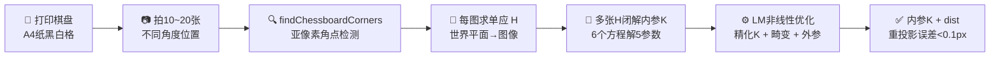

# Zhang's Camera Calibration — 张氏相机标定法（2000）

## 🚀 动手体验

> 🧪 **先懂原理**：翻到下一节「核心概念」，页面里直接嵌入了可拖动滑块的原理动画（SIFT高斯金字塔、FLANN KD树、GrabCut迭代、KCF响应峰、ICP配准等），拖一拖就懂。

> 🎮 **再跑真机**：跳到第5页「源码实现」，底部有真机实验室（OpenCV.js 浏览器本地运行），选图调参即可看到真实效果与三语代码。

---

<AlgorithmCard
  name="张氏相机标定"
  enName="Zhang's Camera Calibration"
  year="2000"
  chapter="第3章 · 图像预处理"  chapterLink="/chapters/ch03-preprocessing"
  branch="几何视觉"
  level="低层"
  analogy="用一张打印出来的棋盘纸就能校准相机——就像钟表师傅靠一个标准齿轮给整个机芯调零"
  scene="工业相机内参标定 / 视觉测量 / 三维重建 / SLAM 初始化 / AR 标定板"
  paper="https://www.microsoft.com/en-us/research/wp-content/uploads/2016/02/tr98-71.pdf"
/>  cvApi="cv2.calibrateCamera"
  defaultParams="patternSize=(9,6), squareSize=单位mm, flags=0"
  complexity="O(N · n)，N 张图 n 个角点；闭解 O(1)，LM 优化 O(iter·N·n)"
  :related="['algo-homography', 'algo-ransac', 'algo-stereo-bm']"
  :dependencies="['concept-camera-model', 'concept-homography', 'concept-radial-distortion', 'op-harris-response', 'op-subpixel-corner']"
  :evolvedFrom="['algo-stereo-bm']"
/>

## TL;DR

> **一句话**：用 A4 纸打印一张棋盘格，从不同角度拍 10~20 张照片，喂给 `cv2.calibrateCamera`，就能算出相机的内参和畸变系数——精度媲美昂贵的三维标定物，但成本是一张 A4 纸。

- **解决什么**：1999 年之前标定相机要么用精密加工的 3D 标定物（贵），要么用自标定（不稳定）。张正友 2000 年提出用平面标定板（打印棋盘）的方法，一举解决"精度"和"成本"的矛盾。
- **核心思想**：平面靶标上的点和图像点之间是一个单应矩阵 H；多张图片得到多个 H；用 H 之间的约束可以闭解出内参 K；最后用 LM 非线性优化精化所有参数（含畸变）。
- **代价**：打印一张棋盘 + 花 2 分钟拍 10~20 张照片 + OpenCV 一行代码，重投影误差做到 0.1 像素以内。
- **前置阅读**：建议先读 [单应矩阵 H](../branches/geometry/homography.md)。

## 3 分钟电梯演讲



## 四层闭环视图

| 层级 | 内容 | 对应文件 |
|---|---|---|
| **L1 论文** | 张正友 2000《A Flexible New Technique for Camera Calibration》 | [paper.md](./paper) |
| **L2 方法** | 针孔模型 / 单应约束 / 径向畸变初估 / LM 非线性优化 | [concepts.md](./concepts) |
| **L3 实现** | findChessboardCorners → cornerSubPix → calibrateCamera → projectPoints | [architecture.md](./architecture) / [source.md](./source) |
| **L4 实战** | 工业相机标定 / 视觉测量 / SLAM VO 初始化 / AR Kit 标定 | [painpoints.md](./painpoints) / [tricks.md](./tricks) |

## 核心贡献（含代码落点）

| 贡献 | 是什么 | 解决了什么痛点 | 在代码里的位置 |
|---|---|---|---|
| **平面靶标替代 3D 物** | 仅需打印棋盘格（2D 平面）| 3D 标定物昂贵、加工难 | `findChessboardCorners` |
| **单应约束闭解 K** | 每个 H 提供 2 个方程，3 张图解 5 个内参 | 传统 DLT 需 3D 标定物 | 论文 §3.1 Closed-form solution |
| **径向畸变初估** | 闭解步骤直接估计 k1、k2 | 畸变使内参不准 | 论文 §3.2 Estimating radial distortion |
| **LM 非线性精化** | 最小化重投影误差 | 闭解在有噪声时偏 | `calibrateCamera` 内部 LM |
| **亚像素角点** | 用 `cornerSubPix` 精确到 0.01 像素 | 角点粗检测只能到 1 像素 | `cv2.cornerSubPix` |
| **几何意义可验证** | 重投影误差可直观评估 | 不知道标得准不准 | `cv2.projectPoints` 回投 |

## 为什么它是工业界事实上的标准

张氏标定法之前的三种标定方法：

| 方法 | 年代 | 标定物 | 精度 | 成本 |
|---|---|---|---|---|
| **DLT（直接线性变换）** | 1971 | 3D 标定物（刚性三维靶）| 高 | ⚠️ 需精密加工，几千元 |
| **Tsai 两步法** | 1987 | 3D 或平面 + 精密位移台 | 高 | ⚠️ 需要运动台 |
| **自标定** | 1992~ | 不需要任何标定物 | 低 | ⚠️ 不稳定，实际不可用 |
| **⭐ 张氏标定** | **2000** | **打印棋盘（A4 纸）** | **高** | **✅ 几毛钱** |

**这就是为什么你在 OpenCV、Matlab、HALCON、ROS、Open3D、AprilCal、Kalibr 里看到的标定工具，底层全是张氏方法的变种。**

## 快速上手（5 行）

```python
import cv2, numpy as np, glob

# 准备：世界坐标系下的棋盘角点（z=0）
objp = np.zeros((9*6, 3), np.float32)
objp[:, :2] = np.mgrid[0:9, 0:6].T.reshape(-1, 2) * 25.0  # 25mm 一格

obj_pts, img_pts, size = [], [], None
for f in glob.glob('calib/*.jpg'):
    img = cv2.imread(f); gray = cv2.cvtColor(img, cv2.COLOR_BGR2GRAY)
    size = gray.shape[::-1]
    ret, corners = cv2.findChessboardCorners(gray, (9, 6), None)
    if ret:
        corners2 = cv2.cornerSubPix(gray, corners, (11,11), (-1,-1),
            (cv2.TERM_CRITERIA_EPS+cv2.TERM_CRITERIA_MAX_ITER, 30, 0.001))
        obj_pts.append(objp); img_pts.append(corners2)

# 一行标定
ret, K, dist, rvecs, tvecs = cv2.calibrateCamera(
    obj_pts, img_pts, size, None, None)

print(f'重投影误差: {ret:.3f} px')
print(f'内参 K:\n{K}')
print(f'畸变 dist: {dist.ravel()}')
```

::: tip 重投影误差
`ret` 就是重投影误差，单位像素。**好的标定应 < 0.2 px，优秀 < 0.1 px**。如果 > 0.5 px 说明有问题（角点没检准、棋盘不平整、拍摄姿势覆盖不够）。
:::

## 本档路线

- [📄 论文原文与解读](./paper.md) —— Zhang 2000 核心推导
- [💡 核心概念](./concepts.md) —— 针孔模型、单应、径向畸变、LM 优化
- [🏗️ 架构与流程](./architecture.md) —— 7 步标定管线、手写版本、API 对照表
- [💻 源码走读](./source.md) —— OpenCV 调用、Numpy 手写单应闭解、在线标定 demo
- [💣 踩坑与痛点](./painpoints.md) —— 10 个典型坑 + 速查表
- [🎯 调参技巧](./tricks.md) —— 参数速查、场景抄作业、标定 checklist
