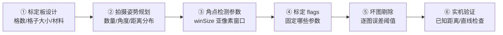

# 调参技巧：标定时的参数选择与工程经验

## 一、参数调优顺序（不是所有参数都要同时调）

按这个顺序调，每一步确认没问题再进下一步：



## 二、棋盘板怎么选（最容易被忽视的一步）

### 2.1 格数选择

| 内角点 | 格子数 | 特点 | 适用场景 |
|---|---|---|---|
| 4×4 | 5×5 | 最小可用，角点少 | 鱼眼镜头（画面变形大）|
| **7×5** | 8×6 | 角点 35 个，灵活 | 一般场景 / 嵌入式 |
| **9×6** | 10×7 | **OpenCV 经典，角点 54 个** | **通用推荐** |
| 11×8 | 12×9 | 角点 88 个，冗余多 | 高精度工业测量 |
| 15×10 | 16×11 | 角点 150 个 | 计量级标定实验室 |

**经验**：角点越多冗余越多、对噪声越鲁棒，但检测更慢、拍摄时需要棋盘更大。**9×6 是默认推荐**。

### 2.2 格子大小选择

格子大小由**工作距离和分辨率**决定：

$$
\text{格子像素大小} = \frac{\text{焦距} \times \text{格子物理尺寸}}{\text{工作距离}} \times \text{像素密度}
$$

**经验法则**：图像上每个格子至少占 **8×8 像素**，最好 15×20 像素。

| 场景 | 分辨率 | 工作距离 | 推荐格子大小 |
|---|---|---|---|
| 手机标定 | 1920×1080 | 30 cm | 20~25 mm |
| 工业相机 | 1280×1024 | 50 cm | 15~30 mm |
| 大范围监控 | 1920×1080 | 2~5 m | 50~100 mm |
| 鱼眼镜头 | 1280×1024 | 20 cm | 10~15 mm |
| 远心镜头 | 2448×2048 | 10 cm | 1~5 mm |

### 2.3 材料选择

| 材料 | 精度 | 成本 | 推荐度 |
|---|---|---|---|
| **陶瓷棋盘** | ±0.001 mm | ¥2000+ | 🏆 工业计量级 |
| **玻璃棋盘** | ±0.005 mm | ¥500-1500 | ✅ 工业首选 |
| **金属棋盘（铝）**| ±0.01 mm | ¥300-800 | ✅ 耐用 |
| 激光打印 + 亚克力 | ±0.1 mm | ¥20 | ⚠️ 原型/教学 |
| 普通 A4 纸打印 | ±0.5 mm+ | ¥0.1 | ❌ 不推荐做测量 |

## 三、拍摄姿势规划（15~20 张怎么拍）

### 推荐分布（20 张方案）

```
┌─────────┬─────────┬─────────┐
│ 左上倾斜 │  上倾斜  │ 右上倾斜 │   3 张（各角度，距离中）
├─────────┼─────────┼─────────┤
│  左倾斜  │  正对中  │  右倾斜  │   5 张（3 中距+1近+1远）
├─────────┼─────────┼─────────┤
│ 左下倾斜 │  下倾斜  │ 右下倾斜 │   3 张（各角度，距离中）
├─────────┼─────────┼─────────┤
│  近距正对 │  远距正对 │ 旋转45° │   3 张
├─────────┼─────────┼─────────┤
│ 大倾斜左 │ 大倾斜右 │ 上下颠倒 │   3 张（大角度，畸变估计）
└─────────┴─────────┴─────────┘
  合计 ~17 张
+ 3 张随机姿态（保险）→ 20 张
```

### 三条铁律

1. **倾斜角度要够**：至少几张倾斜到 25°~35°（但别超过 45°，否则角点检测会失败）
2. **棋盘要出现在图像边缘**：角点出现在图像四角时，畸变参数才有约束
3. **不要重复同样姿势**：同样角度同样距离拍 10 张 = 1 张

## 四、flags 参数组合（按场景抄作业）

### 场景 1：教学/初学者（保险选项）

```python
flags = 0  # 默认，全参数自由估计
# 估计 fx, fy, cx, cy, k1, k2, p1, p2, k3
```

### 场景 2：普通工业镜头（最常用）

```python
flags = (cv2.CALIB_FIX_K3 |       # k3 一般很小，固定为 0
         cv2.CALIB_ZERO_TANGENT_DIST)  # 切向畸变忽略
# 估计 fx, fy, cx, cy, k1, k2（6 个参数）
```

适合：装配精度好的工业定焦镜头。

### 场景 3：消费级 USB 摄像头/手机镜头

```python
flags = 0  # 全部估计，含切向畸变
# 估计 fx, fy, cx, cy, k1, k2, p1, p2, k3（9 个参数）
```

适合：树莓派摄像头、手机镜头、便宜的 USB 摄像头——这些镜头装配精度一般，p1、p2 不为 0。

### 场景 4：广角/鱼眼镜头（< 120°）

```python
flags = cv2.CALIB_RATIONAL_MODEL
# 估计 fx, fy, cx, cy, k1~k6, p1, p2（12 个参数）
```

**注意**：鱼眼镜头（> 120°）应该用 `cv2.fisheye` 模块而不是 `cv2.calibrateCamera`。

### 场景 5：已有厂家内参（快速验证）

```python
K_init = np.array([[fx, 0, cx], [0, fy, cy], [0,0,1]], dtype=np.float64)
dist_init = np.zeros(5)
flags = cv2.CALIB_USE_INTRINSIC_GUESS
ret, K, dist, _, _ = cv2.calibrateCamera(obj_pts, img_pts, size, K_init, dist_init, flags=flags)
```

当你已经知道厂家内参，只是想精化时用。

## 五、角点检测参数调优

### winSize（亚像素窗口）

| winSize | 适用 |
|---|---|
| (5, 5) | 格子小（<10 像素）、图像锐利 |
| **(11, 11)** | **默认，大多数场景** |
| (15, 15) | 格子大、略有模糊 |

### findChessboardCorners 的 flags

```python
flags = (cv2.CALIB_CB_ADAPTIVE_THRESH +  # 自适应阈值（光照不均匀）
         cv2.CALIB_CB_NORMALIZE_IMAGE +  # 归一化（光照差异大）
         cv2.CALIB_CB_FAST_CHECK)        # 快速预检查（提速）
ret, corners = cv2.findChessboardCorners(gray, (9,6), flags)
```

**推荐默认加这三个 flag**——特别是 `FAST_CHECK`，能让检测速度快 5~10 倍。

## 六、坏图剔除阈值

| 阈值 | 严格度 | 适用 |
|---|---|---|
| 中位数 × 1.5 | 严格 | 高精度测量（宁可多删）|
| **中位数 × 2.0** | **推荐** | **通用工业** |
| 中位数 × 3.0 | 宽松 | 数据少、尽量保留 |
| 不剔除 | - | 教学/快速验证 |

**剔除后必须重新标定**（最好迭代 2~3 轮直到稳定）。

## 七、7 个典型场景的抄作业参数

| 场景 | 镜头 | 格数/格子 | 图像数 | flags | 目标 RMSE |
|---|---|---|---|---|---|
| 手机标定 | 手机镜头（28mm 等效）| 9×6 / 25mm | 20 张 | 0 | < 0.3 px |
| 工业视觉检测 | 25mm 定焦 C 口 | 9×6 / 20mm | 15 张 | FIX_K3 + ZERO_TANGENT | < 0.15 px |
| 视觉测量（0.1mm 级）| 远心镜头 | 11×8 / 5mm | 20 张 | FIX_K3 + ZERO_TANGENT | < 0.08 px |
| SLAM/机器人 | 鱼眼（<120°）| 7×5 / 30mm | 25 张 | RATIONAL_MODEL | < 0.2 px |
| 机器人鱼眼（>150°）| 鱼眼镜头 | 用 fisheye 模块 | 20 张 | fisheye 专用 | < 0.3 px |
| 无人机航拍 | 广角运动相机 | 9×6 / 100mm | 20 张 | RATIONAL_MODEL | < 0.25 px |
| AR/VR 头显 | 镜头带畸变 | 9×6 / 20mm | 20 张 | RATIONAL + TILTED | < 0.15 px |

## 八、性能与精度优化清单

### 精度优化

- [ ] 玻璃/陶瓷标定板（平整度 < 0.01 mm）
- [ ] 漫反射光源（避免反光），背光最佳
- [ ] ISO 100~200（低噪），曝光时间合适（无模糊）
- [ ] 20 张图覆盖所有姿态
- [ ] 亚像素窗口 (11,11)，迭代 30 次
- [ ] 迭代剔除坏图 2~3 轮
- [ ] 固定对焦+锁死

### 速度优化（在线标定）

- [ ] 用 ChArUco 板（部分遮挡也能检测）
- [ ] `CALIB_CB_FAST_CHECK` 快速跳过无棋盘图
- [ ] 图像缩小到 1/2 分辨率检测角点，再映射回原分辨率做亚像素
- [ ] 固定 fx/fy 比值、主点、k3 减少参数
- [ ] 10 张以内图标定（够用但精度略降）

## 九、什么时候该用非棋盘方案？

| 方案 | 优点 | 缺点 | 适用 |
|---|---|---|---|
| **棋盘格（默认）** | 标准、OpenCV 原生 | 必须全可见 | 一般场景 |
| **ChArUco** | 部分遮挡可用、ID 可识别 | 需要 opencv-contrib | 机器人/AR/部分遮挡 |
| **圆点阵列** | 抗模糊、亚像素更准 | 对透视敏感 | 工业（HALCON 偏好）|
| **AprilGrid** | 鲁棒、开源 | 生态不如棋盘 | Kalibr/SLAM |
| **对称圆环** | 对透视和光照鲁棒 | 难打印 | 高精度场景 |

## 十、真实调参日记（示范）

> **场景**：工业检测，1280×1024 单色相机，16mm C 口定焦，工作距离 300mm，要求测量精度 ±0.1 mm。

**第一次尝试**：
- 9×6 棋盘，25mm 格子，A4 纸贴硬纸板
- 12 张图（全是正对拍）
- RMSE = 0.45 px ❌，实机测量偏差 1.2 mm

**问题诊断**：
- 姿态单调（全正对）→ 约束不足
- 棋盘贴纸板有弯曲
- 只有 12 张图

**第二次尝试**：
- 同棋盘，但贴在 5mm 玻璃板上
- 20 张图（按推荐分布拍摄）
- flags = FIX_K3 | ZERO_TANGENT_DIST
- RMSE = 0.18 px ✅，实机测量偏差 0.25 mm

**还不够**（目标 0.1 mm）：

**第三次尝试**：
- 升级到陶瓷棋盘 9×6（20mm 格子，精度 0.001 mm）
- 18 张图，3 张大倾斜，近中远各 3 张
- 光源换成环形漫反射光源，ISO 100
- 三脚架 + 软件触发（无手抖）
- 亚像素窗口 (11,11)
- RMSE = 0.087 px 🏆，实机测量偏差 0.08 mm ✅

**经验**：精度到最后 0.1 mm 级，**瓶颈不在算法，在硬件（标定板平整度、光源、三脚架）**。

## 十一、标定结果长期稳定性维护

- **每 3~6 个月重新标定一次**（镜头会因温度/振动缓慢偏移）
- **温度变化大的环境**（工厂车间夏冬温差）建议每次开机校准
- **保存标定记录**：记录 RMSE、日期、温度、图片数，方便追溯
- **使用前验证**：每天开工前，拍一张已知尺寸的物体（比如标准量块）验证精度
