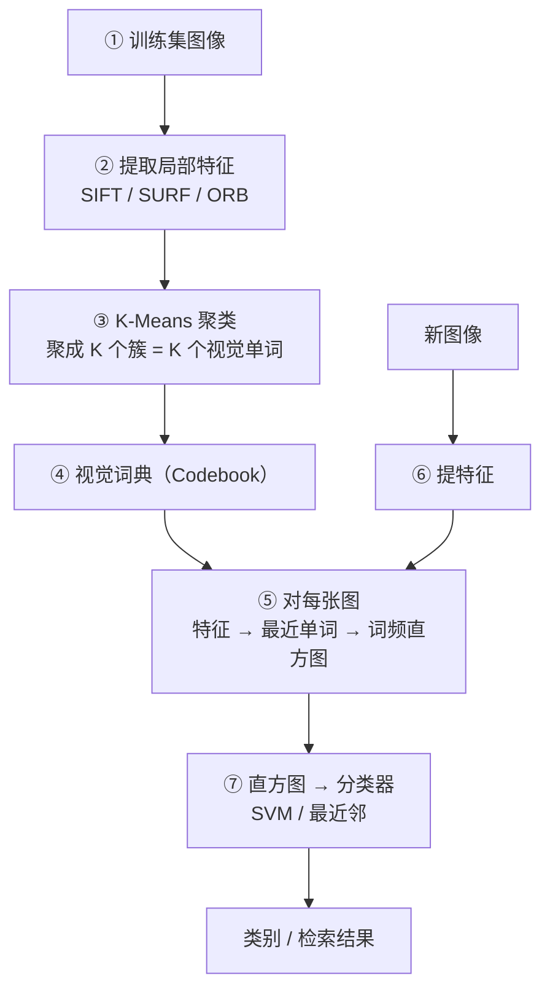
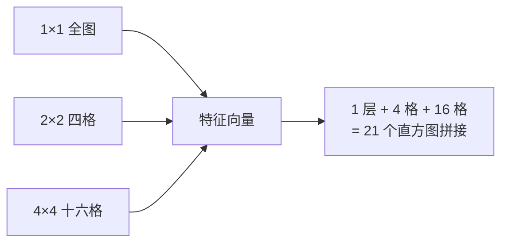
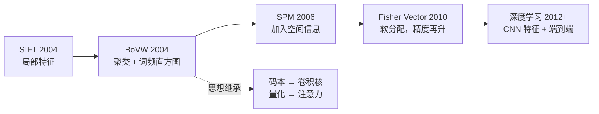

# BoVW 词袋模型

> **年份**：2004 起（Csurka 等）／ 2006 空间金字塔版 ｜ **地位**：**把图像识别变成「文本分类」的第一套成熟方案**，深度学习前图像分类与检索的绝对主流。
> **所属章**：[📘 第12章 景物识别](/chapters/ch12-recognition) ｜ **所属分支**：🌿 [目标检测](/branches/detection/)

---

## 一句话是什么

**把图像里的一堆局部特征（如 SIFT）当成一篇文档里的「单词」，先建一本「视觉词典」，再把图像表示成「视觉单词出现的频率直方图」** —— 于是图像分类就变成了文本分类，可以直接套用 SVM。

---

## 生活化比方

> 想知道一篇文章讲什么，一个好办法是**统计词频**：「医生」「病人」「药」出现得多 → 医学文章；「球」「球门」「助攻」多 → 体育文章。
>
> BoVW 就是把这个思路搬到图像上：
> - **视觉单词** = 一类长得像的局部特征（比如都是「圆角」或都是「斜线交点」）
> - **视觉词典** = 把所有视觉单词收集起来
> - **一篇文章** = 一张图像的「视觉词频直方图」
>
> **词典是通用语，直方图是文章指纹。**

---

## 完整流程



**四个关键步骤，每一步都有坑**：

| 步骤 | 做什么 | 关键参数 |
|---|---|---|
| **提取特征** | 用 SIFT/SURF/ORB 提局部特征 | 特征数与描述子维度 |
| **建词典** | K-Means 聚类成 K 个簇心 | **K 是核心超参**（通常 500–4000） |
| **编码** | 每个特征分配到最近的单词 | 硬分配 or 软分配 |
| **池化** | 统计词频，得到直方图 | 是否加权（TF-IDF） |

---

## 核心思想：为什么要聚类

**问题**：图像里的 SIFT 描述子有成千上万个，每个都是 128 维向量，直接比较毫无意义——**同一栋楼在两张照片里，特征点的位置和数量完全不同。**

**解法**：把「连续的特征向量」**量化**成「离散的单词」。

- 用 K-Means 把空间划成 K 个区域，每个区域的中心就是一个「视觉单词」
- 任意特征点 → 找到最近的单词 → 记为出现了这个单词
- **于是「两张图特征点数量不同」的问题消失了**——都变成 K 维直方图，可以直接比

::: tip 这一步的深刻之处
**它把「可变长的特征集合」变成了「定长的向量」。** 这正是传统 CV 从「几何匹配」走向「统计学习」的关键一步。后来深度学习的「码本 → 卷积核」也是同一个思路。
:::

---

## 升级版：空间金字塔匹配（SPM）

**BoVW 最大的缺陷是丢掉了空间信息**：「天空在上、地面在下」和「天地颠倒」在纯词袋里完全一样。

**SPM 的解法**：把图分成越来越细的网格，每一层都做一次词袋统计，然后**串起来**。



**效果**：SPM 在场景分类基准上把准确率从 ~65% 提升到 ~80%——**这是 2006 年最重要的图像分类进展之一**。

---

## 代码实现

```python
import cv2
import numpy as np
from sklearn.cluster import MiniBatchKMeans
from sklearn.svm import LinearSVC

# ---------- ① 提取局部特征（用 ORB 举例；也可换 SIFT） ----------
def extract_feats(img, n=300):
    img = cv2.cvtColor(img, cv2.COLOR_BGR2GRAY)
    orb = cv2.ORB_create(nfeatures=n)
    kp, des = orb.detectAndCompute(img, None)
    return des if des is not None else np.zeros((0, 32), np.uint8)

# ---------- ② 建视觉词典 ----------
all_des = np.vstack([extract_feats(im) for im in train_imgs]).astype(np.float32)

K = 1000                                        # 词典大小（核心超参）
kmeans = MiniBatchKMeans(n_clusters=K, batch_size=1000, n_init=3,
                         random_state=0).fit(all_des)
codebook = kmeans.cluster_centers_              # (K, D) 视觉词典

# ---------- ③ 编码 + 池化 ----------
def encode_hist(img, codebook):
    des = extract_feats(img).astype(np.float32)
    if len(des) == 0:
        return np.zeros(len(codebook), np.float32)
    # 用 FLANN 加速最近邻查找
    flann = cv2.FlannBasedMatcher(dict(algorithm=1, trees=5),
                                 dict(checks=50))
    matches = flann.knnMatch(des, codebook, k=1)
    hist = np.zeros(len(codebook), np.float32)
    for m in matches:
        hist[m[0].trainIdx] += 1                 # 词频
    return hist / (hist.sum() + 1e-9)            # L1 归一化

# ---------- ④ 训练分类器 ----------
X = np.stack([encode_hist(im, codebook) for im in train_imgs])
X = np.sqrt(X)                                   # Hellinger 核近似，效果更好
clf = LinearSVC().fit(X, train_labels)

# ---------- ⑤ 预测 ----------
x_test = np.sqrt(encode_hist(test_img, codebook))[None, :]
print(clf.predict(x_test))
```

---

## 参数速查

| 参数 | 含义 | 建议 |
|---|---|---|
| **K（词典大小）** | 视觉单词数量 | **500–4000**；太小欠拟合，太大过拟合且慢 |
| **特征类型** | SIFT / SURF / ORB | 精度优先 SIFT，速度优先 ORB |
| **每图特征数** | 提多少个局部特征 | 300–2000，太多拖慢且冗余 |
| **归一化** | 直方图怎么归一 | **L1 + 开方（Hellinger）** 比直接用原始 TF 效果好 |
| **网格层级（SPM）** | 空间划分层数 | 1+2+4（21 块）是经典配置 |
| **分类器** | SVM / 最近邻 | 线性 SVM 够用；核 SVM 略优但慢 |

---

## 强项与短板

| ✅ 强项 | ⚠️ 短板 |
|---|---|
| **样本需求小**：每类几十张图就能训 | **丢掉空间信息**（SPM 只能部分弥补） |
| 抗旋转、抗尺度（得益于 SIFT） | **慢**：建词典 + 编码都很耗时 |
| **可解释**：能反查「哪些视觉单词贡献了判定」 | 词典 K 敏感，调参成本高 |
| 检索任务上的经典利器 | 被深度特征全面取代 |

---

## 工业上还在用它

| 场景 | 为什么选它 |
|---|---|
| **商标 / 包装识别** | 样本少（每种包装几十张）、要抗旋转 |
| **印刷品缺印/错印检测** | 词袋能捕捉「整体图案分布异常」 |
| **文物/艺术品以图搜图** | 跨视角检索，BoVW 至今是很强的基线 |
| **织物/材料分类** | 纹理特征也可以当「视觉单词」 |
| **小样本工业缺陷分型** | 比训 CNN 划算（不需要大量标注） |

::: tip 和深度学习对比的真实结论
**在「每类样本 < 50 张 + 无 GPU」的场景，BoVW+SVM 常常还能打赢朴素 CNN。** 但样本一多（每类上百张），深度学习就全面反超。**选型看样本量，不看新旧。**
:::

---

## 演化关系



**它留下的思想**：**「把连续特征量化成离散词元，再用统计方法建模」** —— 这个思路在 Transformer 时代以「码本 / 向量量化 VQ-VAE」的形式复活了。

---

## 相关页面

- 📘 [第12章 景物识别](/chapters/ch12-recognition)
- 🌿 [目标检测分支总览](/branches/detection/)
- 📌 [Viola-Jones 检测器](/branches/detection/viola-jones)
- 📌 [DPM 可变形部件模型](/branches/detection/dpm)
- 📄 [SIFT 完整档案](/algorithms/sift/)（BoVW 最常用的局部特征）
- 🎛 [描述子匹配](/branches/feature-matching/descriptors)
