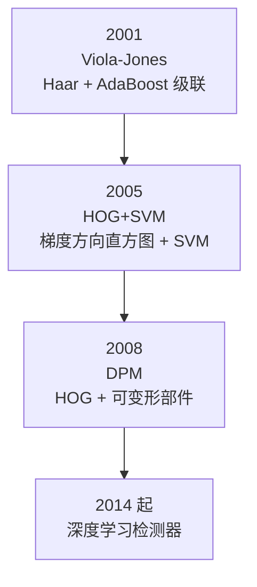
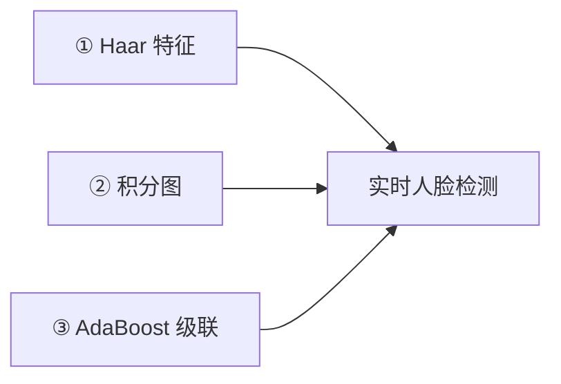
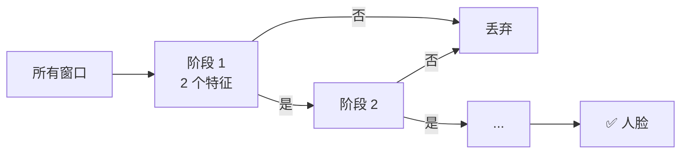
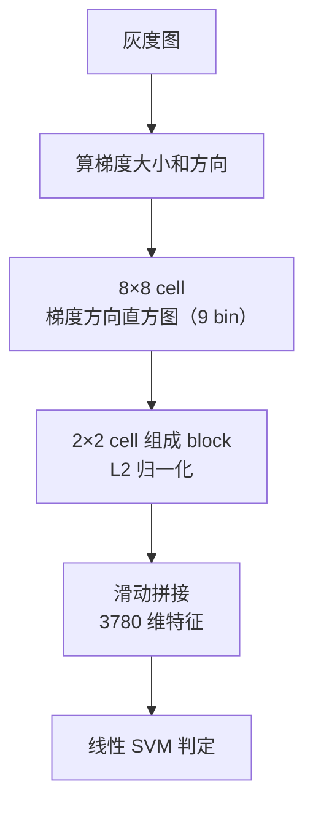
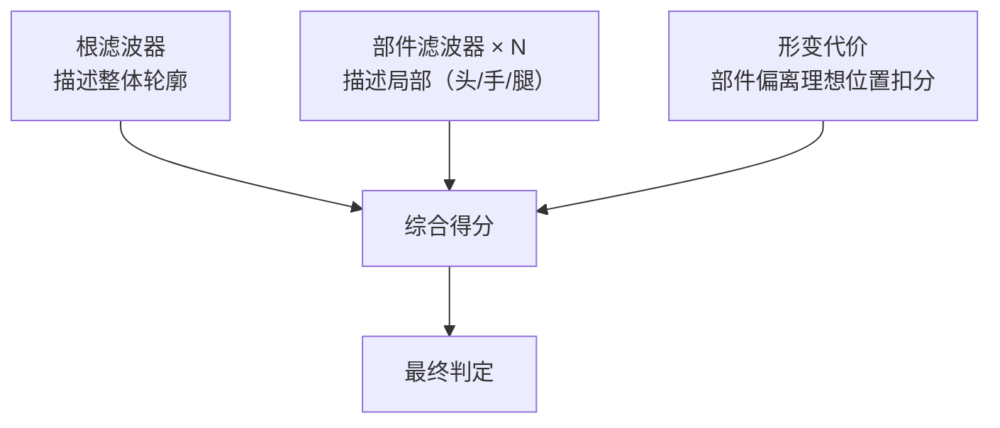
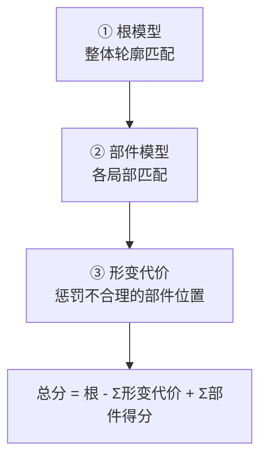
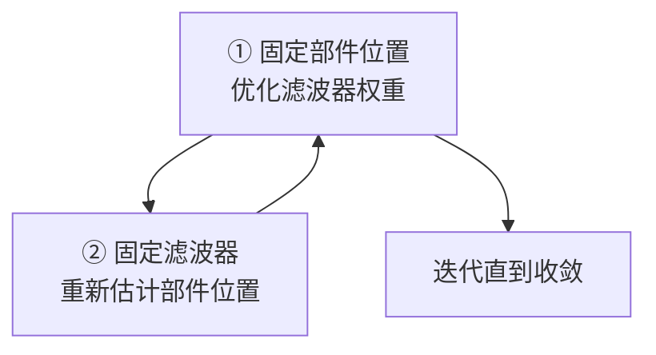

# 经典检测器

> **一句话**：传统目标检测的三代代表——Viola-Jones、HOG+SVM、DPM。

## 三代演进



| 代际 | 年份 | 特征 | 分类器 | 目标 | 速度 |
|---|---|---|---|---|---|
| 一代 | 2001 | Haar | AdaBoost 级联 | 人脸 | **实时** |
| 二代 | 2005 | HOG | 线性 SVM | 行人 | 慢 |
| 三代 | 2008 | HOG + 部件 | 潜 SVM | 通用 | 很慢 |

## 一代：Viola-Jones（2001）

### 三大贡献



### ① Haar 特征

**用黑白矩形块的差值作为特征**。

```
类型 1（横向边缘）      类型 2（纵向边缘）
■■□□                  ■□
                      ■□
值 = 左区均值 - 右区均值  值 = 上区均值 - 下区均值

类型 3（中心-周围）      类型 4（对角）
□■□                    ■□
■■■                    □■
□□□
```

**为什么 Haar 特征能表示人脸**：

| 人脸部位 | 典型 Haar 特征 |
|---|---|
| 眼睛区 | 眼睛比脸颊暗 → 纵向边缘特征 |
| 鼻梁 | 鼻梁两侧比中间亮 → 横向特征 |
| 嘴 | 嘴比下巴暗 → 纵向特征 |

**特征数量**：在 24×24 窗口内有**约 18 万个** Haar 特征。用 AdaBoost 从中挑选出几千个最有效的。

### ② 积分图

见 [滑动窗口与积分图](/branches/detection/sliding-window)。

**作用**：让任意矩形区域的像素和在 **O(1)** 内算出。

**没有积分图，Viola-Jones 做不到实时**。

### ③ AdaBoost 级联

**AdaBoost 的作用**：从 18 万个 Haar 特征里挑出**最有效的几百个**，并给它们加权组合。

**级联的作用**：把分类器排成流水线，用最简单的先筛。



**累计效果**：每阶段排除 50%，10 阶段后只剩 0.1% 的窗口进入最终判断。

### 使用

```python
# OpenCV 自带的预训练模型
face_cascade = cv2.CascadeClassifier(
    cv2.data.haarcascades + 'haarcascade_frontalface_default.xml'
)

faces = face_cascade.detectMultiScale(
    gray,
    scaleFactor=1.1,      # 尺度步长
    minNeighbors=5,       # 每个框至少被检测到几次才保留
    minSize=(30, 30)
)
```

| 参数 | 含义 | 建议 |
|---|---|---|
| `scaleFactor` | 金字塔步长 | 1.05–1.3 |
| `minNeighbors` | 框的"得票数" | 3–6（越高越严） |
| `minSize` | 最小尺寸 | 按场景 |

::: tip `minNeighbors` 是关键的"质量阀门"
**它不是 NMS，而是"得票"机制**：

在同一个位置附近的多层尺度上，如果检测器**多次**判定为人脸，说明可靠。

| `minNeighbors` | 效果 |
|---|---|
| 0–1 | 大量误报 |
| **5** | **默认，平衡** |
| 8+ | 很严，可能漏检 |
:::

### 各类预训练模型

OpenCV 自带多种 Haar / LBP 级联：

| 模型 | 目标 |
|---|---|
| `haarcascade_frontalface_default` | **正脸** |
| `haarcascade_frontalface_alt2` | 正脸（更准） |
| `haarcascade_profileface` | **侧脸** |
| `haarcascade_eye` | 眼睛 |
| `haarcascade_smile` | 微笑 |
| `haarcascade_fullbody` | 全身 |
| `haarcascade_upperbody` | 上半身 |
| `haarcascade_russian_plate_number` | **俄罗斯车牌** |

**每个 XML 文件就是一个预训练好的级联分类器**。

### 性能

| 指标 | 数值 |
|---|---|
| 输入窗口 | 24×24 |
| 640×480 耗时 | ~30–80 ms（CPU） |
| 检测率 | 95%+（正面人脸） |
| 误报 | 每帧 0–2 个 |

### 局限

::: warning Viola-Jones 的局限
1. **只擅长正面人脸** —— 侧脸、俯仰角很大时失效
2. **遮挡敏感** —— 戴口罩、眼镜框大时效果差
3. **光照敏感** —— 极端光照下失效
4. **不能处理非刚性/多姿态物体**
5. **LBP 版本更快但精度略低**
:::

**训练自己的级联**：

```bash
# OpenCV 提供工具
opencv_createsamples -img positive.jpg -vec samples.vec -num 1000
opencv_traincascade -data output -vec samples.vec -bg negatives.txt \
    -numPos 1000 -numNeg 5000 -numStages 20 \
    -featureType HAAR -w 24 -h 24
```

**训练时间**：几小时到几天（取决于数据量和阶段数）。

## 二代：HOG+SVM（2005）

### 核心思路

**不看颜色，只看"形状的轮廓走向"**。



### HOG 的三个关键设计

| 设计 | 作用 |
|---|---|
| **cell 内直方图** | 对局部形变不敏感 |
| **block 重叠 + L2 归一化** | 对光照变化鲁棒 |
| **方向分 bin（9 个）** | 只看方向分布，忽略绝对大小 |

### 使用

```python
hog = cv2.HOGDescriptor()
hog.setSVMDetector(cv2.HOGDescriptor_getDefaultPeopleDetector())

rects, weights = hog.detectMultiScale(
    img,
    winStride=(8, 8),
    padding=(32, 32),
    scale=1.05
)
```

**详见** [HOG+SVM 完整档案](/algorithms/hog-svm/)。

### 性能

| 指标 | 数值 |
|---|---|
| 输入窗口 | 64×128 |
| 特征维度 | 3780 |
| 640×480 耗时 | ~200 ms |
| 检出率 | 85%–92%（直立行人） |

## 三代：DPM（2008）

### 核心创新：可变形部件模型

**DPM = 根滤波器 + 多个部件滤波器 + 形变代价**



**生活比方**：检测一个人，不只看"整体像不像人"，还要找"有没有头、有没有手、有没有腿"，**而且这些部件的位置关系要合理**（头在身体上面，手在两侧）。

### 三层结构



### 与 HOG+SVM 的关键差异

| 维度 | HOG+SVM | DPM |
|---|---|---|
| 模型结构 | **单一滤波器** | **根 + 多部件** |
| 表达能力 | 只能描述刚性形状 | **能描述形变** |
| 对姿态 | 敏感 | **更鲁棒** |
| 速度 | 慢 | **更慢**（多部件搜索） |
| 精度 | 中 | **当时最优** |

### 训练：潜 SVM（Latent SVM）

**困难**：部件的位置是**潜变量**（不知道每个训练样本里部件在哪）。

**解法**：**交替优化**。



**即**：先假设部件在某个位置，训练滤波器；再用训练好的滤波器找部件的最优位置；反复。

### 历史地位

::: tip DPM 为什么重要
| 事实 | 意义 |
|---|---|
| **PASCAL VOC 2007/2008/2009 连续三年冠军** | 传统检测的**巅峰** |
| 很多思想被深度学习继承 | 多尺度、部件、形变代价 |
| **R-CNN 明确对标 DPM** | "用 CNN 特征替代 HOG 特征" |
| Felzenszwalb 因此获得 PASCAL 终身成就奖 | 学术认可 |

**DPM 是理解深度学习检测器的重要桥梁**：

- DPM 的"根 + 部件" → 注意力机制 / 可变形卷积
- DPM 的潜 SVM → 弱监督学习
- DPM 的多尺度 → FPN
:::

**但 DPM 太慢**：在 2008 年的机器上，一张图要**几十秒**。

## 三代对比总结

| 维度 | Viola-Jones | HOG+SVM | DPM |
|---|---|---|---|
| 年份 | 2001 | 2005 | 2008 |
| 特征 | Haar | HOG | HOG |
| 分类器 | AdaBoost 级联 | 线性 SVM | 潜 SVM |
| 模型结构 | 单分类器 | 单滤波器 | **根 + 部件** |
| 目标 | 人脸 | 行人 | 通用 |
| 速度 | **实时** | 慢 | 很慢 |
| 形变适应 | 差 | 差 | **好** |
| 训练难度 | 中 | **低** | 高 |
| 训练时间 | 数周 | **数分钟** | 数天 |
| 现役场景 | 早期人脸检测 | 嵌入式行人 | 已被取代 |

## 速度-精度权衡图


**选择逻辑**：

| 你的需求 | 选 |
|---|---|
| 正面人脸、要快 | Viola-Jones |
| 直立行人、嵌入式 | HOG+SVM |
| 通用物体、有点慢也行 | DPM |
| 高精度、有 GPU | 深度学习 |

## 为什么它们被取代

::: warning 传统检测的五个死穴
1. **手工特征表达力有限** —— 描述不了"猫"这种复杂的类别
2. **滑窗计算量爆炸** —— 高分辨率下做不到实时
3. **多尺度代价高** —— 尺度多则慢，规模小则漏
4. **对遮挡、极端姿态乏力** —— 特征固定，无法自适应
5. **非极大值抑制的取舍** —— 挨着的目标容易漏
:::

**深度学习如何解决**：

| 死穴 | 深度学习解法 |
|---|---|
| 手工特征 | **CNN 自动学习特征** |
| 滑窗爆炸 | 密集预测 / Anchor（一次前向） |
| 多尺度 | **FPN（几乎免费）** |
| 遮挡/姿态 | 大数据 + 强正则化 |
| NMS 取舍 | Soft-NMS / NMS-free |

## 实用建议

::: tip 什么时候还用传统检测器
| 场景 | 推荐 | 理由 |
|---|---|---|
| **嵌入式人脸检测（无 GPU）** | Viola-Jones | 几毫秒搞定 |
| **低算力行人检测** | HOG+SVM | 无需训练，可用预训练 |
| **教学/研究** | 全部 | 理解检测的本质 |
| **作为 baseline** | 全部 | 深度学习的最好对照 |
| **规则性极强的工业场景** | 阈值 + 轮廓 | **比检测器更稳** |
:::

::: warning 不要强行用传统方法做通用检测
**如果需求是"检测各种物体"**（人、车、动物、商品……）：

- 传统方法需要**每类都训练一个模型**
- DPM 虽然通用，但速度不可接受
- **直接用深度学习**（YOLO 系列）

参考 [agent-yolo](https://yejinlei.github.io/agent-yolo/) 的 YOLO 家族研究。
:::

## 相关链接

- [滑动窗口与积分图](/branches/detection/sliding-window)
- [NMS → YOLO 传承详解](/legacy/nms-to-yolo)
- [HOG+SVM 完整档案](/algorithms/hog-svm/)
- [⑤ 传统目标检测分支](/branches/detection/)
- [返回检测分支](/branches/detection/)
