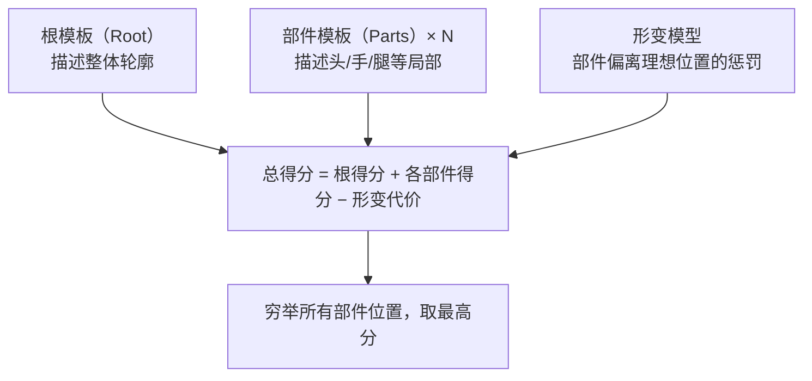
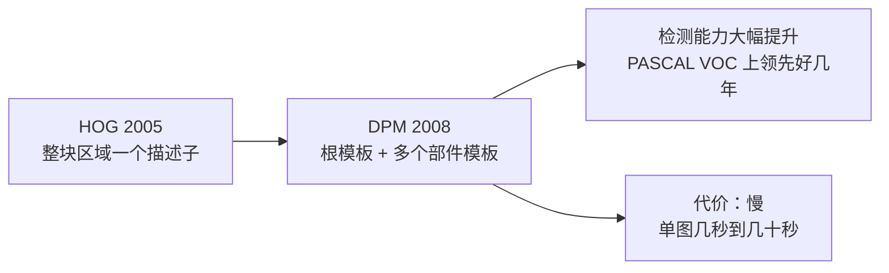
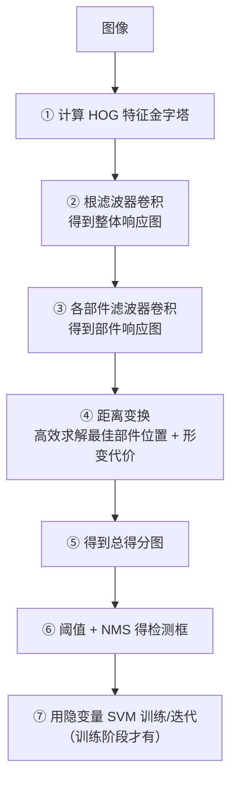
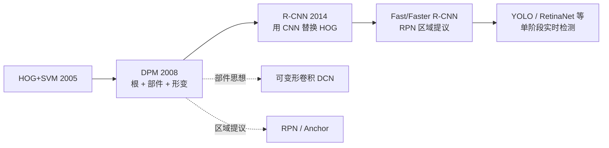

# DPM 可变形部件模型

> **年份**：2008 ｜ **作者**：Pedro Felzenszwalb 等 ｜ **地位**：**传统目标检测的巅峰之作**，在深度学习方法出现前，它是 PASCAL VOC 上的最强检测器。
> **所属章**：[📘 第12章 景物识别](/chapters/ch12-recognition) ｜ **所属分支**：🌿 [目标检测](/branches/detection/) · 经典检测器族

---

## 一句话是什么

**把物体拆成「一个整体 + 若干个可以小幅移动的部件」**——检测时不仅要求整体像，还要求部件都在合理的位置上，于是能容忍「人手臂摆动」「车角度变化」这类形变。

---

## 生活化比方

> 你认一只「猫」，是怎么认的？
>
> 你不会用一把尺子量所有猫的轮廓——因为猫会**伸懒腰、弓背、扭头**，轮廓千变万化。但无论怎么动，**「头在这里、两只耳朵在头上、四条腿在身体下」这个结构关系是稳定的**。
>
> DPM 就是这个思路：**整体轮廓给一个模板，各部件再给各自的模板，部件之间允许小幅偏移，但偏移要「付代价」**。最终找那种「整体像 + 部件位置也合理」的最优解。

---

## 核心思想：整体 + 部件 + 形变代价



**数学形式**（这就是它全部的核心）：

$$
\text{score} = \text{root} \cdot \phi_0 + \sum_{i=1}^{n} \max_{\Delta}\left[ w_i \cdot \phi_i(\Delta) - \text{cost}_i(\Delta) \right]
$$

**翻译成人话**：

1. **根模板**给出「整体像不像」的分数。
2. 每个**部件模板**在允许的小范围内搜索，找出「这个部件放这里最像」。
3. 但**偏离理想位置要扣分**（形变代价）——所以部件不能乱跑。
4. 把「根分数 + 各部件最优分数 − 形变扣分」加起来，就是整个假设的得分。

::: tip 妙在哪：能用动态规划快解
那个 $\max_{\Delta}$ 看着要穷举（很慢），但形变代价是**二次型**（凸函数），于是可以用**距离变换**在 O(n) 时间内求出所有位置的最优值。**这是 DPM 能实用化的技术关键。**
:::

---

## 与 HOG+SVM 的关系



| | HOG+SVM | DPM |
|---|---|---|
| 特征 | HOG | HOG（同样用） |
| 模型 | 单个线性 SVM | **根 + 多个部件，混合模型** |
| 形变 | 完全不能容忍 | **可容忍小幅形变** |
| 速度 | 几十到几百毫秒 | **数秒到数十秒** |
| 适用 | 刚性物体（行人） | **非刚性物体（动物、车辆多视角）** |

---

## 完整流程



**训练是难点**：DPM 用**隐变量 SVM（Latent SVM）**——因为训练时「部件到底在哪」是未知的（隐变量），需要「固定部件位置训模型 → 固定模型估部件位置」交替迭代。

---

## 代码示例

```python
# ⚠️ OpenCV 没有内置 DPM 的检测接口（只有旧版 cv2.dpm 的历史实现）
# 传统上使用原作者的开源实现 dpm (voc-release5) 或其 MATLAB 版本
#
# 这里给出「理解性实现」的核心结构示意

import numpy as np

def dpm_score(root_score, part_scores, deform_costs):
    """
    root_score:  (H, W)      根模板响应图
    part_scores: list of (H, W)  各部件模板响应图
    deform_costs: list of (H, W) 各位置相对理想锚点的形变代价
    """
    total = root_score.copy()

    for score_i, cost_i in zip(part_scores, deform_costs):
        # 对每个锚点位置，找出「部件最优放置位置」的净收益
        net = score_i - cost_i                 # 实际实现用距离变换加速
        total += net.max()                     # 加进总分

    return total

# 检测：在金字塔每一层跑一遍，取高于阈值的候选，再做 NMS
```

::: warning 为什么现在很少直接用 DPM 了
**慢**是原罪：一张图几秒到几十秒，做不了实时。而且训练流程复杂（隐变量 SVM 要多次迭代）。**它的价值在于思想**——「部件 + 形变」这套建模思路后来被深度学习全面吸收（可变形卷积 DCN、部件注意力等）。
:::

---

## 强项与短板

| ✅ 强项 | ⚠️ 短板 |
|---|---|
| **能处理形变**——传统检测器里唯一真正做到的 | **慢**：单图数秒到数十秒 |
| 多视角可用混合模型建模 | 训练复杂（隐变量 SVM） |
| 检测精度在当时是 SOTA | 参数极多，调参困难 |
| 思想影响深远（部件建模） | 被深度学习全面取代（2014 后） |

---

## 演化关系



**它留下的遗产**：**「物体可以形变，模型必须容忍形变」** —— 这个洞察是 DPM 最珍贵的贡献。

---

## 相关页面

- 📘 [第12章 景物识别](/chapters/ch12-recognition)
- 🌿 [目标检测分支总览](/branches/detection/)
- 📌 [Viola-Jones 检测器](/branches/detection/viola-jones)
- 📌 [BoVW 词袋模型](/branches/detection/bovw)
- 📄 [HOG+SVM 完整档案](/algorithms/hog-svm/)（DPM 的特征基础）
- 🔗 [传承脉络：传统 CV → 深度学习](/legacy/)
