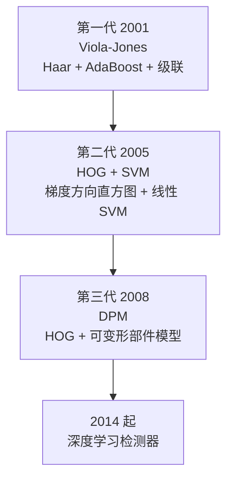
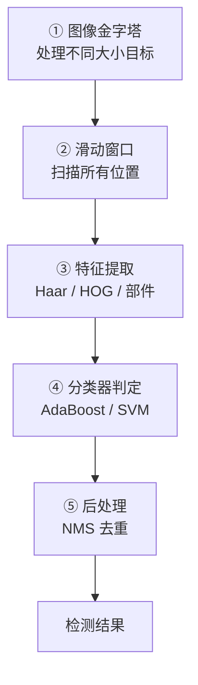
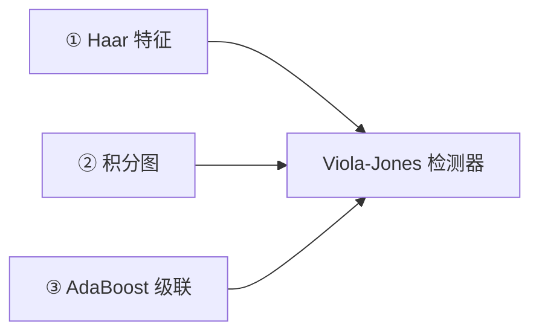
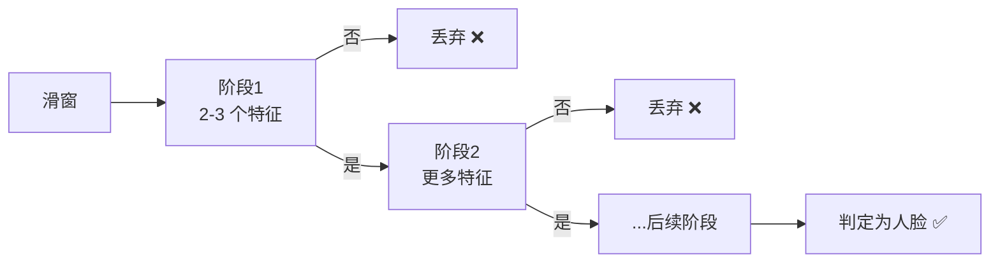
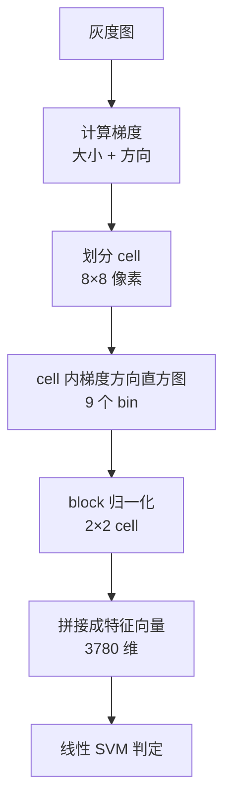
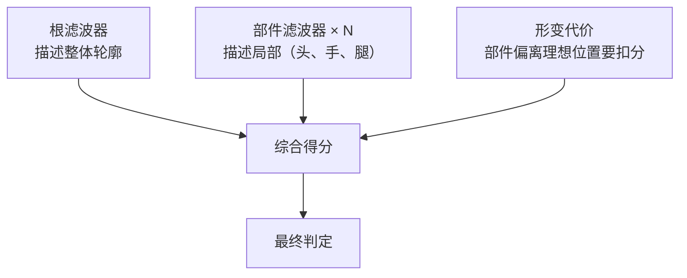
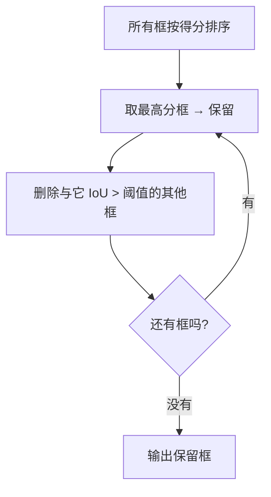
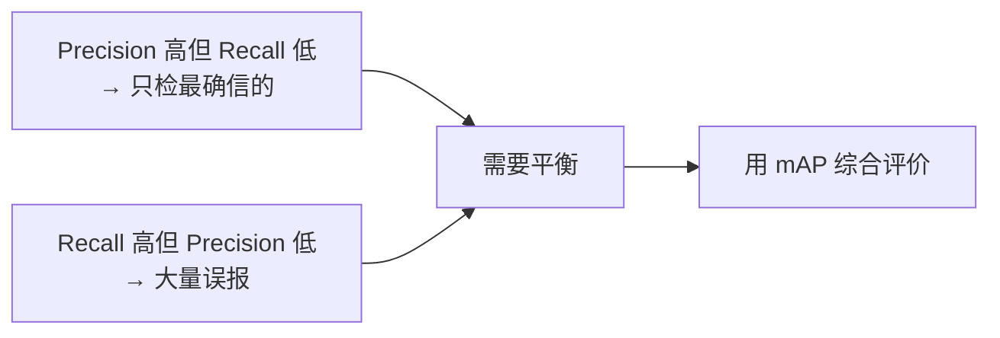
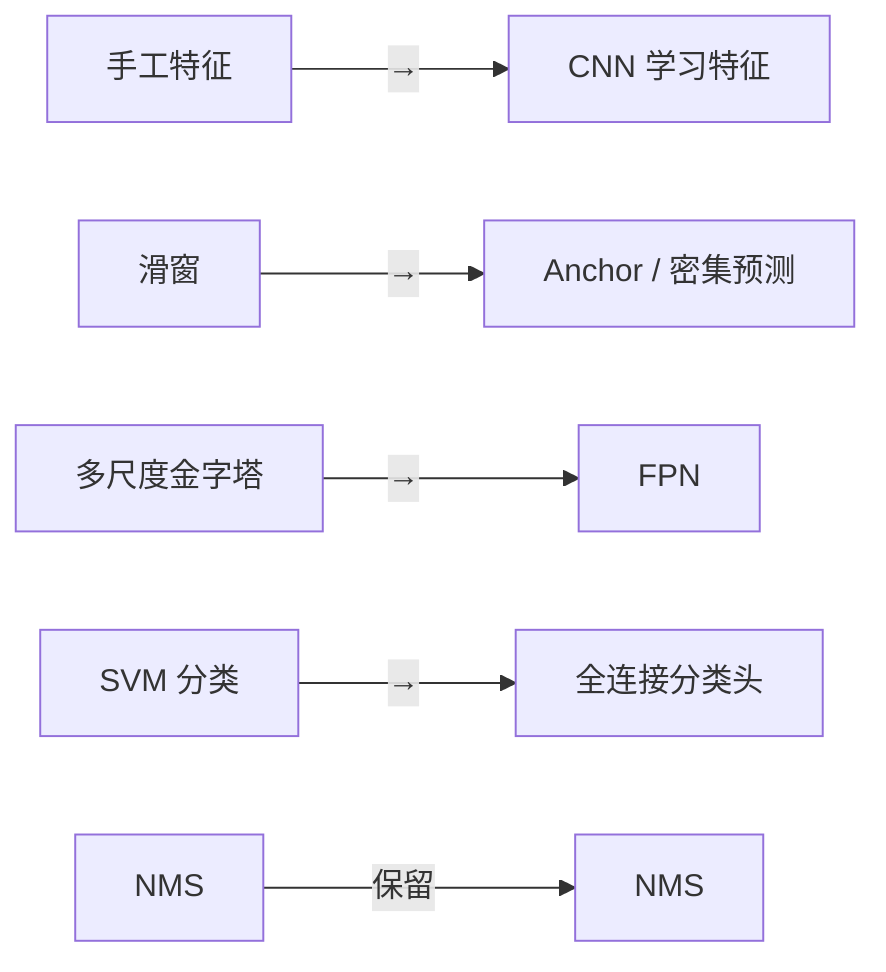

# ⑤ 传统目标检测

> **学习难度 ⭐⭐⭐⭐** ｜ **一句话**：在图像中找到目标，并给出它的位置和类别。

## 这个分支解决什么问题

前四个分支都是「分析图像」，这个分支开始**回答业务问题**：图里有没有人？车在哪？

**目标检测 = 从"看"到"认"的第一步**。它输出的不是一个数字，而是一串「框 + 类别 + 置信度」。

## 检测输出的结构


## 传统检测的三代演进



| 代际 | 年份 | 核心思想 | 代表 | 检测目标 |
|---|---|---|---|---|
| 第一代 | 2001 | 积分图 + 级联分类器 | Viola-Jones | **人脸**（实时） |
| 第二代 | 2005 | 手工特征 + 滑动窗口 + 线性分类 | HOG+SVM | **行人** |
| 第三代 | 2008 | 部件模型 + 形变代价 | DPM | 通用物体 |
| 转型 | 2014 | 区域提议 + CNN | R-CNN 系列 | 通用物体 |

## 共同的技术骨架

所有传统检测器都遵循同一套流程：



::: tip 理解了这个骨架，就理解了传统检测
**核心矛盾**：滑窗数量极多（百万级），每个窗口都要提特征 + 分类 → **必须让单窗口计算极快**。

三个时代的解决方案：

| 时代 | 如何让单窗口快 |
|---|---|
| Viola-Jones | **积分图**（Haar 特征 O(1) 计算）+ **级联**（大部分窗口被前几级否掉） |
| HOG+SVM | HOG 特征可**复用**（重叠块只算一次）+ 线性 SVM 极快 |
| DPM | 同样用 HOG + **级联**加速 |
:::

## 第一代：Viola-Jones（2001）

### 三大贡献



**① Haar 特征**：用黑白矩形块的差值作为特征。

```
[■■] 横向边缘    [■] 纵向边缘    3×3 棋盘
[□□]             [□]
```

**生活比方**：看人脸是不是有「眼睛比脸颊暗」这个模式——用两个矩形块做差就测出来了。

**② 积分图**：让「任意矩形的像素和」能在 **O(1)** 时间内算出来。

**生活比方**：给全班算分数总和，不一个个加，而是预先造一张「前 n 个人累积和」的表，任意区间和 = 两个表值相减。

$$ \text{Sum}(D) = I_4 - I_2 - I_3 + I_1 $$

**③ AdaBoost 级联**：



**核心思想**：**用最简单的判据快速排除大量非人脸窗口**，只有少数可疑窗口进入后续复杂判断。99% 的窗口在第一两级就被扔掉。

### 性能

| 指标 | 数值 |
|---|---|
| 输入尺寸 | 24×24 检测窗口 |
| 速度 | **实时**（当时CPU上 15 FPS） |
| 检测率 | 95%+（正面人脸） |
| 训练时间 | 数周（2001 年的机器） |

**局限**：**只擅长正面人脸**。侧面、遮挡、光照极端时失效。

## 第二代：HOG+SVM（2005）

### 核心思路



### 为什么 HOG 有效

**生活比方**：**不看颜色，只看「形状的轮廓走向」**。

- 人的轮廓：竖直方向梯度多（身体），水平方向梯度在某处（肩膀、头）
- 描述「这个窗口里梯度朝各个方向的分布」→ 就描述了形状

**HOG 的三个关键设计**：

| 设计 | 作用 |
|---|---|
| **cell 内直方图** | 对局部形变不敏感 |
| **block 重叠 + L2 归一化** | 对光照变化鲁棒 |
| **梯度方向分为 9 个 bin** | 忽略梯度的绝对大小，只看方向分布 |

### 性能

| 指标 | 数值 |
|---|---|
| 输入尺寸 | 64×128 检测窗口 |
| 特征维度 | **3780** 维 |
| 速度 | 640×480 约 200 ms（CPU，非实时） |
| 检测率 | 85%–92%（直立行人） |
| 误报 | 每帧 0.5–2 个 |

详见 [HOG+SVM 完整档案](/algorithms/hog-svm/)。

## 第三代：DPM（2008）

### 核心创新

DPM = **HOG 特征 + 可变形部件模型（Deformable Part Model）**



**生活比方**：检测一个人，不只看「整体像不像人」，还要找「有没有头、有没有手、有没有腿」，并且这些部件的位置关系要合理（头在身体上面，手在两侧）。

### 与 HOG+SVM 的关键差异

| 维度 | HOG+SVM | DPM |
|---|---|---|
| 模型结构 | 单一滤波器 | 根 + 多个部件 |
| 表达能力 | 只能描述刚性形状 | 能描述形变 |
| 对姿态 | 敏感 | 更鲁棒 |
| 速度 | 慢 | **更慢**（多部件搜索） |
| 精度 | 中 | **当时最优** |

::: tip DPM 的历史地位
- **连续三年（2007-2009）PASCAL VOC 检测冠军**
- 是传统检测的**巅峰**
- 它的很多思想（多尺度、部件、形变代价）被后来的深度学习继承
- 深度学习的 R-CNN 提出时，就是**对标 DPM** 的
:::

## NMS：所有检测器都要用的后处理

### 为什么需要 NMS

滑窗会让**同一个目标被打上几十个框**（相邻位置、相邻尺度都会命中）。需要去掉重复的，只留最好的。

### NMS 算法



**生活比方**：一堆人推荐同一家餐厅，只留最权威的那个推荐，把说同样话的都划掉。

```python
def nms(boxes, scores, iou_threshold=0.5):
    idxs = np.argsort(scores)[::-1]
    keep = []
    while len(idxs) > 0:
        i = idxs[0]
        keep.append(i)
        # 算 i 与其他框的 IoU
        ious = compute_iou(boxes[i], boxes[idxs[1:]])
        # 保留 IoU 小于阈值的
        idxs = idxs[1:][ious < iou_threshold]
    return keep
```

| 参数 | 效果 |
|---|---|
| `iou_threshold = 0.3` | 严格，框少，可能漏掉挨着的目标 |
| `iou_threshold = 0.5` | 常用默认 |
| `iou_threshold = 0.7` | 宽松，框多，可能重复 |

::: tip NMS 一直活到了深度学习时代
**NMS 是传统 CV 留给深度学习的最大遗产**。

YOLO、Faster R-CNN、SSD 全都要用 NMS（或它的变体 Soft-NMS、DIoU-NMS）。见 [传承脉络](/legacy/)。
:::

## 检测质量评估

### IoU（交并比）

$$ \text{IoU} = \frac{\text{预测框} \cap \text{真值框}}{\text{预测框} \cup \text{真值框}} $$

| IoU | 判定 |
|---|---|
| > 0.5 | 通常算命中 |
| > 0.75 | 严格标准 |
| < 0.5 | 未命中 |

### 核心指标

| 指标 | 含义 |
|---|---|
| **Precision** | 检出的里面有多少是真的 |
| **Recall** | 真的里面检出多少 |
| **AP** | 单类别 PR 曲线下面积 |
| **mAP** | 所有类别 AP 的平均 |



## 三类检测器对比

| 维度 | Viola-Jones | HOG+SVM | DPM |
|---|---|---|---|
| 年份 | 2001 | 2005 | 2008 |
| 特征 | Haar | HOG | HOG |
| 分类器 | AdaBoost 级联 | 线性 SVM | 潜 SVM |
| 目标 | 人脸 | 行人 | 通用 |
| 速度 | **实时** | 慢 | 很慢 |
| 形变适应 | 差 | 差 | **好** |
| 训练难度 | 中 | 低 | 高 |
| 现役场景 | 早期人脸检测 | 嵌入式行人检测 | 已被取代 |

## 传统检测的固有局限

::: warning 五个绕不过去的坎
1. **手工特征表达力有限** → 复杂类别检不好
2. **滑窗计算量爆炸** → 高分辨率做不到实时
3. **多尺度代价高** → 尺度多则慢，规模小则漏
4. **非极大值抑制的取舍** → 挨着的目标容易漏
5. **对遮挡、极端姿态乏力**
:::

**这些局限正是深度学习检测器出现的动因**：



## 场景选型速查

| 场景 | 推荐 | 理由 |
|---|---|---|
| 正面人脸（低算力） | **Viola-Jones** | OpenCV 自带，实时 |
| 直立行人（平视、嵌入式） | **HOG+SVM** | 无需训练，可用预训练模型 |
| 通用物体（无 GPU） | **DPM** | 传统最优，但很慢 |
| 需要高精度/遮挡/多姿态 | **深度学习** | 传统方法做不到 |
| 工业缺陷（规则形状） | **阈值 + 轮廓 + 特征判定** | 更稳更简单 |

详见 [HOG+SVM 踩坑与调参](/algorithms/hog-svm/painpoints) 与 [调参技巧](/algorithms/hog-svm/tricks)。

## 相关链接

- [HOG+SVM 完整档案](/algorithms/hog-svm/)
- [NMS → YOLO 传承脉络](/legacy/)
- [② 特征检测分支](/branches/feature-detection/)
- [返回分支总览](/branches/)
