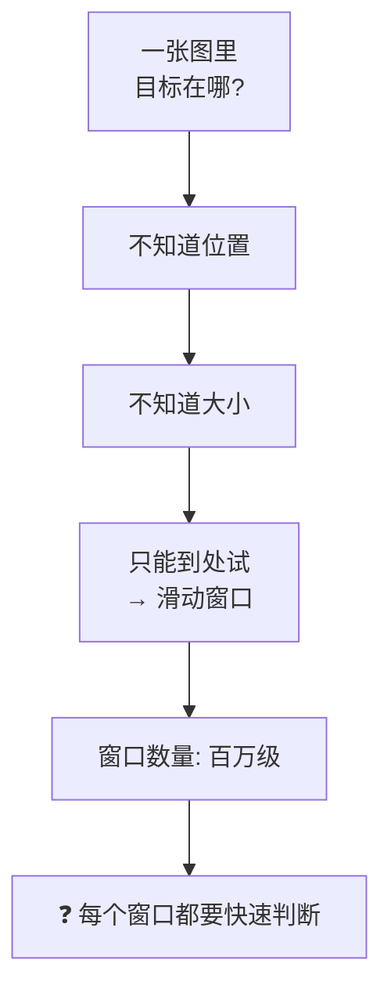
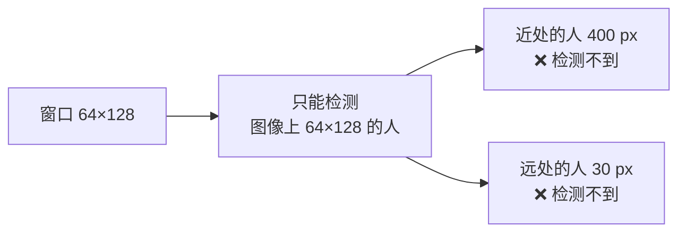
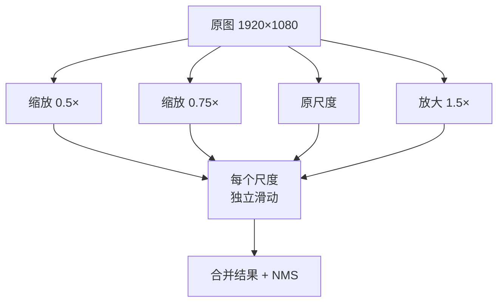
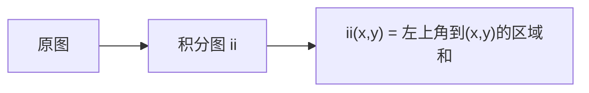
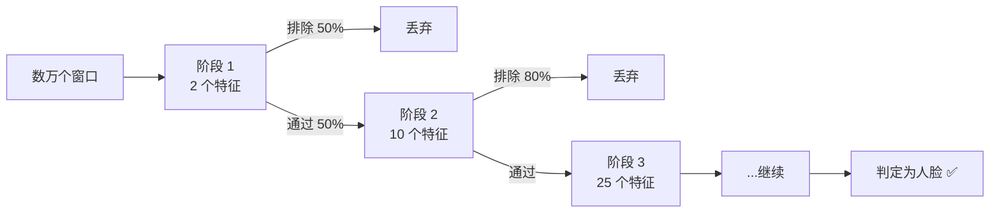
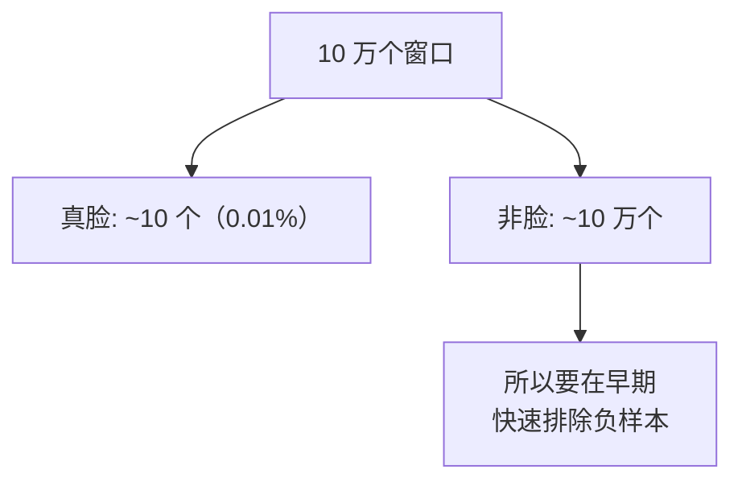
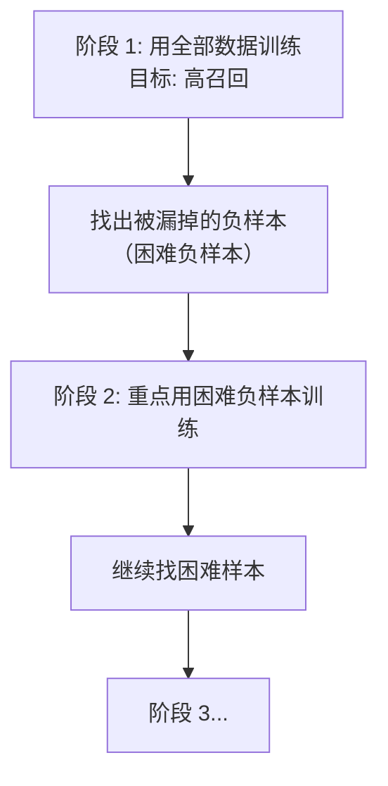
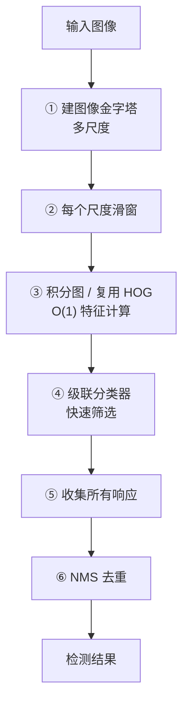

# 滑动窗口与积分图

> **一句话**：传统检测器的骨架——「到处看 + 快速判断」，以及让"快速判断"成为可能的积分图。

## 检测的基本难题



**核心矛盾**：

| 需求 | 冲突 |
|---|---|
| **覆盖所有位置和尺度** | 窗口数爆炸（百万级） |
| **每个窗口要准确判断** | 特征计算复杂 |
| 两者相乘 | 计算量不可接受 |

**整个传统检测史，就是"如何在百万窗口上做快速判断"的历史**。

## ① 滑动窗口

### 基本做法


### 窗口数量的估算

**例**：640×480 图像，窗口 64×128，步长 8 像素。

| 尺度 | 位置数 |
|---|---|
| 原尺度 | ((640-64)/8+1) × ((480-128)/8+1) ≈ 73 × 45 = 3285 |
| 缩放 10 个尺度 | 约 1.5 万–3 万 |

**如果步长 4 像素** → 数量×4 → **10 万级**。

**如果再加多个尺度** → **百万级**。

::: warning 这就是传统检测慢的根本原因
**每个窗口都要算 HOG 特征（3780 维）**。

假设 10 万个窗口，每个算 HOG 要 0.1 ms → **10 秒**。

**必须想办法加速**：
1. **复用计算**（重叠窗口的 HOG 特征可以复用）→ HOG 的实际做法
2. **极简特征 + 级联** → Viola-Jones 的做法
3. **近似 + 索引** → 后来的做法
:::

### 步长的取舍

| 步长 | 窗口数 | 效果 | 速度 |
|---|---|---|---|
| 2 px | 极多 | 几乎不漏 | 极慢 |
| 4 px | 多 | 好 | 慢 |
| **8 px** | **适中** | 好 | 中 |
| 16 px | 少 | 可能漏小目标 | 快 |

**8 像素是常见默认**（对应 HOG 的一个 cell 大小）。

## ② 图像金字塔

### 为什么要金字塔

**固定大小的窗口无法检测不同大小的目标**。



**解决**：**把图像缩放到多个尺度**，每个尺度都滑窗。



**生活比方**：想看不同距离的物体，可以把照片打印成不同大小，然后用同一个放大镜看。缩小的照片上的小物体，放大后就跟原图上的大物体一样大了。

### 尺度步长

**scale 参数**（每个尺度的缩放比）：

| scale | 层数（从 1080 到 32 px） | 效果 |
|---|---|---|
| 1.02 | ~180 层 | 几乎不漏，极慢 |
| **1.05** | **~72 层** | **平衡（常用）** |
| 1.1 | ~36 层 | 快，可能漏 |
| 1.2 | ~18 层 | 很快，明显漏 |

::: tip 为什么 1.05 是黄金值
**每层只缩 5%**，意味着从"正好匹配"到"缩小到下一层"，只有很小的尺寸差 → **覆盖完整**。

**层数计算**：

$$ n = \frac{\log(\text{最小尺度} / \text{最大尺度})}{\log(1/\text{scale})} $$

**OpenCV 的 `detectMultiScale` 默认 scale=1.05**。
:::

### 金字塔的性能代价

**层数与耗时几乎成正比**。

| 尺度步长 | 层数 | 相对耗时 |
|---|---|---|
| 1.02 | 180 | 5× |
| 1.05 | 72 | **2×** |
| 1.1 | 36 | 1× |
| 1.2 | 18 | 0.5× |

**这就是"为什么传统检测慢"的直接答案**。

::: tip 深层的问题：小目标消失
**在金字塔的深层（大尺度层），小目标被放大** —— 这解决了"检测小目标"的问题。

**但代价是计算量**。

**深度学习时代的解法（FPN）**：**不用缩放图像，而是在网络的不同层级取特征** —— 浅层特征图分辨率高（对应小目标），深层特征图分辨率低（对应大目标）。**几乎免费的尺度覆盖**。

**这就是 PyTorch 论文说的"传统金字塔很贵，FPN 很便宜"**。详见 [传承脉络：金字塔到 FPN](/legacy/)。
:::

## ③ 积分图（让 Haar 特征 O(1)）

### 问题

**Haar 特征** = 几个矩形区域的像素和之差。

**朴素算法**：矩形内有 N 个像素 → 累加 N 次 → **O(N)**。

**Viola-Jones 需要计算数十万个 Haar 特征**（每个窗口几百个特征 × 数万窗口）→ 不可接受。

### 积分图的解法

**定义**：`ii(x, y)` = **从左上角到 (x, y) 的所有像素之和**。



**关键公式**：

$$ \text{Sum}(D) = ii(x_4, y_4) - ii(x_2, y_4) - ii(x_4, y_2) + ii(x_2, y_2) $$

**几何理解**：

```
D 区域的和 
= 大矩形(到右下角)的和 
- 左边条带的和 
- 上边条带的和 
+ 重复减掉的左上角小矩形
```

**这就是容斥原理**。

**生活比方**：要给全班算"第 10 到第 20 个人的分数和"。不用一个个加，而是预先造一张"前 n 个人累积和"的表，然后**两次查表相减**。

### 复杂度对比

| 方法 | 单个矩形和 |
|---|---|
| 朴素 | O(N)，N = 矩形面积 |
| **积分图** | **O(1)，4 次查表** |

**加速效果**：对于 20×20 的矩形，**加速 100 倍以上**。

### 积分图怎么算

**一次遍历就能建好**（动态规划）：

$$ ii(x, y) = I(x, y) + ii(x-1, y) + ii(x, y-1) - ii(x-1, y-1) $$

**意思**：当前和 = 当前像素 + 左边的累积 + 上边的累积 - 重复算的左上角。

**建表耗时**：O(W×H)，**只有一次**。之后所有矩形和查询都是 O(1)。

```python
# OpenCV 有现成函数
integral = cv2.integral(gray)     # 返回 (H+1, W+1) 的积分图
# 更精确的（64 位，避免溢出）
integral = cv2.integral(gray, sdepth=cv2.CV_64F)
```

### 积分图的现代应用

::: tip 积分图在深度学习中也有回响
| 应用 | 说明 |
|---|---|
| **Box Filter（盒式滤波）** | 用积分图 O(1) 算任意大小盒滤波 |
| **快速引导滤波** | 大量使用积分图 |
| **SSD 代价体积** | 立体匹配中快速算块差异 |
| **IoU 计算** | 检测评估中快速算框面积 |

**思想**：**把"重复的求和"变成"预计算 + 查表"**。这是通用的性能优化模式。
:::

## ④ 级联分类器（Viola-Jones 的另一半）

### 思路

**用极简特征快速排除大量负样本，只有可疑样本才做复杂判断**。



### 为什么有效

**关键假设**：**大部分窗口都是负样本**（真实人脸只占图像很小一块）。



**设计原则**：

| 阶段 | 特征数 | 通过率 |
|---|---|---|
| 1 | 极少（1–3） | 低（快速筛掉一半） |
| 2 | 少 | 中 |
| 3+ | 多 | 高（精确判断） |

**累计效果**：假设每阶段排除 50%，10 阶段后：
$$ 0.5^{10} \approx 0.001 $$

**10 万窗口 → 100 个窗口进入最后阶段** → **计算量降 1000 倍**。

::: tip 级联思想的三次生命
| 时期 | 体现 |
|---|---|
| 2001 | **Viola-Jones 级联** |
| 2015 | 两阶段检测器（RPN 先筛候选） |
| 2019 | Cascade R-CNN、Early Exit |

**"先便宜地排除，再昂贵地确认"是跨越 20 年的通用优化原则**。
:::

### AdaBoost 怎么训练级联

**思路**：每个阶段的分类器只关注"上一阶段漏掉的难样本"。



**这就是「困难负样本挖掘（Hard Negative Mining）」的雏形**。

**在 DPM、HOG+SVM 甚至深度学习中都被使用**。

## ⑤ NMS（滑动窗口的后处理）

**滑窗的必然结果**：同一个目标被打上几十个框。

**NMS** 解决这个问题——**按得分排序，只留最好的，删掉它旁边的**。

详见 [NMS → YOLO 传承详解](/legacy/nms-to-yolo)。

## 完整流程



## 性能优化清单

| 优化 | 加速 | 代价 |
|---|---|---|
| **积分图** | 特征计算 100× | 一次建表 |
| **级联** | 分类 10–100× | 训练复杂 |
| **HOG 特征复用** | 特征计算 4–10× | 实现复杂 |
| **ROI 裁剪** | 3–10× | 需先验 |
| **降分辨率** | 2–4× | 小目标漏检 |
| **增大 scale** | 2× | 漏检 |
| **增大 winStride** | 2–4× | 漏检 |
| **跳帧 + 跟踪** | 2–5× | 运动目标 |

## 参数速查

| 参数 | 含义 | 建议 |
|---|---|---|
| `scale` | 金字塔缩放 | **1.05** |
| `winStride` | 滑窗步长 | (8, 8) |
| `padding` | 边缘填充 | (32, 32) |
| `minSize` | 最小检测尺寸 | 依场景 |
| `maxSize` | 最大检测尺寸 | 依场景，**限制可提速** |

::: tip `maxSize` / `minSize` 是免费的提速
**如果你知道目标的尺寸范围，一定要设这两个参数**。

比如"只检测 100–400 px 高的人"：
- 避免了极小尺度（省 50% 时间）
- 避免了极大尺度（省 20% 时间）

**这是零代价的优化**。
:::

## 常见踩坑

::: danger 坑 1：没设 minSize/maxSize
**现象**：检测极慢，且出现大量明显错误的小框。

**解决**：**设定目标尺寸范围**，直接砍掉不必要的尺度。

```python
rects, weights = hog.detectMultiScale(
    img,
    winStride=(8, 8),
    padding=(32, 32),
    scale=1.05,
    minSize=(64, 128),       # ✅ 设上限下限
    maxSize=(512, 1024)
)
```
:::

::: danger 坑 2：以为步长越小越好
**现象**：winStride=(2,2) 时慢了 16 倍，检出率只提升 3%。

**真相**：**步长的影响是"平方级"的**（横竖两个方向）。从 8 到 2 是 16 倍计算量。

**建议**：**用 8**（对应 HOG 一个 cell），需要更密时用 4。
:::

::: danger 坑 3：忘了 NMS
**现象**：一个目标显示几十个框。

**解决**：用 `detectMultiScale` 的 `groupThreshold`，或自己做 NMS。

详见 [NMS 详解](/legacy/nms-to-yolo)。
:::

::: danger 坑 4：金字塔从原图开始，忽略了上采样
**现象**：比检测窗口更小的目标检测不到。

**根因**：如果目标只有 30 px 高而窗口是 64×128，**原尺度上永远匹配不上**。

**解决**：金字塔要**从小于目标尺寸的尺度开始**（即需要上采样）。

**但注意**：`detectMultiScale` 只做下采样（缩小），不做上采样。所以**小目标要靠"把特征窗口做小"**（改 winSize，需重训）。
:::

::: danger 坑 5：padding 设 0
**现象**：图像边缘附近的目标检测不到。

**解决**：`padding=(32, 32)`（半个窗口大小）。

**原理**：padding 让检测窗口能"伸出"图像边界，覆盖边缘附近的目标。
:::

## 与深度学习的对照

| 传统组件 | 深度学习对应 | 关系 |
|---|---|---|
| 滑动窗口 | 密集预测 / Anchor | **被替代** |
| 图像金字塔 | FPN / 多尺度训练 | **被优化** |
| 积分图 | 卷积的隐式累积 | 思想保留 |
| 级联分类器 | RPN / 两阶段 | **思想继承** |
| NMS | NMS | **完全保留** |

::: tip 一句话总结
**传统检测的骨架是"金字塔 + 滑窗 + 特征 + 分类 + NMS"**。

**深度学习把"特征 + 分类"换成了 CNN，把"滑窗"换成了密集预测，把"金字塔"换成了 FPN**。

**但"多尺度 + 密集 + 后处理"这个骨架，一个字都没变**。

**这就是为什么理解了传统检测，就理解了 YOLO 的设计**。
:::

## 相关链接

- [⑤ 传统目标检测分支](/branches/detection/)
- [经典检测器（Viola-Jones / HOG+SVM / DPM）](/branches/detection/classic-detectors)
- [NMS → YOLO 传承详解](/legacy/nms-to-yolo)
- [HOG+SVM 完整档案](/algorithms/hog-svm/)
- [返回检测分支](/branches/detection/)
