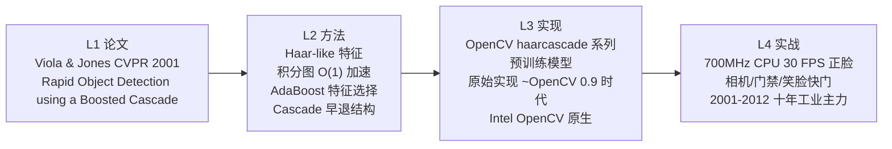
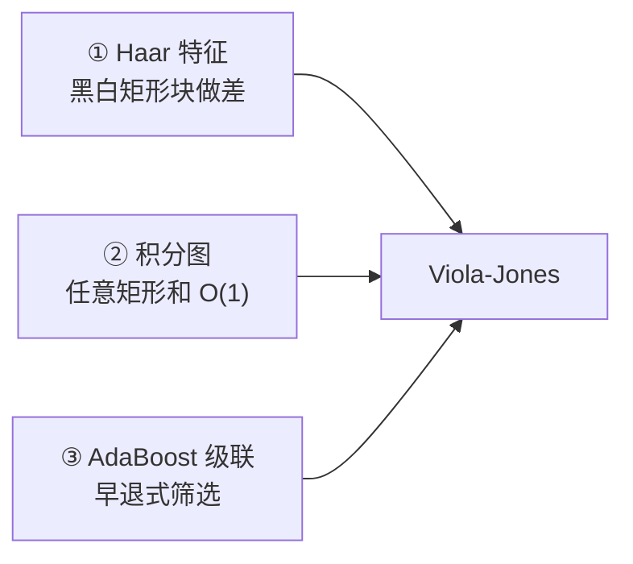
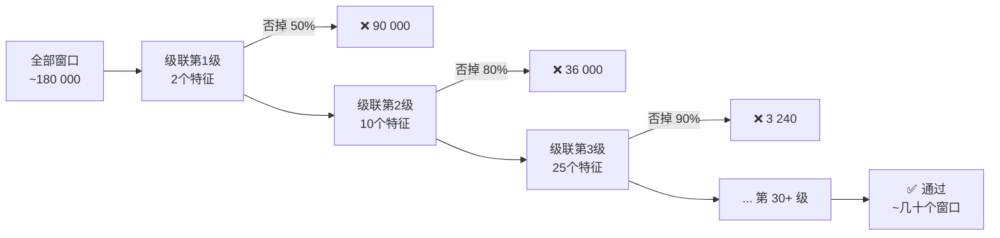
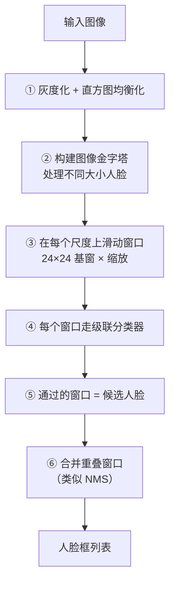
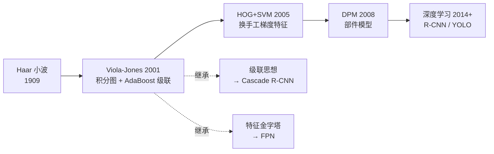

# Viola-Jones 检测器

<AlgorithmCard
  name="Viola-Jones 人脸检测器"
  en-name="Viola-Jones Object Detection Framework"
  chapter="第12章 景物识别"
  branch="目标检测 · 经典检测器族"
  year="2001"
  author="Paul Viola, Michael Jones"
  paper="https://doi.org/10.1109/CVPR.2001.990517"
  level="高层"
  tagline="CV 历史上第一个实时人脸检测器——三级组合拳打出 30 FPS"
  analogy="像漏斗式招聘：HR 先用学历门槛一秒筛掉一半，再用笔试筛三成，最后才花一小时面试剩下的人。大部分窗口在第一关就被毙，整体飞快。"
  scene="相机取景框实时人脸框、数码相机笑脸快门、门禁/考勤机人脸定位、驾驶员疲劳监测粗定位、早期人脸解锁、工业模板匹配。"
  :pros="[
    '2001 年就做到 30 FPS 实时检测（Pentium III 700MHz）',
    '无需 GPU、模型几百 KB、嵌入式友好',
    '积分图思想影响了后续所有快速特征计算',
    '级联分类器的早退设计成为工业工程范式',
    'OpenCV 开箱即用，预训练模型齐全'
  ]"
  :cons="[
    '只擅长刚性正脸，侧脸/俯仰/遮挡效果差',
    'Haar 特征过浅，无法处理行人等复杂形状',
    '训练新类别需要完整的 AdaBoost 训练管线',
    '对光照敏感，必须配直方图均衡化',
    '已被 HOG/DPM/深度学习全面超越'
  ]"
/>

## TL;DR

**一句话**：**Haar 特征 + 积分图 + AdaBoost 级联**三级组合拳——积分图让特征 O(1) 算完，AdaBoost 挑最判别特征，级联漏斗把 99% 非人脸窗口前几关就毙掉。
**解决**：在 2001 年把人脸检测从秒级压到 30 FPS 实时，首次让 CV 走出实验室进入消费电子。
**代价**：Haar 特征只能描述简单明暗关系，侧脸/遮挡/复杂形状无能为力；训练新类别流程繁琐。
**前置阅读**：[🐣 入门第 4 页 Viola-Jones 一句话](/for-beginners/p4-other-classics#viola-jones-三级火箭做实时检测)

## 3 分钟电梯演讲


## 四层闭环视图



## 核心贡献一览

| 贡献 | 一句话 | 代码落点 |
|---|---|---|
| Haar-like 特征 | 相邻矩形和之差，捕捉"眼睛比脸颊暗"这类模式 | 特征模板 2/3/4 矩形 |
| 积分图 | 任意矩形像素和 4 次查表 O(1) | `cv2.integral()`（预处理一次）|
| AdaBoost 特征选择 | 从 16 万候选特征里挑 200+ 判别特征 | `cv2.boost`/训练阶段 |
| Cascade 级联 | 多级漏斗，前几级快速毙掉负窗 | `cv2.CascadeClassifier` 加载预训练 xml |
| 多尺度滑窗 + 聚类 | 金字塔 + 滑窗 + 近邻聚类（NMS 雏形）| `detectMultiScale(scaleFactor, minNeighbors)` |

---

## 一句话是什么

**用「黑白矩形块的亮度差」当特征、用「积分图」把特征算到 O(1)、用「AdaBoost 级联」把绝大多数窗口在头几关就否掉** —— 三板斧合力，把原来要几秒的人脸检测压到 15 帧/秒。

---

## 生活化比方

> 想象你在人堆里找熟人。你不会对每个人都仔细端详：**先远远看轮廓**（第一道筛子），像的才走近看；**再看五官位置对不对**（第二道），对的才盯着细看（最后一道）。
>
> Viola-Jones 就是这个逻辑：**每一级分类器都是一道筛子，绝大多数「不像脸」的窗口在前几级就被扔掉了**。最后只剩几十个窗口需要仔细判断。

---

## 三大贡献



### ① Haar 特征：用「亮度差」捕捉人脸模式

人脸上有一些稳定的明暗关系：**眼睛比脸颊暗、鼻梁比两侧亮、嘴比周围暗**。Haar 特征就用「两个或多个黑白矩形块的和差」来量化这些关系。

```
两矩形（横向边缘）      两矩形（纵向边缘）      三矩形（鼻梁）        四矩形（棋盘）
▛▜                       ▛                       ▛▜▛                  ▛▜
▙▟                       ▙                       ▙▟▙                  ▜▛
```

**特征值 = 白区像素和 − 黑区像素和。** 一个 24×24 的检测窗口里，这套模板能产生约 **16 万个** Haar 特征——数量巨大，但每个都极其简单。

### ② 积分图：让「算矩形和」变成 O(1)

**问题**：每个 Haar 特征都要算矩形区域的像素和，如果每次遍历，16 万个特征根本算不完。

**解法**：**积分图（Integral Image）** —— 预处理一次，之后**任意矩形区域的像素和都能用 4 次加减算出来**。

$$
I(x,y) = \sum_{x' \le x,\, y' \le y} i(x', y')
$$

```python
# 任意矩形 (x, y, w, h) 的和，只需 4 次索引 + 3 次加减
s = I[y+h, x+w] - I[y, x+w] - I[y+h, x] + I[y, x]
```

::: tip 这是整个算法的灵魂
**预处理 O(图像面积)，之后每个特征 O(1)。** 无论矩形多大、多少个，代价恒定为常数。这一招让「16 万个特征」从不可能变成了可能。
:::

### ③ AdaBoost 级联：把「大部分窗口」提前扔掉

**问题**：即使单特征很快，16 万个特征 × 数十万个窗口 = 天文数字。

**解法分两步**：

1. **AdaBoost 挑选**：从 16 万个特征里，用 AdaBoost 挑出**最有判别力的几百个**，组成一个强分类器。
2. **级联（Cascade）**：把多个强分类器**串成漏斗**，每一级都要求「通过所有前级」才继续。



**关键洞察**：**前几级只用极少特征、代价极低，却能把 90% 以上的背景窗口否掉**。真正需要精细判断的只有最后那几十个窗口。这就是「平均代价」而非「最坏代价」的经典设计。

---

## 完整流程



---

## 一行代码

```python
import cv2

# OpenCV 内置了训练好的级联，开箱即用
face_cascade = cv2.CascadeClassifier(
    cv2.data.haarcascades + 'haarcascade_frontalface_default.xml')

gray = cv2.cvtColor(img, cv2.COLOR_BGR2GRAY)
gray = cv2.equalizeHist(gray)          # 预处理能显著提升检出率

faces = face_cascade.detectMultiScale(
    gray,
    scaleFactor=1.1,      # 每次缩放 1.1 倍
    minNeighbors=5,       # 需要多少邻居才确认（关键参数！）
    minSize=(30, 30),
    flags=cv2.CASCADE_SCALE_IMAGE)
```

---

## 参数速查

| 参数 | 含义 | 怎么调 |
|---|---|---|
| `scaleFactor` | 金字塔每层的缩放比 | **1.1 是平衡点**；1.05 更全但更慢，1.3 快但会漏 |
| `minNeighbors` | 一个候选需要多少个邻居才保留 | **最关键的参数**：3 → 误报多，8 → 漏检多，**5–6 最常用** |
| `minSize` / `maxSize` | 检测窗口尺寸范围 | **限定了就大幅提速**，且能过滤明显不合理的误报 |
| 输入图 | 先裁剪 ROI + 限制尺寸 | 缩小输入图是最有效的提速手段 |

---

## 强项与短板

| ✅ 强项 | ⚠️ 短板 |
|---|---|
| **实时**（CPU 上几十毫秒） | **只擅长正面**：侧脸、俯仰角大时检出率骤降 |
| 无需 GPU，可直接跑在嵌入式 | 对光照不均、强背光敏感 |
| 模型极小（几百 KB），启动快 | 遮挡（口罩、墨镜）时明显下降 |
| 只需灰度图，算力极低 | 非刚性形变（表情夸张）容忍度差 |
| OpenCV 备好多种预训练级联 | 训练自己的级联很麻烦（要 AdaBoost 训练流程） |

---

## 常见的三个坑

::: warning 坑 1：`minNeighbors` 设小了，误报多到没法用
这是最典型的问题。**默认 3 就会有一堆误报**（把窗户、花纹当成脸）。
**解法**：先调到 5–6，再用 `minSize` 过滤小框，最后加一层「人脸区域合理性校验」（如宽高比接近 1）。
:::

::: warning 坑 2：忘了直方图均衡化，暗光下检出率暴跌
`cv2.equalizeHist` 常被忽略，但它在暗光/背光场景能显著提升检出率。
**代价**：会同时放大噪点，所以最好先轻度高斯去噪再均衡。
:::

::: warning 坑 3：想检测侧脸却用默认正面级联
OpenCV 自带多个级联：`haarcascade_frontalface_default.xml`（正面）、`haarcascade_profileface.xml`（侧脸）、`haarcascade_eye.xml`（眼睛）等。
**别用错模型**——正面级联检测侧脸效果很差。
:::

---

## 演化关系



**它留下了什么**：级联的早退思想、多尺度金字塔、滑动窗口范式——**这三件事至今仍活在深度学习检测器里**。详见 [传承脉络](/legacy/)。

---

## 工业上还在用它

| 场景 | 为什么还选它 |
|---|---|
| 门禁 / 考勤机 | 无 GPU、芯片便宜、响应快 |
| 相机自动对焦（人脸优先） | 算力预算极低（几十 MFLOPS） |
| 驾驶员疲劳监测（初步定位） | 只需粗定位，后续交给别的模块 |
| 工业产线的人脸/模板定位 | 稳定、可解释、样本需求为零 |

---

## 相关页面

- 📘 [第12章 景物识别](/chapters/ch12-recognition)
- 🌿 [目标检测分支总览](/branches/detection/)
- 🎯 [滑动窗口与积分图](/branches/detection/sliding-window)
- 📄 [HOG+SVM 完整档案](/algorithms/hog-svm/)（同为经典检测器，对比着看）
- 📌 [DPM 可变形部件模型](/branches/detection/dpm)（Viola-Jones 的后继）
