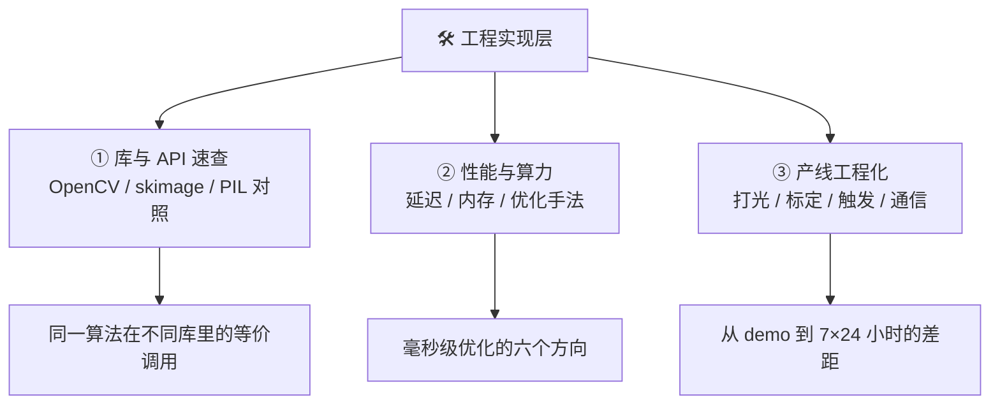
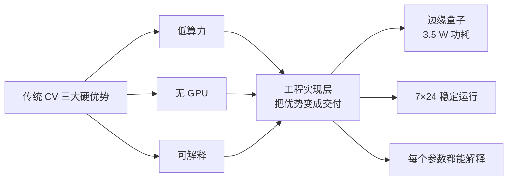

# 🛠 工程实现层

> **一句话**：章体系教你「算法是什么」，这一层教你**「怎么让它在一个真实项目里跑起来、跑得准、跑得快」**。
> **定位**：`⑦ 工程实现层` —— 独立于六大算法分支之外的第 7 条线，它**横跨所有分支**，是「从会算法到能交付」之间的那道墙。

---

## 为什么需要独立一层

章毓晋体系是**纯理论骨架**——它告诉你「Canny 的最优检测准则是什么」，但不会告诉你：

- `cv2.Canny` 的 `apertureSize` 到底该设 3 还是 5？
- 同一个算法，为什么在 OpenCV 上 30 ms，在自家嵌入式上要 800 ms？
- 产线要 7×24 小时跑，程序怎么保证不「内存泄漏 + 慢慢变慢」？
- 相机触发和算法处理怎么同步？

**这些全是「章体系不管、但项目没了它就不成立」的问题。** 传统 CV 相比深度学习最硬的优势就是**低算力、无 GPU、可在边缘设备运行**——而要把这个优势变现，全靠这一层。

---

## 这一层包含什么

| 页面 | 回答什么问题 |
|---|---|
| [**① 库与 API 速查**](/branches/engineering/opencv-api) | 同一个操作，OpenCV / scikit-image / PIL / Matlab 分别怎么写？ |
| [**② 性能与算力**](/branches/engineering/performance) | 慢在哪？怎么优化？嵌入式到底跑不跑得动？ |
| [**③ 产线工程化**](/branches/engineering/pipeline) | 打光、标定、触发、通信、稳定性——真实产线的全部要素 |

---

## 与传统 CV 优势的关系

::: tip 这一层和深度学习的正面竞争
**深度学习不是「更准」就能赢的。** 在「200 元边缘盒子 / 3.5 W 功耗 / 50 张样本 / 必须说明为什么报警」这四个约束同时成立时，传统 CV 至今仍是最优解。这一层就是把这件事讲透。
:::

---

## 三份配套材料

| 你想了解 | 去哪 |
|---|---|
| **真实功耗与延迟实测** | [嵌入式边缘部署案例](/cases/edge-deployment) |
| **工业产线真实落地** | [工业缺陷检测案例](/cases/industrial-defect) |
| **算法本身的工程细节** | 各算法档案的「源码走读 + 踩坑 + 调参」页，如 [Canny 源码](/algorithms/canny/source) |

---

## 一句话总结这一层

> **算法决定「能不能做」，工程决定「能不能用」。** 传统 CV 项目里，工程投入通常占 70%，算法只占 30%——这一层就是那 70%。
