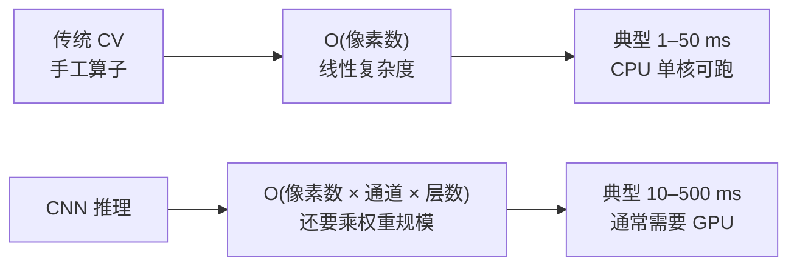
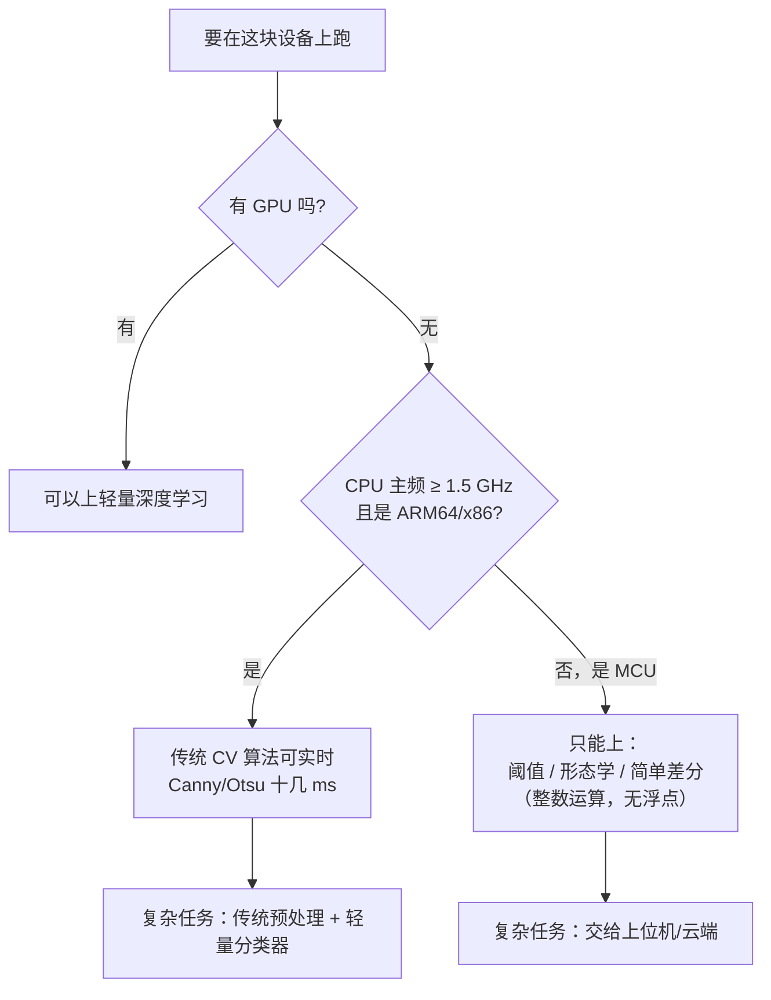

# 性能与算力

> **一句话**：搞清楚**「慢在哪、快多少、能不能塞进那块边缘盒子」**——传统 CV 最硬的优势就在这张表里。

---

## 为什么传统 CV 敢叫「低算力」



**核心差别**：传统算子是**固定的小核卷积 + 简单算术**，没有权重矩阵，没有几十亿次乘加。**它是「线性且常数小」的**，这正是它能在 MCU / 树莓派 / 低功耗盒子上跑的根本原因。

---

## 一张表看懂量级差异

| 任务 | 传统 CV 方案 | 典型耗时（CPU 单核，1280×960） | 深度学习方案 | 典型耗时（无 GPU） |
|---|---|---|---|---|
| 边缘检测 | Canny | **3–10 ms** | 边缘检测网络 | 150–600 ms |
| 阈值分割 | Otsu | **1–3 ms** | 语义分割网 | 300 ms–2 s |
| 人脸检测 | Viola-Jones | **20–50 ms** | 轻量 CNN 检测器 | 80–300 ms |
| 行人检测 | HOG+SVM | **80–250 ms** | YOLO nano | 150–400 ms |
| 特征匹配 | ORB | **10–30 ms** | SuperPoint | 100 ms+ |
| 完整产线检测 | 阈值+形态+轮廓 | **15–40 ms** | — | — |

> ⚠️ **上表是量级参考**，不是精确基准。同一算法在不同硬件、不同图像尺寸下差异可达一个数量级。真实数据请以你自己平台的实测为准，参见 [嵌入式部署案例](/cases/edge-deployment)。

---

## 性能的「六个优化方向」

### ① 分辨率：最有效的一招

**把输入图缩小，耗时几乎按面积平方下降。**

```python
import cv2
# 1280×960 → 640×480，像素数降到 1/4，耗时通常也降到 1/4 左右
small = cv2.resize(img, (640, 480), interpolation=cv2.INTER_AREA)
# 在小图上检测，再把坐标 ×2 映射回原图
```

**代价**：小目标的检测能力下降。**判据**：目标在缩小后至少还有 10–15 个像素宽。

### ② ROI：只算该算的地方

```python
# 不要对整幅图跑算法，先裁出感兴趣区域
roi = img[y1:y2, x1:x2]
result = cv2.Canny(roi, 50, 150)
```

产线上目标位置通常固定 —— **只处理 ROI 能带来 3–10 倍提升**。

### ③ 色彩空间：灰度永远最快

```python
gray = cv2.cvtColor(img, cv2.COLOR_BGR2GRAY)   # 3 通道 → 1 通道
# 绝大多数算子只需要灰度；颜色只在必须时用（HSV 用于颜色分选）
```

### ④ 数据类型：`uint8` vs `float64`

```python
# ❌ 慢：Python 默认 float64，内存 8 倍，SIMD 也用不上
x = np.array(img, dtype=np.float64)

# ✅ 快：uint8 是 OpenCV 的原生类型，直接走 SIMD
x = img.astype(np.uint8)
```

::: warning 最隐蔽的性能陷阱
**只写 `cv2.Sobel(img, -1, 1, 0)` 会溢出**——梯度有正有负，`uint8` 存不下。正确写法是 `cv2.CV_32F` 或 `cv2.CV_64F` 再转回。**为了快而用错类型，结果是数据全错。**
:::

### ⑤ 算法替换：更快的等价方案

| 慢的 | 快的替代 | 速度比 | 代价 |
|---|---|---|---|
| SIFT | ORB | **5–10×** | 精度略降，但对多数任务够用 |
| 暴力匹配 BF | FLANN | **3–10×** | 近似结果，可能漏掉极少数最优匹配 |
| 全图滑窗检测 | 金字塔 + ROI + 级联 | **10×+** | 需要合理的先验 |
| `cv2.GrabCut` | 阈值 + 形态学 | **50×+** | 质量下降，但产线大多够用 |
| Python 循环 | NumPy 向量化 | **10–100×** | 代码可读性略降 |

### ⑥ 并行：最后的手段

```python
# 多相机/多工位场景可以多进程并行
from multiprocessing import Pool
with Pool(4) as p:
    results = p.map(process_one, image_list)
```

**注意**：OpenCV 自身已经开了多线程（`cv2.setNumThreads`），**在嵌入式单核上反而要把它关掉**，否则线程调度开销会拖慢整体。

```python
cv2.setNumThreads(1)   # 单核嵌入式上设为 1，避免线程切换开销
```

---

## 内存：比速度更容易被忽视

| 问题 | 症状 | 解法 |
|---|---|---|
| **内存泄漏** | 跑几小时后内存持续上涨、最后崩 | 检查循环内是否反复创建大对象；C++ 里注意 `Mat` 引用计数 |
| **大图驻留** | 多路相机时 OOM | 处理完立刻 `del`；不要同时缓存多路原图 |
| **临时对象过多** | GC 抖动、帧率不稳 | 复用缓冲区，`cv2.copyTo` 代替反复分配 |

::: tip 嵌入式上的一条铁律
**尽量在初始化阶段把缓冲区全部分配好**，运行阶段只做填充和计算。**动态分配是嵌入式实时性最大的敌人**——一次 `malloc` 卡 20 ms，产线就漏一个产品。
:::

---

## 一张「选型决策图」



---

## 实测方法（别靠猜）

```python
import time
import cv2

def bench(func, n=100, warmup=10):
    for _ in range(warmup):          # 预热，让缓存和线程池就绪
        func()
    t0 = time.perf_counter()
    for _ in range(n):
        func()
    return (time.perf_counter() - t0) / n * 1000   # 毫秒

img = cv2.imread('test.jpg', 0)
print('Canny      :', bench(lambda: cv2.Canny(img, 50, 150)), 'ms')
print('Otsu       :', bench(lambda: cv2.threshold(img, 0, 255,
                          cv2.THRESH_BINARY + cv2.THRESH_OTSU)), 'ms')
print('GaussianBlur:', bench(lambda: cv2.GaussianBlur(img, (5, 5), 1.2)), 'ms')
```

::: warning 三条测量纪律
1. **必须预热**——第一次调用往往慢好几倍（线程池、缓存、库初始化）。
2. **测最坏情况**——用最大尺寸的图、最多的目标。
3. **在目标设备上测**——PC 上的 5 ms，在 ARM 上可能是 80 ms。
:::

---

## 相关页面

- 🛠 [库与 API 速查](/branches/engineering/opencv-api)
- 🏭 [产线工程化](/branches/engineering/pipeline)
- 🚀 [嵌入式边缘部署（3.5 W 实测）](/cases/edge-deployment)
- 📄 [Canny 源码走读与性能](/algorithms/canny/source)
