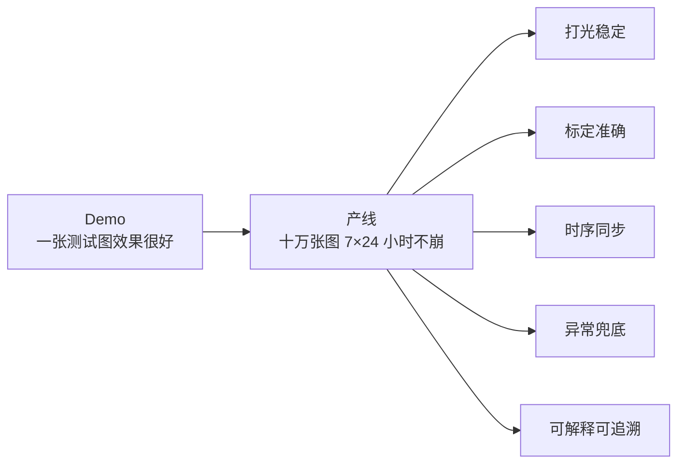
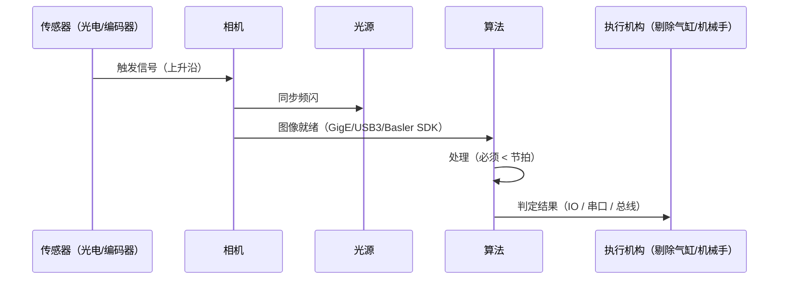

# 产线工程化

> **一句话**：从一个「跑得通的 demo」到一个「7×24 小时不出错的产品」，中间隔着的全部东西。

---

## demo 与产线的距离



::: tip 一个残酷的比例
**传统 CV 项目里，算法开发通常只占 30% 工作量**，剩下 70% 全在「打光、标定、触发、通信、异常处理、日志、现场调试」。这一页讲的就是那 70%。
:::

---

## ① 打光：一半的成功在镜头之前

**这是最重要、最被低估的一环。** 打光不对，再好的算法也救不回来；打光对了，阈值分割就能搞定 80% 的检测。

| 打光方式 | 效果 | 适合检测什么 |
|---|---|---|
| **环形光（明场）** | 均匀照亮，表面细节清楚 | 表面印刷、字符、颜色分选 |
| **同轴光** | 只反射垂直方向的平面光 | **镜面/金属表面划痕、平整度** |
| **背光（透射）** | 物体变剪影，背景全白 | **尺寸测量、轮廓提取、异物** |
| **低角度暗场** | 只让凸起/划痕「亮起来」 | **划痕、凹凸、脏污** |
| **条形光（多角度）** | 定向打光，突出特定方向特征 | 拉丝方向、螺纹 |
| **穹顶光** | 全方向漫射，无色差阴影 | 高反光曲面（球形件） |
| **频闪 + 可编程光源** | 一台设备多种打光 | 多缺陷同时检测 |

::: tip 记住这条优先级
**遇到检测难题，第一反应是「改打光」，第二反应是「改镜头/景深」，第三才是「改算法」。** 顺序反了的项目，往往陷入无止境的调参泥潭。
:::

```python
# 内部参考：如果必须用算法补打光不足，「分块 + 背景归一化」是最有效的
import cv2
import numpy as np

def flatten_illumination(gray, ksize=51):
    """用大核模糊估计「照明背景」，相除得到光照均匀化的图。"""
    bg = cv2.GaussianBlur(gray, (ksize, ksize), 0)
    norm = cv2.divide(gray, bg, scale=128)   # 注意 bg 不能为 0
    return norm
```

---

## ② 标定：把像素换算成毫米

**没标定，一切测量都是「像素」，没有物理意义。**

| 标定类型 | 解决什么 | 怎么做 |
|---|---|---|
| **像素当量标定** | 1 像素 = 多少 mm | 拍标准量块/标尺，算比例 |
| **畸变标定** | 镜头边缘的桶形/枕形畸变 | 棋盘格 + `cv2.calibrateCamera` |
| **相机-机器人手眼标定** | 相机坐标 ↔ 机械手坐标 | 九点标定 / 手眼标定 |
| **多相机标定** | 多个工位的坐标统一 | 共同标定靶 |

```python
# 像素当量的最小实现：拍一枚已知尺寸的标准件
import cv2
import numpy as np

img = cv2.imread('calib_block.jpg', 0)
_, bw = cv2.threshold(img, 0, 255, cv2.THRESH_BINARY + cv2.THRESH_OTSU)
cnts, _ = cv2.findContours(bw, cv2.RETR_EXTERNAL, cv2.CHAIN_APPROX_SIMPLE)
c = max(cnts, key=cv2.contourArea)
rect = cv2.minAreaRect(c)
px_width = max(rect[1])                       # 像素宽度
mm_per_px = 20.0 / px_width                   # 已知标准件 20 mm
```

::: warning 标定不是「做一次就完了」
**温度变化、镜头松动、更换镜头、光源位置变动，都会让标定失效。** 产线要求「每个班次首件复检标定」是很常见的规矩。**标定漂移是产线上最隐蔽的精度杀手**——所有尺寸系统性偏差一点，你很难第一时间发现。
:::

---

## ③ 时序同步：相机、光源、算法、执行机构的对时



| 要点 | 说明 |
|---|---|
| **硬触发优先于软触发** | 软触发有操作系统调度延迟，抖动可达几十毫秒 |
| **处理时间必须 < 节拍** | 产线 60 件/分 → 节拍 1 s → 处理必须留足余量（建议 < 60%） |
| **丢帧要能感知** | 上电计数器，帧序号不连续必须记录报警 |
| **光源和曝光同步** | 频闪光源要在曝光窗口内点亮，否则亮度不稳 |

---

## ④ 异常兜底：让程序「永不猝死」

```python
def safe_process(frame, params):
    """生产环境里，任何异常都不应该让整条线停下来。"""
    try:
        if frame is None:
            return {'ok': False, 'reason': 'camera_none'}

        # ① 输入合理性检查（亮度、尺寸）
        if frame.std() < 1.0:
            return {'ok': False, 'reason': 'image_uniform'}   # 可能是遮挡/全黑

        result = detect(frame, params)

        # ② 结果合理性检查（检出数、尺寸范围）
        if len(result['boxes']) == 0:
            return {'ok': False, 'reason': 'no_target', 'raw': result}

        return {'ok': True, 'result': result}

    except Exception as e:
        # ③ 任何异常都要记录，但不能崩
        log_error(e, frame)
        return {'ok': False, 'reason': f'exception: {e}'}
```

**必须有的兜底机制**：

| 机制 | 作用 |
|---|---|
| **心跳/看门狗** | 程序卡死时自动重启 |
| **配置热更新** | 现场调参不用停机 |
| **结果三重记录** | 图像 + 判定 + 时间戳，方便追溯 |
| **降级策略** | 算法失败时切到保守规则（如「全部标记为待复检」） |
| **NG 图留存** | 不良品图像自动存档，用于复盘与调参 |

---

## ⑤ 可解释与可追溯

传统 CV 最大的隐藏优势：**每一个判定都能说清为什么。**

```python
# 不合格判定的完整证据链
report = {
    'part_id': 'A20261024-0017',
    'timestamp': '2026-10-24T10:23:45.123+08:00',
    'results': {
        'diameter_mm': {'value': 19.87, 'spec': (19.90, 20.10), 'pass': False},
        'circularity': {'value': 0.982,  'spec': (0.990, 1.000), 'pass': False},
    },
    'evidence': {
        'raw_image':   'ng/20261024/A...0017_raw.png',
        'mask_image':  'ng/20261024/A...0017_mask.png',
        'contour_json':'ng/20261024/A...0017_contour.json',
    },
    'decision': 'NG',
    'reason': '直径偏小 0.03 mm，且圆度不足（边缘有毛刺）',
    'calib': {'mm_per_px': 0.0412, 'calib_time': '2026-10-24T08:00:12+08:00'},
}
```

**这张报告比「模型置信度 0.87」有说服力得多** —— 客户能看懂、能复现、能据此改进工艺。

---

## ⑥ 现场调试的实用手法

| 手法 | 用途 |
|---|---|
| **图像 + 中间结果叠加显示** | 一眼看出问题出在预处理、分割还是判定 |
| **参数实时滑动条**（`cv2.createTrackbar`） | 现场调阈值最快的方式 |
| **批量回放模式** | 拿历史图集离线调参，不动产线 |
| **离线复现包** | 现场图 + 参数 + 版本号打包回传，研发本地复现 |

```python
import cv2

# 现场调参神器：一个窗口拖阈值，立刻看效果
def nothing(x):
    pass

cv2.namedWindow('tune')
cv2.createTrackbar('low',  'tune', 50,  255, nothing)
cv2.createTrackbar('high', 'tune', 150, 255, nothing)

while True:
    lo = cv2.getTrackbarPos('low', 'tune')
    hi = max(lo + 1, cv2.getTrackbarPos('high', 'tune'))
    edges = cv2.Canny(gray, lo, hi)
    cv2.imshow('tune', edges)
    if cv2.waitKey(30) == 27:      # ESC 退出
        break
```

---

## 交付检查清单

- [ ] 打光方案已固化（型号、位置、亮度写进文档）
- [ ] 标定流程与复检周期已书面化
- [ ] 硬触发 + 帧序号监控已实现
- [ ] 处理时间 < 节拍 60%
- [ ] 异常兜底：任何情况下程序不崩
- [ ] 三重记录（图 + 结果 + 时间戳）已落地
- [ ] 现场调参不需停机（参数热更新）
- [ ] 版本管理：算法版本 / 参数版本 / 库版本三者绑定
- [ ] NG 图留存与复盘机制

---

## 相关页面

- 🛠 [库与 API 速查](/branches/engineering/opencv-api)
- ⚡ [性能与算力](/branches/engineering/performance)
- 🏭 [工业缺陷检测案例](/cases/industrial-defect)
- 🚀 [嵌入式边缘部署案例](/cases/edge-deployment)
- 🎯 [场景反查入口](/scenarios/)
