# 斑点与特征点

> **一句话**：从「一个坐标」升级到「坐标 + 尺度 + 方向 + 描述子」——这才是能跨图像匹配的完整特征。

## 从角点到完整特征

**角点的问题**：

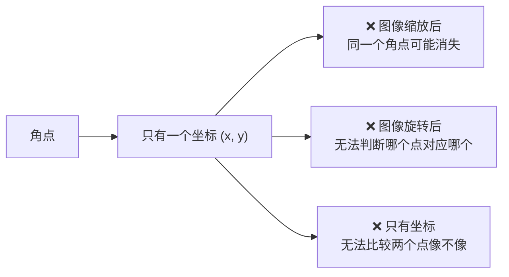

**完整特征需要四样东西**：

| 要素 | 作用 |
|---|---|
| **位置 (x, y)** | 在哪 |
| **尺度 σ** | 多大（跨尺度匹配的关键） |
| **方向 θ** | 朝向（跨旋转匹配的关键） |
| **描述子** | 一个向量，描述该点周围长什么样 |

## ① 斑点检测（Blob Detection）

### 什么是斑点

**斑点 = 一块区域跟周围有差异**。

**生活比方**：白墙上的一个墨点——它不是"点"，而是**有面积的异常区域**。

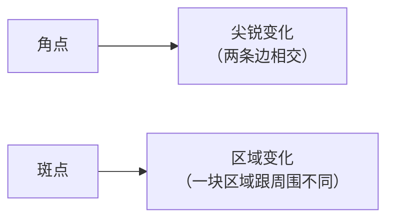

### 为什么斑点比角点好

| 对比 | 角点 | 斑点 |
|---|---|---|
| 尺度适应 | ❌ 固定窗口 | ✅ **多尺度检测** |
| 定位精度 | 高 | 中 |
| 抗噪 | 中 | **好**（区域平均） |
| 尺度不变性 | ❌ | ✅ **有** |

### LoG（Laplacian of Gaussian）

**顺序**：先高斯平滑（去噪），再 Laplacian（找变化）。

**关键洞察**：**改变 sigma，LoG 对不同尺寸的斑点响应最强**。

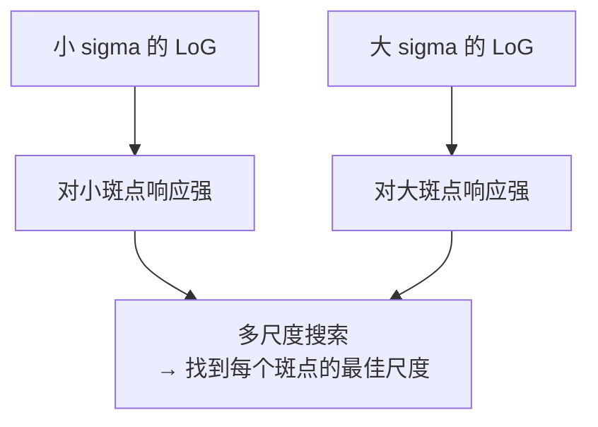

**这就是「尺度空间」概念的起源**！

::: tip 尺度空间的直观理解
**同一个物体，在不同距离看，尺度不同**。

- 远处的树 → 图像上很小
- 近处的树 → 图像上很大

如果要匹配"同一棵树"，必须**在所有尺度上都检测**，然后跨尺度匹配。

**LoG 提供了"某个尺度上的斑点响应"**，把所有尺度的响应叠起来就是**尺度空间**。
:::

### DoG（Difference of Gaussians）

**问题**：LoG 计算量太大（两个方向求导）。

**解法**：**用两个高斯模糊相减近似 LoG**。

$$ \text{DoG} = G(k\sigma) * I - G(\sigma) * I $$

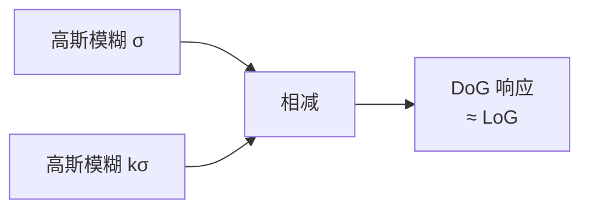

**加速倍数**：约 **3–5 倍**（LoG 要二阶导，DoG 只要两次高斯模糊，且高斯可分离）。

::: tip 为什么 DoG 能近似 LoG
数学上可以证明：

$$ G(k\sigma) - G(\sigma) \approx (k-1)\sigma^2 \nabla^2 G $$

右边的 $\nabla^2 G$ 正是 LoG。所以 DoG 是 LoG 的**尺度归一化近似**。

**这个近似是 SIFT 得以实用的关键**。
:::

### SIFT 中的尺度空间

**SIFT 构建一个「高斯金字塔 + DoG 金字塔」**：

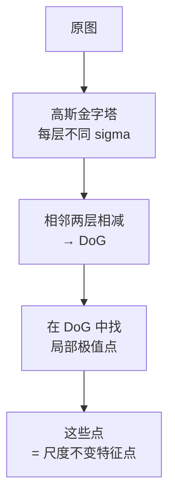

**关键**：极值不仅要在**空间上**（同层 3×3）比较，还要在**尺度上**（上下两层）比较。

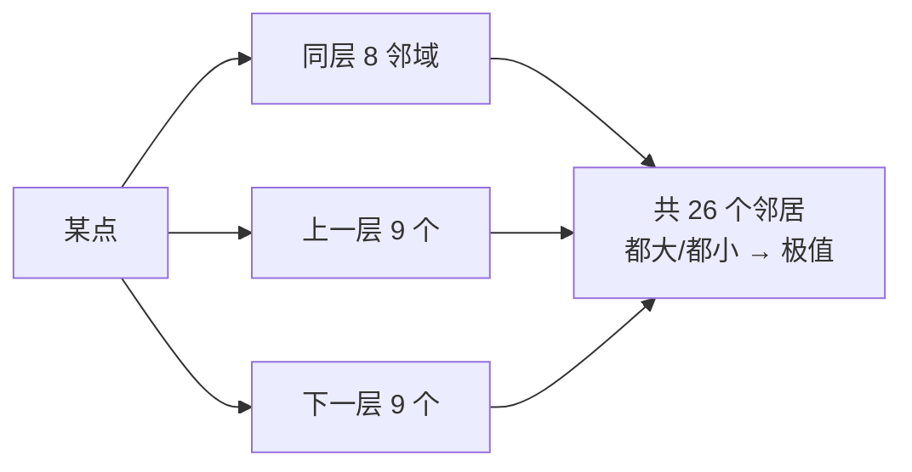

**这就是「26 邻域极值检测」**——SIFT 找特征点的核心步骤。

详见 [SIFT 算法流程](/algorithms/sift/architecture)。

### 其他斑点检测器

| 方法 | 特点 |
|---|---|
| LoG | 精度高，慢 |
| DoG | **LoG 快速近似，SIFT 核心** |
| DoH（Hessian） | 用 Hessian 行列式，**SURF 核心** |
| MSER | **最大稳定极值区域**，对仿射变换鲁棒 |
| SimpleBlobDetector | OpenCV 提供的简易版本 |

### SimpleBlobDetector（实用工具）

```python
params = cv2.SimpleBlobDetector_Params()

# 按颜色
params.filterByColor = True
params.blobColor = 0        # 0=黑斑点, 255=白斑点

# 按面积
params.filterByArea = True
params.minArea = 20
params.maxArea = 5000

# 按圆度（0=不圆, 1=正圆）
params.filterByCircularity = True
params.minCircularity = 0.7

# 按凸性
params.filterByConvexity = True
params.minConvexity = 0.8

# 按惯性比（区分线和圆）
params.filterByInertia = True
params.minInertiaRatio = 0.5

detector = cv2.SimpleBlobDetector_create(params)
keypoints = detector.detect(gray)
```

**用途**：**工业里的圆点/孔洞检测**（电路板焊盘、细胞、标记点）。

## ② 完整局部特征

### SIFT 的四个步骤

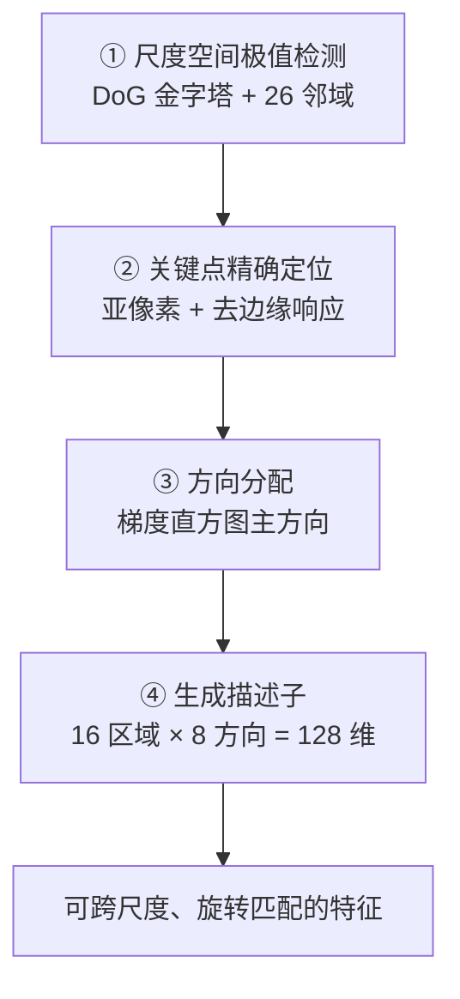

### 步骤 ②：关键点精确定位

**两个精化动作**：

| 精化 | 目的 |
|---|---|
| **亚像素插值**（用泰勒展开） | 把位置精度提高到亚像素 |
| **去除边缘响应** | DoG 在边缘上也有强响应，要去掉 |

**去除边缘响应的判据**（用 Hessian 矩阵）：

$$ \frac{\text{trace}(H)^2}{\det(H)} < \frac{(r+1)^2}{r} $$

`r = 10`（论文取 10，表示主曲率比不能超过 10）。

**为什么需要**：如果不做这步，**大量边缘上的点会成为"特征点"**，它们沿边缘方向不稳定（滑动问题）。

### 步骤 ③：方向分配

**做法**：在以关键点为中心的邻域里，统计**梯度方向直方图**（36 个 bin，每 10 度一个），取**峰值方向**为主方向。

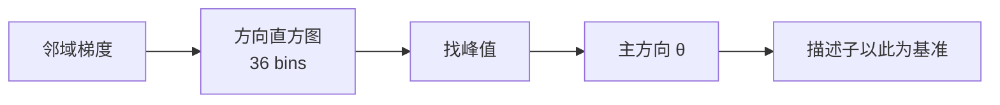

**效果**：**旋转不变性**。不管图像怎么旋转，都按"相对主方向"描述。

**副产品**：如果一个位置有多个峰值（相差 > 80% 的次峰），会产生**多个特征点**（同位置，不同方向）。所以 SIFT 的特征点数量会比检测到的极值点多。

### 步骤 ④：生成描述子

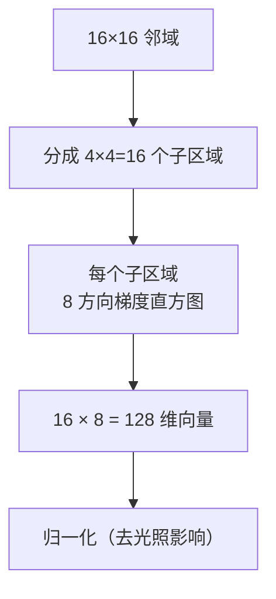

**关键设计**：

| 设计 | 作用 |
|---|---|
| 16×16 邻域 | 包含足够的上下文 |
| 4×4 子区域 | 保留空间结构 |
| 每个子区域 8 方向 | 保留方向信息 |
| **三线性插值** | 让描述子对位置微小偏移鲁棒 |
| **归一化 + 截断（0.2）** | 对光照变化鲁棒 |

::: tip 128 维是怎么来的
$$ 4 \times 4 \text{ (子区域)} \times 8 \text{ (方向)} = 128 $$

**这个数字成了经典**。后来很多描述子都沿用（或对比）这个维度。
:::

### SURF（SIFT 的加速版）

**三个加速技巧**：

| 技巧 | 说明 |
|---|---|
| **积分图** | 算矩形区域和 O(1) |
| **盒式滤波器近似** | 用简单矩形滤波近似高斯二阶导 |
| **Hessian 检测器** | 用 DoH 而非 DoG |

**速度**：比 SIFT **快 3–5 倍**。精度略低。

**专利**：曾有专利，**2020 年已过期**。

### ORB（工程首选）

**构成**：

```
ORB = oFAST（带方向的 FAST） + rBRIEF（旋转后的 BRIEF）
```

**oFAST**：用**灰度质心法**给 FAST 角点加方向。

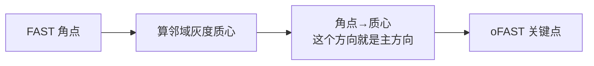

**rBRIEF**：BRIEF 描述子是"随机取若干点对，比较大小"生成的二进制串。旋转图像后这些点对的位置要跟着旋转 → **rBRIEF**。

| 对比 | SIFT | ORB |
|---|---|---|
| 检测 | DoG（慢） | FAST（**极快**） |
| 描述子 | 128 维浮点 | **256 位二进制** |
| 匹配距离 | 欧氏 | **汉明**（异或 + 数 1） |
| 单帧耗时 | ~200 ms | **~5 ms** |
| 精度 | 高 | 中 |
| 专利 | 已过期 | **无** |

**匹配速度**：汉明距离可以用 **CPU 的 POPCNT 指令**一条指令算 64 位，快几个数量级。

```python
orb = cv2.ORB_create(
    nfeatures=500,        # 最多返回几个
    scaleFactor=1.2,      # 金字塔缩放因子
    nlevels=8,            # 金字塔层数
    edgeThreshold=31,     # 边界忽略区
    firstLevel=0,
    WTA_K=2,              # BRIEF 取点数
    scoreType=cv2.ORB_HARRIS_SCORE,
    patchSize=31,
    fastThreshold=20
)
kp, des = orb.detectAndCompute(gray, None)
```

## 特征点检测器总对比

| 检测器 | 年份 | 尺度不变 | 旋转不变 | 描述子 | 速度 | 专利 | 现状 |
|---|---|---|---|---|---|---|---|
| Harris | 1988 | ❌ | 部分 | 无 | 中 | 无 | 教学 |
| SIFT | 1999 | ✅ | ✅ | 128 维 | 慢 | 已过期 | **精度标杆** |
| SURF | 2006 | ✅ | ✅ | 64/128 维 | 中 | 已过期 | 备选 |
| FAST | 2006 | ❌ | ❌ | 无 | 极快 | 无 | 配合 BRIEF |
| BRISK | 2011 | ✅ | ✅ | 512 位 | 快 | 无 | 备选 |
| **ORB** | 2011 | ✅ | ✅ | 256 位 | **极快** | 无 | **工业首选** |
| AKAZE | 2013 | ✅ | ✅ | 486 位 | 中 | 无 | 非线性尺度 |
| KAZE | 2012 | ✅ | ✅ | — | 慢 | 无 | 非线性扩散 |

## 选型决策

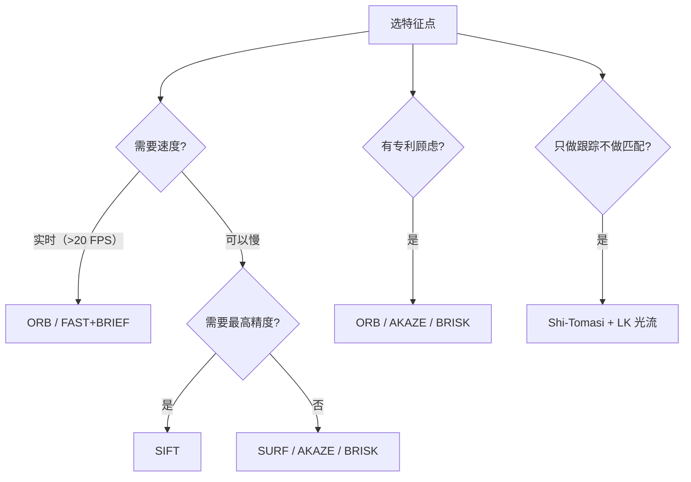

## 参数速查

### SIFT

| 参数 | 默认 | 说明 |
|---|---|---|
| `nfeatures` | 0（不限） | 最多返回几个 |
| `nOctaveLayers` | 3 | 每层的层数 |
| `contrastThreshold` | 0.04 | 过滤低对比度点（↑减少噪声点） |
| `edgeThreshold` | 10 | 去边缘响应 |
| `sigma` | 1.6 | 初始高斯模糊 |

```python
sift = cv2.SIFT_create(nfeatures=1000, contrastThreshold=0.04, edgeThreshold=10)
```

### ORB

| 参数 | 默认 | 说明 |
|---|---|---|
| `nfeatures` | 500 | 最多返回几个 |
| `scaleFactor` | 1.2 | 金字塔缩放 |
| `nlevels` | 8 | 金字塔层数 |
| `fastThreshold` | 20 | FAST 阈值（↓更多点） |

### AKAZE

```python
akaze = cv2.AKAZE_create()
kp, des = akaze.detectAndCompute(gray, None)
```

## 常见踩坑

::: danger 坑 1：SIFT 特征点集中在纹理区
**现象**：纹理丰富的墙上有 800 个点，天空只有 3 个。

**根因**：SIFT 的极值响应在纹理区更强。

**解决**：
- 用 `nfeatures` 限制总数（但仍是纹理区优先）
- **手动做网格配额**（每块最多 N 个点）
- **接受这个现实**：纹理少的区域本来就缺少可区分特征
:::

::: danger 坑 2：`contrastThreshold` 太低
**现象**：检测出大量"特征点"，但都在平坦区，匹配效果差。

**根因**：低对比度区域的极值点往往不稳定。

**解决**：提高 `contrastThreshold` 到 **0.04–0.06**。

| 值 | 效果 |
|---|---|
| 0.01 | 点很多，但噪声点也多 |
| **0.04** | **默认，推荐** |
| 0.08 | 点很少，但都是稳健点 |
:::

::: danger 坑 3：ORB 匹配效果差
**现象**：ORB 特征点够多，但匹配内点率很低。

**可能原因与解决**：

| 原因 | 解决 |
|---|---|
| 用了欧氏距离而非汉明距离 | **必须用 `NORM_HAMMING`** |
| 用了 FLANN 的 KDTree | ORB 要用 **LSH** 或直接 BF |
| `WTA_K` 设置与距离度量不匹配 | `WTA_K=2` 用 Hamming；`WTA_K=3/4` 用 Hamming2 |
| `fastThreshold` 太高 | 降到 10–20 |
:::

::: danger 坑 4：以为特征点越多越好
**现象**：设了 5000 个点，匹配变慢且误匹配增多。

**真相**：**匹配复杂度是 O(N×M)**。点数翻倍，匹配时间 4 倍。

**且**：增加的点往往是质量较低的（响应值低），会带来更多误匹配。

**建议**：

| 场景 | 特征点数 |
|---|---|
| 实时 SLAM | 300–800 |
| 全景拼接 | 1000–2000 |
| 离线高精度 | 2000–5000 |
:::

::: danger 坑 5：在文本/条形码上提特征
**现象**：特征点全在文字上，或者根本没点。

**根因**：
- 文字区域特征密集但**重复性高**（很多个"e"长得一样）→ 误匹配
- 条码区域是**重复条纹** → 匹配极不稳定

**解决**：避开这些区域，或用**全局方法**（模板匹配 / 边缘轮廓）替代。
:::

::: danger 坑 6：忘了 `detectAndCompute` 的 mask
**现象**：想在特定区域提特征，结果全图都提了。

**解决**：`detectAndCompute(img, mask)` 第二个参数是掩膜（非零区域才检测）。

```python
mask = np.zeros(gray.shape, np.uint8)
mask[100:400, 200:600] = 255      # 只在 ROI 里检测
kp, des = sift.detectAndCompute(gray, mask)
```
:::

## 与深度学习的衔接

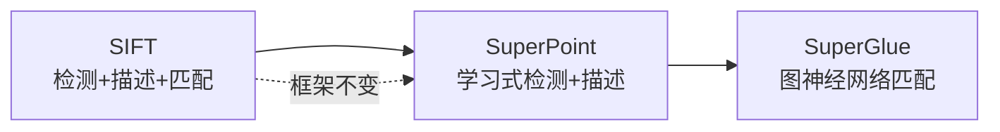

| 传统步骤 | 学习式替代 |
|---|---|
| DoG 极值检测 | SuperPoint 的检测头 |
| 128 维 SIFT 描述子 | 256 维学习描述子 |
| 最近邻匹配 | SuperGlue（注意力机制） |
| Lowe 比值筛选 | 可微分匹配 |
| RANSAC | **仍用 RANSAC** |

::: tip 一个关键观察
**Pipeline 的每一步在传统 CV 里都被研究透了**。深度学习只是把"手工规则"换成"学习参数"。

**这就是为什么学完 SIFT，再看 SuperPoint 会觉得「本来就是同一件事」**。

详见 [传承脉络](/legacy/)。
:::

## 相关链接

- [角点检测](/branches/feature-detection/corners)
- [边缘检测](/branches/feature-detection/edges)
- [SIFT 完整档案](/algorithms/sift/)
- [③ 特征匹配分支](/branches/feature-matching/)
- [返回特征检测分支](/branches/feature-detection/)
