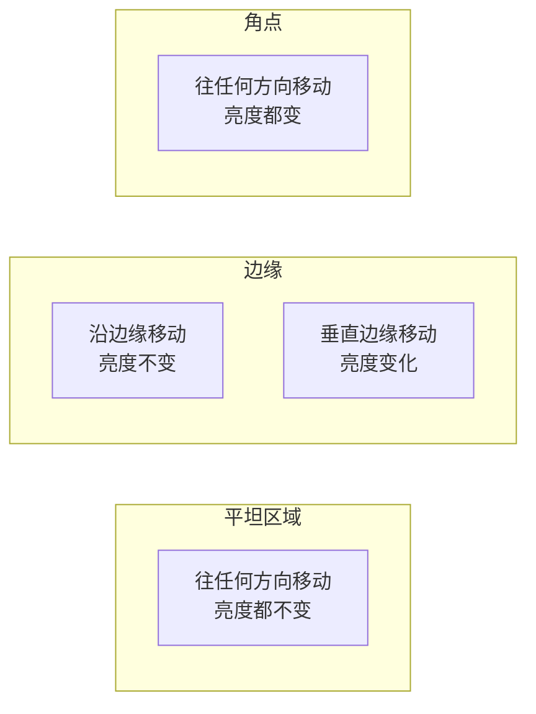
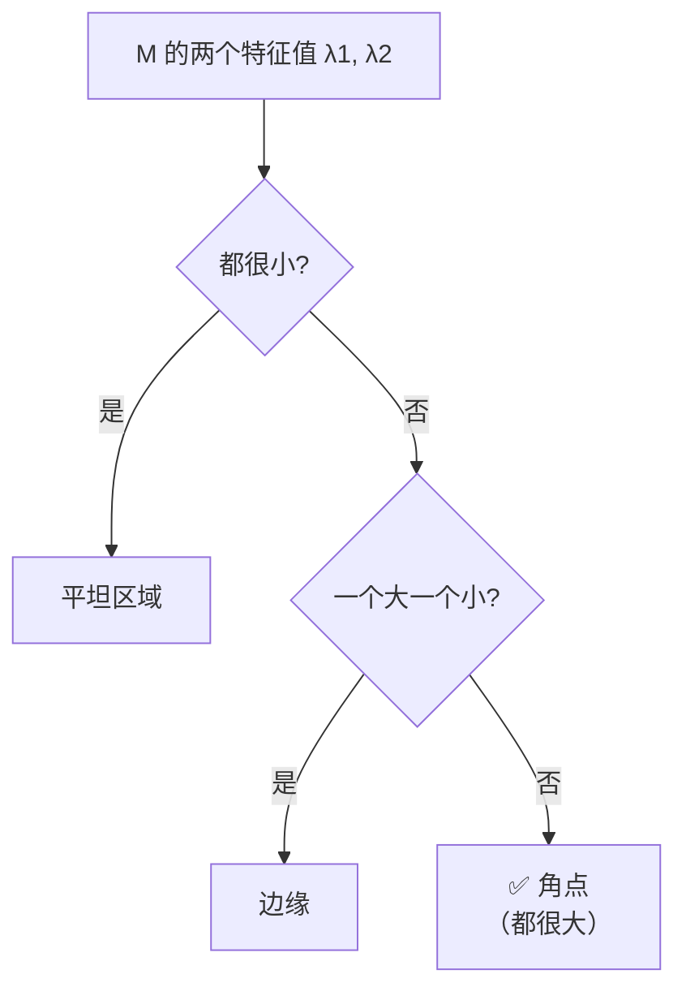
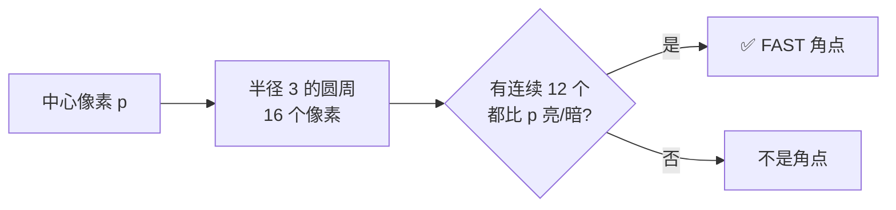
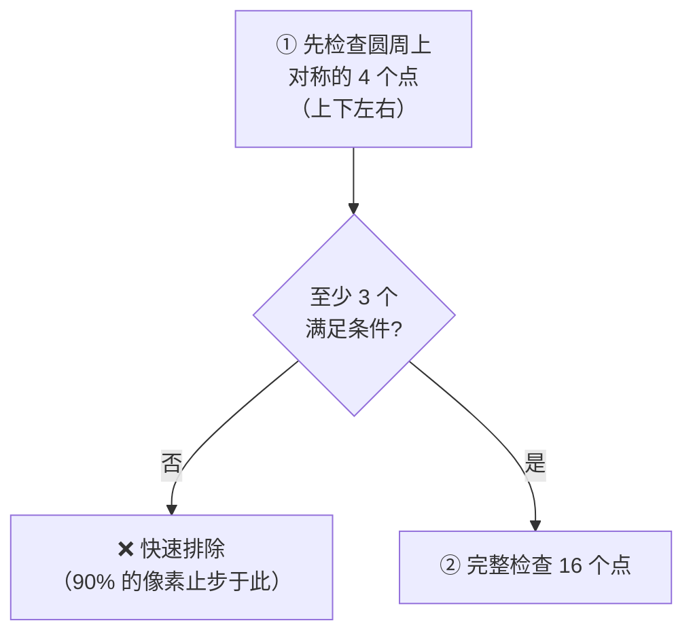
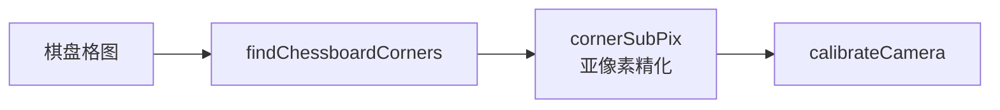
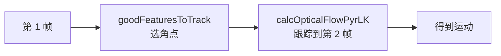
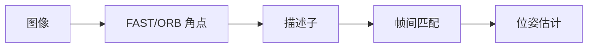

# 角点检测

> **一句话**：找出图像里「往任何方向移动都会变」的位置——那种四面都卡住的点。

## 什么是角点

**角点 = 两个方向都有明显亮度变化的位置**。



**生活比方**：手指按在桌上试：

| 位置 | 感觉 | 对应 |
|---|---|---|
| 桌面中间 | 四面都能滑 | 平坦区域 |
| 桌边 | 只能沿桌边滑 | 边缘 |
| **桌角** | **四面都卡住** | **角点** |

## 为什么角点是好特征

| 性质 | 说明 |
|---|---|
| **唯一性** | 能精确定位（不像边缘只能定一条线） |
| **稳定性** | 对光照变化不敏感（只关心"有没有变化"，不关心"变化多少"） |
| **可重复性** | 换角度看，还是角点 |

**这是「特征点」概念的核心**：**能唯一确定一个位置的点**。

## ① Harris 角点检测（1988）

### 核心思想

在图像上取一个小窗口，往**各个方向**移动一点，看窗口内亮度变化多少。

- 所有方向变化都小 → 平坦区域
- 只有一个方向变化大 → 边缘
- **所有方向变化都大 → 角点**

### 数学框架

**窗口移动 $(u, v)$ 后的亮度变化**：

$$ E(u, v) = \sum_{x,y} w(x,y) \left[ I(x+u, y+v) - I(x,y) \right]^2 $$

**泰勒展开后**：

$$ E(u, v) \approx \begin{bmatrix} u & v \end{bmatrix} M \begin{bmatrix} u \\ v \end{bmatrix} $$

其中 **M 是自相关矩阵**：

$$ M = \sum_{x,y} w(x,y) \begin{bmatrix} I_x^2 & I_x I_y \\ I_x I_y & I_y^2 \end{bmatrix} $$

**关键**：**M 的两个特征值决定了这个点的性质**。

### 特征值判据（最重要的理解）



| λ₁, λ₂ | 判定 | 图示 |
|---|---|---|
| 都小 | 平坦区域 | 无方向偏好 |
| 一大一小 | 边缘 | 一个方向变化，一个不变 |
| **都大** | **角点** | 所有方向都变化 |

**直觉**：特征值代表两个正交方向上的"变化强度"。

- 边缘：只有一个方向强 → 一个特征值大
- 角点：两个方向都强 → 两个特征值都大

### Harris 响应函数

**不用真的算特征值**（很慢），用行列式和迹代替：

$$ R = \det(M) - k \cdot \text{trace}(M)^2 = \lambda_1\lambda_2 - k(\lambda_1 + \lambda_2)^2 $$

| 符号 | 含义 |
|---|---|
| `det(M)` = λ₁·λ₂ | 特征值之积 |
| `trace(M)` = λ₁+λ₂ | 特征值之和 |
| `k` | 经验常数，**0.04–0.06** |

**判定规则**：

| R 值 | 判定 |
|---|---|
| R 大（正） | **角点** |
| R 负（绝对值大） | 边缘 |
| \|R\| 小 | 平坦 |

```python
# OpenCV 的 Harris
dst = cv2.cornerHarris(gray, blockSize=2, ksize=3, k=0.04)

# 阈值化
dst_norm = cv2.normalize(dst, None, 0, 255, cv2.NORM_MINMAX).astype(np.uint8)
dst_norm[dst_norm < 100] = 0     # 阈值

# 膨胀使标记更明显
kernel = np.ones((3, 3), np.uint8)
dst_norm = cv2.dilate(dst_norm, kernel)
# 在原图上标红
img[dst_norm > 100] = [0, 0, 255]
```

### 参数说明

| 参数 | 含义 | 建议 |
|---|---|---|
| `blockSize` | 邻域窗口大小 | **2–3**（越小越灵敏） |
| `ksize` | Sobel 核大小 | 3 |
| `k` | 经验常数 | **0.04** |

::: warning `blockSize` 的影响很大
| blockSize | 效果 |
|---|---|
| 2 | 检测出**很多**角点（包括噪声） |
| 3–5 | 平衡 |
| 7+ | 只检测**最显著**的角点，但可能漏 |

**通常从 2 或 3 开始**。
:::

### Harris 的局限

::: warning 三个局限
1. **不具备尺度不变性** —— 图放大 2 倍后，同一个角点可能不再是"角点"（因为窗口相对变小）
2. **不具备旋转不变性**（严格说，M 的特征值本身是旋转不变的，但**响应值排序**会变，导致选出的点不同）
3. **需要手动定阈值** —— R 的绝对值没有明确物理意义
:::

## ② Shi-Tomasi（`goodFeaturesToTrack`）

### 改进点

Harris 用 $R = \lambda_1\lambda_2 - k(\lambda_1+\lambda_2)^2$，**需要调 k**。

Shi-Tomasi 发现：直接用**较小的那个特征值**就够：

$$ R = \min(\lambda_1, \lambda_2) $$

**为什么更合理**：

- 角点的定义是"两个特征值都大"
- 用 min 正好表达"两个都要大"
- **不需要调 k**

```python
corners = cv2.goodFeaturesToTrack(
    gray,
    maxCorners=100,        # 最多返回几个角点
    qualityLevel=0.01,     # 质量阈值（相对于最好角点的比例）
    minDistance=10,        # 角点之间的最小距离
    blockSize=3,
    useHarrisDetector=False  # False 用 Shi-Tomasi
)
```

### 参数详解

| 参数 | 含义 | 建议 |
|---|---|---|
| `maxCorners` | 数量上限 | 100–1000 |
| `qualityLevel` | 质量门槛 | **0.01–0.1** |
| `minDistance` | 最小间距 | 10–20 |
| `blockSize` | 邻域大小 | 3 |

::: tip `qualityLevel` 的实际含义
**它不是绝对阈值，而是相对于最高响应值的比例**。

- `qualityLevel=0.01` → 只保留响应值 > 最高值×0.01 的点
- `qualityLevel=0.1` → 更严格，保留的点少

**这个设计很聪明**：不用知道 R 的绝对范围，只需给个比例。

**但缺点是**：如果图像里有**一个极强角点**（如高对比度的标记），它的响应值会拉高基准，导致其他角点被过滤掉。
:::

::: tip `minDistance` 是"防扎堆"的关键
**问题**：一个真实的角点周围可能有多个相邻像素都响应强 → 检测出一堆挨着的点。

**解决**：`minDistance` 保证角点之间至少隔这么多像素。

**做跟踪时，这个参数很重要**——点太密集没有额外信息，只是浪费计算。
:::

### Shi-Tomasi vs Harris 对比

| 维度 | Harris | Shi-Tomasi |
|---|---|---|
| 判据 | `det - k·trace²` | `min(λ₁, λ₂)` |
| 需调参数 | k, 阈值 | `qualityLevel`（比例） |
| 返回数量 | 需自己后处理 | **可限制 top-N** |
| 间距控制 | 无 | **有 `minDistance`** |
| 实际使用 | 教学 | **工程首选** |

::: tip 结论
**工程里基本都用 `goodFeaturesToTrack`（Shi-Tomasi）**，因为它：

- 不需要调 k
- 能直接限制数量和间距
- OpenCV 做了充分优化
:::

## ③ FAST（超快角点）

### 核心思想

**用一个"圆形邻域"判断：如果圆周上有连续 N 个像素都比中心亮（或都暗），就是角点**。



**默认参数**：半径 3，圆周 16 点，阈值 12 个连续点。

**生活比方**：站在圆圈中心看周围 16 个人，如果连续 12 个人的肤色都比你亮（或都比你暗），说明你站在"颜色突变的边界点"上。

### 为什么 FAST 这么快



**关键**：用一个**极廉价的初筛**过滤掉绝大多数非角点。

**这就是 Viola-Jones 级联思想在角点检测上的应用**！

### 使用

```python
fast = cv2.FastFeatureDetector_create(
    threshold=10,
    nonmaxSuppression=True,      # 非极大值抑制（去重叠）
    type=cv2.FAST_FEATURE_DETECTOR_TYPE_9_16
)
kp = fast.detect(gray, None)
```

| 参数 | 含义 | 建议 |
|---|---|---|
| `threshold` | 亮度差阈值 | 10–40 |
| `nonmaxSuppression` | 是否 NMS | **True** |
| `type` | 连续点数 | `9_16`（9/16）或 `5_8` |

### FAST 的局限

::: warning FAST 的三个问题
1. **不具旋转不变性** —— 图转了，检测结果可能变
2. **不具尺度不变性** —— 同 Harris
3. **特征点扎堆** —— 一个角点附近检测出一堆，**必须开 NMS**
:::

**FAST 本身不产生描述子** —— 它只给"点"，不给"描述"。所以 FAST 通常和 **BRIEF** 描述子搭配 → 就是 **ORB**。

## ④ AGAST（FAST 的加速版）

**AGAST = Adaptive and Generic Accelerated Segment Test**

**改进**：根据图像局部统计，**动态调整决策树**，让初筛更高效。

**速度**：比 FAST 快约 30%。

```python
agast = cv2.AgastFeatureDetector_create(threshold=10)
kp = agast.detect(gray, None)
```

## 四种角点检测器对比

| 维度 | Harris | Shi-Tomasi | FAST | AGAST |
|---|---|---|---|---|
| 年份 | 1988 | 1994 | 2006 | 2010 |
| 判据 | 特征值组合 | min(λ₁,λ₂) | 圆周明暗 | 自适应决策树 |
| 旋转不变 | 部分 | 部分 | ❌ | ❌ |
| 尺度不变 | ❌ | ❌ | ❌ | ❌ |
| 速度 | 中 | 中 | **极快** | **极快** |
| 描述子 | 需另配 | 需另配 | 需另配（BRIEF） | 需另配 |
| 典型用途 | 教学 | **跟踪、光流** | **实时检测** | 实时检测 |

## 亚像素精化

**需求**：角点定位精度要高于 1 像素（工业测量）。

```python
# ① 先粗定位
corners = cv2.goodFeaturesToTrack(gray, 100, 0.01, 10)

# ② 亚像素精化
criteria = (cv2.TERM_CRITERIA_EPS + cv2.TERM_CRITERIA_MAX_ITER, 40, 0.001)
corners_sub = cv2.cornerSubPix(
    gray, corners, 
    winSize=(5, 5),       # 搜索窗口
    zeroZone=(-1, -1),
    criteria=criteria
)
```

**精度**：可达 **0.1–0.3 像素**。

**原理**：在粗定位点周围，用**梯度正交性**（角点到某边缘的向量垂直于该边缘的梯度）建立方程，用最小二乘求解。

::: tip 什么时候需要亚像素
| 场景 | 需要？ |
|---|---|
| 相机标定（棋盘角点） | **必须** |
| 高精度测量 | **必须** |
| 特征匹配（做描述子） | 不需要 |
| 跟踪 | 不需要 |
:::

## 角点检测的完整应用

### 场景 1：相机标定



```python
ret, corners = cv2.findChessboardCorners(gray, (9, 6), None)
if ret:
    corners = cv2.cornerSubPix(gray, corners, (11, 11), (-1, -1), criteria)
```

### 场景 2：稀疏光流跟踪



**角点是光流的理想点**：光流假设"邻域运动一致"，而角点周围的运动最容易一致（不像边缘，沿边缘方向运动无法确定）。

### 场景 3：SLAM 前端



## 性能参考（1920×1080 灰度，CPU）

| 方法 | 耗时 | 检测点数（典型） |
|---|---|---|
| Harris | ~50 ms | 数千 |
| Shi-Tomasi | ~30 ms | 100（受 maxCorners 限制） |
| **FAST** | **~5 ms** | 数千 |
| AGAST | ~4 ms | 数千 |

## 常见踩坑

::: danger 坑 1：角点扎堆
**现象**：一个真实角点周围检测出十几个点。

**解决**：
- **`minDistance`**（Shi-Tomasi）
- **NMS**（FAST 的 `nonmaxSuppression=True`）
- 手动做网格配额（每个网格最多 N 个点）
:::

::: danger 坑 2：选到的角点分布不均
**现象**：所有角点集中在纹理丰富的一小块区域。

**根因**：`goodFeaturesToTrack` 按响应值排序取 top-N，纹理丰富区响应值高。

**解决**：

```python
# 网格配额法：把图分块，每块最多取 N 个
h, w = gray.shape
grid_h, grid_w = h // 4, w // 4
for i in range(4):
    for j in range(4):
        roi = gray[i*grid_h:(i+1)*grid_h, j*grid_w:(j+1)*grid_w]
        pts = cv2.goodFeaturesToTrack(roi, maxCorners=25, qualityLevel=0.01, minDistance=10)
        # 坐标加回全局偏移
```
:::

::: danger 坑 3：Harris 响应值是浮点，不能直接显示
**现象**：`cv2.imshow` 显示 Harris 结果一片黑。

**根因**：`cornerHarris` 输出是 `float32`，且范围不在 0–255。

**解决**：归一化再显示。

```python
dst_norm = cv2.normalize(dst, None, 0, 255, cv2.NORM_MINMAX)
dst_uint8 = dst_norm.astype(np.uint8)
```
:::

::: danger 坑 4：FAST 阈值太敏感
**现象**：`threshold=10` 时检测出海量点（包括噪声）。

**解决**：提高到 **20–40**。具体看图像对比度。
:::

::: danger 坑 5：以为角点检测有尺度不变性
**现象**：模板图和现场图尺度不同，角点匹配失败。

**真相**：**Harris / Shi-Tomasi / FAST 都不具备尺度不变性**。

**解决**：需要尺度不变时用 **SIFT / SURF / ORB**（它们在多尺度上检测），或者**自己构建图像金字塔**在每层检测。

详见 [斑点与特征点](/branches/feature-detection/blobs)。
:::

## 相关链接

- [边缘检测](/branches/feature-detection/edges)
- [斑点与特征点](/branches/feature-detection/blobs)
- [SIFT 完整档案](/algorithms/sift/)
- [③ 特征匹配分支：光流](/branches/feature-matching/)
- [返回特征检测分支](/branches/feature-detection/)
