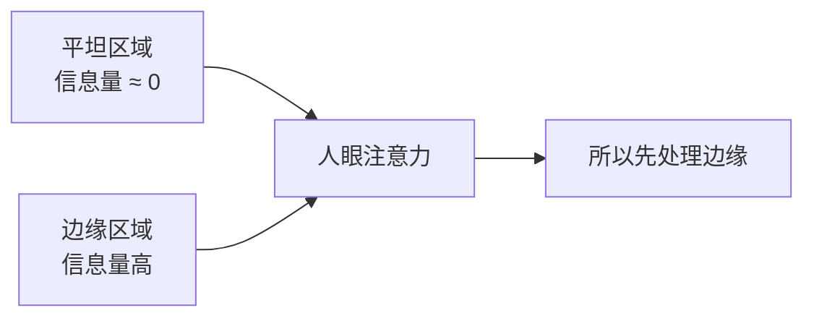
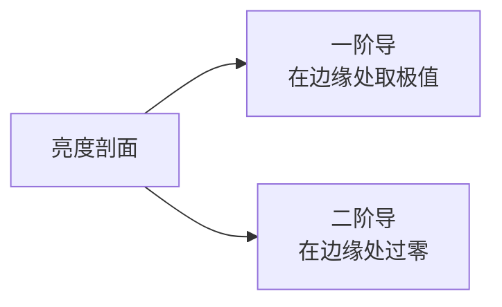
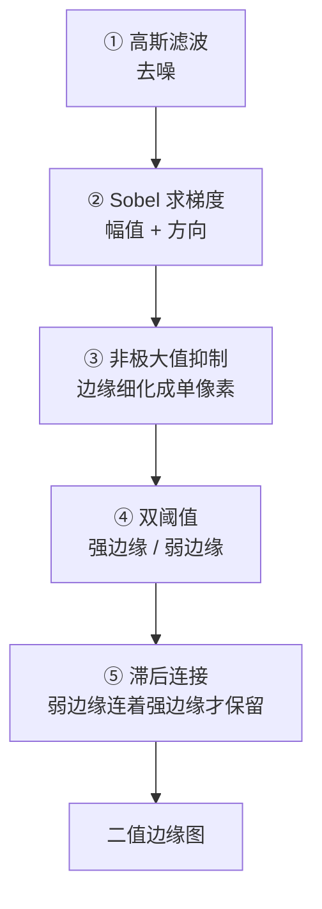
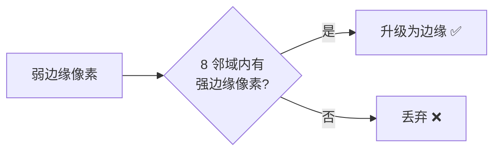
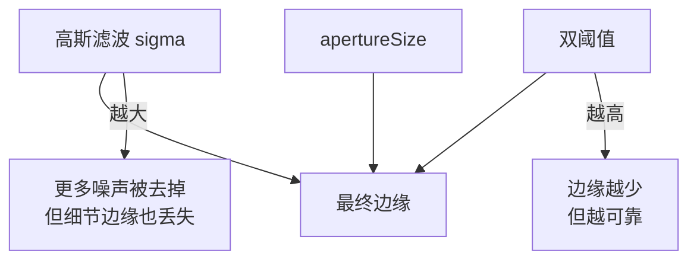
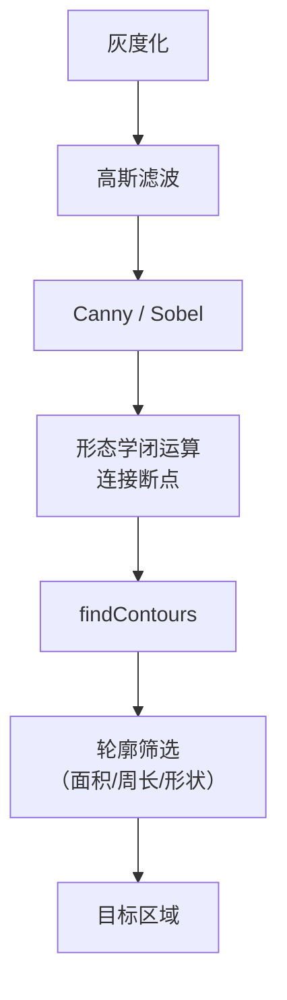

# 边缘检测

> **一句话**：找出图像里「亮度变化最剧烈」的位置。

## 为什么找边缘

**边缘 = 物体的轮廓 = 信息最集中的地方**。

从信息论角度：图像里大量像素是"平坦"的（天空、墙面、桌面），信息量几乎为零。**边缘上的像素承载了绝大部分信息**。

**生活比方**：给你一张纸画速写，你会画什么？**轮廓线**。没人会去描一个纯色区域内部。



## 边缘的数学定义

**边缘 = 亮度函数的梯度极值点**。

| 概念 | 含义 |
|---|---|
| **一阶导（梯度）** | 亮度变化的快慢 → **极值**处是边缘 |
| **二阶导（拉普拉斯）** | 变化的变化率 → **过零点**是边缘 |



**生活比方**：开车时，位置 = 像素值，速度 = 一阶导，加速度 = 二阶导。

- 速度**最大**的地方 → 一阶导极值 → 边缘
- 加速度**变号**的地方 → 二阶导过零 → 边缘

## ① Sobel 算子

**思想**：用两个 3×3 的核分别算水平方向梯度和垂直方向梯度。

**水平梯度核**（检测**垂直**边缘）：

```
-1  0  1
-2  0  2
-1  0  1
```

**垂直梯度核**（检测**水平**边缘）：

```
-1  -2  -1
 0   0   0
 1   2   1
```

**生活比方**：左列减右列 → 如果左右亮度差大，结果就大 → 说明这里有**竖直的边缘**。

**梯度幅值与方向**：

$$ G = \sqrt{G_x^2 + G_y^2} \qquad \theta = \arctan\left(\frac{G_y}{G_x}\right) $$

```python
# 分别求两个方向
gx = cv2.Sobel(gray, cv2.CV_64F, 1, 0, ksize=3)
gy = cv2.Sobel(gray, cv2.CV_64F, 0, 1, ksize=3)

# 组合
magnitude = np.sqrt(gx**2 + gy**2)
magnitude = np.uint8(np.clip(magnitude, 0, 255))
```

::: warning Sobel 输出要用 CV_64F
**现象**：梯度为负的地方被截断成 0（因为 `uint8` 不能存负数）。

**解决**：用 `cv2.CV_64F`（浮点），再取绝对值。

```python
# 错误
gx = cv2.Sobel(gray, cv2.CV_8U, 1, 0)      # 负梯度丢失

# 正确
gx = cv2.Sobel(gray, cv2.CV_64F, 1, 0)
gx = cv2.convertScaleAbs(gx)                # 取绝对值并转 uint8
```
:::

### Sobel 的参数

| 参数 | 含义 | 建议 |
|---|---|---|
| `ddepth` | 输出类型 | **`CV_64F`** |
| `dx`, `dy` | 求导阶数 | (1,0) 或 (0,1) |
| `ksize` | 核大小 | 1, 3, **5**, 7 |

**ksize 的影响**：

| ksize | 效果 |
|---|---|
| 3 | 标准 Sobel，对噪声敏感 |
| 5 / 7 | **更平滑**，抗噪更好，但边缘定位略粗 |
| 1 | 用 3×1 或 1×3 核（不做平滑） |

::: tip 推荐用 5
**ksize=3 的 Sobel 对噪声很敏感**。用 5 或 7 会先做轻度平滑再求导，效果好很多。

代价：边缘稍微变粗。
:::

### Scharr 算子

**Sobel 在 3×3 时精度不足**（它是"近似"）。Scharr 是 3×3 下的**最优近似**：

```
-3   0   3         -3  -10  -3
-10  0  10          0    0   0
-3   0   3          3   10   3
```

```python
gx = cv2.Scharr(gray, cv2.CV_64F, 1, 0)
```

**比 Sobel 3×3 更准**，速度几乎一样。**需要 3×3 时优先用 Scharr**。

## ② Laplacian 算子

**思想**：直接算二阶导。

$$\nabla^2 f = \frac{\partial^2 f}{\partial x^2} + \frac{\partial^2 f}{\partial y^2}$$

**核**：

```
0   1   0
1  -4   1
0   1   0
```

**特点**：

| 优点 | 缺点 |
|---|---|
| 各向同性（所有方向一样） | **对噪声极敏感**（二阶导放大噪声） |
| 一个核搞定 | 需要平滑预处理 |
| 边缘定位精确（过零点） | 输出有正有负 |

```python
laplacian = cv2.Laplacian(gray, cv2.CV_64F)
laplacian = cv2.convertScaleAbs(laplacian)
```

::: warning Laplacian 必须先平滑
**二阶导对噪声的放大是一阶导的平方级别**。所以 Laplacian 之前**必须**做高斯平滑。

**这就引出了 LoG（高斯拉普拉斯）**。
:::

### LoG（Laplacian of Gaussian）

**顺序**：先高斯平滑，再 Laplacian。


**等价的核形状**（墨西哥帽）：

```
      0   0  -1   0   0
      0  -1  -2  -1   0
     -1  -2  16  -2  -1
      0  -1  -2  -1   0
      0   0  -1   0   0
```

::: tip LoG 的意义
**LoG 是「尺度」概念的起点**。

改变高斯核的 sigma，LoG 就对不同尺寸的斑点有最强响应：

- 小 sigma → 响应小斑点
- 大 sigma → 响应大斑点

**这就是 SIFT 尺度空间的理论基础**。详见 [SIFT 核心概念](/algorithms/sift/concepts)。
:::

## ③ Canny（最优经典边缘检测）

**Canny 的四个准则**（1986 年论文提出）：

| 准则 | 含义 |
|---|---|
| **低误检** | 不是边缘的不要报 |
| **低漏检** | 是边缘的都要报 |
| **单响应** | 一条边缘只报一次（不要变成粗带） |
| **定位准** | 报出的位置要贴近真实边缘 |

**Canny 就是为满足这四条而设计的**。

### 五个步骤



### 关键步骤解读

**① 高斯滤波**：因为 Canny 用的是"一阶导极值"判据，对噪声敏感，所以必须先平滑。

**② 求梯度**：得到每个像素的梯度幅值和方向。

**③ 非极大值抑制（NMS）—— Canny 的精髓**

**问题**：梯度极值往往是一条**粗带**（好几个像素宽）。

**解决**：只保留**梯度方向上的局部最大值**。


**生活比方**：山脊上有很多点，只保留"往两侧走都下坡"的那些点，其余扔掉 → 得到一条精确的山脊线。

::: tip 非极大值抑制也是深度学习的核心组件
**Canny 在 1986 年提出的 NMS，是深度学习检测器 NMS 的"远房亲戚"**（虽然用途不同：Canny 是梯度方向上的细化，检测器是框之间的去重）。

**思想相通**：**在相似候选中只保留最好的那个**。
:::

**④ 双阈值**：

| 类型 | 条件 | 处理 |
|---|---|---|
| **强边缘** | 梯度 > `highThreshold` | **直接保留** |
| **弱边缘** | `lowThreshold` < 梯度 < `highThreshold` | 待定 |
| 非边缘 | 梯度 < `lowThreshold` | 丢弃 |

**⑤ 滞后连接（Hysteresis）**：



**为什么这样设计**：噪声产生的孤立弱边缘会被丢弃，而真实边缘（连续延伸的）会被保留。

**生活比方**：判断一条山路是不是真的——如果它连着一条确定的大路（强边缘），那它也是真的；如果它孤零零地悬在荒野（周围没有强边缘），那可能是幻觉（噪声）。

### Canny 代码

```python
# 最简用法
edges = cv2.Canny(gray, 100, 200)

# 完整参数
edges = cv2.Canny(
    gray,
    threshold1=100,        # 低阈值
    threshold2=200,        # 高阈值
    apertureSize=3,        # Sobel 核大小，3/5/7
    L2gradient=False       # False: |Gx|+|Gy|；True: sqrt(Gx²+Gy²)
)
```

| 参数 | 建议 | 说明 |
|---|---|---|
| `threshold1`（低） | 高阈值的 **1/2 到 1/3** | 弱边缘门槛 |
| `threshold2`（高） | 从 200 起调 | 强边缘门槛 |
| `apertureSize` | 3 | Sobel 核 |
| `L2gradient` | False | True 更准但稍慢 |

::: tip 双阈值的设定经验
**高低阈值比取 1:2 或 1:3**。

**怎么定绝对值**：看图像的梯度分布。

```python
# 用图像的中位数估计
median = np.median(gray)
low = int(max(0, 0.66 * median))
high = int(min(255, 1.33 * median))
edges = cv2.Canny(gray, low, high)
```

**这个"中位数法"是社区流传的实用技巧**，适合自动选择参数。
:::

### 影响 Canny 效果的因素



**sigma 的影响**（OpenCV 的 Canny 内部固定用 3×3 高斯，想调要自己先做）：

```python
# 先自己高斯模糊，控制 sigma
blurred = cv2.GaussianBlur(gray, (5, 5), 1.5)
edges = cv2.Canny(blurred, 50, 150)
```

## 四种边缘检测器对比

| 维度 | Sobel | Scharr | Laplacian | **Canny** |
|---|---|---|---|---|
| 导数阶 | 一阶 | 一阶 | 二阶 | 一阶 |
| 抗噪 | 中 | 中 | **差** | **好** |
| 边缘宽度 | 粗 | 粗 | 粗 | **单像素** |
| 闭环性 | 无 | 无 | 无 | **闭环（滞后连接）** |
| 参数 | 少 | 少 | 少 | **多** |
| 速度 | **快** | 快 | **快** | 慢 |
| 精度 | 低 | 中 | 中 | **高** |
| 适用 | 方向梯度、快速预览 | 需要 3×3 精度 | 斑点、LoG | **通用边缘提取** |

::: tip 选型建议
| 需求 | 选 |
|---|---|
| 只要快速看看有什么边缘 | Sobel / Laplacian |
| 需要方向信息 | Sobel / Scharr |
| **工业检测、需要干净单像素边缘** | **Canny** |
| **实时性优先，能接受粗边缘** | Sobel |
:::

## 边缘检测的完整流程

真实项目里，边缘检测很少单独使用：



## 性能参考

| 方法 | 1920×1080 灰度耗时 |
|---|---|
| Sobel 3×3 | ~5 ms |
| Sobel 5×5 | ~8 ms |
| Scharr | ~5 ms |
| Laplacian | ~4 ms |
| Canny | ~15–25 ms |

## 常见踩坑

::: danger 坑 1：边缘断裂，轮廓不闭合
**现象**：Canny 出来的边缘是断断续续的，没法直接找轮廓。

**根因**：
- 对比度低的地方梯度弱 → 低于低阈值
- 噪声导致边缘断裂

**解决**：

1. **降低阈值**（尤其低阈值）
2. **先增强对比度**（CLAHE）
3. **形态学闭运算**连接断点（核依据断裂长度定）
4. **先膨胀再腐蚀**（用小核）
:::

::: danger 坑 2：边缘太多太乱
**现象**：纹理区域（草地、毛发、砖墙）产生海量边缘。

**根因**：纹理本身就包含大量方向变化。

**解决**：

1. **提高阈值**
2. **在此之前做强平滑**（大 sigma 高斯 / 双边 / 导向滤波）
3. **只在你关心的区域检测**（ROI）
4. **用"纹理抑制"**：先做局部方差统计，只在高方差区域检测
:::

::: danger 坑 3：Sobel 输出全黑
**现象**：`cv2.Sobel` 结果一片黑。

**根因**：用了 `CV_8U` 输出，负梯度被截断为 0。

**解决**：用 `CV_64F` + `convertScaleAbs`。

```python
gx = cv2.Sobel(gray, cv2.CV_64F, 1, 0, ksize=3)
gx = cv2.convertScaleAbs(gx)     # ✅
```
:::

::: danger 坑 4：Canny 的阈值要重新调
**现象**：在一个数据集上调好的阈值，换一批图就失效。

**根因**：Canny 阈值是**绝对梯度值**，与图像对比度强相关。

**解决**：

- 用**中位数法自动定阈值**（见上文代码）
- 或在**归一化后的图像**上跑 Canny
- 或先确定图像的梯度范围，按分位数取阈值
:::

## 与其他分支的衔接

| 下游 | 说明 |
|---|---|
| **轮廓提取** | Canny → 闭运算 → `findContours` |
| **直线检测** | Canny → Hough 变换 |
| **特征检测** | 边缘是特征的基础（如 Harris 用梯度） |
| **SIFT** | 用 LoG/DoG 而非简单边缘 |
| **CNN** | **第一层卷积核学到的往往就是边缘检测器** |

::: tip 一个值得记住的观察
**把 AlexNet / VGG 第一层的卷积核可视化出来，很多长得像 Sobel 和 Gabor 滤波器**。

这说明：**有意义的低层特征是客观存在的，深度学习只是"重新发现了"它们**。

**这也是为什么理解了传统边缘检测，就能理解 CNN 第一层在做什么**。
:::

## 相关链接

- [Canny 完整档案](/algorithms/canny/)
- [滤波与卷积](/branches/image-processing/filtering)
- [形态学操作](/branches/image-processing/morphology)
- [② 特征检测分支](/branches/feature-detection/)
- [返回特征检测分支](/branches/feature-detection/)
