# ② 特征检测

> **学习难度 ⭐⭐** ｜ **一句话**：找出图像里「独特、稳定、值得记住」的位置。

## 这个分支解决什么问题

一张 1920×1080 的图有 200 万个像素。想比较两张图，不可能逐像素比。**必须找出少数几个「有代表性」的点**，用它们代表整张图。

**特征检测 = 给图像装「记忆锚点」**。就像你记住一个陌生人的脸，不会记住每一个毛孔，而是记住眼睛、嘴角这些「有辨识度的位置」。

## 什么才算「好特征」

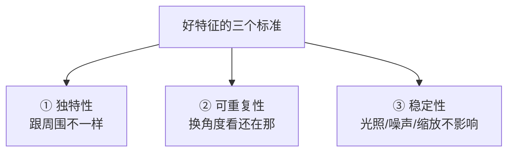

**举个生活例子**：

- **平坦墙面** → 到处都是白色，找不出特征（不独特）
- **一条直线边缘** → 沿边缘移动时不变，只能定「在线上」（一维不独特）
- **墙角** → 横竖都能定位，唯一确定（**好特征**）

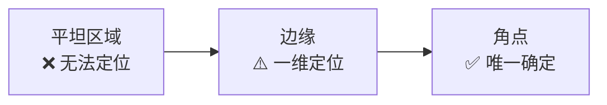

## 特征类型谱系

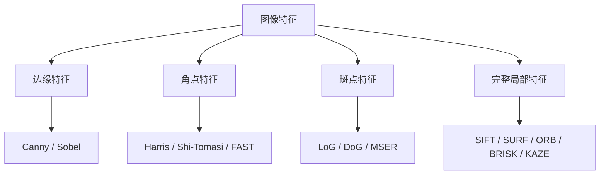

## 核心算法对比

| 算法 | 年份 | 不变量 | 速度 | 专利 | 现状 |
|---|---|---|---|---|---|
| Sobel | 1968 | 无 | 极快 | 无 | 仍在用 |
| **Harris** | 1988 | 旋转 | 快 | 无 | 教学经典 |
| Shi-Tomasi | 1994 | 旋转 | 快 | 无 | `goodFeaturesToTrack` |
| **SIFT** | 1999/2004 | 旋转/缩放/亮度 | 慢 | **已过期** | 精度标杆 |
| SURF | 2006 | 旋转/缩放 | 中 | 已过期 | SIFT 加速版 |
| **FAST** | 2006 | 无 | **极快** | 无 | 实时首选 |
| **ORB** | 2011 | 旋转/部分缩放 | 极快 | 无 | **工业首选** |
| BRISK | 2011 | 旋转/缩放 | 快 | 无 | 备选 |
| AKAZE | 2013 | 旋转/缩放 | 中 | 无 | 非线性尺度 |

## 三类代表算法详解

### 角点类：Harris / Shi-Tomasi

**思路**：角点是「往任何方向移动，亮度都变化明显」的点。

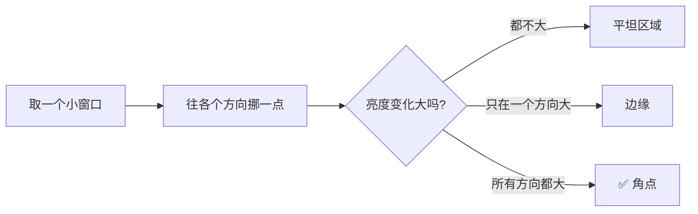

**生活比方**：把手指按在墙上，往任何方向动都没阻力 → 墙面（无特征）；只能沿一个方向滑 → 墙角线（边缘）；四面都卡住 → 墙角（角点）。

**Harris 的数学本质**：用图像梯度的**自相关矩阵** M 判断

$$
M = \sum_{x,y} w(x,y) \begin{bmatrix} I_x^2 & I_xI_y \\ I_xI_y & I_y^2 \end{bmatrix}
$$

不背公式，只需记住：**M 的两个特征值都大 → 角点**。

| 特征值情况 | 判定 |
|---|---|
| λ₁、λ₂ 都很小 | 平坦区域 |
| 一个大一个小 | 边缘 |
| **都很大** | **角点** |

**Shi-Tomasi 改进**：Harris 用 $R = \lambda_1\lambda_2 - k(\lambda_1+\lambda_2)^2$，Shi-Tomasi 简化为 $R = \min(\lambda_1, \lambda_2)$，效果更好且不用调 k。

**Harris 的局限**：**不具备尺度不变性**。同一个角点，图片放大 2 倍后可能就不是角点了。

### 斑点类：LoG / DoG

**思路**：找「一块区域跟周围不一样」的位置。

**生活比方**：白墙上的一个黑点 → 斑点。它不是一个「点」，而是一个「有面积的异常区域」。

**LoG（高斯拉普拉斯）**：用不同大小的高斯核去平滑图像再做拉普拉斯，找出响应最强的尺度。

**DoG（高斯差分）**：LoG 的近似加速——两个不同 sigma 的高斯模糊结果相减。

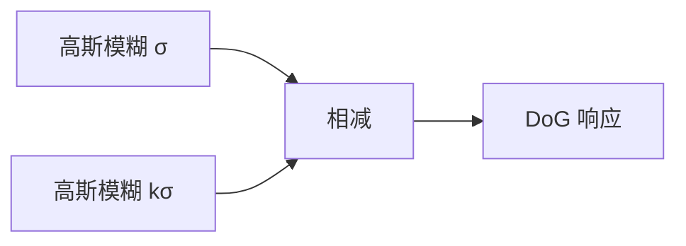

::: tip 为什么 DoG 很重要
**SIFT 的核心就是 DoG 金字塔**。它在不同尺度上找 DoG 极值点，从而获得**尺度不变性**。
:::

### 完整局部特征：SIFT / ORB

**SIFT 的贡献**：把「特征点」从「一个坐标」升级为「坐标 + 尺度 + 方向 + 128 维描述子」。

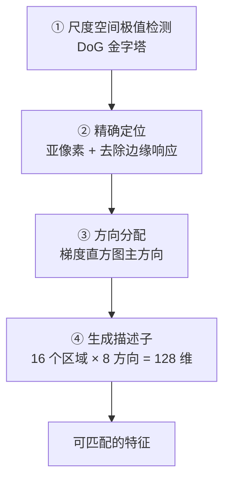

**SIFT 为什么经典**：

| 特性 | 如何实现 |
|---|---|
| 尺度不变 | DoG 金字塔多尺度检测 |
| 旋转不变 | 以主方向为基准旋转坐标 |
| 亮度不变 | 描述子做归一化 |
| 部分视角不变 | 局部邻域描述 |

详见 [SIFT 完整档案](/algorithms/sift/)。

**ORB 的贡献**：把 SIFT 的速度提升 100 倍。

```
ORB = oFAST（带方向的 FAST 关键点） + rBRIEF（旋转后的 BRIEF 描述子）
```

| 对比 | SIFT | ORB |
|---|---|---|
| 特征点检测 | DoG（慢） | FAST（极快） |
| 描述子 | 128 维浮点 | 256 位二进制 |
| 匹配方式 | 欧氏距离 | **汉明距离**（异或运算） |
| 单帧耗时（640×480） | ~200 ms | ~5 ms |
| 精度 | 高 | 中 |
| 专利 | 已过期 | **无** |

::: tip ORB 为什么是工程首选
**无专利 + 极快 + 精度够用**。SLAM 系统（ORB-SLAM）就是靠它做到实时的。
:::

## 算法演进谱系

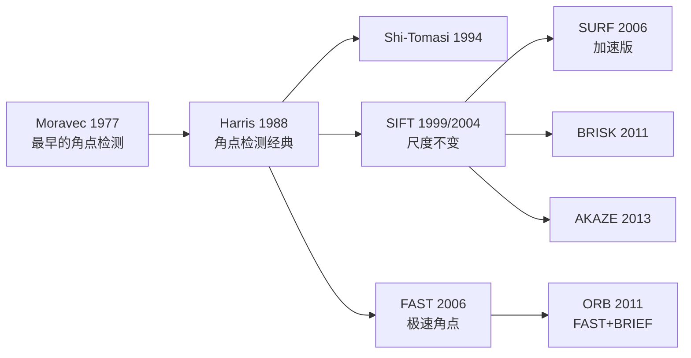

**关键节点解读**：

| 年份 | 事件 | 意义 |
|---|---|---|
| 1977 | Moravec | 首次提出「兴趣点」概念 |
| 1988 | **Harris** | 角点检测的数学框架奠基 |
| 1999 | **SIFT** | 第一个「尺度不变」的完整特征 |
| 2006 | FAST/SURF | 向「实时」冲刺 |
| 2011 | **ORB** | 免费 + 实时，工程落地 |

## 典型实战场景

### 场景 1：全景图拼接

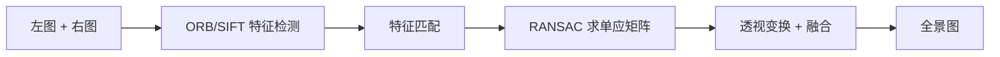

### 场景 2：SLAM 视觉里程计

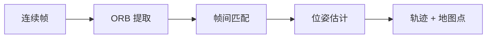

### 场景 3：图像检索 / 去重

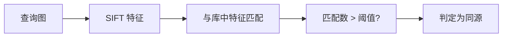

### 场景 4：工业定位

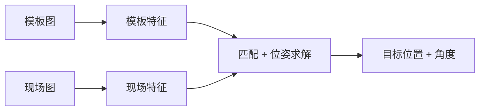

## 选型速查

| 需求 | 首选 | 理由 |
|---|---|---|
| 精度第一（离线） | **SIFT** | 最鲁棒，专利已过期可免费商用 |
| 速度第一（实时） | **ORB** | 极快且无专利 |
| 只找角点，不做匹配 | **Shi-Tomasi** | 简单可靠 |
| 嵌入式 / MCU | FAST | 计算量最小 |
| 有专利顾虑 | ORB / AKAZE / BRISK | 全部免费 |
| 纹理极少的图像 | 不要用特征点法 | 改用边缘或区域匹配 |

## 常见误区

::: warning 三个误区
1. **"特征点越多越好"** → 错。太多会导致匹配慢且误匹配多。通常限制在 500–2000 个。
2. **"SIFT 精度高所以随便用"** → 错。SIFT 在 640×480 上可能 200 ms，做不到实时。
3. **"ORB 精度差不能用"** → 错。在纹理丰富的室内场景，ORB 效果接近 SIFT。
:::

## 相关链接

- [SIFT 完整档案](/algorithms/sift/)
- [HOG+SVM 行人检测](/algorithms/hog-svm/)
- [③ 特征匹配分支](/branches/feature-matching/)
- [返回分支总览](/branches/)
