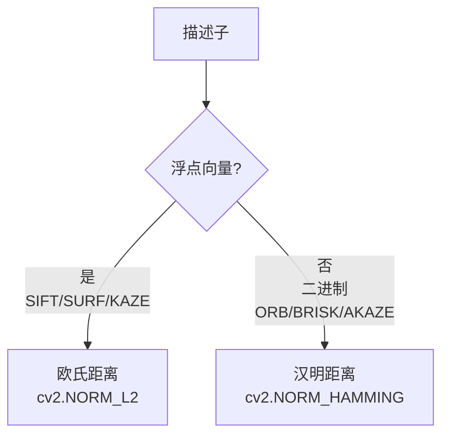
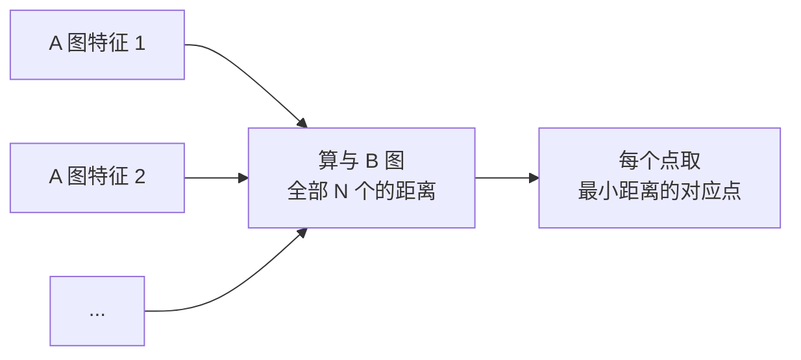

# 描述子匹配

> **一句话**：给左图的每个特征点，在右图里找「最像」的那个。

## 两种距离：欧氏 vs 汉明

**第一步必须搞清楚：你的描述子是什么类型**。



| 描述子类型 | 代表 | 距离 | 计算 |
|---|---|---|---|
| **浮点向量** | SIFT（128 维 float） | **欧氏距离 L2** | $\sqrt{\sum(a_i-b_i)^2}$ |
| **二进制串** | ORB（256 bit） | **汉明距离** | 异或后数 1 的个数 |

::: tip 汉明距离为什么快
256 位 = 4 个 64 位整数。**异或 + 数 1 的个数（POPCNT 指令）**，一条指令就能算 64 位。

所以 ORB 的匹配速度比 SIFT **快一到两个数量级**。

**这不是"稍快"，而是量级差异**。
:::

## ① 暴力匹配（Brute-Force）

### 思路

**A 图每个点，跟 B 图所有点都算一遍距离，取最近的**。



**复杂度**：O(M × N)。M=N=1000 时是 100 万次距离计算。

### 代码

```python
# SIFT：欧氏距离
bf = cv2.BFMatcher(cv2.NORM_L2, crossCheck=False)
matches = bf.knnMatch(des1, des2, k=2)      # 取最近的两个

# ORB：汉明距离
bf = cv2.BFMatcher(cv2.NORM_HAMMING, crossCheck=True)
matches = bf.match(des1, des2)              # 取最近的
```

### `match` vs `knnMatch`

| 方法 | 返回 | 用途 |
|---|---|---|
| `match` | 每个点**最好的一个**匹配 | 交叉验证 |
| `knnMatch(k=2)` | 每个点**最好的 k 个** | **Lowe 比值法** |

**现代实践首选 `knnMatch(k=2)`**，因为要做比值筛选。

## ② FLANN（近似最近邻）

### 思路

**不做精确查找，用索引结构快速找到"大概率最近"的点**。

**生活比方**：相亲时先按条件分组（年龄/地域/学历），只在最可能的组里找 → 快得多，偶尔漏掉最优解但影响不大。

### 两种索引

| 索引 | 算法常量 | 适用描述子 |
|---|---|---|
| **KD 树** | `FLANN_INDEX_KDTREE = 1` | **浮点（SIFT/SURF）** |
| **LSH** | `FLANN_INDEX_LSH = 6` | **二进制（ORB/BRISK）** |

```python
# 浮点描述子（SIFT/SURF）
FLANN_INDEX_KDTREE = 1
index_params = dict(algorithm=FLANN_INDEX_KDTREE, trees=5)
search_params = dict(checks=50)
flann = cv2.FlannBasedMatcher(index_params, search_params)

# 二进制描述子（ORB/BRISK）
FLANN_INDEX_LSH = 6
index_params = dict(
    algorithm=FLANN_INDEX_LSH,
    table_number=6,         # 哈希表数量，通常 6-12
    key_size=12,            # 哈希键的长度
    multi_probe_level=1     # 多探针级别
)
search_params = dict(checks=50)
flann = cv2.FlannBasedMatcher(index_params, search_params)
```

::: warning FLANN + ORB 的常见错误
**错误**：用 KD 树匹配 ORB 描述子。

**现象**：报错或结果异常。

**原因**：KD 树是为**连续空间**设计的，二进制描述子不适合。

**正确**：ORB 用 **LSH**（`algorithm=6`），或者干脆用 **BF + 汉明距离**（ORB 快，BF 也够用）。
:::

### 参数说明

| 参数 | 含义 | 建议 |
|---|---|---|
| `trees` | KD 树数量 | 5（越多越准，越慢） |
| `checks` | 搜索检查次数 | 50（越多越准，越慢） |
| `table_number` | LSH 哈希表数 | 6–12 |
| `key_size` | 哈希键长度 | 12 |
| `multi_probe_level` | 多探针 | 1–2 |

## ③ BF vs FLANN 对比

| 维度 | BF | FLANN |
|---|---|---|
| 精度 | **精确** | 近似 |
| 速度（N<500） | **快** | 有额外开销 |
| 速度（N>2000） | 慢 | **快** |
| 二进制支持 | ✅ | ✅（需 LSH） |
| 实现难度 | 简单 | 需调索引参数 |

::: tip 决策
- **特征点 < 500** → 用 **BF**（更简单，精度还高）
- **特征点 > 2000** → 用 **FLANN**
- **中间** → 两者都试，看哪个快

**实际上，ORB 因为描述子太短（256 bit），BF 匹配 1000 个点也就几毫秒**，很多时候根本不需要 FLANN。
:::

## ④ 匹配结果的可信度

**初步匹配必然包含大量错误**。典型的正确率：

| 描述子 | 初步匹配正确率 |
|---|---|
| SIFT | 30%–60% |
| ORB | 20%–50% |
| SURF | 30%–55% |

**所以筛选步骤是必须的**。


## ⑤ 匹配可视化

```python
import cv2

# 画匹配（只画前 N 个）
result = cv2.drawMatches(
    img1, kp1, img2, kp2, matches[:50], None,
    flags=cv2.DrawMatchesFlags_NOT_DRAW_SINGLE_POINTS
)

# 用不同颜色画内点/外点
matches_mask = mask.ravel().tolist()
result = cv2.drawMatches(
    img1, kp1, img2, kp2, good_matches, None,
    matchColor=(0, 255, 0),           # 绿色
    singlePointColor=(255, 0, 0),
    matchesMask=matches_mask          # 1=画, 0=不画
)
```

::: tip 可视化是调试的第一步
**看到连线就知道对不对**：

| 现象 | 说明 |
|---|---|
| 连线方向一致、平行 | ✅ 好匹配（纯平移） |
| 连线汇聚到一点 | ✅ 好匹配（旋转/缩放） |
| 连线杂乱交叉 | ❌ 大量误匹配 |
| 匹配点集中在局部 | ⚠️ 变换估计不可靠 |
:::

## ⑥ 性能优化

### 提前筛选

```python
matches = bf.knnMatch(des1, des2, k=2)

# ① 用比值法先筛（减少后续计算）
good = [m for m, n in matches if m.distance < 0.75 * n.distance]

# ② 按距离排序，只保留最好的 N 个
good = sorted(good, key=lambda x: x.distance)[:2000]
```

### 用 crossCheck 简化

```python
# crossCheck=True 时，match 返回的已经是"互相最优"的匹配
bf = cv2.BFMatcher(cv2.NORM_HAMMING, crossCheck=True)
matches = bf.match(des1, des2)
```

**代价**：`crossCheck` 会让 BF 内部计算双向，速度减半。但省去了手动交叉验证。

**注意**：`crossCheck=True` 时**不能用 `knnMatch`**。

### 批量处理

多张图配同一模板时：

```python
# ① 模板描述子只算一次
kp_t, des_t = sift.detectAndCompute(template, None)

# ② 对每张图只算一次检测
for img in images:
    kp, des = sift.detectAndCompute(img, None)
    matches = bf.knnMatch(des_t, des, k=2)
    # ...
```

### GPU 加速

```python
# 用 OpenCV 的 CUDA 模块（需编译 CUDA 支持）
bf_gpu = cv2.cuda.DescriptorMatcher_createBFMatcher(cv2.NORM_L2)
```

但**传统 CV 的匹配本来就快**，通常不需要 GPU。

## 性能参考

| 配置 | 特征点数 | 耗时 |
|---|---|---|
| BF + SIFT | 1000 × 1000 | ~200 ms |
| FLANN + SIFT | 1000 × 1000 | ~40 ms |
| BF + ORB | 1000 × 1000 | **~5 ms** |
| FLANN + ORB | 1000 × 1000 | ~8 ms（反而不划算） |

::: tip 结论
**ORB + BF 汉明匹配是最快的组合**。FLANN 在 ORB 上反而因为索引开销而变慢。

**FLANN 的价值在 SIFT/SURF 这类长浮点描述子**（比如 5000+ 个点）。
:::

## 常见踩坑

::: danger 坑 1：距离度量选错
**现象**：ORB 匹配结果全是错的。

**根因**：用了 `NORM_L2` 而不是 `NORM_HAMMING`。

**解决**：

| 描述子 | 度量 |
|---|---|
| SIFT / SURF / KAZE | `cv2.NORM_L2` |
| **ORB / BRISK / AKAZE** | `cv2.NORM_HAMMING` |

**AKAZE 的特殊情况**：默认描述子是二进制，但如果设 `descriptor_type=cv2.AKAZE_DESCRIPTOR_MLDB`，用的还是 `NORM_HAMMING`。
:::

::: danger 坑 2：忘了 `k=2`
**现象**：无法用 Lowe 比值法。

**解决**：`knnMatch(des1, des2, k=2)`。**k=2 才能对比"最近"和"第二近"**。
:::

::: danger 坑 3：`knnMatch` 返回不足 k 个
**现象**：`for m, n in matches` 报错 `ValueError: not enough values to unpack`。

**根因**：某个特征点在另一张图里只有 1 个候选（描述子数太少）。

**解决**：

```python
good = []
for match in matches:
    if len(match) == 2:              # ✅ 先检查长度
        m, n = match
        if m.distance < 0.75 * n.distance:
            good.append(m)
```
:::

::: danger 坑 4：特征数太少导致匹配数不足
**现象**：只有 3–5 对匹配，无法算单应矩阵。

**解决**：
- **降低 `fastThreshold` / `contrastThreshold`**（提更多点）
- **降低比值阈值**（放宽筛选）
- **确认图像有重叠区域**
- **检查图像是否有足够纹理**
:::

::: danger 坑 5：以为匹配数越多越好
**现象**：500 对匹配，但 RANSAC 内点率只有 10%。

**真相**：**内点率比匹配总数重要得多**。

| 情况 | 评价 |
|---|---|
| 100 对匹配，80 内点 | ✅ 很好 |
| 500 对匹配，30 内点 | ❌ 差（大量误匹配） |

**要让 RANSAC 能工作，内点必须占多数（> 50%）**。
:::

## 与深度学习匹配的对比

| 维度 | 传统（BF/FLANN） | 学习式（SuperGlue） |
|---|---|---|
| 计算 | 距离度量 | **注意力机制** |
| 精度 | 中 | **高（尤其重复纹理）** |
| 速度 | **极快** | 慢（需 GPU） |
| 训练数据 | 不需要 | 需要 |
| 可解释性 | 高 | 低 |

::: tip 什么时候不用深度学习
**ORB + BF + 比值 + RANSAC 这套传统流程，在很多场景下就是最优解**：

- 嵌入式设备（无 GPU）
- 实时要求高（> 30 FPS）
- 纹理良好的场景（室内、城市）
- 不需要处理极端视角变化

**深度学习方法在"重复纹理"和"大视角变化"上有明显优势**，但代价是算力和数据。
:::

## 相关链接

- [② 特征检测分支](/branches/feature-detection/)
- [鲁棒估计（Lowe 比值 / 交叉验证 / RANSAC）](/branches/feature-matching/robust-estimation)
- [SIFT 完整档案](/algorithms/sift/)
- [③ 特征匹配分支](/branches/feature-matching/)
- [返回特征匹配分支](/branches/feature-matching/)
