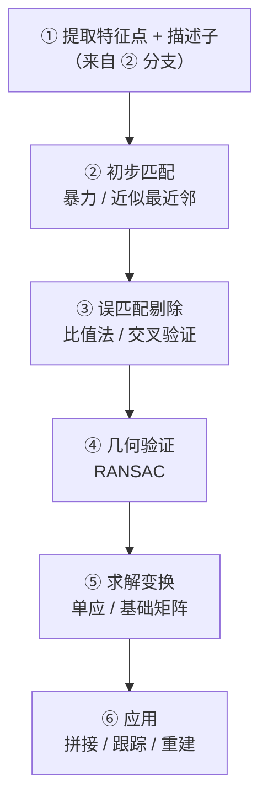
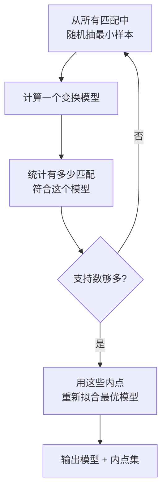
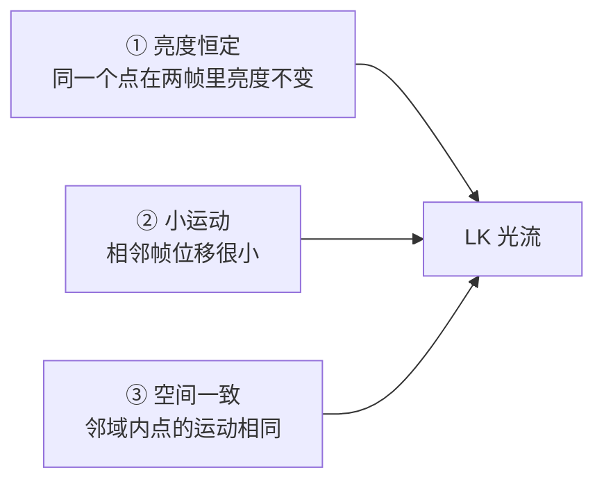
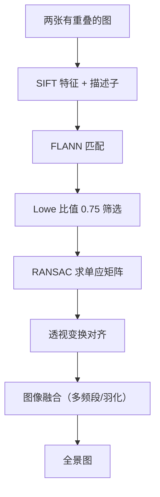

# ③ 特征匹配

> **学习难度 ⭐⭐⭐** ｜ **一句话**：把两张图里的对应点找出来。

## 这个分支解决什么问题

有了特征点（上一分支），下一步是**建立对应关系**。「左图第 37 个特征点 = 右图第 192 个特征点」，有了这种对应，才能算相机怎么动的、目标在哪。

**特征匹配 = 图像之间的「翻译官」**。它回答的问题是：A 图里的这个点，在 B 图里对应哪个点？

## 完整流程



## ① 描述子匹配

### 暴力匹配（Brute-Force）

**思路**：A 图里的每个点，跟 B 图里的**所有点**都算一遍距离，取最近的。

**生活比方**：相亲——每个人跟所有候选人依次见一遍，最后选最合适的。

| 描述子类型 | 距离度量 |
|---|---|
| SIFT / SURF（浮点向量） | **欧氏距离（L2）** |
| ORB / BRIEF（二进制） | **汉明距离**（异或后数 1 的个数） |

```python
# SIFT 用 L2
bf = cv2.BFMatcher(cv2.NORM_L2)
matches = bf.knnMatch(des1, des2, k=2)

# ORB 用汉明距离
bf = cv2.BFMatcher(cv2.NORM_HAMMING)
matches = bf.knnMatch(des1, des2, k=2)
```

**复杂度**：O(N × M)。N=M=1000 时是 100 万次距离计算。

### FLANN（近似最近邻）

**思路**：不做精确查找，用「索引结构」快速找到「大概率最近」的点。

**生活比方**：相亲改成先按条件分组（年龄、职业）——只在最可能匹配的组里找，快得多，偶尔漏掉最优解但影响不大。

```python
FLANN_INDEX_KDTREE = 1
index_params = dict(algorithm=FLANN_INDEX_KDTREE, trees=5)
search_params = dict(checks=50)
flann = cv2.FlannBasedMatcher(index_params, search_params)
matches = flann.knnMatch(des1, des2, k=2)
```

| 方法 | 精度 | 速度 | 适用 |
|---|---|---|---|
| BF | 精确 | 慢 | 特征点 < 500 |
| FLANN | 近似 | 快 | 特征点 > 1000 |

::: tip FLANN 的适用条件
- **只适用于浮点描述子**（SIFT/SURF），不适用于二进制（ORB）
- ORB 想加速要用 **LSH 索引**（`algorithm=6`）
:::

## ② 误匹配剔除

初步匹配必然有大量错误。这一步是关键。

### 距离阈值法

**思路**：距离太远的匹配直接扔掉。

```python
good = [m for m, n in matches if m.distance < 0.7 * n.distance]
```

### Lowe 比值法（最常用）

**思路**：不仅看「最近的那个有多近」，还要看「比第二近的近多少」。

$$ \text{最近距离} < \text{比值} \times \text{第二近距离} $$

**生活比方**：选对象时，不只要求「这个人不错」，还要求「这个人比第二名明显更好」。如果两个候选人条件差不多，说明你**其实分不清**，这个匹配不可靠。

```python
matches = bf.knnMatch(des1, des2, k=2)   # 取最近的两个
good = []
for m, n in matches:
    if m.distance < 0.75 * n.distance:   # 经典阈值 0.75
        good.append(m)
```

| 比值阈值 | 效果 |
|---|---|
| 0.9 | 宽松，匹配多，误匹配多 |
| **0.75** | **Lowe 论文推荐** |
| 0.6 | 严格，匹配少但准 |

### 交叉验证（Cross Check）

**思路**：A→B 的最佳匹配是 j，反过来 B→A 的最佳匹配也得是 i，才保留。

```python
bf = cv2.BFMatcher()
matches = bf.match(des1, des2)      # A → B
matches2 = bf.match(des2, des1)     # B → A
# 找出互相是最优的
```

::: tip 组合使用
**比值法 + 交叉验证**一起用，效果最好。
:::

### GMS（网格运动统计）

**思路**：正确的匹配，**周围的匹配也倾向于有一致的运动**。用网格统计每个匹配周围的支持度。

**优势**：不需要几何模型假设，速度快，适合实时。

## ③ 几何验证：RANSAC

### 为什么要几何验证

即使做完比值法和交叉验证，仍有错误匹配。但**正确的匹配会遵循同一种几何变换**（比如都是旋转+平移），错误的匹配是随机的。

### RANSAC 的思路



**生活比方**：一屋子人投票选领导。

1. 随机找几个人，他们商量一个标准
2. 看有多少人同意这个标准
3. 同意的人最多 → 这个标准就是主流
4. 用主流的人重新定标准

**应用示例**：

```python
# 用 RANSAC 求单应矩阵
H, mask = cv2.findHomography(
    pts_src, pts_dst,
    cv2.RANSAC,      # 用 RANSAC
    5.0              # 重投影误差阈值（像素）
)
# mask 标记哪些是内点
```

| 求解目标 | 方法 | 最小点数 |
|---|---|---|
| 2D 变换（平移+旋转+缩放） | `estimateAffine2D` | 3 |
| 平面单应矩阵 | `findHomography` | 4 |
| 基础矩阵 F | `findFundamentalMat` | 8 |
| 本质矩阵 E | `findEssentialMat` | 5 |

### RANSAC 参数

| 参数 | 含义 | 建议 |
|---|---|---|
| `ransacReprojThreshold` | 内点判定阈值 | 3.0–5.0 像素 |
| `maxIters` | 最大迭代 | 2000 |
| `confidence` | 置信度 | 0.995 |

::: warning RANSAC 的前提
**内点必须占多数**（通常要求 > 50%）。如果误匹配比正确匹配还多，RANSAC 会失败。

所以**先用比值法把粗暴的错误清掉，再上 RANSAC**。
:::

## ④ 运动估计与光流

### 光流（Optical Flow）

**思路**：不找特征点，直接算**每个像素**在相邻帧的移动量。

**生活比方**：特征匹配是「记住几个路标找路」，光流是「看整个画面怎么流动」。

| 方法 | 特点 |
|---|---|
| Lucas-Kanade 稀疏光流 | 只在特征点上算，快 |
| Farneback 稠密光流 | 每个像素都算，慢但信息全 |
| Horn-Schunck | 经典稠密方法 |

**Lucas-Kanade 的三个假设**：



::: tip 为什么是「金字塔 LK」
「小运动」假设要求位移小。为了处理大位移，**在图像金字塔的每一层都算**——先在大尺度（缩小图）算粗略位移，再逐层细化。这就是 `calcOpticalFlowPyrLK`。
:::

```python
next_pts, status, err = cv2.calcOpticalFlowPyrLK(
    prev_gray, next_gray,
    prev_pts, None,
    winSize=(21, 21),
    maxLevel=3
)
```

### 特征跟踪


## 典型实战场景

### 场景 1：全景图拼接（完整流程）



```python
# 关键代码骨架
sift = cv2.SIFT_create()
kp1, des1 = sift.detectAndCompute(img1, None)
kp2, des2 = sift.detectAndCompute(img2, None)

flann = cv2.FlannBasedMatcher(dict(algorithm=1, trees=5), dict(checks=50))
raw = flann.knnMatch(des1, des2, k=2)
good = [m for m, n in raw if m.distance < 0.75 * n.distance]

src = np.float32([kp1[m.queryIdx].pt for m in good]).reshape(-1, 1, 2)
dst = np.float32([kp2[m.trainIdx].pt for m in good]).reshape(-1, 1, 2)
H, mask = cv2.findHomography(src, dst, cv2.RANSAC, 5.0)
```

### 场景 2：目标跟踪（模板匹配）


### 场景 3：视觉定位（工业）


## 匹配质量评估

| 指标 | 含义 |
|---|---|
| 匹配点数 | 越多越好（但也可能越多越脏） |
| **内点率** | RANSAC 内点 / 总匹配数，**> 50% 才算好** |
| 重投影误差 | 内点到模型的距离，越小越准 |
| 覆盖率 | 匹配点在图上的分布范围，越广越稳 |

::: warning 匹配点全是「扎堆」的怎么办
如果所有匹配点都集中在图像一小块区域，说明：
- 那块区域纹理丰富，其他地方纹理少
- 求出的变换模型**外推不可靠**

**解决**：特征检测时限制每个区域的最大点数（如 `SIFT` 的 `nfeatures` + 网格配额）。
:::

## 选型速查

| 场景 | 特征 | 匹配 | 验证 |
|---|---|---|---|
| 离线高精度 | SIFT | FLANN + 比值 | RANSAC + 单应 |
| 实时 SLAM | ORB | BF + 汉明 | RANSAC + 基础矩阵 |
| 快速粗匹配 | ORB | BF | 汉明距离阈值 |
| 大位移跟踪 | ORB | — | 金字塔 LK 光流 |
| 稠密运动分析 | — | — | Farneback 光流 |

## 参数速查表

| 环节 | 参数 | 建议值 |
|---|---|---|
| ORB 特征数 | `nfeatures` | 500–2000 |
| Lowe 比值 | `ratio` | 0.75 |
| BF 匹配 | `k`（knnMatch） | 2 |
| RANSAC | `reprojThreshold` | 3.0–5.0 |
| RANSAC | `maxIters` | 2000 |
| LK 光流 | `winSize` | (21, 21) |
| LK 光流 | `maxLevel` | 3 |

## 相关链接

- [② 特征检测分支](/branches/feature-detection/)
- [SIFT 完整档案](/algorithms/sift/)
- [⑥ 几何视觉分支](/branches/geometry/)
- [返回分支总览](/branches/)
