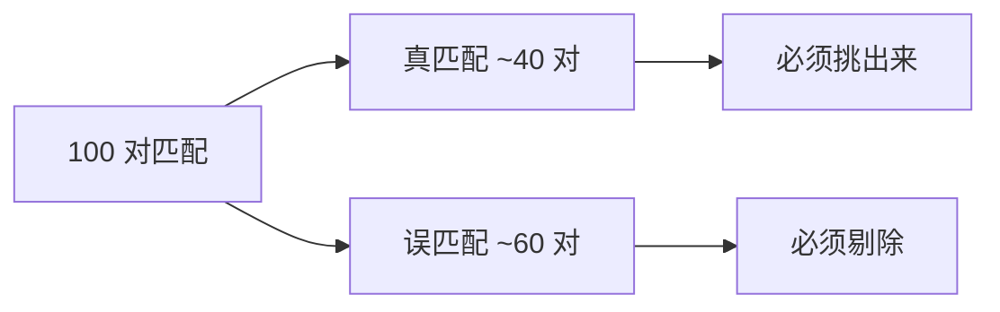
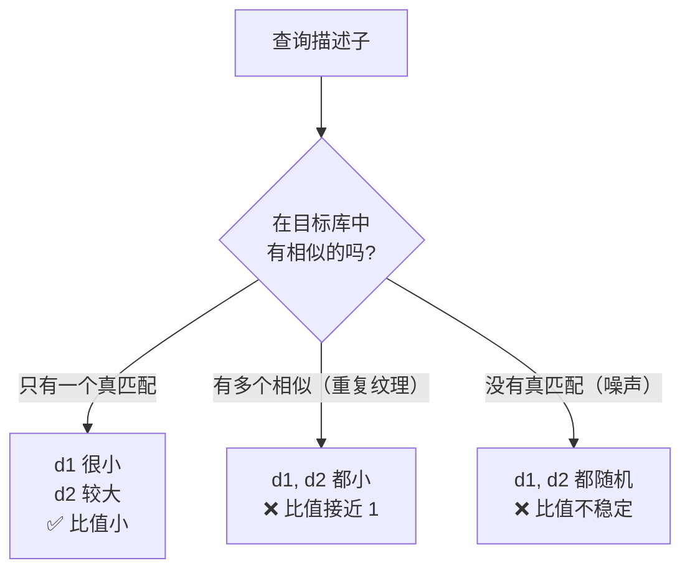
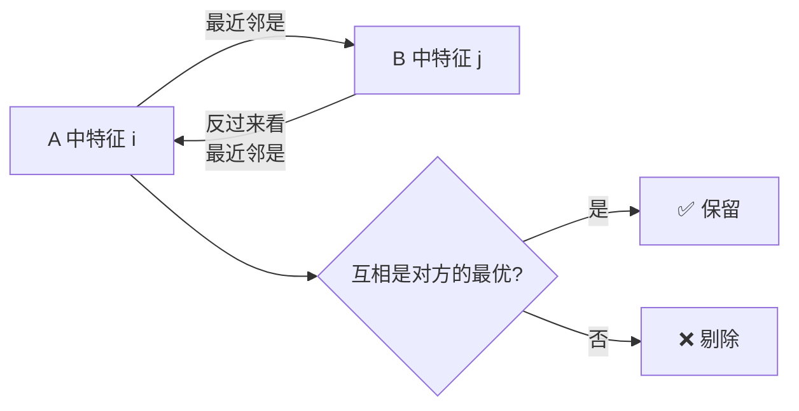
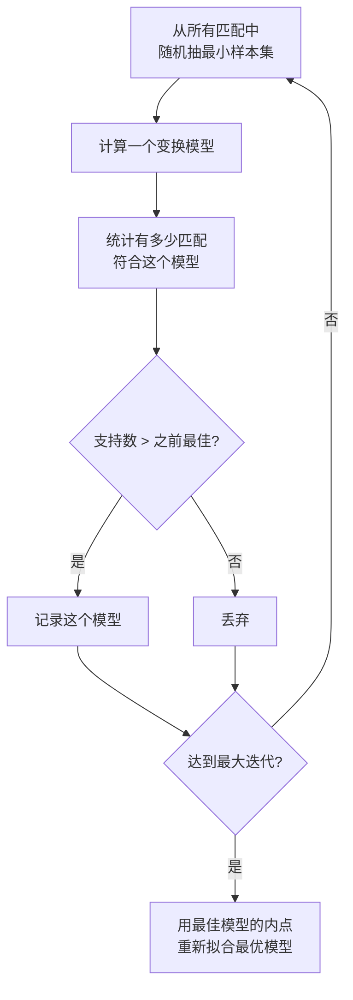
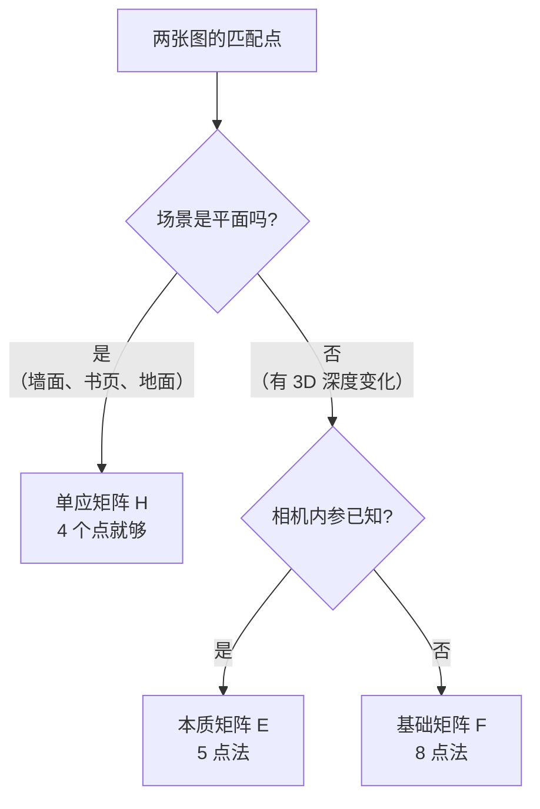
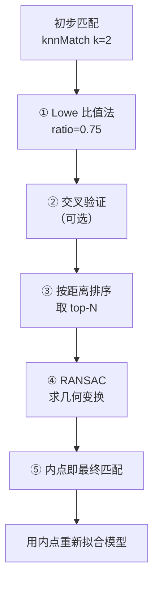

# 鲁棒估计

> **一句话**：从一堆"大部分正确、小部分错误"的匹配里，把正确的挑出来，并求出几何变换。

## 为什么需要鲁棒估计

**现实情况**：初步匹配里 30%–70% 是错的。



**直接最小二乘会失败**：只要有一个严重离群点，拟合结果就完全偏掉。

**生活比方**：10 个人报数，9 个人靠谱，1 个人乱报。取平均会被那 1 个人带偏。**正确做法是先判断谁是"内点"，再用内点求平均**。

## ① Lowe 比值法

### 思路

**不只要求"最近的那个够近"，还要求"比第二近的明显更好"**。

$$ d_1 < \text{ratio} \times d_2 $$

其中 $d_1$ 是最近距离，$d_2$ 是第二近距离。

**生活比方**：选对象时，不只要求"这个人不错"，还要求"这个人比第二名明显更好"。**如果两个候选人条件差不多，说明你其实分不清**，这样的匹配不可靠。

### 为什么有效

现在考虑真实的匹配情况：



**核心直觉**：

| 情况 | d1 | d2 | 比值 |
|---|---|---|---|
| **真匹配，特征独特** | 小 | 大 | **小 → 保留** |
| 误匹配，重复纹理 | 小 | 小 | 大 → 剔除 |
| 误匹配，无对应 | 大 | 大 | 不稳定 → 剔除 |

**如果最近邻和第二近邻距离差不多，说明这个描述子"不够独特"**，很可能是误匹配。

### 阈值选择

| ratio | 效果 | 论文结论 |
|---|---|---|
| 0.9 | 宽松，更多匹配，误匹配多 | — |
| **0.75** | **Lowe 论文推荐** | 淘汰 90% 的误匹配 |
| 0.7 | 更严格，匹配少但准 | 特定场景 |
| 0.6 | 很严格，可能漏掉正确匹配 | 高精度场景 |

```python
matches = bf.knnMatch(des1, des2, k=2)
good = []
for m, n in matches:
    if m.distance < 0.75 * n.distance:
        good.append(m)
```

::: warning 比值法也有局限
**当目标库很小、特征很少时**，第二近邻可能也"很远"，导致比值异常。

**当图像有大量重复纹理**（栅栏、砖墙、窗口），比值法会把**正确的匹配也剔除**（因为它们确实有多个相似点）。

**解决**：这类场景**不能只靠比值法**，必须靠几何验证（RANSAC）。
:::

## ② 交叉验证（Cross Check）

### 思路

**A→B 的最佳匹配是 j，反过来 B→A 的最佳匹配也必须是 i**。



### 为什么有效

**如果 i→j 是真匹配，那 j→i 也应该成立**。

**如果 i→j 是误匹配**（i 在 B 中其实没有对应），那么 j 的"真对应"会是另一个点 k，导致 j→k ≠ i。

### 代码

```python
# 方法一：用 crossCheck 参数
bf = cv2.BFMatcher(cv2.NORM_HAMMING, crossCheck=True)
matches = bf.match(des1, des2)     # 自动只返回互相最优的

# 方法二：手动做双向
matches_forward = bf.match(des1, des2)
matches_backward = bf.match(des2, des1)

# 建立反向索引
backward_map = {m.queryIdx: m.trainIdx for m in matches_backward}

# 只保留互相最优的
good = []
for m in matches_forward:
    # m: des1[m.queryIdx] → des2[m.trainIdx]
    # 反向：des2[m.trainIdx] → des1[?]
    if m.trainIdx in backward_map and backward_map[m.trainIdx] == m.queryIdx:
        good.append(m)
```

### 比值法 vs 交叉验证

| 维度 | 比值法 | 交叉验证 |
|---|---|---|
| 需要 | `knnMatch(k=2)` | 双向匹配 |
| 速度 | 快 | 慢（计算两次） |
| 效果 | 好 | 好 |
| 用在哪 | 通用 | 配合比值法 |

::: tip 组合使用效果最好
**两者一起用**：

```python
# ① 双向匹配
matches_1 = bf.knnMatch(des1, des2, k=2)
matches_2 = bf.knnMatch(des2, des1, k=2)

# ② 建立反向映射
backward = {}
for m in matches_2:
    if len(m) == 2:
        backward[m[0].queryIdx] = m[0].trainIdx

# ③ 双向 + 比值
good = []
for pair in matches_1:
    if len(pair) != 2:
        continue
    m, n = pair
    # 比值法
    if m.distance < 0.75 * n.distance:
        # 交叉验证
        if m.trainIdx in backward and backward[m.trainIdx] == m.queryIdx:
            good.append(m)
```

**代价**：速度减半。**收益**：匹配质量明显提升。
:::

## ③ GMS（网格运动统计）

### 思路

**正确的匹配，周围的匹配也倾向于有一致的运动**。

```mermaid
flowchart TB
  A["一个正确匹配"] --> B["它周围的邻域里<br/>也有很多正确匹配"]
  C["一个错误匹配"] --> D["它周围的匹配<br/>是随机的"]
  B --> E["用"周围匹配数"<br/>作为置信度"]
  D --> E
  E --> F["阈值筛选"]
```

**做法**：把图像分网格，统计每个匹配所在网格邻域的匹配数。

- 匹配数多 → 高置信度（运动一致）
- 匹配数少 → 低置信度（孤立，可能是误匹配）

### 优势

| 优势 | 说明 |
|---|---|
| **不需要几何模型假设** | 不用假设纯旋转/平移 |
| **极快** | 只需统计网格 |
| **适合实时** | 论文报告可到 1000 FPS |
| 对重复纹理鲁棒 | 相比比值法 |

**GMS 常被用于 ORB-SLAM 类系统的匹配筛选**。

## ④ RANSAC（核心）

### 为什么需要

即使做完比值法 + 交叉验证，仍有误匹配。但：

::: tip 关键洞察
**正确的匹配会遵循同一种几何变换，错误的匹配是随机的**。

例：两张图之间是"旋转 + 平移"。所有正确匹配对都满足同一个变换矩阵，而错误匹配散落各处。
:::

### 算法



**生活比方**：一屋子人投票选领导。

1. 随机找几个人，他们商量一个标准
2. 看有多少人同意这个标准
3. 同意的人最多 → 这个标准就是主流
4. 用主流的人重新定标准

### 为什么 RANSAC 能工作

**概率推理**：

设内点率为 $w$，最小样本数 $n$，迭代 $k$ 次。

**至少有一次抽到的样本全是内点的概率**：

$$ P = 1 - (1 - w^n)^k $$

**举例**（w=0.5, n=4）：

| 迭代 k | 成功率 |
|---|---|
| 10 | 6% |
| 50 | 74% |
| 100 | 95% |
| 200 | 99.8% |

**所以要迭代足够多次**。OpenCV 会根据置信度自动计算。

### 求解目标与最小点数

| 求解 | OpenCV 函数 | 最小点数 | 适用 |
|---|---|---|---|
| 平移 | — | 1 | 简单位移 |
| 相似变换（平移+旋转+缩放） | `estimateAffinePartial2D` | 2 | 尺度+旋转 |
| **仿射变换** | `estimateAffine2D` | 3 | 平行保持 |
| **单应矩阵 H** | `findHomography` | **4** | 平面场景 |
| **基础矩阵 F** | `findFundamentalMat` | **8**（8 点法） | 一般运动 |
| **本质矩阵 E** | `findEssentialMat` | **5**（5 点法） | 已知内参 |
| PnP（位姿） | `solvePnPRansac` | 3（P3P） | 已知 3D |

```python
# 单应矩阵（最常用）
H, mask = cv2.findHomography(
    src_pts, dst_pts,
    cv2.RANSAC,
    ransacReprojThreshold=5.0,     # 重投影误差阈值（像素）
    maxIters=2000,
    confidence=0.995
)
# mask: N×1 数组，1=内点，0=外点
inliers = mask.ravel().sum()

# 基础矩阵
F, mask = cv2.findFundamentalMat(
    pts1, pts2,
    cv2.FM_RANSAC,
    ransacReprojThreshold=1.0,     # 极线距离（像素）
    confidence=0.99
)

# 本质矩阵
E, mask = cv2.findEssentialMat(
    pts1, pts2, K,
    method=cv2.RANSAC,
    prob=0.999,
    threshold=1.0
)
```

### 单应 vs 基础矩阵：怎么选



| 判断依据 | 用 H | 用 F/E |
|---|---|---|
| 场景 | **平面** | 有深度变化 |
| 相机运动 | 任意（但场景平面） | 有平移 |
| 最小点 | 4 | 8（F）/ 5（E） |
| 输出 | 2D 平面映射 | 极线约束 |

::: warning 纯旋转时不要用 F
**如果相机只有旋转没有平移**（如全景拍摄），**基础矩阵 F 会退化**（不唯一/无法求解）。

**解决**：这种情况用**单应矩阵 H**（任意深度的场景，纯旋转都能用 H 建模）。
:::

### 关键参数：重投影阈值

| 阈值 | 效果 |
|---|---|
| 1.0 px | 极严格，内点少但很准 |
| **3.0–5.0 px** | **常用** |
| 10.0 px | 宽松，内点多但包含误匹配 |

**怎么定**：看匹配点的定位精度。

- 亚像素精化的点 → 1.0–2.0
- 普通特征点 → 3.0–5.0
- 有较大噪声 → 5.0–10.0

## ⑤ 完整筛选流程



### 完整代码

```python
import cv2
import numpy as np

def match_and_filter(img1, img2):
    # ① 特征提取
    sift = cv2.SIFT_create(nfeatures=2000)
    kp1, des1 = sift.detectAndCompute(img1, None)
    kp2, des2 = sift.detectAndCompute(img2, None)

    if des1 is None or des2 is None or len(des1) < 2 or len(des2) < 2:
        return None, None, None

    # ② 初步匹配
    flann = cv2.FlannBasedMatcher(
        dict(algorithm=1, trees=5), dict(checks=50)
    )
    raw = flann.knnMatch(des1, des2, k=2)

    # ③ Lowe 比值法
    good = []
    for pair in raw:
        if len(pair) == 2:
            m, n = pair
            if m.distance < 0.75 * n.distance:
                good.append(m)

    if len(good) < 10:
        return None, None, good

    # ④ 提取点对
    src = np.float32([kp1[m.queryIdx].pt for m in good]).reshape(-1, 1, 2)
    dst = np.float32([kp2[m.trainIdx].pt for m in good]).reshape(-1, 1, 2)

    # ⑤ RANSAC
    H, mask = cv2.findHomography(src, dst, cv2.RANSAC, 5.0)
    if H is None:
        return None, None, good

    inlier_mask = mask.ravel().astype(bool)
    inliers = [g for g, keep in zip(good, inlier_mask) if keep]

    return H, inliers, good
```

### 内点率评估

```python
inlier_ratio = len(inliers) / len(good)

if inlier_ratio > 0.7:
    quality = "优秀"
elif inlier_ratio > 0.5:
    quality = "良好"
elif inlier_ratio > 0.3:
    quality = "一般"
else:
    quality = "差（结果不可信）"
```

::: warning 内点率的经验门槛
| 内点率 | 评价 | 建议 |
|---|---|---|
| > 0.7 | 优秀 | 直接用 |
| 0.5–0.7 | 良好 | 可用 |
| 0.3–0.5 | 一般 | 谨慎使用 |
| **< 0.3** | **差** | **结果不可信，应拒绝** |

**RANSAC 的理论前提是内点占多数（> 50%）**。低于这个值，RANSAC 可能找错模型。
:::

## ⑥ 内点的几何一致性检验

**进一步验证**：检查变换后的点是否落在预期位置。

```python
# 用 H 变换所有内点，看重投影误差
src_pts = np.float32([kp1[m.queryIdx].pt for m in inliers]).reshape(-1, 1, 2)
dst_pts = np.float32([kp2[m.trainIdx].pt for m in inliers]).reshape(-1, 1, 2)

projected = cv2.perspectiveTransform(src_pts, H)
errors = np.linalg.norm(projected - dst_pts, axis=2).ravel()

print(f"平均重投影误差: {errors.mean():.2f} px")
print(f"最大误差: {errors.max():.2f} px")
```

**好的结果**：平均误差 < 1 px，最大误差 < 阈值。

**差的信号**：平均误差 > 3 px，或有个别点误差极大（说明那个"内点"其实是误匹配）。

## 性能参考

| 步骤 | 1000 对匹配的耗时 |
|---|---|
| Lowe 比值法 | < 1 ms |
| 交叉验证 | ~2 ms（额外一次匹配） |
| RANSAC 单应（2000 次迭代） | ~10–30 ms |
| RANSAC 基础矩阵 | ~20–50 ms |
| 总计（不含特征提取） | **~15–60 ms** |

::: tip RANSAC 是主要的耗时环节
**优化方向**：

- **减少输入的匹配数**（先用比值法狠筛）
- **降低 `maxIters`**（如果内点率高）
- **提高 `confidence` 的反面**：降低 confidence 会减少迭代次数（但可能失败）
:::

## 常见踩坑

::: danger 坑 1：匹配太少导致 RANSAC 失败
**现象**：`findHomography` 返回 `None`。

**根因**：匹配数少于最小点数（H 要 4 对，F 要 8 对），或内点太少无法收敛。

**解决**：
- **降低比值阈值**（0.75 → 0.8）得到更多匹配
- **提高特征点数**（`nfeatures`）
- **降低 `contrastThreshold`**
- **检查图像是否有重叠**
:::

::: danger 坑 2：用 H 处理非平面场景
**现象**：全景拼接时，前景物体明显错位/鬼影。

**根因**：**H 假设场景是平面**，有深度变化时不能完美对齐。

**解决**：
- 拍摄时**相机原地旋转**（不移动）
- 用 **seam finding**（寻找拼接缝）避免明显错位
- 用多频段融合弱化鬼影
:::

::: danger 坑 3：RANSAC 阈值过大
**现象**：内点率看起来很高（90%），但结果错误。

**根因**：阈值过大，误匹配也被当成内点。

**解决**：阈值取 **3–5 px**，并检查**平均重投影误差**。
:::

::: danger 坑 4：点对顺序搞反
**现象**：`findHomography(src, dst)` 的 H 方向搞错，变换后图像跑到画面外。

**说明**：
- `H` 把 `src` 映射到 `dst`
- `warpPerspective(img2, H_inv, ...)` 用的是**逆变换**

**记忆**：`findHomography(源点, 目标点)` → H 是"源→目标"的变换。
:::

::: danger 坑 5：忘了检查 mask
**现象**：把外点也用上了，结果很差。

**解决**：`mask` 是 `N×1` 的 `uint8`，**必须先 `ravel()`**：

```python
inlier_mask = mask.ravel().astype(bool)   # ✅
# inlier_mask = mask                        # ❌ 形状不对
```
:::

## 相关链接

- [描述子匹配](/branches/feature-matching/descriptors)
- [③ 特征匹配分支](/branches/feature-matching/)
- [全景拼接案例](/cases/)
- [⑥ 几何视觉分支：对极几何](/branches/geometry/)
- [返回特征匹配分支](/branches/feature-matching/)
