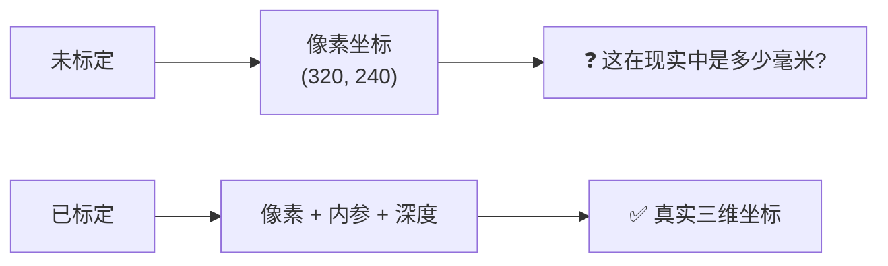
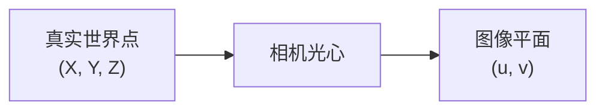
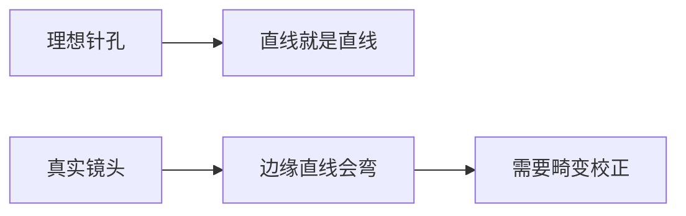
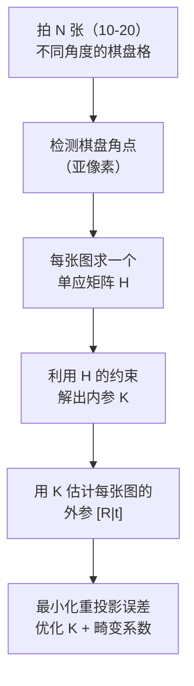
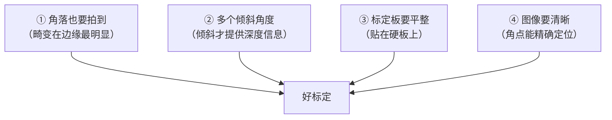
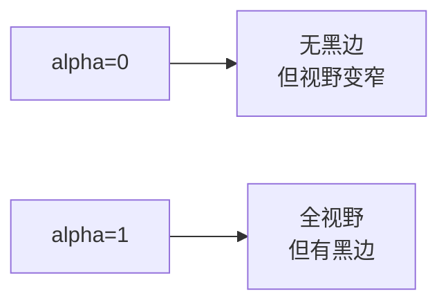
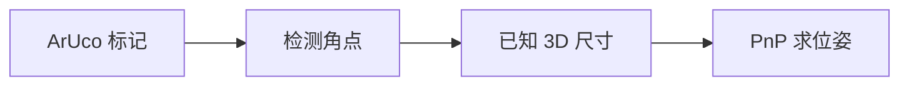
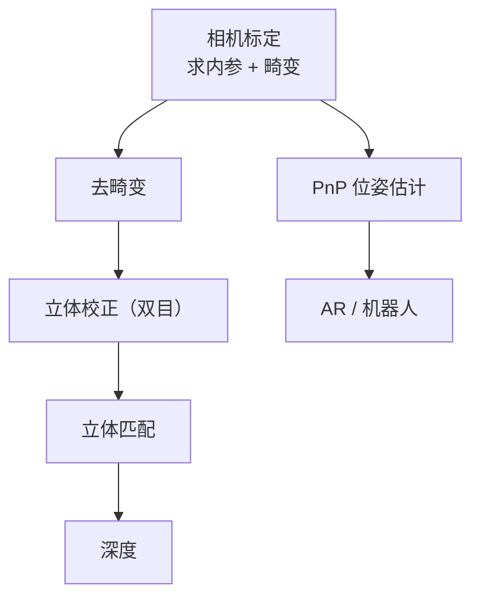

# 相机标定

> **一句话**：搞清楚相机的"内参"，让像素坐标能和真实世界的毫米对上。

## 为什么必须标定

**未标定的相机拍出来的像素，没法换算成真实距离**。



**生活比方**：一把没有刻度的尺子。你知道"这东西有 3 格长"，但不知道"3 格是多少厘米"。

## ① 相机模型

### 针孔模型

**生活比方**：小时候用纸盒做的小孔成像——光线穿过小孔，在后面的纸上形成倒立的像。



### 完整投影公式

$$
s \begin{bmatrix} u \\ v \\ 1 \end{bmatrix}
= \underbrace{\begin{bmatrix} f_x & 0 & c_x \\ 0 & f_y & c_y \\ 0 & 0 & 1 \end{bmatrix}}_{K\ \text{(内参)}}
\underbrace{\begin{bmatrix} R_{3\times3} & t_{3\times1} \end{bmatrix}}_{[R|t]\ \text{(外参)}}
\begin{bmatrix} X \\ Y \\ Z \\ 1 \end{bmatrix}
$$

**不用背，记住两件事**：

| 参数 | 含义 | 生活理解 |
|---|---|---|
| **内参 K** | 相机自身的属性 | **相机是什么** |
| **外参 [R\|t]** | 相机在世界中的位姿 | **相机在哪** |

### 内参的四个量

| 参数 | 含义 |
|---|---|
| $f_x$ | x 方向焦距（单位：像素） |
| $f_y$ | y 方向焦距（像素） |
| $c_x$ | 光心的 x 坐标（主点） |
| $c_y$ | 光心的 y 坐标（主点） |

**典型值**：1920×1080 图像，$f_x \approx 1000$，$c_x \approx 960$，$c_y \approx 540$。

::: tip 为什么焦距单位是像素
$$ f_{\text{像素}} = f_{\text{毫米}} / \text{像素物理尺寸}_{\text{毫米}} $$

**举例**：物理焦距 4 mm，像素尺寸 2 μm → $f_{像素} = 4 / 0.002 = 2000$。

**这样表示的好处**：投影计算全部在像素单位下完成，不用关心传感器物理尺寸。
:::

### 畸变

**真实镜头不是理想针孔**：

| 畸变 | 表现 | 参数 |
|---|---|---|
| **径向畸变** | 直线变弯（鱼眼/桶形/枕形） | $k_1, k_2, k_3$ |
| **切向畸变** | 镜头装配偏移导致 | $p_1, p_2$ |



**径向畸变公式**：

$$ x_{corrected} = x(1 + k_1r^2 + k_2r^4 + k_3r^6) $$

**典型的畸变系数**（如 GoPro 广角）：

| 参数 | 典型值 |
|---|---|
| $k_1$ | **0.1 ~ -0.3** |
| $k_2$ | 0.01 ~ 0.1 |
| $p_1, p_2$ | 很小（< 0.01） |

::: tip 畸变的实用判断
**怎么知道相机有没有畸变**？

- **拍一张直线网格**（瓷砖、网格纸）
- **看边缘的直线是否弯曲**
- **边缘弯曲越明显，畸变越大**

**广角镜头畸变明显**（GoPro 可达 k₁ = -0.3），**长焦镜头畸变较小**。
:::

## ② 张正友标定法（1999）

### 革命性在哪

**传统方法**：需要精密加工的 3D 标定块（多个已知位置的点）。

**张正友**：**只需要一张打印的棋盘格**。

| 对比 | 传统 3D 标定物 | 张正友棋盘格 |
|---|---|---|
| 标定物 | 精密加工 | **一张打印纸** |
| 成本 | 昂贵 | **几乎为零** |
| 操作 | 复杂 | **拍十几张照片** |
| 精度 | 高 | **同样高** |

**这就是为什么张正友法成为工业标准**。

### 算法思路



### 为什么能解出内参

**核心洞察**：**棋盘格是平面的**，所以每张图都满足一个单应矩阵 H。

**每个 H 给出两个约束**（正交性 + 长度相等）：
$$ h_1^T K^{-T}K^{-1} h_2 = 0 $$
$$ h_1^T K^{-T}K^{-1} h_1 = h_2^T K^{-T}K^{-1} h_2 $$

**内参有 5 个未知量**（$f_x, f_y, c_x, c_y, \gamma$），每个 H 给 2 个约束。

**所以至少需要 3 张图**（3×2 = 6 ≥ 5）。**实践中用 10–20 张**。

### 代码

```python
import cv2
import numpy as np

# ① 准备棋盘格的 3D 点
CHESSBOARD = (9, 6)          # 内角点数（宽, 高）
SQUARE_SIZE = 25.0           # 方格边长，单位：mm

objp = np.zeros((CHESSBOARD[0] * CHESSBOARD[1], 3), np.float32)
objp[:, :2] = np.mgrid[0:CHESSBOARD[0], 0:CHESSBOARD[1]].T.reshape(-1, 2)
objp *= SQUARE_SIZE          # 乘上实际尺寸

objpoints = []               # 3D 点
imgpoints = []               # 2D 点

# ② 逐张处理
for fname in image_files:
    img = cv2.imread(fname)
    gray = cv2.cvtColor(img, cv2.COLOR_BGR2GRAY)

    # 找棋盘角点
    ret, corners = cv2.findChessboardCorners(gray, CHESSBOARD, None)

    if ret:
        # 亚像素精化
        criteria = (cv2.TERM_CRITERIA_EPS + cv2.TERM_CRITERIA_MAX_ITER, 30, 0.001)
        corners = cv2.cornerSubPix(gray, corners, (11, 11), (-1, -1), criteria)

        objpoints.append(objp)
        imgpoints.append(corners)

# ③ 标定
ret, K, dist, rvecs, tvecs = cv2.calibrateCamera(
    objpoints, imgpoints, gray.shape[::-1], None, None
)

print(f"重投影误差: {ret:.4f} 像素")
print(f"内参 K:\n{K}")
print(f"畸变系数: {dist.ravel()}")
```

### 参数与检查

| 项 | 说明 |
|---|---|
| `CHESSBOARD` | **内角点数**（不是方格数！9×6 方格 → 8×5 内角点） |
| `SQUARE_SIZE` | 方格边长，**单位决定输出单位** |
| `ret` | **重投影误差，< 0.5 像素算好** |

::: warning 最容易搞错的：`CHESSBOARD` 是内角点数
**8×5 的方格棋盘** → 内角点是 **7×4**。

```python
CHESSBOARD = (7, 4)     # ✅ 内角点数
```

**OpenCV 找的是"格子交点"**，不是格子本身。
:::

::: tip 标定质量判断标准
| 重投影误差 | 评价 |
|---|---|
| < 0.3 px | **优秀** |
| 0.3–0.5 px | 良好 |
| 0.5–1.0 px | 可用 |
| > 1.0 px | **需重新标定** |
:::

### 标定板拍摄要点



| 要点 | 为什么 |
|---|---|
| **覆盖画面四角** | 畸变在边缘最强，不拍角落就估不准畸变 |
| **多个倾斜角度** | 纯正对拍摄无法求解全部参数 |
| **标定板平整** | 弯曲的板会让"平面假设"失效 |
| **图像清晰** | 角点定位精度决定标定精度 |
| **10–20 张** | 太少不稳定，太多收益递减 |

::: danger 常见错误：只正对着拍
**现象**：重投影误差看起来很小（0.2 px），但实际使用中定位很偏。

**根因**：正对拍摄时，**倾斜相关参数无法约束**（病态问题）。

**解决**：**必须有各种倾斜角度**（30°–60° 倾斜的多张）。
:::

## ③ 去畸变

标定完就用：**把畸变图像"拉直"**。

```python
# 方法一：直接去畸变
undistorted = cv2.undistort(img, K, dist)

# 方法二：先算映射表（多次使用时更高效）
h, w = img.shape[:2]
new_K, roi = cv2.getOptimalNewCameraMatrix(K, dist, (w, h), alpha=1, newImgSize=(w, h))
map1, map2 = cv2.initUndistortRectifyMap(K, dist, None, new_K, (w, h), cv2.CV_32FC1)
undistorted = cv2.remap(img, map1, map2, cv2.INTER_LINEAR)
```

### `alpha` 参数

| alpha | 效果 |
|---|---|
| 0 | **裁剪**所有黑边（放大后无黑边） |
| 1 | **保留**所有像素（有黑边） |
| 中间值 | 折中 |



### 手动去畸变（自己写公式）

```python
def undistort_manual(img, K, dist):
    h, w = img.shape[:2]
    fx, fy = K[0, 0], K[1, 1]
    cx, cy = K[0, 2], K[1, 2]
    k1, k2, p1, p2, k3 = dist.ravel()[:5]

    # 生成归一化坐标网格
    u, v = np.meshgrid(np.arange(w), np.arange(h))
    x = (u - cx) / fx
    y = (v - cy) / fy

    # 径向畸变
    r2 = x**2 + y**2
    radial = 1 + k1*r2 + k2*r2**2 + k3*r2**3

    # 切向畸变
    x_d = x * radial + 2*p1*x*y + p2*(r2 + 2*x**2)
    y_d = y * radial + p1*(r2 + 2*y**2) + 2*p2*x*y

    # 转回像素坐标
    map_x = (x_d * fx + cx).astype(np.float32)
    map_y = (y_d * fy + cy).astype(np.float32)

    return cv2.remap(img, map_x, map_y, cv2.INTER_LINEAR)
```

**理解这个公式的意义**：**畸变就是"像素坐标的映射变形"**，去畸变就是"反向查表"。

## ④ 相机标定的现代替代

### 自标定

**思路**：不用标定板，直接用**场景中的对应点**估计内参。

**优点**：无需标定物。
**缺点**：不稳定，需要足够多的点且有丰富的运动。

**SFM 系统（如 COLMAP）会在重建过程中同时估计内参**。

### 相机内参的先验

| 参数 | 常见先验 |
|---|---|
| $f_x / f_y$ | **通常相等**（方形像素） |
| $c_x, c_y$ | **通常接近图像中心** |
| 畸变 | 广角镜头较大，长焦较小 |

**这些先验可以用于约束优化**（如 `CALIB_FIX_ASPECT_RATIO`）。

### 标定标志物（ArUco / AprilTag）

**思路**：用已知大小的**二维码标记**，检测到就能算位姿。



**优势**：

| 优势 | 说明 |
|---|---|
| **单张图即可** | 不需要多角度 |
| **实时** | 可用于 AR / 机器人 |
| **鲁棒** | 部分遮挡也能识别 |
| **有 ID** | 可以同时识别多个标记 |

```python
# ArUco 检测
aruco_dict = cv2.aruco.getPredefinedDictionary(cv2.aruco.DICT_6X6_250)
detector = cv2.aruco.ArucoDetector(aruco_dict)
corners, ids, rejected = detector.detectMarkers(gray)

# 求位姿
rvec, tvec, _ = cv2.aruco.estimatePoseSingleMarkers(
    corners, marker_length=0.05, cameraMatrix=K, distCoeffs=dist
)
```

::: tip ArUco 是工业机器人最常用的定位方案
**原因**：单张图、实时、鲁棒、简单。

**典型应用**：机械臂抓取（目标上贴一个 ArUco 码）、无人机降落、AR。
:::

## 标定参数速查

| 项 | 建议 |
|---|---|
| 棋盘内角点 | 7×4 或 8×5（容易框满画面） |
| 方格边长 | 20–40 mm（精度与画面覆盖的平衡） |
| 拍摄张数 | **15–25 张** |
| 倾斜角度 | 覆盖 ±45° |
| 棋盘在画面位置 | **必须覆盖四角** |
| 重投影误差 | **< 0.5 px** |

## 常见踩坑

::: danger 坑 1：`CHESSBOARD` 写成了方格数
**现象**：`findChessboardCorners` 一直返回 False。

**根因**：把"9×6 方格"写成了 `(9, 6)`。实际内角点是 **(8, 5)**。

**解决**：**数交点，不数格子**。或者用 `findChessboardCornersSB`（更鲁棒，自动处理）。
:::

::: danger 坑 2：`SQUARE_SIZE` 单位搞错
**现象**：标定出来的所有尺寸差 10 倍。

**根因**：用 cm 的数值但以为是 mm。

**说明**：**标定输出的单位就是 `SQUARE_SIZE` 的单位**。用 mm 则所有结果都是 mm。
:::

::: danger 坑 3：标定板不平
**现象**：重投影误差很大（> 1 px），且集中在某些图。

**根因**：标定板被打印在软纸上，或者用胶带贴得不平。

**解决**：**一定要贴在硬质平板（亚克力板/玻璃）上**，用双面胶均匀粘合。
:::

::: danger 坑 4：只用正对拍摄
**现象**：重投影误差很小，但实际使用中定位不准。

**根因**：正对拍摄是**病态问题**，参数间有相关性（不同的内参组合能产生相同的重投影）。

**解决**：**必须有多角度倾斜的图片**（倾斜 30°–60°）。
:::

::: danger 坑 5：图像分辨率变化后内参失效
**现象**：用 1920×1080 标定的内参，在 640×480 上用，结果全错。

**根因**：**内参与分辨率绑定**（$f_x, c_x$ 都是像素单位）。

**解决**：按比例缩放：

```python
scale = 640 / 1920
K_scaled = K.copy()
K_scaled[0, 0] *= scale      # fx
K_scaled[1, 1] *= scale      # fy
K_scaled[0, 2] *= scale      # cx
K_scaled[1, 2] *= scale      # cy
```
:::

::: danger 坑 6：畸变图片标定和去畸变图片混用
**现象**：标定后所有像素都"轻微的弯"。

**说明**：

- `calibrateCamera` → 得到的是**畸变图像**的内参 + 畸变系数
- `undistort` → 用这些参数得到校正图
- **在去畸变图上再做几何测量**（不能用畸变图直接测）

**正确流程**：**标定 → 去畸变 → 在去畸变图上做测量/匹配**。
:::

## 标定与"标定之外"的关系



**相机标定是几何视觉的"地基"**。所有后续的几何计算都依赖它。

## 相关链接

- [对极几何](/branches/geometry/epipolar)
- [立体视觉](/branches/geometry/stereo)
- [双目测距案例](/cases/)
- [⑥ 几何视觉分支](/branches/geometry/)
- [返回几何视觉分支](/branches/geometry/)
