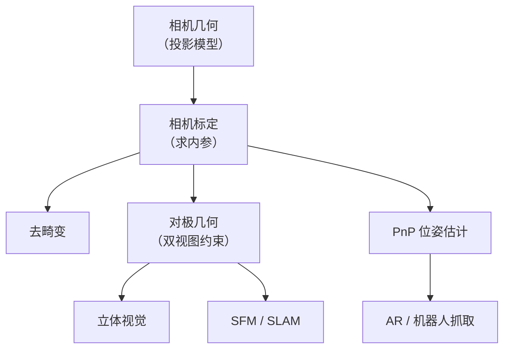
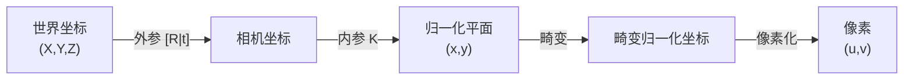
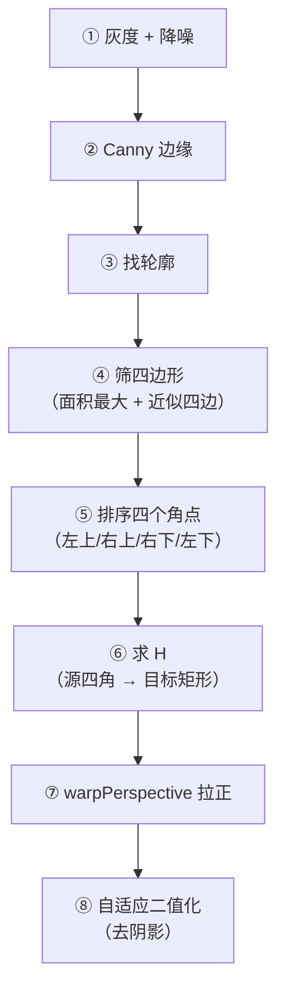
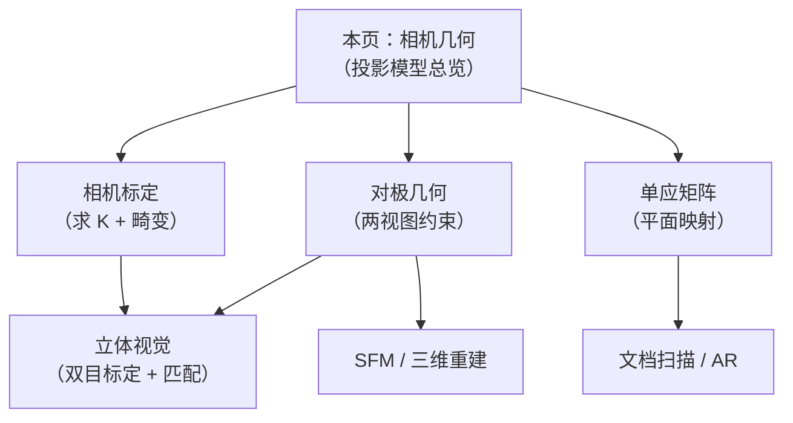

# 相机几何

> **一句话**：搞清楚"3D 世界的一个点，怎么变成图像上的一个像素"，以及反过来的解法。

## 这个页面讲什么

**相机几何 = "相机怎么把三维世界投影成二维图像"的数学**。

它是**所有几何视觉的基础**：标定、双目标定、位姿估计、三维重建、SLAM，全部建立在这套投影模型上。



## 本章的三个子主题

| 页面 | 内容 | 用途 |
|---|---|---|
| **[相机标定](/branches/geometry/calibration)** | 求内参 + 畸变系数 | 让像素能换算成真实尺寸 |
| **[对极几何](/branches/geometry/epipolar)** | 两视图的几何约束 | 把 2D 搜索降为 1D |
| **[单应矩阵](/branches/geometry/homography)** | 平面到平面的映射 | 找平面、做透视校正 |

## ① 从 3D 到 2D：投影链条



**每一个箭头都是一步变换**：

| 步骤 | 变换 | 参数 |
|---|---|---|
| 世界 → 相机 | 刚体变换（旋转 + 平移） | **外参** |
| 相机 → 归一化平面 | 除以深度 Z | 无 |
| 归一化 → 像素 | 乘焦距 + 加主点 | **内参 K** |
| 加畸变 | 非线性多项式 | **畸变系数** |

**完整写出来**：

$$ s\begin{bmatrix} u\\v\\1 \end{bmatrix} = K \cdot \underbrace{\begin{bmatrix} R & t \end{bmatrix}}\begin{bmatrix} X\\Y\\Z\\1\end{bmatrix} $$

## ② 为什么"深度丢失"是本质问题

**投影把 3D 压成 2D，必然丢失一个维度（深度）**。


**所以**：

| 从图中能得到 | 得不到 |
|---|---|
| 点的**方向** | 点的**距离** |
| 点的相对位置（在像面上） | 绝对三维坐标 |

::: tip 这是单目视觉的根本困难
**单目相机无法直接得到深度**。

**所有的"单目测距"其实都是"借助先验"**：

| 方法 | 借助的先验 |
|---|---|
| 已知物体真实尺寸 | "车牌是 440 mm 宽" |
| 已知地面平面 | "物体在地面上"（地平面约束） |
| 已知运动 | 从运动中恢复结构（SFM） |
| 深度学习 | 从数据中学"典型尺寸" |

**而双目/结构光/ToF 通过"额外信息（第二视角/主动光）"直接测量深度**。

**这就是为什么"双目"看起来只是"多一个相机"，却能测距**——多了一个视角，多了几何约束。
:::

## ③ 关键概念速查

| 概念 | 含义 | 在哪里用 |
|---|---|---|
| **内参 K** | 相机自身属性 | 投影计算 |
| **外参 [R\|t]** | 相机位姿 | 投影计算 |
| **畸变系数** | 镜头非线性 | 校正 |
| **单应 H** | 平面间映射 | 平面检测、透视校正 |
| **基础矩阵 F** | 两视图约束（像素坐标） | 特征匹配验证 |
| **本质矩阵 E** | 两视图约束（归一化坐标） | 位姿估计 |
| **三角化** | 从两视角求 3D 点 | 三维重建 |
| **PnP** | 已知 3D-2D 对应求位姿 | AR、机器人 |

### PnP（Perspective-n-Point）

**问题**：已知一些 3D 点及其在图像中的 2D 投影，求相机的位姿 (R, t)。

```python
# 已知 3D 点和对应的 2D 像素点
success, rvec, tvec = cv2.solvePnP(
    object_points,      # 3D 点 (N, 3)
    image_points,       # 2D 点 (N, 2)
    camera_matrix,      # 内参 K
    dist_coeffs         # 畸变
)

# 用 RANSAC 更鲁棒
success, rvec, tvec, inliers = cv2.solvePnPRansac(
    object_points, image_points,
    camera_matrix, dist_coeffs,
    iterationsCount=100,
    reprojectionError=8.0,
    confidence=0.99
)
```

**最少需要几个点**：

| 方法 | 最少点数 |
|---|---|
| **P3P** | 3（有 4 个解，需第 4 点消歧） |
| **EPnP** | 4+ |
| **迭代法** | 4+ |

::: tip PnP 是 AR 和机器人抓取的核心
**AR 的完整流程**：


**机械臂抓取**：


:::

## ④ 单应矩阵

**当场景是平面（或相机纯旋转）时，两图之间是单应变换**。

$$ \begin{bmatrix} u'\\v'\\1 \end{bmatrix} \sim H \begin{bmatrix} u\\v\\1 \end{bmatrix} $$

**H 是 3×3 矩阵，8 个自由度**（去掉尺度）→ **需要 4 对点**。

```python
# 求单应
H, mask = cv2.findHomography(pts1, pts2, cv2.RANSAC, 5.0)

# 用 H 做透视变换
warped = cv2.warpPerspective(img, H, (width, height))
```

### 典型应用

| 应用 | 说明 |
|---|---|
| **文档扫描仪** | 把倾斜拍的纸"拉正" |
| **平面检测** | 找桌面、地面、标定板 |
| **AR 平面跟踪** | 把虚拟物体贴在平面上 |
| **全景拼接** | 纯旋转时用 H 对齐 |
| **逆透视变换（IPM）** | 车道线检测中的"鸟瞰图" |

::: tip 文档扫描仪案例
**需求**：手机拍文档 → 自动"拉正"。

**流程**：



**关键点 1：四角排序**

```python
def order_points(pts):
    """把四个点排序为：左上、右上、右下、左下"""
    rect = np.zeros((4, 2), dtype=np.float32)

    # 左上 = x+y 最小；右下 = x+y 最大
    s = pts.sum(axis=1)
    rect[0] = pts[np.argmin(s)]
    rect[2] = pts[np.argmax(s)]

    # 右上 = y-x 最小；左下 = y-x 最大
    diff = np.diff(pts, axis=1).ravel()
    rect[1] = pts[np.argmin(diff)]
    rect[3] = pts[np.argmax(diff)]

    return rect
```

**为什么这个排序对**：

- **左上角**：x 和 y 都小 → x+y 最小 ✅
- **右下角**：x 和 y 都大 → x+y 最大 ✅
- **右上角**：x 大 y 小 → y-x 最小 ✅
- **左下角**：x 小 y 大 → y-x 最大 ✅

**这是一个非常巧妙的技巧**（在文档扫描里几乎必用）。

**关键点 2：自适应二值化去阴影**

```python
# ❌ 全局阈值：纸面阴影处会变黑
_, binary = cv2.threshold(gray, 127, 255, cv2.THRESH_BINARY)

# ✅ 自适应阈值：每个区域独立判断
binary = cv2.adaptiveThreshold(
    gray, 255,
    cv2.ADAPTIVE_THRESH_GAUSSIAN_C,     # 高斯加权（比均值更平滑）
    cv2.THRESH_BINARY,
    blockSize=31,                       # 局部窗口（必须是奇数）
    C=15                                # 阈值偏移
)
```

**自适应阈值能自动适应"纸面渐变阴影"**——这是它存在的意义。
:::

## ⑤ 手眼标定

**问题**：相机看到的坐标 → 机器人能执行的动作，中间要转换。


| 布置方式 | 说明 |
|---|---|
| **眼在手上（Eye-in-Hand）** | 相机装在机械臂末端，**跟着动** |
| **眼在手外（Eye-to-Hand）** | 相机固定，**看整个工作区** |

**核心方程**（$AX = XB$，这是经典的"手眼标定方程"）：

```python
# 采集多组位姿（不同姿态下拍同一个标定板）
# R_gripper2base, t_gripper2base: 机械臂末端位姿（正运动学）
# R_target2cam, t_target2cam: 标定板相对相机的位姿（solvePnP）

R_cam2gripper, t_cam2gripper = cv2.calibrateHandEye(
    R_gripper2base, t_gripper2base,
    R_target2cam, t_target2cam,
    method=cv2.CALIB_HAND_EYE_TSAI
)
```

**四个参数的含义**：

| 参数 | 从哪来 |
|---|---|
| `R_gripper2base` | 机械臂**正运动学**（从关节角算末端位姿） |
| `R_target2cam` | **solvePnP**（标定板相对相机） |
| 输出 `R_cam2gripper` | **我们想求的**（相机相对末端） |

::: tip 手眼标定需要"多姿态"
**至少要两个不同姿态**（理论上），**实践用 10–20 个**。

**为什么**：**单一姿态下，无法分离"旋转"和"平移"**。

**采样策略**：

- **机器人末端做"球面运动"**（绕一个点转各种角度）
- **覆盖各种方向**（不要都在一个平面内）
- **标定板在相机视野内完整可见**
:::

## 常见踩坑

::: danger 坑 1：把"内参"和"外参"搞混
**现象**：换个相机位置后，内参也重算了。

**根因**：**内参是相机自身的属性（焦距、主点），与拍摄位置无关**；外参才是位姿（每张图不同）。

| 参数 | 何时会变 |
|---|---|
| **内参 K** | **只在变焦/换镜头/改分辨率时变** |
| **外参 [R\|t]** | **每张图都不同** |

**实践**：**内参标定一次，长期复用**（存文件），只在硬件变化时重标。
:::

::: danger 坑 2：忽略畸变
**现象**：用"直线检测"发现直线是弯的；用几何测量发现边缘处误差大。

**根因**：**未做畸变校正**。

**解决**：**先 `undistort`，再做几何测量**。

**判断**：拍一张网格图，看边缘直线是否弯。
:::

::: danger 坑 3：坐标系方向搞错
**现象**：3D 点云是"镜像"的，或者深度符号反了。

**说明**：

| 坐标系 | x | y | z |
|---|---|---|---|
| **相机坐标系（OpenCV）** | 右 | **下** | **前**（光轴方向） |
| 图像坐标系 | 右 | **下** | — |
| 世界坐标系 | 自定义 | 自定义 | 自定义 |

**注意：y 轴向下！**（这是图像/相机的约定）

**如果要画 3D 可视化，常需要 `y = -y` 转成"y 向上"的标准右手系**。
:::

::: danger 坑 4：`solvePnP` 的点太少或共面
**现象**：位姿不稳定，或者有多个解。

**根因**：

- **点数 < 4**（欠定）
- **点共线**（退化）
- **点共面**（有解但需要额外消歧，且对噪声敏感）

**解决**：

- **至少 4 个点**（推荐 6+）
- **点在 3D 中不要共面**（最理想）
- **用 `solvePnPRansac`** 排除误匹配
:::

::: danger 坑 5：标定尺寸单位不一致
**现象**：算出来的平移量差 1000 倍。

**根因**：**单位不统一**。

**解决**：**全程统一单位**：

| 参数 | 常见单位 |
|---|---|
| 标定板方格 | mm 或 m |
| 内参 f | **像素** |
| 平移 t | **和标定板同单位** |

**记牢**：**t 的单位 = 标定板尺寸的单位**。
:::

## 与本分支其他页的关系



## 相关链接

- [相机标定](/branches/geometry/calibration)
- [对极几何](/branches/geometry/epipolar)
- [立体视觉与 SFM](/branches/geometry/stereo-sfm)
- [立体视觉（视差测距）](/branches/geometry/stereo)
- [⑥ 几何视觉分支](/branches/geometry/)
