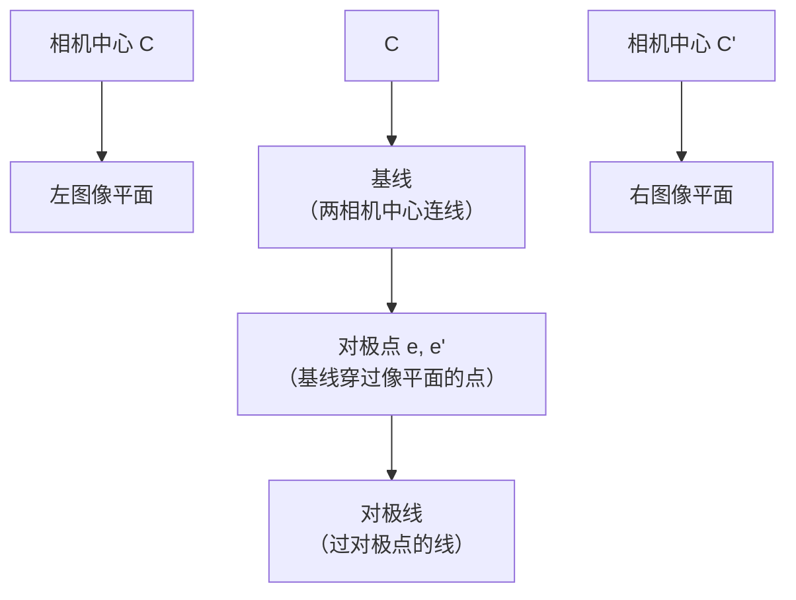
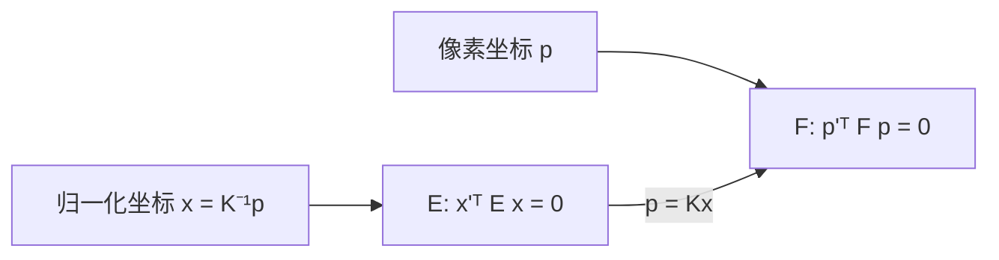
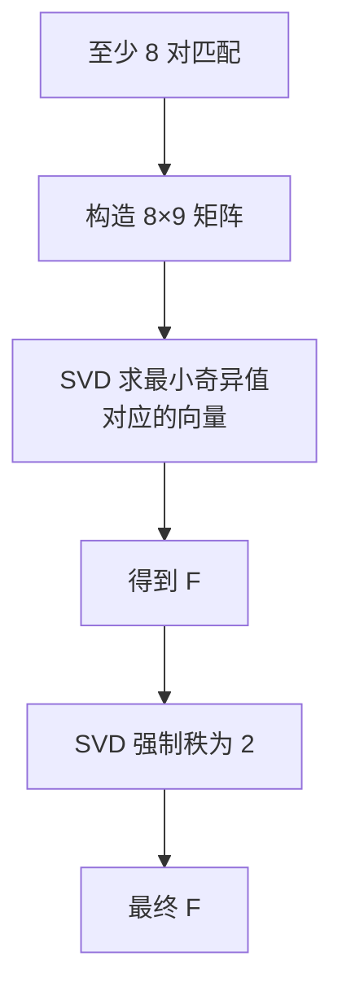
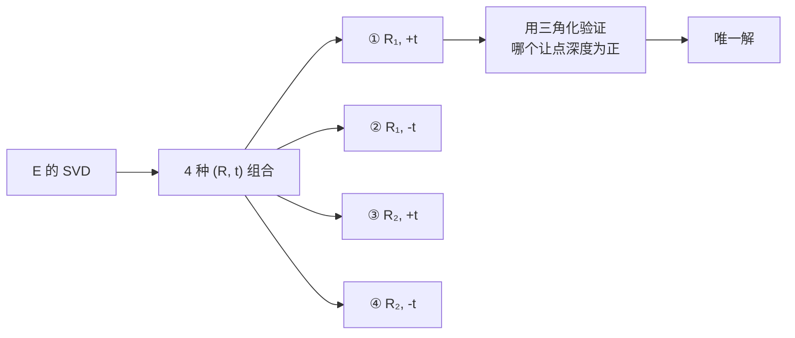
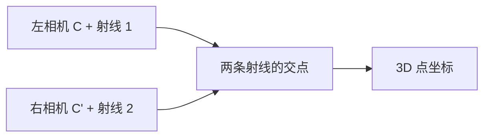
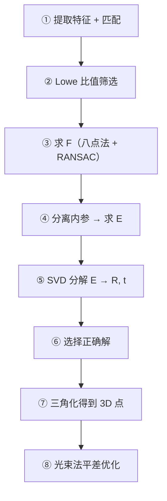
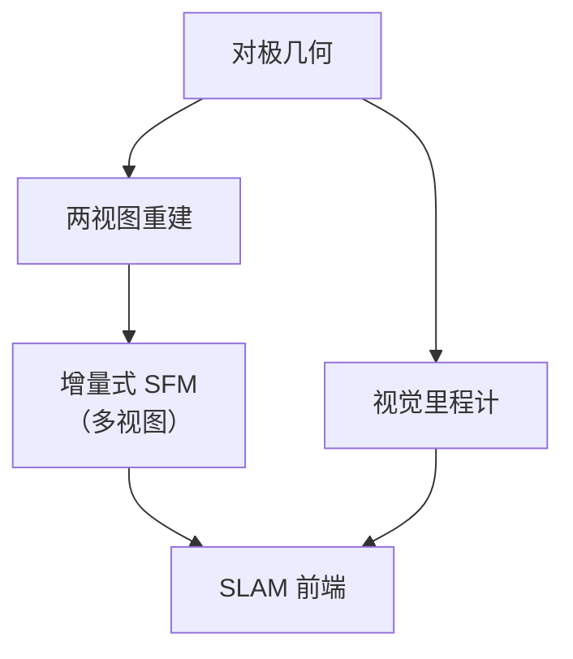

# 对极几何

> **一句话**：两张图之间有一条「几何约束线」，能把 2D 搜索降成 1D 搜索。

## 核心事实

**给定左图的一个点，它在右图中的对应点一定在一条直线上**。


**生活比方**：你知道朋友站在左边房间某处。要看他在右边房间的投影位置，**不用把整个右图找一遍**——只需要在一条特定的直线上找。

## 为什么这很重要

| 方法 | 搜索范围 |
|---|---|
| 无约束 | **2D 全图搜索**（O(N²)） |
| **有对极约束** | **1D 直线上搜索**（O(N)） |

**加速效果**：

- 匹配从平方级降到线性级
- 能**剔除大量误匹配**（不在对极线上的都是错的）

## ① 基本概念



| 概念 | 定义 |
|---|---|
| **基线** | 两个相机光心的连线 |
| **对极平面** | 包含基线 + 空间点 P 的平面 |
| **对极点 e** | 基线在**本图**上的投影点 |
| **对极线 l'** | 对极平面在**另一图**上的投影线 |
| **本质** | **空间点 P 一定在对极平面上，所以它的像一定在对极线上** |

### 直观理解

**想象**：

1. 左相机看到空间中的点 P（但不知道它在深度方向上的具体位置）
2. P 可能在射线 C→p 上的任何位置
3. **这条射线在右图中的投影就是一条直线**（对极线）
4. 所以 P 在右图中的像一定在这条线上

**这就是「对极约束」**。

## ② 三类矩阵

| 矩阵 | 描述 | 坐标类型 | 最小点数 |
|---|---|---|---|
| **单应 H** | 平面场景 | 像素 | **4** |
| **基础矩阵 F** | 一般运动 | **像素坐标** | **8（八点法）** |
| **本质矩阵 E** | 一般运动 | **归一化坐标** | **5（五点法）** |

### 基础矩阵 F

**定义**：

$$ \mathbf{p'}^T F \mathbf{p} = 0 $$

其中 $\mathbf{p}, \mathbf{p'}$ 是两图中的**像素齐次坐标**。

**性质**：

| 性质 | 说明 |
|---|---|
| 秩 | **rank(F) = 2**（因为 $F e' = 0$） |
| 自由度 | **7**（9 个元素，去掉尺度和秩约束） |
| 对极线 | $l' = F\mathbf{p}$（左点到右线） |
| 对极点 | $Fe = 0$ → $e$ 是 F 的右零空间 |

### 本质矩阵 E

**定义**：$E = K'^T F K$

**与 F 的关系**：



**E 的性质**：

| 性质 | 说明 |
|---|---|
| **两个奇异值相等** | $\sigma_1 = \sigma_2 = \sigma \ne \sigma_3$ |
| 自由度 | **5**（3 旋转 + 3 平移 - 1 尺度） |
| 分解 | SVD 分解可得到 R 和 t |

**为什么 E 更好**：因为奇异值约束（$\sigma_1 = \sigma_2$）能用于校验和优化。

## ③ 八点法（求 F）

### 思路

$$ \mathbf{p'}^T F \mathbf{p} = 0 $$

**展开成一维**：

$$ [u'u,\ u'v,\ u',\ v'u,\ v'v,\ v',\ u,\ v,\ 1] \cdot \mathbf{f} = 0 $$

其中 $\mathbf{f}$ 是 F 展平成的 9 维向量。

**每对匹配给出一个方程**。**8 对匹配** → 8 个方程 → 能解出 $\mathbf{f}$（差一个尺度）。



::: tip 为什么最后要强制秩 2
**理论上 F 的秩必须是 2**（因为是反对称矩阵与可逆矩阵的乘积）。

**但用 SVD 直接算出来的 F 可能秩为 3**（数值误差）。

**修正**：对 F 做 SVD，把最小的奇异值**置零**，重新组装 F。

**这就是"8 点法"的完整流程**。
:::

### 代码

```python
# 方法一：OpenCV（推荐）
F, mask = cv2.findFundamentalMat(
    pts1, pts2,
    cv2.FM_RANSAC,          # 用 RANSAC 处理误匹配
    1.0,                    # 极线距离阈值（像素）
    0.99                    # 置信度
)
inliers = mask.ravel().sum()

# 方法二：手写八点法（理解用）
def fundamental_8point(pts1, pts2):
    # 归一化（重要！）
    pts1_n, T1 = normalize(pts1)
    pts2_n, T2 = normalize(pts2)

    # 构造 A 矩阵
    A = np.column_stack([
        pts2_n[:, 0] * pts1_n[:, 0],
        pts2_n[:, 0] * pts1_n[:, 1],
        pts2_n[:, 0],
        pts2_n[:, 1] * pts1_n[:, 0],
        pts2_n[:, 1] * pts1_n[:, 1],
        pts2_n[:, 1],
        pts1_n[:, 0],
        pts1_n[:, 1],
        np.ones(len(pts1_n))
    ])

    # SVD 求最小奇异值对应的向量
    _, _, Vt = np.linalg.svd(A)
    F = Vt[-1].reshape(3, 3)

    # 强制秩 2
    U, S, Vt = np.linalg.svd(F)
    S[-1] = 0
    F = U @ np.diag(S) @ Vt

    # 反归一化
    return T2.T @ F @ T1
```

::: danger 必须做归一化！
**未归一化的八点法数值上是灾难**：

- 图像坐标可能是 0–1920
- 齐次坐标的多次乘积会到 10⁶–10¹² 量级
- **条件数极差**，SVD 结果不可信

**归一化方法（Hartley 归一化）**：

1. 把点平移到**质心在原点**
2. 缩放到**平均距离为 √2**
3. 记录变换矩阵 T
4. 在归一化坐标下求 F
5. 反归一化：$F = T_2^T F_{norm} T_1$

**不归一化，八点法基本无法工作**。
:::

## ④ 五点法（求 E）

**八点法需要 8 对匹配**，而 **E 只有 5 个自由度** → 理论上 **5 对就够了**。

**五点法的优势**：

| 优势 | 说明 |
|---|---|
| 需要更少匹配 | **5 vs 8** |
| 能用内参约束 | 解空间更小 |
| 精度更高 | 因为加了约束 |

**缺点**：**需要解 10 次多项式**，实现复杂。

**实践**：**直接用 OpenCV**。

```python
E, mask = cv2.findEssentialMat(
    pts1, pts2, K,
    method=cv2.RANSAC,
    prob=0.999,
    threshold=1.0           # 像素阈值
)

# 从 E 恢复位姿
_, R, t, mask_pose = cv2.recoverPose(E, pts1, pts2, K)
```

::: tip 八点法 vs 五点法
| 场景 | 用哪个 |
|---|---|
| 不知道内参 | **八点法求 F** |
| 知道内参（已标定） | **五点法求 E**（更准） |
| 匹配点很多（> 100） | 八点法 + RANSAC（稳） |
| 匹配点很少（5–10） | **五点法**（唯一选择） |
:::

## ⑤ 从 E 恢复位姿

**E 包含旋转和平移**：

$$ E = [t]_\times R $$

| 符号 | 含义 |
|---|---|
| $R$ | 旋转矩阵 |
| $[t]_\times$ | 平移向量 t 的反对称矩阵 |

**四个可能的解**：



**怎么选**：**三角化后所有点的深度都为正的那个解**。

**OpenCV 的 `recoverPose` 自动做这个选择**。

```python
points, R, t, mask = cv2.recoverPose(
    E, pts1, pts2, K,
    distanceThresh=100,      # 超过这个距离的点不算
    mask=mask
)
```

## ⑥ 三角化（求 3D 点）

**已知**：两个相机位姿 + 匹配点。

**求**：空间点的 3D 坐标。



**理论上两条射线应相交**，但**实际上（噪声）不相交** → 用**最小二乘**求最近点。

```python
# 两种方法

# 方法一：DLT
points_4d = cv2.triangulatePoints(P1, P2, pts1.T, pts2.T)
points_3d = (points_4d[:3] / points_4d[3]).T

# 方法二：从 recoverPose 得到
P1 = K @ np.hstack([np.eye(3), np.zeros((3, 1))])      # 左相机
P2 = K @ np.hstack([R, t])                              # 右相机
points_4d = cv2.triangulatePoints(P1, P2, pts1.T, pts2.T)
points_3d = (points_4d[:3] / points_4d[3]).T
```

::: warning 三角化的精度问题
**三角化对噪声很敏感**，特别是：

| 情况 | 问题 |
|---|---|
| **基线太小** | 两条射线几乎平行 → 交点极不稳定 |
| **点太远** | 深度误差正比于 Z² |
| **匹配误差大** | 直接导致 3D 点偏移 |

**判据：三角化夹角**

```python
def triangulation_angle(C1, C2, P):
    """C1, C2: 相机中心；P: 3D 点"""
    v1 = (P - C1) / np.linalg.norm(P - C1)
    v2 = (P - C2) / np.linalg.norm(P - C2)
    return np.degrees(np.arccos(np.clip(np.dot(v1, v2), -1, 1)))
```

| 夹角 | 深度可靠性 |
|---|---|
| < 0.5° | **不可信** |
| 0.5°–2° | 一般 |
| > 2° | **可信** |

**所以 SLAM 系统会剔除夹角太小的点**。
:::

## ⑦ 工程实践：完整流程



```python
def two_view_reconstruction(pts1, pts2, K):
    # ① 求本质矩阵（用 RANSAC）
    E, mask = cv2.findEssentialMat(
        pts1, pts2, K, method=cv2.RANSAC, prob=0.999, threshold=1.0
    )
    if E is None or mask.sum() < 5:
        return None

    pts1_in = pts1[mask.ravel() == 1]
    pts2_in = pts2[mask.ravel() == 1]

    # ② 恢复位姿
    _, R, t, mask_pose = cv2.recoverPose(E, pts1_in, pts2_in, K)

    # ③ 三角化
    P1 = K @ np.hstack([np.eye(3), np.zeros((3, 1))])
    P2 = K @ np.hstack([R, t])
    pts4d = cv2.triangulatePoints(P1, P2, pts1_in.T, pts2_in.T)
    pts3d = (pts4d[:3] / pts4d[3]).T

    return R, t, pts3d
```

## 常见踩坑

::: danger 坑 1：忘了归一化
**现象**：手写的八点法结果完全错误。

**根因**：数值条件数极差。

**解决**：**Hartley 归一化**（见上文代码）。

**或者直接用 `cv2.findFundamentalMat`**（OpenCV 内部做了归一化）。
:::

::: danger 坑 2：点共面导致退化
**现象**：F 求解不稳定，或者得到多解。

**根因**：**所有点在一个平面上时，基础矩阵退化**（有无穷多解）。

**解决**：**改用单应矩阵 H**（平面场景下 H 更合适）。

```python
# 判断：用 H 算内点率，和用 F 算的比
H, mask_H = cv2.findHomography(pts1, pts2, cv2.RANSAC, 3.0)
F, mask_F = cv2.findFundamentalMat(pts1, pts2, cv2.FM_RANSAC, 1.0, 0.99)

if mask_H.sum() > 0.7 * len(pts1):
    print("场景可能是平面，用 H")
else:
    print("场景有深度变化，用 F")
```
:::

::: danger 坑 3：纯旋转运动
**现象**：无法恢复平移 t（t 接近 0）。

**根因**：**纯旋转时基线为 0**，对极几何退化。

**解决**：

- **用单应矩阵 H**（纯旋转时，任意深度都能用 H）
- 或者拍摄时**确保有平移运动**
:::

::: danger 坑 4：F 的极线距离阈值设错
**现象**：内点率异常高（95%）或异常低（10%）。

**说明**：`findFundamentalMat` 的 `ransacReprojThreshold` 是**到极线的距离**（不是重投影误差）。

| 阈值 | 效果 |
|---|---|
| 0.5 px | 严格 |
| **1.0 px** | **推荐** |
| 3.0 px | 宽松 |

**与 `findHomography` 的阈值（重投影误差）不是一回事**。
:::

::: danger 坑 5：三角化出负深度
**现象**：三角化得到一半的点 Z < 0（跑到相机后面了）。

**根因**：**R, t 的符号选错了**（recoverPose 的 4 个解中选错）。

**解决**：用 `cv2.recoverPose`（自动选正确解），或手动检查哪个解让深度全为正。
:::

## 与 SLAM / 三维重建的关系



| 应用 | 用到的对极几何 |
|---|---|
| 视觉里程计 | 帧间 E 估计 + 三角化 |
| 增量式 SFM | 初始化用地对极几何 |
| 双目视觉 | 立体校正后对极线水平 |
| AR | 平面跟踪 + 位姿 |

::: tip 对极几何是几何视觉的"心脏"
**所有多视图几何的算法**，都建立在"对极约束"之上。

**即使深度学习遍地的今天**：

- 学习出的匹配点 → 仍要用 E / F 做几何验证
- 学习出的深度 → 仍要满足对极一致性
- **几何是物理约束，不会被替代**
:::

## 相关链接

- [相机标定](/branches/geometry/calibration)
- [立体视觉](/branches/geometry/stereo)
- [鲁棒估计（RANSAC）](/branches/feature-matching/robust-estimation)
- [⑥ 几何视觉分支](/branches/geometry/)
- [返回几何视觉分支](/branches/geometry/)
