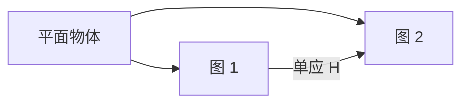
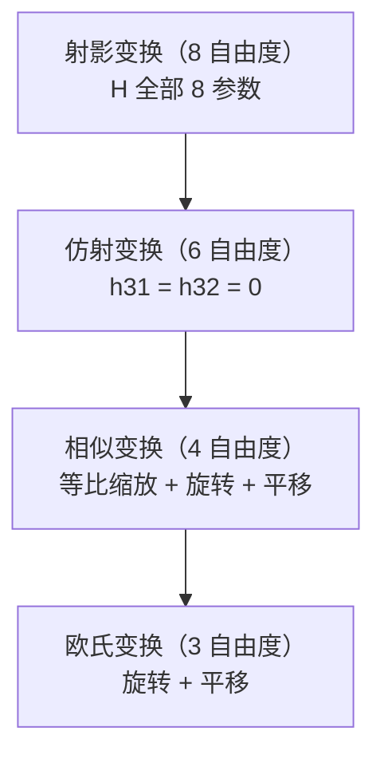

# 单应矩阵

> **一句话**：把"一个平面"在两张图之间的对应关系，用一个 3×3 矩阵描述清楚。

## 为什么需要单应

**一般场景**（有深度变化）→ 两图之间是**对极几何**（点对点映射成一条线）。

**平面场景** → 两图之间是**一个确定的点对点映射**（单应）。



**生活比方**：**用地砖拍照**。

- 你从不同角度看同一片地砖，地砖上的**图案**不会变
- 但**位置和形状**会变（近大远小）
- **单应矩阵就是描述这个"变"的规则**

## ① 数学定义

$$ \begin{bmatrix} u' \\ v' \\ 1 \end{bmatrix} \sim H \begin{bmatrix} u \\ v \\ 1 \end{bmatrix} $$

其中 $H$ 是 3×3 矩阵：

$$ H = \begin{bmatrix} h_{11} & h_{12} & h_{13} \\ h_{21} & h_{22} & h_{23} \\ h_{31} & h_{32} & h_{33} \end{bmatrix} $$

**"∼"是"相差一个尺度"的意思**（齐次坐标）。

| 自由度 | 说明 |
|---|---|
| 9 个元素 - 1 个尺度 = **8 个自由度** | |
| 每对点给 **2 个**方程 | |
| **所以至少需要 4 对点** | |

::: tip 单应 vs 对极几何
| | 单应 H | 基础矩阵 F |
|---|---|---|
| 约束类型 | **点↔点** | 点↔线 |
| 场景要求 | **平面** 或 **纯旋转** | 一般场景 |
| 最小点数 | **4** | 8 |
| 输出 | 确定坐标 | 一条线 |

**判断用哪个**：**如果场景是平面（或相机绕光心转），用 H**（信息更多、更精确）。

**代码判断法**：

```python
H, mask_H = cv2.findHomography(pts1, pts2, cv2.RANSAC, 3.0)
F, mask_F = cv2.findFundamentalMat(pts1, pts2, cv2.FM_RANSAC, 1.0, 0.99)

# H 的内点率高 → 场景很可能是平面
if mask_H.sum() > 0.8 * len(pts1):
    print("平面场景，用 H")
else:
    print("一般场景，用 F")
```
:::

## ② 四种变换的层级

**单应是"射影变换"（最一般），其他变换都是它的特例**。



| 变换 | 自由度 | 保持什么 | 用途 |
|---|---|---|---|
| **射影** | 8 | **直线还是直线** | 透视校正 |
| **仿射** | 6 | + 平行还是平行 | 仿射配准 |
| **相似** | 4 | + 角度不变 | 同比例缩放 |
| **欧氏** | 3 | + 长度不变 | 刚体配准 |

::: tip "保持什么"是选择变换的依据
**举例**：

| 场景 | 用哪个 |
|---|---|
| 拍倾斜的桌面（透视） | **射影** |
| 卫星图配准（有旋转缩放） | 相似 / 仿射 |
| 工件刚性平移（产线） | **欧氏**（只要平移旋转） |
| 两个不同软件打开同一图像 | 视情况（可能还需要翻转） |

**用更"简单"的变换（自由度少）更稳**（因为约束更多、不容易被噪声带偏）。

**所以能用仿射就别用射影**。
:::

## ③ 求解单应

**DLT（直接线性变换）**：

$$ \begin{bmatrix} u' \\ v' \\ 1 \end{bmatrix} \sim \begin{bmatrix} h_{11} & h_{12} & h_{13} \\ h_{21} & h_{22} & h_{23} \\ h_{31} & h_{32} & h_{33} \end{bmatrix} \begin{bmatrix} u \\ v \\ 1 \end{bmatrix} $$

**展开**（消去尺度）：

$$ u' = \frac{h_{11}u + h_{12}v + h_{13}}{h_{31}u + h_{32}v + h_{33}}, \quad v' = \frac{h_{21}u + h_{22}v + h_{23}}{h_{31}u + h_{32}v + h_{33}} $$

**每对点给出 2 个线性方程** → **4 对点得到 8 个方程** → 解出 8 个未知数。

```python
# 方法一：OpenCV（推荐）
H, mask = cv2.findHomography(src_pts, dst_pts, cv2.RANSAC, 5.0)
inliers = mask.ravel().sum()

# 方法二：手写 DLT（理解用）
def homography_dlt(src, dst):
    """从 N 对点求单应（N >= 4）"""
    src = np.asarray(src, dtype=np.float64)
    dst = np.asarray(dst, dtype=np.float64)

    # Hartley 归一化（关键！）
    src_n, T_src = normalize_points(src)
    dst_n, T_dst = normalize_points(dst)

    A = []
    for (x, y), (u, v) in zip(src_n, dst_n):
        A.append([-x, -y, -1, 0, 0, 0, u*x, u*y, u])
        A.append([0, 0, 0, -x, -y, -1, v*x, v*y, v])

    A = np.array(A)
    _, _, Vt = np.linalg.svd(A)
    H = Vt[-1].reshape(3, 3)

    # 反归一化
    H = np.linalg.inv(T_dst) @ H @ T_src
    return H / H[2, 2]


def normalize_points(pts):
    """Hartley 归一化：质心到原点，平均距离为 sqrt(2)"""
    centroid = pts.mean(axis=0)
    shifted = pts - centroid
    avg_dist = np.mean(np.linalg.norm(shifted, axis=1))
    scale = np.sqrt(2) / avg_dist
    T = np.array([
        [scale, 0, -scale * centroid[0]],
        [0, scale, -scale * centroid[1]],
        [0, 0, 1]
    ])
    pts_n = (T[:2, :2] @ pts.T).T + T[:2, 2]
    return pts_n, T
```

::: danger 必须做归一化（同八点法）
**原始像素坐标（0–1920）直接送入 DLT → 数值条件极差**。

**Hartley 归一化**：

1. 平移使质心在原点
2. 缩放使平均距离为 √2
3. 求 H 后再反归一化：$H = T_{dst}^{-1} H_{norm} T_{src}$

**不归一化的 DLT 基本不可用**。OpenCV 内部做了这个。
:::

## ④ 用单应做透视变换

### 基本用法

```python
H, mask = cv2.findHomography(src_pts, dst_pts, cv2.RANSAC, 5.0)

# 变换图像（需要指定输出尺寸）
warped = cv2.warpPerspective(img, H, (out_w, out_h))

# 变换点
def transform_points(pts, H):
    pts_h = np.hstack([pts, np.ones((len(pts), 1))])
    transformed = (H @ pts_h.T).T
    return transformed[:, :2] / transformed[:, 2:3]
```

### 文档扫描（最经典应用）

```python
def scan_document(img):
    """把倾斜拍摄的文档拉正"""
    h, w = img.shape[:2]

    # ① 灰度 + 边缘
    gray = cv2.cvtColor(img, cv2.COLOR_BGR2GRAY)
    blurred = cv2.GaussianBlur(gray, (5, 5), 0)
    edges = cv2.Canny(blurred, 50, 150)

    # ② 找四边形轮廓
    contours, _ = cv2.findContours(edges, cv2.RETR_EXTERNAL,
                                   cv2.CHAIN_APPROX_SIMPLE)
    contours = sorted(contours, key=cv2.contourArea, reverse=True)

    doc_contour = None
    for c in contours[:5]:
        peri = cv2.arcLength(c, True)
        approx = cv2.approxPolyDP(c, 0.02 * peri, True)
        if len(approx) == 4 and cv2.contourArea(c) > 0.25 * h * w:
            doc_contour = approx
            break

    if doc_contour is None:
        return None

    # ③ 排序四个角点
    pts = doc_contour.reshape(4, 2).astype(np.float32)
    rect = order_points(pts)      # 左上、右上、右下、左下

    # ④ 计算目标矩形尺寸
    (tl, tr, br, bl) = rect
    width = max(np.linalg.norm(br - bl), np.linalg.norm(tr - tl))
    height = max(np.linalg.norm(tr - br), np.linalg.norm(tl - bl))

    dst = np.array([
        [0, 0],
        [width - 1, 0],
        [width - 1, height - 1],
        [0, height - 1]
    ], dtype=np.float32)

    # ⑤ 求 H 并变换
    H, _ = cv2.findHomography(rect, dst, cv2.RANSAC, 5.0)
    warped = cv2.warpPerspective(img, H, (int(width), int(height)))

    # ⑥ 二值化（去阴影）
    warped_gray = cv2.cvtColor(warped, cv2.COLOR_BGR2GRAY)
    binary = cv2.adaptiveThreshold(
        warped_gray, 255,
        cv2.ADAPTIVE_THRESH_GAUSSIAN_C,
        cv2.THRESH_BINARY,
        blockSize=31, C=15
    )

    return warped, binary


def order_points(pts):
    """四点排序：左上、右上、右下、左下"""
    rect = np.zeros((4, 2), dtype=np.float32)
    s = pts.sum(axis=1)
    rect[0] = pts[np.argmin(s)]     # 左上（x+y 最小）
    rect[2] = pts[np.argmax(s)]     # 右下（x+y 最大）
    diff = np.diff(pts, axis=1).ravel()
    rect[1] = pts[np.argmin(diff)]  # 右上（y-x 最小）
    rect[3] = pts[np.argmax(diff)]  # 左下（y-x 最大）
    return rect
```

::: tip 为什么"用近似四边形而不是精确轮廓"
**纸张边缘会有噪声和毛刺**，精确轮廓可能是几百个点。

**`approxPolyDP` 用多边形近似**（`epsilon` 控制精度），**纸张就应该是 4 个点**。

**筛选条件**：

| 条件 | 为什么 |
|---|---|
| `len(approx) == 4` | 四边形 |
| 面积 > 25% 图像 | 剔除小方块 |
| 按面积降序取前 5 个 | 文档一定是最大的 |

**这套流程对所有"矩形物体定位"都适用**（不只是纸张）。
:::

### 逆透视变换（IPM）：车道线检测

**问题**：透视图里的车道线是斜的（两条线交叉），不方便检测。

**解法**：**用 H 把图像变成"鸟瞰图"**，车道线变成平行直线。

```python
def to_bird_eye(img, src_pts, dst_pts):
    """
    src_pts: 原图中的梯形区域（车道区域）
    dst_pts: 目标矩形
    """
    H, _ = cv2.findHomography(src_pts, dst_pts)
    h, w = img.shape[:2]
    return cv2.warpPerspective(img, H, (w, h)), H


# 典型参数（1280×720）
src = np.float32([
    [580, 460],     # 左上
    [700, 460],     # 右上
    [1100, 720],    # 右下
    [200, 720]      # 左下
])
dst = np.float32([
    [300, 0],
    [1000, 0],
    [1000, 720],
    [300, 720]
])
```

**效果**：


**为什么有用**：**平行直线可以用简单的滑动窗口法检测**（独木桥式的列直方图峰值）。

**这也是"曲率计算"的前提**（在鸟瞰图里，车道线是抛物线）。

## ⑤ 单应的其他应用

| 应用 | 说明 |
|---|---|
| **全景拼接** | 相机绕光心纯旋转 → 用 H 对齐 |
| **AR 平面跟踪** | 追踪平面 → 用 H 计算虚拟物体的贴图位置 |
| **图像配准** | 两张有透视差异的图 → 用 H 对齐 |
| **平面标定（张正友法）** | 棋盘格是平面 → 每张图算一个 H → 解内参 |
| **纹理映射** | 把平面纹理贴到任意视角 |

::: tip 全景拼接的步骤


**关键**：**必须"相机绕光心旋转"**（不移动位置）。

**如果相机平移了** → 视差会产生**重影**（因为不同深度物体的 H 不同）。
:::

## 常见踩坑

::: danger 坑 1：点不够或共线
**现象**：`findHomography` 返回 None，或 H 完全错误。

**根因**：

- **点数 < 4**（欠定）
- **点共线**（退化，无穷多解）

**解决**：

- **至少 4 对**，推荐 **8+ 对**（用 RANSAC 剔除误匹配）
- **检查点分布**（不要集中在一条线上）
:::

::: danger 坑 2：`warpPerspective` 后内容跑出画布
**现象**：变换后图像的大部分是黑的，或者内容被裁掉。

**根因**：**H 把内容映射到了画布外**（尤其是 h31/h32 非零时，透视会导致坐标大幅偏移）。

**解决**：

```python
def warp_with_auto_canvas(img, H):
    """自动计算输出画布大小，保证内容完整"""
    h, w = img.shape[:2]

    # 变换四个角点
    corners = np.array([[0,0], [w,0], [w,h], [0,h]], dtype=np.float32)
    corners_h = np.hstack([corners, np.ones((4, 1))])
    transformed = (H @ corners_h.T).T
    transformed = transformed[:, :2] / transformed[:, 2:3]

    # 计算包围盒
    min_x, min_y = transformed.min(axis=0)
    max_x, max_y = transformed.max(axis=0)

    # 平移让最小值到 0
    T = np.array([
        [1, 0, -min_x],
        [0, 1, -min_y],
        [0, 0, 1]
    ])
    H_final = T @ H

    out_w = int(np.ceil(max_x - min_x))
    out_h = int(np.ceil(max_y - min_y))
    return cv2.warpPerspective(img, H_final, (out_w, out_h))
```
:::

::: danger 坑 3：`findHomography` 的阈值理解错
**现象**：内点数异常。

**说明**：`ransacReprojThreshold` 是**重投影误差（像素）**，不是"到极线的距离"。

| 用途 | 推荐阈值 |
|---|---|
| 高精度配准 | 1.0–2.0 |
| 一般匹配 | **3.0–5.0** |
| 宽松（大量噪声） | 10.0 |
:::

::: danger 坑 4：把单应用在"有明显深度变化"的场景
**现象**：一部分区域对齐了，另一部分完全错位。

**根因**：**场景不是平面**，H 模型不成立。

**解决**：

- **用 F / E（对极几何）**（如果只要点对应）
- **用分块单应**（不同区域不同 H）
- **用光流 / 深度估计**

**判断**：**如果 H 的 RANSAC 内点率 < 70%，就要怀疑场景不是平面**。
:::

::: danger 坑 5：H 的数值尺度问题
**现象**：手写的 DLT 得到的 H 数值极大或极小。

**解决**：**除以 $h_{33}$ 归一化**（让 H[2,2] = 1）。

```python
H = H / H[2, 2]
```
:::

::: danger 坑 6：用 H 变换"图像坐标"但忘了齐次除法
**现象**：变换后的点坐标完全离谱。

**根因**：**变换后的齐次坐标要除以第三个分量**。

```python
# ❌ 错：直接取前两维
pts_new = (H @ pts_h.T).T[:, :2]

# ✅ 对：齐次除法
ts = (H @ pts_h.T).T
pts_new = ts[:, :2] / ts[:, 2:3]
```
:::

::: danger 坑 7：从 H 分解出 R, t 时忘了内参
**现象**：算出的旋转矩阵不是正交的。

**说明**：**H 是"像素坐标之间"的映射，包含了内参**。

**正确流程**：

$$ H = K \begin{bmatrix} r_1 & r_2 & t \end{bmatrix} \implies K^{-1}H = \begin{bmatrix} r_1 & r_2 & t \end{bmatrix} $$

```python
# 分解平面单应（已知内参 K）
def decompose_homography(H, K):
    """从 H 分解出平面法向和位姿（需要同一个平面）"""
    H_norm = np.linalg.inv(K) @ H

    # 归一化
    h1 = H_norm[:, 0] / np.linalg.norm(H_norm[:, 0])
    h2 = H_norm[:, 1] / np.linalg.norm(H_norm[:, 1])

    # 正交化（因为噪声可能破坏正交性）
    h3 = np.cross(h1, h2)

    R = np.column_stack([h1, h2, h3])
    U, _, Vt = np.linalg.svd(R)
    R = U @ Vt                      # 强制正交

    t = H_norm[:, 2] / np.linalg.norm(H_norm[:, 0])
    return R, t
```
:::

## 相关链接

- [相机几何](/branches/geometry/camera-geometry)
- [相机标定](/branches/geometry/calibration)
- [对极几何](/branches/geometry/epipolar)
- [鲁棒估计（RANSAC）](/branches/feature-matching/robust-estimation)
- [⑥ 几何视觉分支](/branches/geometry/)
- [返回几何视觉分支](/branches/geometry/)
