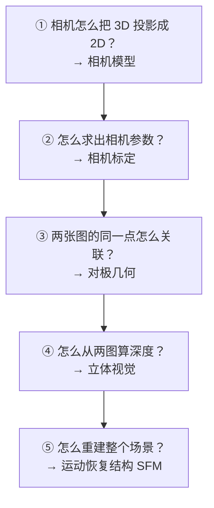
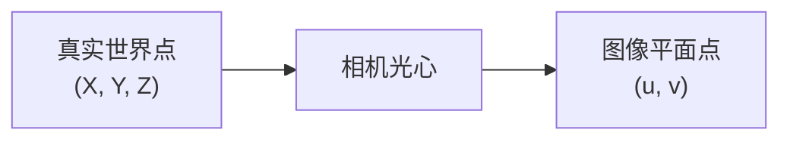
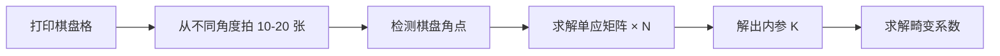
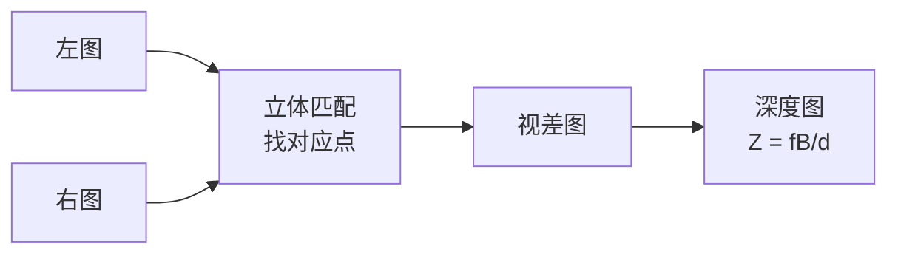
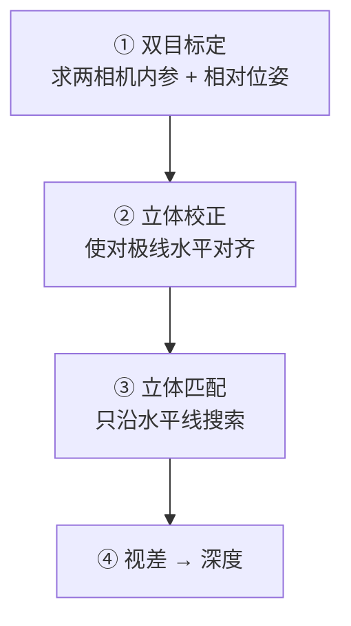
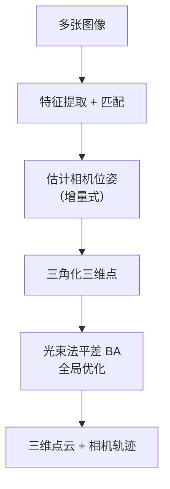
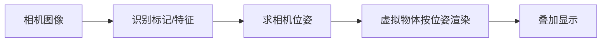

# ⑥ 几何视觉

> **学习难度 ⭐⭐⭐⭐⭐** ｜ **一句话**：从平面图像反推出真实的三维世界。

## 这个分支解决什么问题

前面五个分支都在二维图像上工作。但真实世界是三维的。**几何视觉要回答的是：这个像素点，在真实世界里对应哪个位置？**

**几何视觉 = 图像的「测量学」**。它让相机从「拍照工具」变成「测量仪器」。

## 核心问题链



## ① 相机模型

### 针孔模型

**生活比方**：小时候用纸盒做的小孔成像——光线穿过一个小孔，在后面的纸上形成倒立的像。



### 投影公式

$$
\begin{bmatrix} u \\ v \\ 1 \end{bmatrix}
= \frac{1}{Z}
\underbrace{\begin{bmatrix} f_x & 0 & c_x \\ 0 & f_y & c_y \\ 0 & 0 & 1 \end{bmatrix}}_{\text{内参 } K}
\underbrace{\begin{bmatrix} R & t \end{bmatrix}}_{\text{外参}}
\begin{bmatrix} X \\ Y \\ Z \\ 1 \end{bmatrix}
$$

**不背公式，记住两件事**：

| 参数 | 含义 | 生活理解 |
|---|---|---|
| **内参 K** | 相机自己的属性 | 焦距、成像中心 → 出厂就定了 |
| **外参 [R\|t]** | 相机在世界的位姿 | 相机放在哪、朝哪 → 每张照片都不同 |

::: tip 一句话区分内外参
**内参 = 相机是什么**，**外参 = 相机在哪**。

标定求的是内参；位姿估计求的是外参。
:::

### 畸变

真实镜头不是理想针孔，会有畸变：

| 畸变 | 表现 | 参数 |
|---|---|---|
| **径向畸变** | 直线变弯（鱼眼） | k₁, k₂, k₃ |
| **切向畸变** | 由于镜头装配偏移 | p₁, p₂ |

```python
# 去畸变
undistorted = cv2.undistort(img, K, dist_coeffs)
```

## ② 相机标定

### 张正友标定法（1999）

**思路**：不需要精密的 3D 标定物，只需**打印一张棋盘格**，从不同角度拍十几张，就能算出内参和畸变参数。

**为什么是革命性的**：

| 传统标定 | 张正友标定 |
|---|---|
| 需要精密加工的 3D 标定块 | **一张打印纸** |
| 设备昂贵 | **零成本** |
| 操作复杂 | 拍十几张照片即可 |



```python
# OpenCV 标定
ret, K, dist, rvecs, tvecs = cv2.calibrateCamera(
    object_points,   # 世界坐标中的棋盘角点
    image_points,    # 图像中的棋盘角点
    gray.shape[::-1],
    None, None
)
```

### 标定质量检查

| 指标 | 说明 |
|---|---|
| `ret`（重投影误差） | **< 0.5 像素算好** |
| 标定板角度覆盖 | 需覆盖多个角度和位置 |
| 标定板在画面中的位置 | 需覆盖四角（畸变在边缘最强） |

## ③ 对极几何

### 为什么重要

告诉我们的核心事实：**给一个左图的点，它在右图中的对应点一定在一条直线上（对极线）**。

**这把 2D 搜索降成了 1D 搜索**——极大提速且能剔除误匹配。


**生活比方**：你知道朋友站在左边房间里某处，他在右边房间的投影位置不用全图找——只需要在一条特定直线上找。

### 矩阵与求解

| 矩阵 | 描述 | 求解最小点数 |
|---|---|---|
| **基础矩阵 F** | 像素坐标间的关系 | **8 点** |
| **本质矩阵 E** | 归一化坐标间的关系 | **5 点** |
| 单应矩阵 H | 平面场景的关系 | 4 点 |

$$ \mathbf{p'}^T F \mathbf{p} = 0 $$

$$ E = K'^T F K $$

```python
# 八点法求基础矩阵（含 RANSAC）
F, mask = cv2.findFundamentalMat(pts1, pts2, cv2.FM_RANSAC, 1.0, 0.99)

# 本质矩阵
E, mask = cv2.findEssentialMat(pts1, pts2, K, cv2.RANSAC)

# 从 E 恢复位姿
_, R, t, mask = cv2.recoverPose(E, pts1, pts2, K)
```

::: warning 八点法的退化情况
以下场景八点法会失效（矩阵退化）：
- 所有点**共面**（如拍一面墙）→ 应该用单应矩阵
- 相机**没有平移**只有旋转 → 无法恢复深度
- 点**分布在一条直线或圆锥上**
:::

## ④ 立体视觉（双目测距）

### 核心原理

**视差（Disparity）**：同一个点在左右两图上的水平位置差。**距离越远，视差越小**。

$$ Z = \frac{f \cdot B}{d} $$

| 符号 | 含义 |
|---|---|
| Z | 深度（距离） |
| f | 焦距 |
| B | 双目基线（两相机间距） |
| d | 视差 |

**生活比方**：闭上一只眼再看手指，手指相对背景的位置会「跳」一下。手指近，跳得远（视差大）；手指远，几乎不跳（视差小）。



### 关键步骤



**为什么需要立体校正**：校正后，对应点**在同一水平线上**，匹配从 2D 搜索变成 1D 搜索，极大简化。

```python
# 立体校正
ret, K1, d1, K2, d2, R, T, E, F = cv2.stereoCalibrate(...)
R1, R2, P1, P2, Q, _, _ = cv2.stereoRectify(K1, d1, K2, d2, img_size, R, T)

# 立体匹配（SGBM：半全局块匹配）
stereo = cv2.StereoSGBM_create(
    minDisparity=0,
    numDisparities=64,      # 必须是 16 的倍数
    blockSize=11,
    P1=8*3*11**2,
    P2=32*3*11**2,
    uniquenessRatio=10,
    speckleWindowSize=100,
    speckleRange=32
)
disparity = stereo.compute(left, right)
# 转深度
depth = cv2.reprojectImageTo3D(disparity, Q)
```

### 立体视觉的难点

::: danger 三个经典难点
1. **无纹理区域匹配失败**（白墙、蓝天）→ 用 SGBM 的半全局约束缓解
2. **遮挡区域**（左图可见右图不可见）→ 用左右一致性检验剔除
3. **重复纹理**（栅栏、砖墙）→ 误匹配严重
:::

| 匹配算法 | 精度 | 速度 | 特点 |
|---|---|---|---|
| BM（块匹配） | 低 | **快** | 简单，实时 |
| **SGBM** | 中高 | 中 | **常用，效果速度平衡** |
| GC（图割） | 高 | 慢 | OpenCV 中已移除 |

## ⑤ 三维重建（SFM）

### Structure from Motion（运动恢复结构）

**思路**：用**一个**相机，在不同位置拍**多张**照片，同时恢复出「相机轨迹」和「场景三维结构」。



**生活比方**：你在房间里绕着桌子走一圈拍 30 张照片，SFM 能把桌子重建出来，同时算出你每一步站在哪。

### 关键术语

| 术语 | 含义 |
|---|---|
| **三角化** | 已知两个相机位姿 + 对应点，求 3D 点坐标 |
| **PnP** | 已知 3D 点和其 2D 投影，求相机位姿 |
| **BA（光束法平差）** | 联合优化所有相机位姿和 3D 点，最小化重投影误差 |
| **RANSAC** | 处理误匹配 |

```python
# 三角化
points_4d = cv2.triangulatePoints(P1, P2, pts1.T, pts2.T)
points_3d = points_4d[:3] / points_4d[3]

# PnP：已知 3D-2D 对应求位姿
ret, rvec, tvec, inliers = cv2.solvePnPRansac(
    object_points_3d, image_points_2d, K, dist
)
```

### 主流工具

| 工具 | 特点 |
|---|---|
| **COLMAP** | 开源标杆，效果好，支持大规模 |
| OpenMVG + OpenMVS | 开源，模块化 |
| Bundler | 早期经典 |

## 典型实战场景

### 场景 1：手动测距（双目）


### 场景 2：SLAM（机器人定位建图）


### 场景 3：AR 虚实融合



### 场景 4：三维扫描 / 建模


## 精度与误差

| 误差来源 | 影响 | 缓解 |
|---|---|---|
| 标定误差 | 系统性偏差 | 高精度标定 + 多角度 |
| 匹配误差 | 深度误差 | RANSAC + 一致性检验 |
| 基线太短 | 深度精度差 | 增大基线（受尺寸限制） |
| 基线太长 | 匹配困难 | 需兼顾 |
| 距离太远 | 深度误差平方增长 | 学习**误差 ∝ Z²/(fB)** |

::: warning 一个反直觉的事实
**双目测距的误差随距离平方增长**。

$$ \Delta Z \approx \frac{Z^2}{f \cdot B} \Delta d $$

所以：一个基线 10 cm、焦距 500 px 的双目，测 1 米距离误差约 1 cm；测 10 米误差就约 1 米。**双目不适合测远处**。
:::

## 选型速查

| 需求 | 方案 |
|---|---|
| 单目测距（已知物体尺寸） | 针孔模型 + 已知实际尺寸反推 |
| 单目测距（无已知尺寸） | SFM / 学习式深度估计 |
| 双目测距（近距离高精度） | SGBM + 校正 |
| 室内机器人定位 | ORB-SLAM / 视觉里程计 |
| 高精度三维建模 | COLMAP（SFM + MVS） |
| AR 追踪 | 标记法（ArUco）/ 特征法 |

## 为什么这个分支在深度学习时代依然重要

::: tip 几何视觉是「不可替代」的
| 内容 | 现状 |
|---|---|
| 相机模型 | **必学基础** |
| 张正友标定 | **工业标配，仍在使用** |
| 对极几何 | 核心方法仍在用 |
| PnP | 广泛用于位姿估计 |
| BA 优化 | **SLAM / 三维重建核心** |
| 立体匹配 | 传统方法仍在边缘设备使用 |

**深度学习能替代「特征提取」，但替代不了「几何约束」**。深度学习出的深度图仍要标定相机、仍要做几何一致性检查。

这正是 [agent-yolo](https://yejinlei.github.io/agent-yolo/) 里所说的「传统 CV 的不可替代部分」。
:::

## 相关链接

- [③ 特征匹配分支](/branches/feature-matching/)
- [④ 图像分割分支](/branches/segmentation/)
- [术语表](/glossary)
- [返回分支总览](/branches/)
