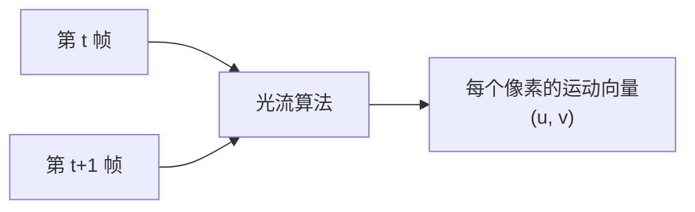
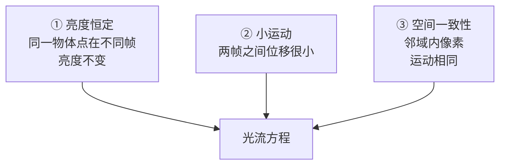
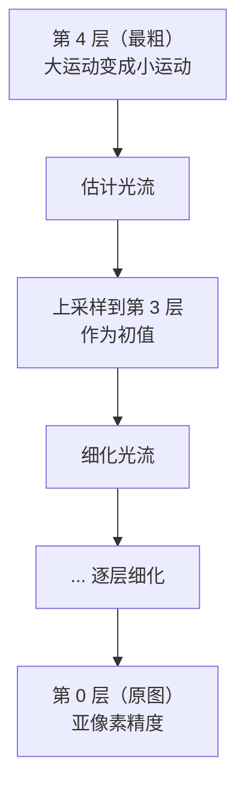
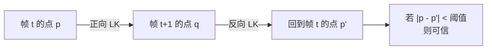
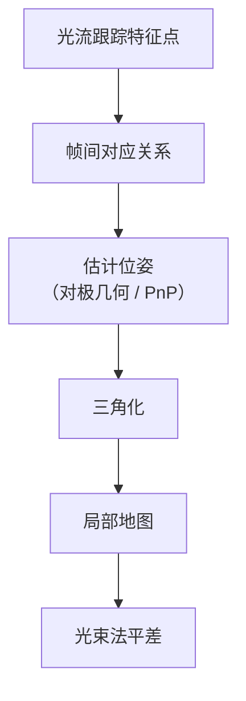

# 光流

> **一句话**：算出画面里每个像素"这一帧到下一帧往哪儿移动了"。

## 光流是什么



**生活比方**：把两帧画面叠起来"抖动"看——每个像素都拖出一小段箭头，箭头方向就是它移动的方向，箭头的长度就是移动的距离。

**这个箭头场就是光流（Optical Flow）**。

## 光流能做什么

| 应用 | 用光流做什么 |
|---|---|
| **运动检测** | 有流的地方就是动的 |
| **目标跟踪** | 跟着流走 |
| **视频稳定** | 估计全局运动再反向补偿 |
| **视觉里程计** | 帧间运动估计 |
| **慢动作插帧** | 按流方向生成中间帧 |
| **行为识别** | 光流是重要输入 |
| **自动驾驶** | 估计自车运动 + 障碍物运动 |

::: tip 光流与"特征匹配"的区别
| | 特征匹配 | 光流 |
|---|---|---|
| 粒度 | **稀疏**（几个特征点） | **半稠密/稠密**（大量像素） |
| 输出 | 点对 | 每个像素的位移向量 |
| 前提 | 需要特征 | 只需要像素邻域相似 |
| 精度 | 特征点处高 | 像素级 |

**LK 光流是"用光流的方式做特征跟踪"**——本质上介于两者之间。
:::

## ① 三大假设

**光流方程是从这三大假设推出来的**：



| 假设 | 含义 | 何时失效 |
|---|---|---|
| **亮度恒定** | 物体点的灰度不变 | 光照变化、镜面反射 |
| **小运动** | 位移 < 1 个像素（泰勒展开的前提） | 快速运动 |
| **空间一致** | 邻域内运动相同 | 运动边界、遮挡处 |

## ② 光流方程

$$ I_x u + I_y v + I_t = 0 $$

| 符号 | 含义 |
|---|---|
| $I_x, I_y$ | 图像的空间梯度 |
| $I_t$ | 时间梯度（帧间差） |
| $u, v$ | 待求的光流（x, y 方向速度） |

**一个方程，两个未知数 → 欠定**（孔径问题）。

::: warning 孔径问题（Aperture Problem）
**透过一个小孔看一条移动的直边**：只能看到垂直于边方向的运动，**沿边方向的运动完全看不出来**。


**这就是为什么需要"空间一致性假设"**——用邻域像素的方程组成方程组来求解。

**LK 光流（Lucas-Kanade）正是这么做的**。
:::

## ③ Lucas-Kanade（LK）光流

### 核心思路

**在一个小窗口（如 3×3、5×5、15×15）内，假设所有像素的光流相同**。

于是有 **n 个方程，2 个未知数**（n = 窗口内像素数）→ **超定方程组** → 最小二乘求解。

$$ \begin{bmatrix} I_{x1} & I_{y1} \\ I_{x2} & I_{y2} \\ \vdots & \vdots \\ I_{xn} & I_{yn} \end{bmatrix} \begin{bmatrix} u \\ v \end{bmatrix} = -\begin{bmatrix} I_{t1} \\ I_{t2} \\ \vdots \\ I_{tn} \end{bmatrix} $$

**最小二乘解**：

$$ \begin{bmatrix} u \\ v \end{bmatrix} = (A^T A)^{-1} A^T b $$

### 可解性条件

**$A^T A$ 必须是可逆的（条件数好）**。

$$ A^T A = \begin{bmatrix} \sum I_x^2 & \sum I_x I_y \\ \sum I_x I_y & \sum I_y^2 \end{bmatrix} $$

**它的特征值决定了"这里能否测光流"**：

| 特征值情况 | 含义 | 能否测光流 |
|---|---|---|
| λ₁, λ₂ 都很小 | 平坦区域 | ❌ 不行 |
| λ₁ ≫ λ₂ | **边缘** | ❌ **孔径问题** |
| **λ₁, λ₂ 都大且相近** | **角点** | ✅ **可以** |

::: tip 这和"角点检测"是同一个数学!
**Harris 角点检测用的就是这个 $A^T A$ 的特征值**（或者它的响应函数）。

**所以 LK 光流天然只在"角点"处可靠**——这解释了为什么 `goodFeaturesToTrack` 常和 LK 光流配对使用。
:::

### 实现：金字塔 LK

**基本 LK 只能处理小于窗口的运动**（因为泰勒展开 + 小运动假设）。

**解决方案：图像金字塔**。



**这就是 `cv2.calcOpticalFlowPyrLK`**（金字塔 LK）。

```python
# ① 先找好的特征点（角点）
p0 = cv2.goodFeaturesToTrack(
    prev_gray,
    maxCorners=200,
    qualityLevel=0.01,      # 拒绝最差的 1%
    minDistance=10,         # 特征点最小间距
    blockSize=3
)

# ② LK 光流跟踪到下一帧
p1, st, err = cv2.calcOpticalFlowPyrLK(
    prev_gray, next_gray,
    p0, None,
    winSize=(21, 21),        # 搜索窗口
    maxLevel=3,              # 金字塔层数
    criteria=(cv2.TERM_CRITERIA_EPS | cv2.TERM_CRITERIA_COUNT, 30, 0.01),
    flags=0                  # 0: 不使用初始估计的流
)

# ③ 筛选成功的跟踪
good_new = p1[st == 1]
good_old = p0[st == 1]

# ④ 可视化
for i, (new, old) in enumerate(zip(good_new, good_old)):
    a, b = new.ravel()
    c, d = old.ravel()
    mask = cv2.line(mask, (int(a), int(b)), (int(c), int(d)), (0, 255, 0), 2)
    frame = cv2.circle(frame, (int(a), int(b)), 5, (255, 0, 0), -1)

output = cv2.add(frame, mask)
```

### 参数详解

| 参数 | 含义 | 建议 |
|---|---|---|
| `winSize` | 搜索窗口大小 | **15–31**（奇数） |
| `maxLevel` | 金字塔层数 | **2–4**（覆盖大运动） |
| `criteria` | 迭代终止条件 | 30 次 / 0.01 px |
| `minEigThreshold` | 最小特征值阈值 | 默认 1e-4 |

::: warning winSize 与 maxLevel 的权衡
**winSize 大**：

- ✅ 能处理更快的运动
- ❌ 违反空间一致性（窗口内可能跨运动边界）
- ❌ 慢

**maxLevel 大**：

- ✅ 能处理更大的位移（每层放大 2 倍）
- ❌ 粗层误差会被放大传播
- ❌ 慢

**经验**：`winSize=21, maxLevel=3` → **能处理约 200+ 像素的位移**。
:::

## ④ 前向后向一致性检验（关键）

**LK 光流会漂移**（尤其是跟踪点离开视野、被遮挡时）。

**检验方法**：**正向跟踪 + 反向跟踪，两者应该回到原点**。



```python
def fb_check(p0, p1, frame0, frame1, thresh=1.0):
    """前向后向一致性检验"""
    # 反向跟踪：从 p1 回到 frame0
    p0_back, st_back, _ = cv2.calcOpticalFlowPyrLK(
        frame1, frame0, p1, None, winSize=(21, 21), maxLevel=3
    )

    # 计算回环误差
    fb_err = np.linalg.norm(p0.reshape(-1, 2) - p0_back.reshape(-1, 2), axis=1)

    # 保留误差小的点
    good = (fb_err < thresh) & (st_back.ravel() == 1)
    return good
```

::: tip 为什么这个检验极其重要
**光流跟踪的漂移是"累积"的**——一旦某帧跟丢了，后面全错。

**前向后向检验能剔除**：

- 被遮挡的点
- 移出视野的边缘点
- 光照剧变的点
- 纹理不足的点

**所有工程化的光流系统都会做这个检验**。
:::

## ⑤ 稠密光流

### Farnebäck 稠密光流

**给每个像素都算光流**（不是只算特征点）。

```python
flow = cv2.calcOpticalFlowFarneback(
    prev_gray, next_gray,
    flow=None,
    pyr_scale=0.5,      # 金字塔缩放（0.5 = 每层减半）
    levels=3,           # 金字塔层数
    winsize=15,         # 平均窗口大小
    iterations=3,       # 每层迭代次数
    poly_n=5,           # 多项式展开邻域
    poly_sigma=1.1,     # 多项式平滑
    flags=0
)
# flow[y, x] = (u, v)
```

**原理直觉**：把局部邻域用多项式拟合，然后基于"多项式系数在帧间保持一致"来解运动。

| 参数 | 含义 | 建议 |
|---|---|---|
| `pyr_scale` | 金字塔缩放 | **0.5** 或 0.3 |
| `levels` | 层数 | **3** |
| `winsize` | 平均窗口 | **15–25** |
| `poly_n` | 多项式邻域 | **5** 或 7 |
| `poly_sigma` | 高斯平滑 σ | 与 poly_n 匹配（5→1.1, 7→1.5） |

### 可视化（HSV 色轮）

**光流的标准可视化**：**方向 → 颜色（色相），强度 → 亮度（明度）**。

```python
def visualize_flow(flow):
    """把光流图可视化：颜色=方向，亮度=幅度"""
    mag, ang = cv2.cartToPolar(flow[..., 0], flow[..., 1])

    hsv = np.zeros((flow.shape[0], flow.shape[1], 3), dtype=np.uint8)
    hsv[..., 0] = ang * 180 / np.pi / 2        # 色相 = 方向
    hsv[..., 1] = 255                          # 饱和 = 255
    hsv[..., 2] = cv2.normalize(mag, None, 0, 255, cv2.NORM_MINMAX)  # 亮度 = 幅度

    return cv2.cvtColor(hsv, cv2.COLOR_HSV2BGR)
```

**读图**：

| 颜色 | 运动方向 |
|---|---|
| 红 | 向右 |
| 青 | 向左 |
| 绿 | 向下 |
| 紫 | 向上 |
| **黑** | **不动** |

### 稀疏 vs 稠密

| | 稀疏（LK） | 稠密（Farnebäck） |
|---|---|---|
| 输出 | 几百个点的流 | 每个像素的流 |
| 速度 | **快（实时）** | 慢 |
| 精度 | 特征点处高 | 均匀但较低 |
| 依赖 | 需要好特征点 | 无 |
| 应用 | **跟踪、VO** | 分割、分析 |

::: tip 稠密光流的加速
**Farnebäck 在 CPU 上很慢**（比如 1080p 可能要几百毫秒）。

**加速方案**：

| 方案 | 说明 |
|---|---|
| 降分辨率 | 先缩放再算，最后放大流场 |
| **DIS（Dense Inverse Search）** | OpenCV 的 `DISOpticalFlow`，**快很多且精度不错** |
| 深度学习 | RAFT、FlowNet（无 GPU 时不适用） |

```python
dis = cv2.DISOpticalFlow_create(cv2.DISOPTICAL_FLOW_PRESET_MEDIUM)
flow = dis.calc(prev_gray, next_gray, None)
```
:::

## ⑥ 现代替代

| 方法 | 特点 |
|---|---|
| **LK + 金字塔** | 经典、快、CPU 可实时 |
| **DIS** | 稠密、快速，OpenCV 内置 |
| **RAFT / RAFT-Stereo** | **精度最高**，需 GPU |
| **FlowNet / PWC-Net** | 学习式，需 GPU |
| **TV-L1** | 变分法，边缘保持好 |

::: tip 什么时候仍需经典光流
| 场景 | 选择 |
|---|---|
| 嵌入式 / 无 GPU | **LK、DIS** |
| 实时跟踪 | **LK** |
| 需要高精度且能接受慢 | Farnebäck、TV-L1 |
| 有 GPU + 需要 SOTA | RAFT |

**经典光流（尤其 LK）在工程中依然大量使用**：它**无需训练、无需 GPU、代码简单、行为可预测**。
:::

## 常见踩坑

::: danger 坑 1：不检查 `st` 状态
**现象**：跟踪点突然跳到画面别处。

**根因**：`calcOpticalFlowPyrLK` 的第二个返回值 `st` 表示"是否找到"。**没找到的点在新图中的坐标是垃圾值**。

**解决**：

```python
p1, st, err = cv2.calcOpticalFlowPyrLK(...)
# ❌ p1[0] 可能是垃圾
# ✅ 必须筛
good = p1[st == 1]
```
:::

::: danger 坑 2：只用 LK，不做前向后向检验
**现象**：跟踪 100 帧后，大量点聚集在一起（漂到同一个点）。

**根因**：**跟丢的点会漂到局部最优（如角点、强边缘处）**，而且它们是"假的成功"（`st=1`）。

**解决**：**必须做 FB 检验**（见上文代码）。
:::

::: danger 坑 3：`winSize` 设为偶数
**现象**：OpenCV 报错或行为异常。

**解决**：**`winSize` 必须是奇数**（窗口有中心像素）。

```python
winSize=(21, 21)     # ✅
winSize=(20, 20)     # ❌
```
:::

::: danger 坑 4：快速运动导致失败
**现象**：第一帧就跟踪失败，或者位移超过 10 px 就错。

**根因**：**金字塔层数太少**，粗层还没覆盖到实际位移。

**计算**：`可处理位移 ≈ winSize × 2^maxLevel`
- winSize=21, maxLevel=3 → 21 × 8 = **168 px**

**解决**：**增大 `maxLevel`**（代价是慢和不稳）。
:::

::: danger 坑 5：光照变化导致光流失效
**现象**：亮度变化（如开灯、曝光跳变）帧上，光流完全错误。

**根因**：**亮度恒定假设被打破**。

**解决**：

- **用归一化互相关（NCC）**替代 SSD 作为匹配代价
- 或做**光照归一化**预处理（直方图均衡、局部对比度归一化）
- 或**用特征匹配替代光流**（SIFT 对光照更鲁棒）
:::

::: danger 坑 6：把 Farnebäck 用在实时系统
**现象**：帧率掉到 5 fps 以下。

**解决**：

- **降分辨率**（720p → 360p 算光流，再上采样）
- **改用 DIS**（快 5–10 倍）
- **改用稀疏 LK**（如果不需要稠密）

**测速**：先 profile，别凭感觉猜。
:::

::: danger 坑 7：用光流做"长时间跟踪"
**现象**：跟踪几分钟后全乱了。

**根因**：**光流是"帧间"的局部估计，误差会累积**。

**解决**：

- **定期重新检测特征点**（不要一直用最初的 p0）
- 用**卡尔曼滤波**平滑轨迹
- 长时间跟踪应该用**模板匹配 / 深度学习跟踪器**

```python
# 每 30 帧重新检测一次
if frame_idx % 30 == 0:
    p0 = cv2.goodFeaturesToTrack(prev_gray, 200, 0.01, 10)
```

**这就是 `calcOpticalFlowPyrLK` 的正确用法：跟踪短、重检测频繁。**
:::

## 光流在 SLAM 中的角色



**与特征匹配的对比**（在 VO/SLAM 中）：

| | 特征匹配（如 ORB） | 光流 |
|---|---|---|
| 速度 | 中 | **快**（有初值时） |
| 精度 | 高 | 中 |
| 对光照变化 | 鲁棒 | 敏感 |
| 大运动 | **鲁棒** | 需要金字塔 |

**实践**：很多 VO 系统**先用光流得到初值，再用特征匹配校验**。

## 相关链接

- [特征匹配分支](/branches/feature-matching/)
- [角点检测（Harris）](/branches/feature-detection/corners)
- [鲁棒估计](/branches/feature-matching/robust-estimation)
- [⑥ 几何视觉分支](/branches/geometry/)
- [返回几何视觉分支](/branches/geometry/)
