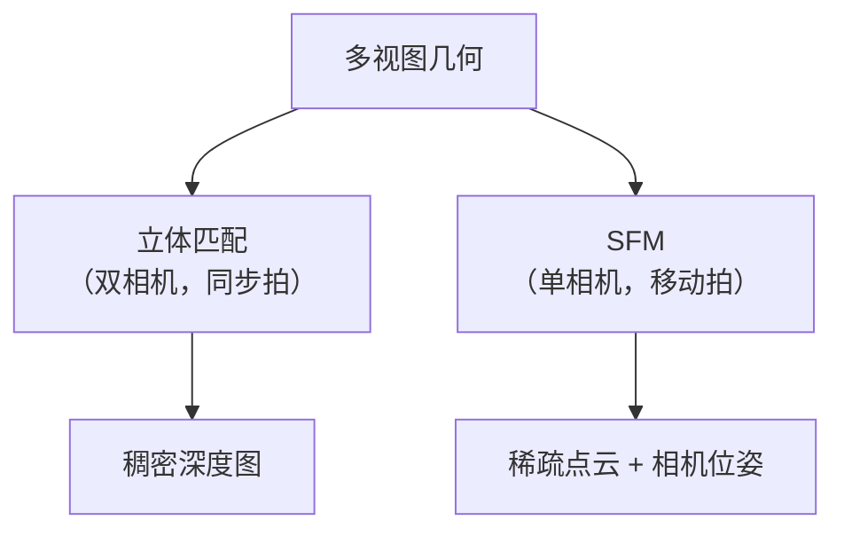
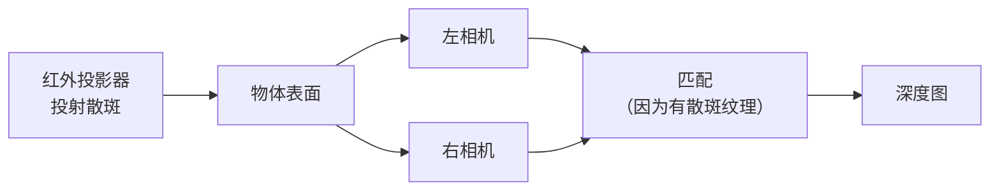
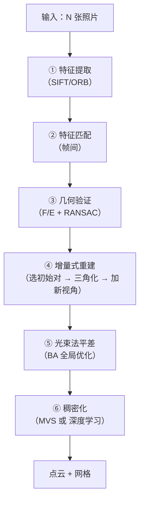
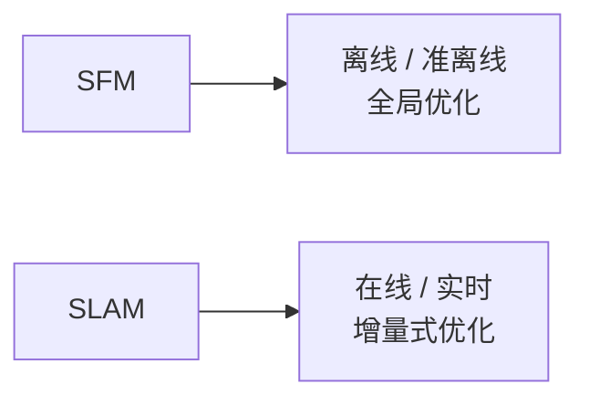

# 立体匹配与 SFM

> **一句话**：从多张照片里，把整个场景的三维结构"算"出来。

## 两条路线



| 路线 | 输入 | 输出 | 特点 |
|---|---|---|---|
| **立体匹配** | 同一时刻的两张图 | **稠密深度图** | 需要同步、标定 |
| **SFM** | 同一相机在不同位置的多张图 | **稀疏点云 + 位姿** | 只用一个相机 |

## ① 立体匹配（回顾）

**核心**：**视差 → 深度**。

$$ Z = \frac{f \cdot B}{d} $$

**完整流程**：


**详细实现见 [立体视觉](/branches/geometry/stereo)**。

::: tip 立体匹配的关键限制
| 限制 | 说明 |
|---|---|
| **需要同步** | 两相机必须同时曝光（否则运动物体出错） |
| **误差 ∝ Z²** | 远处精度急剧下降 |
| **无纹理失败** | 白墙、纯色区域 |
| **需要精确标定** | 双目标定误差会直接变成深度误差 |

**所以"双目测距"适合 0.3–3 m**，超过就不好使了。
:::

## ② 双目结构光（主动双目）

**问题**：无纹理物体上双目匹配失败。

**解法**：**主动投射红外散斑图案**，人为制造纹理。



**优点**：

| 优点 | 说明 |
|---|---|
| **无纹理也能用** | 散斑提供纹理 |
| **被动式（人眼不可见）** | 红外光 |
| **精度高** | 亚像素匹配 |

**代表**：**iPhone 的 Face ID（结构光）、Intel RealSense（主动双目）**。

::: tip 主动双目 vs 结构光（ToF）
| | 主动双目 | 结构光 |
|---|---|---|
| 原理 | 散斑 + 双目匹配 | 编码图案 + 三角测量 |
| 强光下 | **较好** | 差 |
| 近距离 | 好 | **更好** |
| 成本 | 中 | 中高 |
| 代表 | **RealSense D435** | Face ID、Kinect v1 |
:::

## ③ SFM：从运动中恢复结构

**Structure from Motion**：**用一个相机，在多个位置拍同一场景，反解出相机轨迹和场景三维点**。



### 四步详解

**① 特征提取与匹配**

```python
# 用 SIFT 提取特征（尺度不变，最稳）
sift = cv2.SIFT_create(nfeatures=2000)
kp1, desc1 = sift.detectAndCompute(img1, None)
kp2, desc2 = sift.detectAndCompute(img2, None)

# FLANN 快速匹配
FLANN_INDEX_KDTREE = 1
index_params = dict(algorithm=FLANN_INDEX_KDTREE, trees=5)
search_params = dict(checks=50)
flann = cv2.FlannBasedMatcher(index_params, search_params)
matches = flann.knnMatch(desc1, desc2, k=2)

# Lowe 比值检验
good = [m for m, n in matches if m.distance < 0.75 * n.distance]
```

**② 几何验证**

```python
pts1 = np.float32([kp1[m.queryIdx].pt for m in good])
pts2 = np.float32([kp2[m.trainIdx].pt for m in good])

# 求本质矩阵（已标定的情况）
E, mask = cv2.findEssentialMat(pts1, pts2, K, cv2.RANSAC, 0.999, 1.0)
inliers = mask.ravel().sum()
rate = inliers / len(pts1) * 100
print("内点率: %d/%d = %.1f%%" % (inliers, len(pts1), rate))
```

**③ 三角化 + 增量式重建**

```python
# 恢复位姿
_, R, t, mask_pose = cv2.recoverPose(E, pts1, pts2, K)

# 三角化
P1 = K @ np.hstack([np.eye(3), np.zeros((3, 1))])
P2 = K @ np.hstack([R, t])
pts4d = cv2.triangulatePoints(P1, P2, pts1.T, pts2.T)
pts3d = (pts4d[:3] / pts4d[3]).T
```

**④ 光束法平差（Bundle Adjustment）**

**目标**：**最小化所有"观测到的 2D 点"与"投影的 2D 点"的误差**。

$$ \min_{R_i, t_i, X_j} \sum_{i,j} \| \pi(K, R_i, t_i, X_j) - x_{ij} \|^2 $$

**为什么叫"光束"（Bundle）**：每个 3D 点发出的"光线束"应该在投影中心汇聚。

**这是 SFM 精度提升的关键步骤**（通常能把误差降一个数量级）。

::: tip 稠密重建（MVS）
**SFM 得到的是"稀疏点云"**（只有特征点有 3D 坐标）。

**要得到稠密点云**，需要 **MVS（Multi-View Stereo）**：

| 算法 | 特点 |
|---|---|
| **PMVS / CMVS** | 经典，用面片扩散 |
| **COLMAP** | **目前最强的开源实现**（SFM + MVS） |
| **OpenMVS** | 另一套开源工具链 |
| **深度学习** | MVSNet、CasMVSNet（需 GPU） |

**流程**：SFM 的相机位姿 + 原图 → 逐像素深度估计 → 融合 → 稠密点云。
:::

## ④ 常用工具

| 工具 | 特点 |
|---|---|
| **COLMAP** | **最主流的开源 SFM + MVS**（有 GUI 和 CLI） |
| **OpenMVG + OpenMVS** | 开源工具链，可定制 |
| **Meshroom (AliceVision)** | **图形界面友好**，开源 |
| **VisualSFM** | 老牌，Windows 友好 |
| **OpenCV** | 提供基础模块（SFM 模块已迁移到 contrib） |

```bash
# COLMAP 命令行完整流程
# ① 特征提取
colmap feature_extractor --database_path db.db --image_path images/

# ② 特征匹配
colmap exhaustive_matcher --database_path db.db

# ③ 稀疏重建（SFM）
colmap mapper --database_path db.db --image_path images/ --output_path sparse/

# ④ 稠密重建（MVS）
colmap image_undistorter --image_path images/ --input_path sparse/0 --output_path dense/
colmap patch_match_stereo --workspace_path dense/
colmap stereo_fusion --workspace_path dense/ --output_path dense/fused.ply
```

::: tip COLMAP 的坑
| 坑 | 解决 |
|---|---|
| **图像太少/变化太小** | 需要足够多的视差（不能只是旋转） |
| **重复纹理** | 匹配混乱 → 手动加约束或用 GPS 先验 |
| **内存不足** | 减少图像数量或降分辨率 |
| **稀疏重建失败** | 检查匹配内点率（< 30% 就先查图像质量） |

**拍摄要点**：**多角度 + 足够重叠（> 60%）+ 有纹理 + 曝光一致**。
:::

## ⑤ SFM 与 SLAM 的区别



| 维度 | SFM | SLAM |
|---|---|---|
| **速度** | 慢（分钟到小时） | **实时**（30 fps） |
| **精度** | **高**（全局 BA） | 中（局部优化 + 回环） |
| **目标** | 重建场景 | **定位 + 建图** |
| **输入** | 离线图像集 | 实时图像流 |
| **典型** | COLMAP | ORB-SLAM、VINS |

**两者共享同一套几何工具**（特征、对极几何、三角化、BA）。

::: tip 为什么 SLAM 不能"跑全局 BA"
**全局 BA 的复杂度是 O(N³)**（N 是关键帧数）。

**1000 帧的全局 BA 要几十秒**——无法实时。

**SLAM 的解法**：

| 技术 | 作用 |
|---|---|
| **滑动窗口 BA** | 只优化最近 N 帧 |
| **关键帧选择** | 减少待优化变量 |
| **局部地图** | 只优化附近的点 |
| **回环检测 + 位姿图优化** | 全局一致性用便宜的位姿图 |
:::

## 常见踩坑

::: danger 坑 1：拍摄轨迹只有旋转
**现象**：SFM 完全失败，或得到一堆散乱点。

**根因**：**纯旋转时没有视差**，无法三角化。

**解决**：**拍摄时必须平移移动**（横向走动），并且**要有足够的视角变化**。
:::

::: danger 坑 2：内参未知就做 SFM
**现象**：重建结果"弯曲"（像香蕉），尺度漂移。

**根因**：**自标定（未知内参）不稳定**。

**解决**：

- **先用标定板标定内参**（最稳）
- 或者用 COLMAP 的 `--ImageReader.single_camera 1`（假设所有图同一相机）
- **提供 EXIF 焦距**（部分相机有）
:::

::: danger 坑 3：尺度歧义
**现象**：重建出来的模型尺寸"差一点"（不能得到真实的米）。

**说明**：**单目 SFM 天然有尺度歧义**（图像整体放大 2 倍，几何上完全自洽）。

**解决**：

- **放一个已知尺寸的物体**（如标尺、棋盘）
- 用 **IMU / GPS** 提供尺度
- 用 **双目**（基线提供尺度）
:::

::: danger 坑 4：重复纹理导致"鬼影"
**现象**：点云中同一物体出现两次（错位）。

**根因**：**重复纹理（如窗格、砖墙）导致误匹配**。

**解决**：

- **Lowe 比值更严格**（0.6 而不是 0.75）
- **增加几何验证**（对极约束）
- **回环检测 + 全局优化**
- **人工剔除误匹配**
:::

::: danger 坑 5：内存爆掉
**现象**：处理大场景时 OOM。

**解决**：

- **降分辨率**（SIFT 在 4K 图上提取数十万特征）
- **限制特征数**（`nfeatures=2000`）
- **分块处理**（先重建大块，再合并）
- **用增量式（不要一次加载所有图）**
:::

## 相关链接

- [相机几何](/branches/geometry/camera-geometry)
- [对极几何](/branches/geometry/epipolar)
- [立体视觉（视差测距）](/branches/geometry/stereo)
- [特征匹配分支](/branches/feature-matching/)
- [SIFT 算法档案](/algorithms/sift/)
- [⑥ 几何视觉分支](/branches/geometry/)
