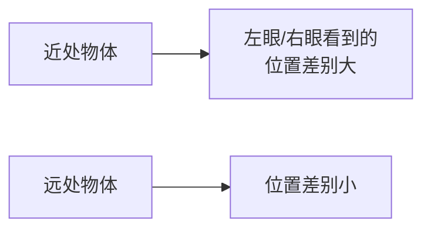
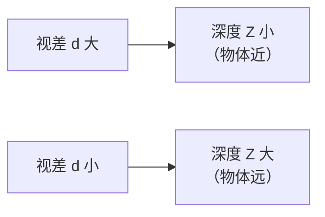
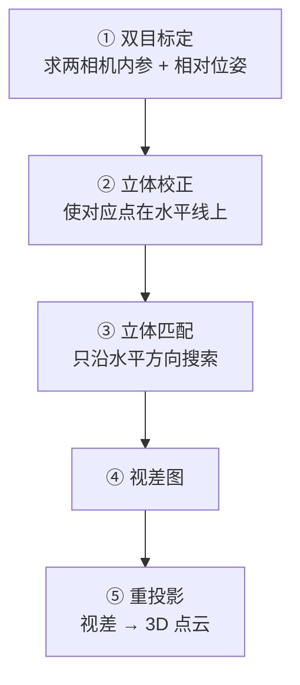
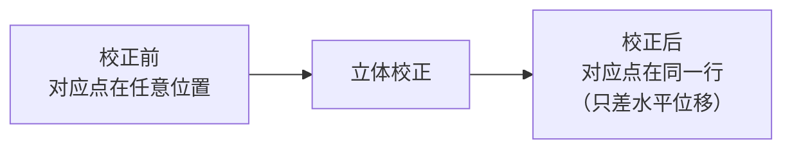
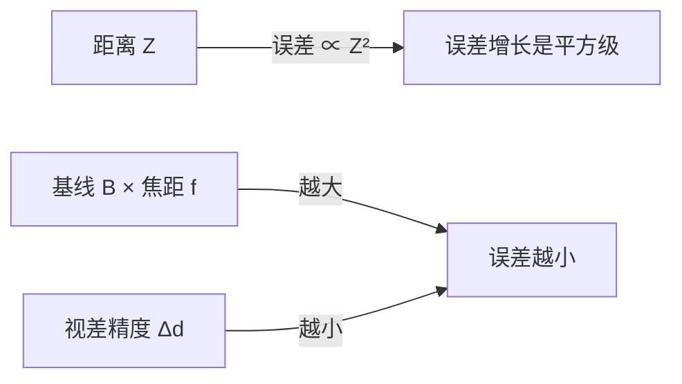

# 立体视觉

> **一句话**：像人的双眼一样，用两个相机看到的位置差算出距离。

## 视差的直观理解

**闭上一只眼再看手指，手指相对背景的位置会"跳"一下**。

| 手指位置 | 跳的幅度 |
|---|---|
| 很近 | **跳得远**（视差大） |
| 很远 | 几乎不跳（视差小） |



**这就是「视差（Disparity）」**。

## ① 核心公式

$$ Z = \frac{f \cdot B}{d} $$

| 符号 | 含义 | 单位 |
|---|---|---|
| **Z** | 深度（距离） | 米 / 毫米 |
| **f** | 焦距 | **像素** |
| **B** | 基线（两相机间距） | 米 / 毫米 |
| **d** | 视差 | **像素** |

**关键关系**：



::: tip 为什么 B 和 f 要乘起来
**f·B 是"测距的能力"**：

- f 大（长焦）→ 同样的视差对应更大的 Z → 能测更远
- B 大（双目间距大）→ 同样 → 能测更远

**所以"想测远，就要大基线或长焦"**。
:::

## ② 完整流程



### ① 双目标定

**在单目标定的基础上，还要估计两个相机之间的相对位姿 (R, T)**。

```python
ret, K1, d1, K2, d2, R, T, E, F = cv2.stereoCalibrate(
    object_points,
    img_points_left,
    img_points_right,
    K1=None, d1=None, K2=None, d2=None,
    image_size=(w, h),
    flags=cv2.CALIB_FIX_INTRINSIC      # 如果已单独标定过
)

print(f"基线: {np.linalg.norm(T) * 1000:.2f} mm")     # T 的单位跟标定板一致
```

### ② 立体校正（关键！）

**目标**：**让对应点在完全相同的水平线上**。



**为什么重要**：

| 未校正 | 校正后 |
|---|---|
| 2D 搜索（整幅图） | **1D 搜索（一行）** |
| 慢 | **快几十倍** |
| 容易误匹配 | 误匹配大幅减少 |

```python
# 立体校正
R1, R2, P1, P2, Q, roi1, roi2 = cv2.stereoRectify(
    K1, d1, K2, d2,
    image_size=(w, h),
    R=R, T=T,
    alpha=0,                # 0=裁剪黑边，1=保留全部
    flags=cv2.CALIB_ZERO_DISPARITY
)

# 生成映射表
map1x, map1y = cv2.initUndistortRectifyMap(K1, d1, R1, P1, (w, h), cv2.CV_32FC1)
map2x, map2y = cv2.initUndistortRectifyMap(K2, d2, R2, P2, (w, h), cv2.CV_32FC1)

# 应用到图像
left_rect = cv2.remap(left_img, map1x, map1y, cv2.INTER_LINEAR)
right_rect = cv2.remap(right_img, map2x, map2y, cv2.INTER_LINEAR)
```

::: tip `Q` 矩阵是关键
**`stereoRectify` 返回的 `Q` 是"视差 → 3D"的重投影矩阵**。

```python
points_3d = cv2.reprojectImageTo3D(disparity, Q)
```

**`points_3d[y, x]` 就是像素 (x, y) 对应的 3D 坐标**。
:::

### ③ 立体匹配

#### SGBM（半全局块匹配，最常用）

```python
stereo = cv2.StereoSGBM_create(
    minDisparity=0,
    numDisparities=16 * 4,          # 必须是 16 的倍数
    blockSize=11,
    P1=8 * 3 * 11 ** 2,
    P2=32 * 3 * 11 ** 2,
    disp12MaxDiff=1,
    uniquenessRatio=15,
    speckleWindowSize=100,
    speckleRange=32,
    preFilterCap=63,
    mode=cv2.STEREO_SGBM_MODE_SGBM_3WAY
)

disparity = stereo.compute(left_rect, right_rect).astype(np.float32) / 16.0
```

**参数详解**：

| 参数 | 含义 | 建议 |
|---|---|---|
| `numDisparities` | 视差搜索范围 | **16 的倍数**，越大越远 |
| `blockSize` | 匹配块大小 | **奇数**，5–21 |
| `P1` | 相邻视差 ±1 的惩罚 | `8 × 通道数 × blockSize²` |
| `P2` | 相邻视差 >1 的惩罚 | `32 × 通道数 × blockSize²` |
| `uniquenessRatio` | 唯一性余量 | 5–15 |
| `disp12MaxDiff` | 左右一致性检查 | 1–2 |
| `speckleWindowSize` | 斑点滤波窗口 | 50–200 |
| `speckleRange` | 斑点判定范围 | 16–32 |

::: tip P1 和 P2 是什么意思
**SGBM 的"半全局"体现在：给视差图加平滑约束**。

- **P1**：如果相邻像素的视差只差 1，罚 P1（小罚）
- **P2**：如果差得多，罚 P2（大罚）

**效果**：鼓励"相邻像素视差接近"，从而得到**平滑连续**的视差图，而不是噪声斑块。

**P2 > P1 是关键**（否则任何视差变化都被同等惩罚，失去了"鼓励平滑但允许突变"的意义）。

**常用比例**：`P2 = 4 × P1`。
:::

#### BM（块匹配，最快）

```python
stereo = cv2.StereoBM_create(
    numDisparities=64,
    blockSize=15
)
disparity = stereo.compute(left_rect, right_rect).astype(np.float32) / 16.0
```

| 对比 | BM | SGBM |
|---|---|---|
| 速度 | **极快** | 中 |
| 精度 | 低 | **高** |
| 输出 | 稀疏 | **较稠密** |
| 适用 | 实时、简单场景 | **通用推荐** |

### ④ 视差 → 深度

```python
# 方法一：用 Q 矩阵（推荐）
points_3d = cv2.reprojectImageTo3D(disparity, Q)
# points_3d[y, x] = (X, Y, Z)

# 方法二：用公式
Z = (f * B) / disparity        # disparity 不能为 0
```

## ③ 精度分析（重要）

### 误差传播

$$ \Delta Z \approx \frac{Z^2}{f \cdot B} \Delta d $$

**关键结论**：



**举例**（f = 500 px, B = 100 mm, Δd = 0.5 px）：

| 距离 Z | 深度误差 ΔZ |
|---|---|
| 0.5 m | 2.5 mm |
| 1 m | 10 mm |
| 2 m | **40 mm** |
| 5 m | **250 mm** |
| 10 m | **1 m** |

::: warning 一个反直觉的事实
**双目测距误差随距离平方增长**。

**所以双目"不适合测远处"**：

| 距离 | 适用性 |
|---|---|
| 0.3–3 m | ✅ **最佳** |
| 3–10 m | ⚠️ 需要长基线 |
| > 10 m | ❌ **不推荐** |

**想测 10 米外，要么基线做到 1 米以上，要么用长焦。**
:::

### 怎么提高精度

| 手段 | 效果 | 代价 |
|---|---|---|
| **增大基线 B** | 线性改善 | 设备体积、匹配难度 |
| **增大焦距 f** | 线性改善 | 视野变窄 |
| **提高视差精度** | 线性改善 | 亚像素插值、更好的匹配 |
| **多次测量平均** | 平方根改善 | 时间 |

::: tip 标定精度是天花板
**如果标定误差大，后面怎么调都白搭**。

**要求**：重投影误差 **< 0.3 px**，且双目的 `stereoCalibrate` 返回的误差 **< 0.5 px**。
:::

## ④ 双目测距的难点

::: danger 三个经典难点
**1. 无纹理区域匹配失败**

白墙、蓝天、纯色桌面 → 没有可匹配的特征。

**解决**：
- **投射散斑纹理**（主动双目 / 结构光）
- 用 SGBM 的平滑约束
- **接受这些区域没有深度**

**2. 遮挡区域**

左图可见、右图不可见的区域。

**解决**：
- **左右一致性检验**（`disp12MaxDiff`）
- 遮挡区域标为无效

**3. 重复纹理**

栅栏、砖墙、格子 → 多个相同候选，误匹配严重。

**解决**：
- **增大 `uniquenessRatio`**
- 用 **SGBM 的全局约束**
- 或者**深度学习立体匹配**（如 RAFT-Stereo）
:::

### 视差图后处理

```python
# ① 左右一致性检验
right_matcher = cv2.ximgproc.createRightMatcher(stereo)
disparity_right = right_matcher.compute(right_rect, left_rect)

# ② 加权最小二乘滤波（WLS）细化
wls = cv2.ximgproc.createDisparityWLSFilter(stereo)
wls.setLambda(8000)
wls.setSigmaColor(1.5)
filtered = wls.filter(disparity, left_rect, disparity_right)
```

**WLS 滤波能显著提升视差图质量**（边缘更准确、空洞更少）。

## ⑤ 单目 vs 双目 vs 结构光

| 方案 | 原理 | 精度 | 距离 | 成本 |
|---|---|---|---|---|
| **单目** | 已知尺寸反推 或 学习 | 低 | 依赖先验 | **极低** |
| **双目** | 视差 | **中高** | 0.3–10 m | 中 |
| **结构光** | 投射图案 + 三角测量 | **高** | 0.3–3 m | 中高 |
| **ToF** | 飞行时间 | 中 | 0.3–5 m | 高 |

::: tip 双目 vs 结构光的核心差异
| 维度 | 双目 | 结构光 |
|---|---|---|
| 无纹理物体 | ❌ 失败 | ✅ **可用**（投射纹理） |
| 强光环境 | ✅ **可用** | ❌ 失效（图案被淹没） |
| 成本 | **低** | 高 |
| 距离 | 可远 | 近（1–3 m） |
| 代表 | 汽车、机器人 | **Face ID、Kinect v1** |

**双目在被测物有纹理、或环境光强时更优**；**结构光在无纹理物体、室内环境下更优**。
:::

## 常见踩坑

::: danger 坑 1：`numDisparities` 不是 16 的倍数
**现象**：`cv2.error: numDisparities must be divisible by 16`。

**解决**：**必须是 16 的整数倍**。

```python
numDisparities = 16 * 4      # ✅ = 64
numDisparities = 60          # ❌
```

**怎么选值**：`numDisparities / 16 × blockSize` 大致等于"能测的最近距离对应的视差范围"。**它决定了能感知多远**。
:::

::: danger 坑 2：忘了立体校正
**现象**：视差图一片噪声（或全黑）。

**根因**：**未校正时，对应点不在同一行**，SGBM 沿水平线搜索找不到。

**解决**：**必须先 `stereoRectify` + `remap`**。

**检验方法**：校正后，在图上**画几条水平线**，看同名点是否在同一行。
:::

::: danger 坑 3：标定板在两个相机里的朝向不一致
**现象**：`stereoCalibrate` 报错或误差极大。

**根因**：双目标定时，**同一张图必须左右相机都能检测到全部角点**，且**顺序一致**。

**解决**：
- 拍摄时让标定板**在两个相机里都完整可见**
- 逐张检查 `findChessboardCorners` 都返回 True
- 左右图的角点顺序必须相同（都由同一函数按同一规则排序）
:::

::: danger 坑 4：左右图搞反
**现象**：所有深度都是负的，或者视差图全无效。

**根因**：`compute(left, right)` 传反了。

**解决**：**左图在前，右图在后**。

**检验**：正确的匹配应该是"左图物体偏右、右图偏左"（视差为负则是反过来，取决于约定）。

**用重投影验证**：`reprojectImageTo3D` 得到的 Z 应该全为正。
:::

::: danger 坑 5：blockSize 太小
**现象**：视差图充满噪声斑块。

**解决**：**blockSize 增大到 11–21**（奇数）。

| blockSize | 效果 |
|---|---|
| 5 | 噪声多，但细节保留 |
| **11** | **推荐起点** |
| 21 | 平滑，但丢失小细节 |
:::

::: danger 坑 6：远处深度完全不可用
**现象**：3 米外测距误差 10 cm 以上。

**原因**：**这是物理限制**（误差 ∝ Z²/(fB)），不是调参能解决的。

**解决**：

- **增大基线**（硬件）
- **换长焦镜头**
- **改用其他测距方式**（激光雷达、ToF）
- 或者**只关心近距离**
:::

## 完整代码示例

```python
import cv2
import numpy as np

class StereoDepth:
    def __init__(self, calib_file):
        # 从标定文件加载 K1, d1, K2, d2, R, T
        fs = cv2.FileStorage(calib_file, cv2.FILE_STORAGE_READ)
        K1 = fs.getNode('K1').mat()
        d1 = fs.getNode('D1').mat()
        K2 = fs.getNode('K2').mat()
        d2 = fs.getNode('D2').mat()
        R = fs.getNode('R').mat()
        T = fs.getNode('T').mat()
        self.img_size = tuple(int(x) for x in fs.getNode('Size').mat().ravel())
        fs.release()

        # 立体校正
        R1, R2, P1, P2, self.Q, _, _ = cv2.stereoRectify(
            K1, d1, K2, d2, self.img_size, R, T, alpha=0
        )
        self.map1 = cv2.initUndistortRectifyMap(
            K1, d1, R1, P1, self.img_size, cv2.CV_32FC1
        )
        self.map2 = cv2.initUndistortRectifyMap(
            K2, d2, R2, P2, self.img_size, cv2.CV_32FC1
        )

        # SGBM
        self.stereo = cv2.StereoSGBM_create(
            minDisparity=0,
            numDisparities=16 * 4,
            blockSize=11,
            P1=8 * 3 * 11**2,
            P2=32 * 3 * 11**2,
            disp12MaxDiff=1,
            uniquenessRatio=15,
            speckleWindowSize=100,
            speckleRange=32
        )
        self.f = P1[0, 0]
        self.B = np.linalg.norm(T) * 1000    # mm

    def compute_depth(self, left, right):
        # 校正
        L = cv2.remap(left, self.map1[0], self.map1[1], cv2.INTER_LINEAR)
        R = cv2.remap(right, self.map2[0], self.map2[1], cv2.INTER_LINEAR)

        # 匹配
        disp = self.stereo.compute(L, R).astype(np.float32) / 16.0

        # 视差 → 3D
        points_3d = cv2.reprojectImageTo3D(disp, self.Q)

        return disp, points_3d

    def depth_at(self, points_3d, x, y, window=5):
        """求某点附近的平均深度（mm）"""
        patch = points_3d[y-window:y+window+1, x-window:x+window+1, 2]
        valid = patch[(patch > 0) & (patch < 100000)]
        if len(valid) == 0:
            return None
        return np.median(valid) * 1000     # 转 mm
```

## 深度图的坐标系

**`reprojectImageTo3D` 输出的 3D 点，坐标系是左相机坐标系**：

| 轴 | 方向 |
|---|---|
| X | 向右（图像右） |
| Y | 向下（图像下） |
| **Z** | **向前（远处）** |

**注意：Y 轴向下**（图像坐标系的约定），如果要转成"标准右手系"（Y 向上），需要取反。

## 相关链接

- [相机标定](/branches/geometry/calibration)
- [对极几何](/branches/geometry/epipolar)
- [双目测距案例](/cases/)
- [⑥ 几何视觉分支](/branches/geometry/)
- [返回几何视觉分支](/branches/geometry/)
