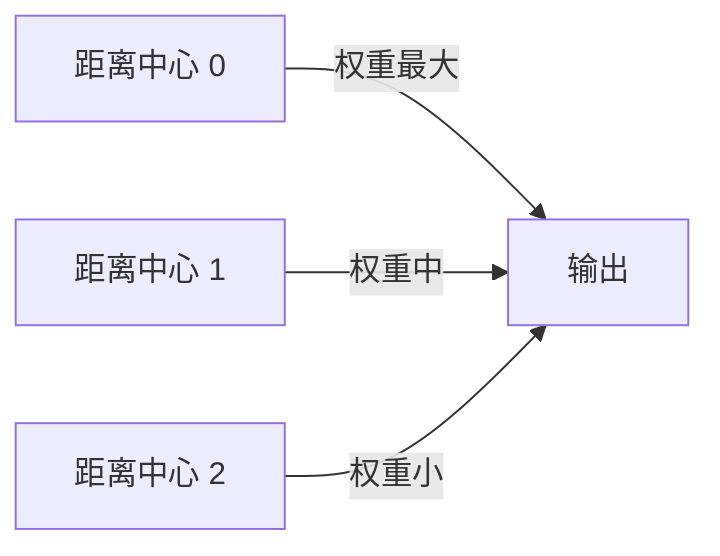
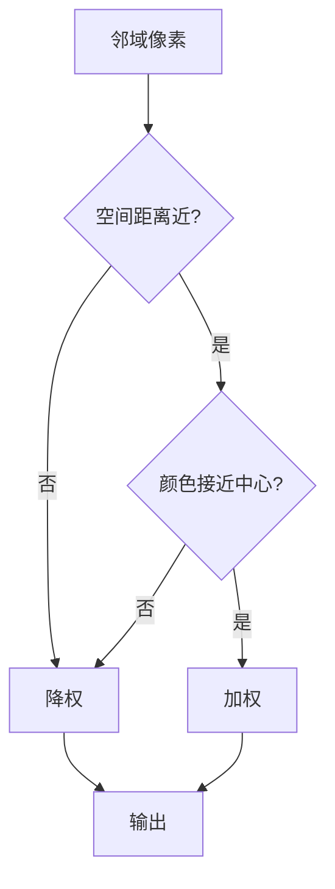
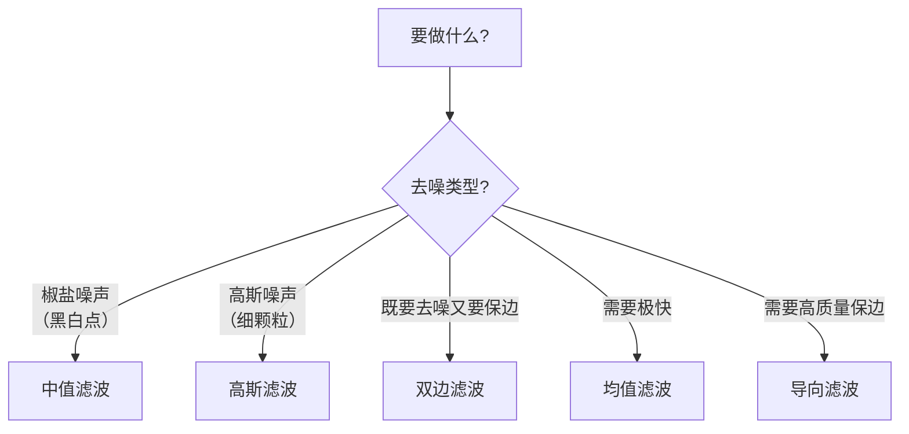

# 滤波与卷积

> **一句话**：卷积是图像处理的「万能扳手」，所有滤波都是它的特例。

## 什么是卷积

### 直观理解

拿一个小窗口（叫**核 / 卷积核 / kernel**）盖在图像上，窗口里的像素按权重相加，得到一个输出值，然后窗口滑动一格，重复。


**生活比方**：用一块有花纹的透明玻璃板在照片上慢慢移动，每移动一格就把透过的光「混合」一次，重新画出一张图。

### 数学定义

$$
(g * f)(x, y) = \sum_{i} \sum_{j} f(x+i, y+j) \cdot g(i, j)
$$

**不用怕公式**。它说的就是：**输出 = 邻域像素的加权平均**。权重就是核。

## 核的作用

| 核 | 效果 |
|---|---|
| 全是 1/9 | 均值滤波（模糊） |
| 中间大、四周小（高斯分布） | 高斯滤波（平滑） |
| `[[0,0,0],[0,1,0],[0,0,0]]` | 原图（恒等） |
| `[[0,-1,0],[-1,5,-1],[0,-1,0]]` | 锐化 |
| `[[-1,-1,-1],[-1,8,-1],[-1,-1,-1]]` | 边缘检测（拉普拉斯） |

::: tip 核的三个基本性质
1. **和为 1** → 保持整体亮度（如均值、高斯）
2. **和为 0** → 提取变化（如边缘检测）
3. **负权重** → 增强对比（如锐化）
:::

## 五种常用滤波对比

### ① 均值滤波

**核**：

```
1/9  1/9  1/9
1/9  1/9  1/9
1/9  1/9  1/9
```

**通俗理解**：把周围 9 个像素一视同仁地求平均。

| 优点 | 缺点 |
|---|---|
| 极快 | 模糊边缘 |
| 实现简单 | 去噪效果一般 |

### ② 高斯滤波（最常用）

**核**：中心权重最大，向四周按高斯分布衰减。

**通俗理解**：求平均，但**越近的像素说话越有分量**。



**数学**：

$$ G(x, y) = \frac{1}{2\pi\sigma^2} e^{-\frac{x^2 + y^2}{2\sigma^2}} $$

**两个参数**：

| 参数 | 含义 | 建议 |
|---|---|---|
| `ksize` | 核大小 | (3,3) / (5,5)，必须奇数 |
| `sigma` | 标准差 | 0（自动 = 0.3×((ksize-1)×0.5-1)+0.8） |

::: warning 关键经验：ksize 与 sigma 要匹配
**经验公式**：`sigma ≈ 0.3 × ((ksize - 1) × 0.5 - 1) + 0.8`

| ksize | 对应 sigma |
|---|---|
| 3 | 0.8 |
| 5 | 1.1 |
| 7 | 1.6 |
| 9 | 2.0 |

传 `sigma=0` 时 OpenCV 会自动按这个公式算。**手动传 sigma 时要注意匹配，否则核会被"截断"导致边缘发黑**。
:::

```python
blurred = cv2.GaussianBlur(img, (5, 5), 0)
```

### ③ 中值滤波

**通俗理解**：把周围 9 个像素**排序，取中间那个**。

| 特点 | 说明 |
|---|---|
| **杀手锏** | 去**椒盐噪声**（黑白斑点） |
| **优势** | **几乎不模糊边缘** |
| **缺点** | 比线性滤波慢（要排序） |

```python
denoised = cv2.medianBlur(img, 5)     # 5 是核大小（奇数）
```

::: tip 为什么中值滤波能去椒盐噪声
一个极端值（比如纯黑 0 或纯白 255）在排序后**一定排在两端**，取中间值时就**被排除掉了**。

而均值滤波会把这个极端值平均进去，只能"稀释"不能"消除"。
:::

### ④ 双边滤波

**通俗理解**：求平均时加两个「折扣」——**空间上远的打折，颜色差别大的也打折**。

第二个折扣是关键：**跨越边缘时不给权重**，所以边缘不会被模糊。



**三个参数**：

| 参数 | 含义 | 建议 |
|---|---|---|
| `d` | 邻域直径 | 5–9（0 则按 sigmaSpace 算） |
| `sigmaColor` | 颜色相似度容差 | 10–150 |
| `sigmaSpace` | 空间距离容差 | 10–150 |

```python
bilateral = cv2.bilateralFilter(img, d=9, sigmaColor=75, sigmaSpace=75)
```

::: warning 双边滤波的代价
**非常慢**。d=9 时，每个像素要算 81 次指数运算。1920×1080 图可能几百毫秒。

**适用**：需要"磨皮但保边"的效果（美颜、去噪保细节）。
**不适用**：实时场景。
:::

### ⑤ 导向滤波

**通俗理解**：用**另一张图（导向图）**来指导怎么平滑。

- 导向图 = 原图 → 保边去噪
- 导向图 = 另一张图 → 把第一张图的细节转移到第二张（抠图、去雾、HDR）

| 对比 | 双边滤波 | 导向滤波 |
|---|---|---|
| 速度 | 慢 | **快（O(N)）** |
| 保边 | 好 | 好 |
| 梯度保持 | 一般 | **好** |
| 使用难度 | 简单 | 需选导向图 |

## 滤波选型决策树



## 卷积的边界处理

核在图像边缘时，会「伸出去」。怎么处理？

| 模式 | 做法 | 特点 |
|---|---|---|
| `BORDER_CONSTANT` | 补 0 或指定值 | 边缘发黑 |
| `BORDER_REPLICATE` | 复制边缘像素 | **默认，常用** |
| `BORDER_REFLECT` | 镜像反射 | 效果好 |
| `BORDER_WRAP` | 环绕 | 少用 |

::: danger 坑：边缘变暗
**现象**：滤波后图像边缘一圈变暗。

**根因**：用 `BORDER_CONSTANT`（补 0）时，边缘的"0"拉低了平均值。

**解决**：用 `BORDER_REPLICATE` 或 `BORDER_REFLECT`。OpenCV 的 `GaussianBlur` 默认就是 `BORDER_REFLECT_101`。
:::

## 可分离卷积：性能的关键

**高斯核是可分离的**：一个 n×n 的二维卷积 = 两个 n×1 和 1×n 的一维卷积。

| 方式 | 计算量（n=7） |
|---|---|
| 直接二维 | 49 次乘法/像素 |
| 分离（1D×2） | **14 次乘法/像素** |

**快 3.5 倍**。OpenCV 的 `GaussianBlur` 内部就做了这个优化。

**这个思想后来被深度学习继承**——MobileNet 的深度可分离卷积就是类似思路。

## 卷积的现代延伸

::: tip 卷积 → CNN
| 传统 CV | 深度学习 |
|---|---|
| 人手工设计核 | **网络自己学核** |
| 高斯核（平滑） | 学习到的平滑滤波器 |
| Sobel 核（边缘） | **第一层学出来的往往就是边缘检测器** |
| 可分离卷积 | MobileNet 深度可分离卷积 |

**CNN 的第一层卷积核可视化出来，常常长得跟 Sobel、Gabor 很像**。这不是巧合——**有用的低层特征是客观存在的**。
:::

## 参数速查

| 滤波 | 关键参数 | 起点建议 |
|---|---|---|
| 均值 | `ksize` | (3,3) |
| 高斯 | `ksize`, `sigmaX` | (5,5), 0 |
| 中值 | `ksize` | 3 或 5 |
| 双边 | `d`, `sigmaColor`, `sigmaSpace` | 9, 75, 75 |
| 导向 | `radius`, `eps` | 8, 0.01 |

## 性能参考（1920×1080 灰度，CPU）

| 滤波 | 耗时 |
|---|---|
| 均值 5×5 | ~3 ms |
| 高斯 5×5 | ~5 ms |
| 中值 5×5 | ~15 ms |
| 双边 d=9 | ~400 ms |
| 导向 r=8 | ~30 ms |

## 常见踩坑

::: danger 坑 1：核太大导致全糊
**现象**：用 31×31 高斯，图像完全失去细节。

**解决**：**灰度图用 3–7，大图去噪也不要超过 15**。宁可多迭代几次小核。

实际上，**多次小核卷积 ≈ 一次大核卷积**（高斯的可加性），而且更快：

$$\sigma_{total}^2 = \sigma_1^2 + \sigma_2^2$$
:::

::: danger 坑 2：彩色图直接滤波导致颜色失真
**现象**：对 BGR 三个通道分别滤波，结果颜色怪异。

**根因**：三通道独立处理，破坏了通道间的相关性。

**解决**：
- 需要保色时 → 转到 **Lab / HSV 空间**，只滤亮度通道
- 或者用**双边滤波**（它对颜色差有保护）

```python
# 保色的正确做法
lab = cv2.cvtColor(img, cv2.COLOR_BGR2LAB)
l, a, b = cv2.split(lab)
l = cv2.bilateralFilter(l, 9, 75, 75)
lab = cv2.merge([l, a, b])
result = cv2.cvtColor(lab, cv2.COLOR_LAB2BGR)
```
:::

::: danger 坑 3：以为滤波能"恢复"模糊图像
**现象**：期望通过滤波让模糊照片变清晰。

**真相**：**滤波只会让图像更模糊或更锐化，不能恢复已经丢失的信息**。真正的去模糊（deconvolution）是另一个问题，且效果有限（病态问题）。

**"锐化"的原理**：`原图 + (原图 - 模糊图)`，即**增强高频**。它不是恢复，只是让边缘看起来更明显（同时增强噪声）。
:::

## 相关链接

- [阈值分割](/branches/image-processing/thresholding)
- [形态学操作](/branches/image-processing/morphology)
- [Canny 中的高斯滤波](/algorithms/canny/concepts)
- [返回图像处理分支](/branches/image-processing/)
