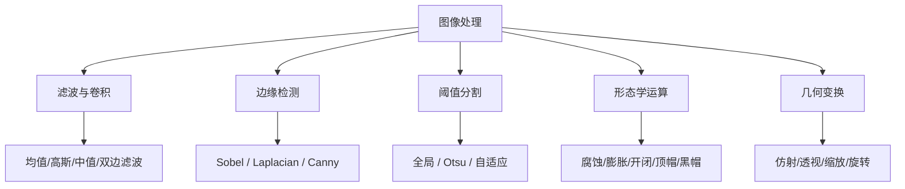
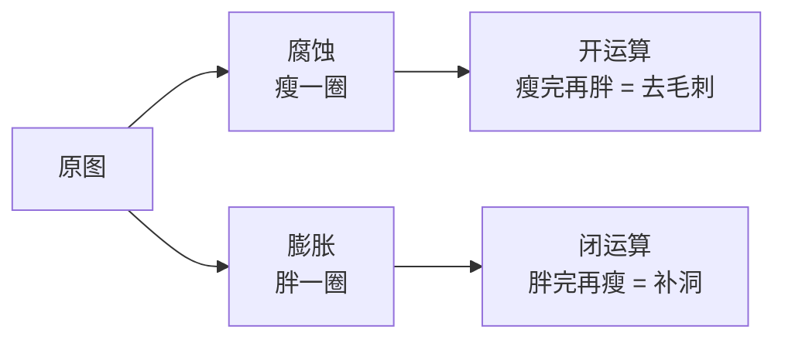
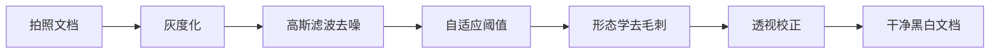
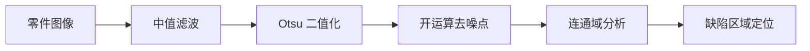
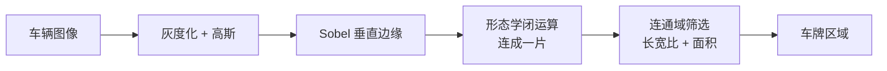
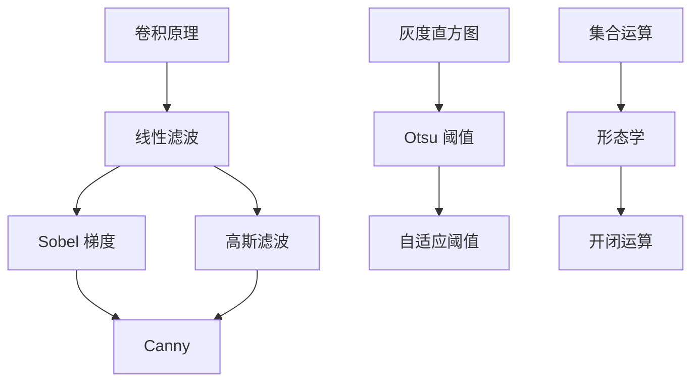

# ① 图像处理

> **学习难度 ⭐** ｜ **一句话**：把原始图像清洗成「能用的图像」。

## 这个分支解决什么问题

相机拍出来的图像是有噪声的、对比度可能不够的、大小可能不合适的。后续所有分析（找边缘、找角点、找目标）都建立在「输入图像质量」之上。

**图像处理 = 图像的下水道系统**。它不解决「图像里有什么」，但决定了后面能不能分析得准。

## 主要内容

## 核心算法清单

### 滤波与卷积

| 算法 | 通俗理解 | 用途 |
|---|---|---|
| 均值滤波 | 看周围一圈求平均，大家一样重要 | 快速去噪（会模糊） |
| **高斯滤波** | 看周围一圈求平均，越近越重要 | 去高斯噪声，保留结构 |
| 中值滤波 | 看周围一圈，取中间那个值 | 去椒盐噪声（不模糊边缘） |
| 双边滤波 | 求平均但「跨越边缘时不算」 | 保边去噪（磨皮效果） |
| 导向滤波 | 用另一张图指导怎么平滑 | 保边、去雾、抠图 |

::: tip 一句话选型
- 噪声是**随机的细颗粒** → 高斯滤波
- 噪声是**黑白点点** → 中值滤波
- 想**磨皮但保留边缘** → 双边滤波
:::

### 边缘检测

| 算法 | 通俗理解 | 特点 |
|---|---|---|
| Sobel | 看左右/上下亮度差 | 简单快速，边缘粗 |
| Laplacian | 看亮度的「凸起程度」 | 对噪声敏感 |
| **Canny** | 找差得最厉害的位置，还要串成线 | **最优，多步骤** |

**Canny 是本项目的旗舰样板算法**，详见 [Canny 完整档案](/algorithms/canny/)。

### 阈值分割

| 算法 | 通俗理解 | 特点 |
|---|---|---|
| 全局阈值 | 定一条线，比它亮的算白 | 需手动选阈值 |
| **Otsu 大津法** | 自动找一条「分得最开」的线 | 自动，双峰直方图效果好 |
| 自适应阈值 | 每个小区域单独定阈值 | 应对光照不均 |

### 形态学运算

| 运算 | 通俗理解 | 效果 |
|---|---|---|
| 腐蚀 | 白色区域「瘦一圈」 | 去小亮点、断开粘连 |
| 膨胀 | 白色区域「胖一圈」 | 补小孔、连接断裂 |
| 开运算 | 先腐蚀再膨胀 | 去小噪点，保持大块形状 |
| 闭运算 | 先膨胀再腐蚀 | 补小黑洞，保持大块形状 |
| 顶帽 | 原图减开运算 | 提取比背景亮的小东西 |
| 黑帽 | 闭运算减原图 | 提取比背景暗的小东西 |

## 典型实战场景

### 场景 1：文档扫描美化

### 场景 2：工业零件缺陷检测（前置）

### 场景 3：车牌识别前置

## 常用参数速查

| 算法 | 关键参数 | 起点建议 |
|---|---|---|
| 高斯滤波 | `ksize`（核大小） | (5,5)，必须是奇数 |
| 高斯滤波 | `sigma` | 0（自动算） |
| 中值滤波 | `ksize` | 3 或 5 |
| 双边滤波 | `d`, `sigmaColor`, `sigmaSpace` | 9, 75, 75 |
| Canny | `lowThreshold`, `highThreshold` | 100, 200（比例 1:2 到 1:3） |
| Otsu | 无（自动） | — |
| 自适应阈值 | `blockSize`, `C` | 11, 2 |
| 形态学 | `kernel`, `iterations` | 3×3，1 次 |

## 分支内算法依赖

## 学习建议

1. **先理解卷积**：所有滤波都是卷积的特例
2. **再练高斯滤波**：理解「核」和「权重」的概念
3. **然后攻 Canny**：它是综合应用（滤波+梯度+非极大值抑制+双阈值+滞后连接）
4. **最后学形态学**：理解集合运算在图像上的意义

::: tip 一个常见误区
很多人以为「图像处理」很简单、不重要。实际上：

- **工业视觉 80% 的成败取决于预处理**
- 后续算法再先进，输入图像质量差就等于零
- Canny 之所以经典，正是因为它在预处理上的设计极其精妙
:::

## 相关链接

- [Canny 边缘检测完整档案](/algorithms/canny/)
- [术语表：卷积](/glossary)
- [返回分支总览](/branches/)
