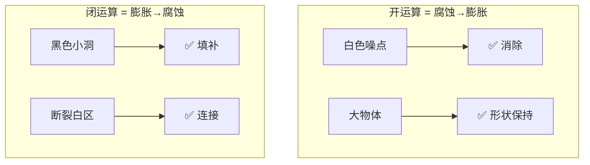
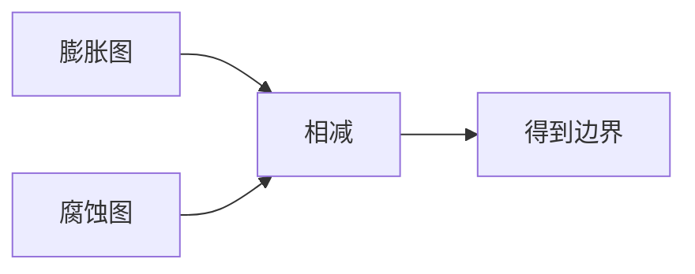
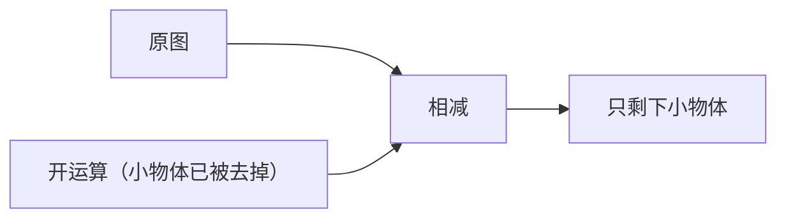
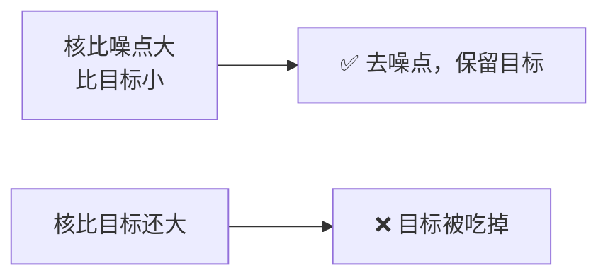

# 形态学操作

> **一句话**：用一个小「探针」在图像上滑动，改变白色区域的形状。

## 什么是形态学

形态学处理**二值图**（以及灰度图），核心思想是：用一个**结构元素（kernel）**在图像上滑动，根据覆盖区域的情况修改输出。

**生活比方**：拿一个橡皮图章（结构元素）在图上盖章，盖到白区就"改动"白区。


## ① 腐蚀（Erosion）

**效果**：白色区域**瘦一圈**。

**规则**：只有当结构元素**完全落在白色区域内**时，中心点才输出白色。


**用途**：
- 去除小的白色噪点
- 断开粘连的物体
- 缩小目标

```python
kernel = np.ones((3, 3), np.uint8)
eroded = cv2.erode(binary, kernel, iterations=1)
```

**直觉理解**：白区边界上的像素，它的邻域里一定有黑色 → 不满足"完全落白" → 被腐蚀掉。

## ② 膨胀（Dilation）

**效果**：白色区域**胖一圈**。

**规则**：只要结构元素**覆盖到任何一个白色像素**，中心点就输出白色。


**用途**：
- 填补小孔洞
- 连接断裂部分
- 扩大目标

```python
dilated = cv2.dilate(binary, kernel, iterations=1)
```

::: tip 腐蚀和膨胀是对偶的
**腐蚀（白区）= 膨胀（黑区）**

对图像取反后做膨胀，等于做腐蚀。这是形态学的基本对偶关系。
:::

## ③ 开运算（Opening）

**顺序**：**先腐蚀，再膨胀**。


**效果**：**去除小白点，保持大物体形状不变**。

**为什么有效**：

- 小噪点在腐蚀阶段就完全消失了
- 大物体被腐蚀后只是缩小，膨胀后能恢复原状

**用途**：
- **去噪点**（最常用）
- 分离轻微粘连的物体
- 去掉细小的凸起

```python
opened = cv2.morphologyEx(binary, cv2.MORPH_OPEN, kernel)
```

::: tip 一句话记住开运算
**"先瘦后胖"→ 小的东西瘦没了，胖不回来**。
:::

## ④ 闭运算（Closing）

**顺序**：**先膨胀，再腐蚀**。


**效果**：**填补小黑洞，保持大物体形状**。

**用途**：
- **连接断裂**（最常用）
- 填补目标内部的孔洞
- 平滑轮廓

```python
closed = cv2.morphologyEx(binary, cv2.MORPH_CLOSE, kernel)
```

::: tip 一句话记住闭运算
**"先胖后瘦"→ 小洞被胖的时候填上了，瘦的时候填进去的料留在里面**。
:::

## 开闭运算对比



| 问题 | 用哪个 |
|---|---|
| 有孤立小白点 | **开运算** |
| 目标内部有小黑洞 | **闭运算** |
| 目标断裂成几段 | **闭运算** |
| 目标有细小毛刺 | **开运算** |

::: warning 顺序很重要！
**先开后闭可以，先闭后开会得到不同结果**。

**常见组合**：先开运算去噪，再闭运算连接 → `open` 之后 `close`。
:::

## ⑤ 形态学梯度

**定义**：`膨胀 - 腐蚀` = 轮廓。



**效果**：提取目标的**外轮廓**。

```python
gradient = cv2.morphologyEx(binary, cv2.MORPH_GRADIENT, kernel)
```

**用途**：轮廓提取（比 Canny 更"粗"，但对二值图很合适）。

## ⑥ 顶帽（Top Hat）

**定义**：`原图 - 开运算`。

**效果**：提取**比背景亮的小物体**。



**为什么有效**：开运算会去掉小亮点，原图减去它 → 剩下的就是那些小亮点。

**用途**：
- **提取亮背景上的小亮点**
- 校正不均匀光照（提取光照不均的部分）

```python
tophat = cv2.morphologyEx(binary, cv2.MORPH_TOPHAT, kernel)
```

::: tip 顶帽的妙用：光照不均校正
用一个**比目标大**的核做开运算，得到的是"背景光照分布"。

`原图 / 开运算结果` → 光照被均匀化。

这跟前面 [阈值分割](/branches/image-processing/thresholding) 里讲的高斯模糊除法是一个思路。
:::

## ⑦ 黑帽（Black Hat）

**定义**：`闭运算 - 原图`。

**效果**：提取**比背景暗的小物体**（小暗点、小孔洞）。

```python
blackhat = cv2.morphologyEx(binary, cv2.MORPH_BLACKHAT, kernel)
```

**用途**：**提取亮背景上的小暗点**（工业里的暗缺陷）。

## 结构元素（核）的选择

### 核的形状

| 形状 | 创建方式 | 适用 |
|---|---|---|
| 矩形 | `np.ones((3,3), np.uint8)` | 通用 |
| 椭圆 | `cv2.getStructuringElement(cv2.MORPH_ELLIPSE, (3,3))` | **更自然，推荐** |
| 十字 | `cv2.getStructuringElement(cv2.MORPH_CROSS, (3,3))` | 特定方向 |

**图示**（3×3）：

```
矩形          椭圆          十字
1 1 1        0 1 0        0 1 0
1 1 1        1 1 1        1 1 1
1 1 1        0 1 0        0 1 0
```

::: tip 默认用矩形，追求自然形状用椭圆
**矩形核**：计算简单（可分离优化）。

**椭圆核**：对圆形的物体（细胞、孔洞）更友好，不会产生方向偏置。

**十字核**：只在横竖方向操作，保留斜向细节。
:::

### 核的大小与形状要匹配目标



**原则**：

- **核要大于要去掉的噪点**
- **核要小于要保留的目标**
- 宁可**多次小核迭代**，不要一次大核

**迭代与核大小的关系**：3×3 核迭代 2 次 ≈ 5×5 核 1 次（近似）。

## 灰度形态学

形态学也能用于**灰度图**：

| 操作 | 灰度图下的含义 |
|---|---|
| 腐蚀 | 取邻域**最小值**（变暗、去亮细节） |
| 膨胀 | 取邻域**最大值**（变亮、去暗细节） |
| 开运算 | 去亮细节（削掉小山峰） |
| 闭运算 | 去暗细节（填平小山谷） |

**用途**：灰度图的光照校正、背景估计。

```python
# 灰度图下的背景估计
background = cv2.morphologyEx(gray, cv2.MORPH_OPEN, 
                              cv2.getStructuringElement(cv2.MORPH_ELLIPSE, (15, 15)))
# 提取前景（比背景亮的细节）
foreground = cv2.subtract(gray, background)
```

## 典型应用流程

### 场景 1：去噪 + 填洞


```python
kernel = cv2.getStructuringElement(cv2.MORPH_ELLIPSE, (3, 3))
opened = cv2.morphologyEx(binary, cv2.MORPH_OPEN, kernel, iterations=1)
closed = cv2.morphologyEx(opened, cv2.MORPH_CLOSE, kernel, iterations=2)
```

### 场景 2：车牌字符的垂直边缘连接


**关键**：用一个**横向拉长的核**，只在水平方向连接。

```python
# 横向核：只连接水平方向
kernel = cv2.getStructuringElement(cv2.MORPH_RECT, (17, 5))
closed = cv2.morphologyEx(edges, cv2.MORPH_CLOSE, kernel)
```

::: tip 方向性核的威力
**想让哪个方向连接，就把核在那个方向拉长**。

- 车牌字符：横向连接 → 核 `(17, 5)`
- 垂直排列的文字：纵向连接 → 核 `(5, 17)`
- 斜向线条：用倾斜核
:::

### 场景 3：分离粘连细胞


**原理**：腐蚀会吃掉细胞之间的连接部分，让它们分开。

## 参数速查

| 操作 | 核大小 | 迭代 |
|---|---|---|
| 去噪点 | 3×3 | 1–2 |
| 填小洞 | 3×3 | 1–2 |
| 连接断裂 | 5×5 或方向核 | 1–2 |
| 分离粘连 | 3×3 | 2–5 |
| 提取轮廓 | 3×3 | 1 |

## 性能开销

形态学操作**非常快**（比滤波快）：

| 操作 | 1920×1080 二值图耗时 |
|---|---|
| 腐蚀 3×3 | < 1 ms |
| 膨胀 3×3 | < 1 ms |
| 开/闭 3×3 | ~2 ms |
| 开/闭 7×7 | ~5 ms |

**可以用得多**——这是传统 CV 里最"划算"的操作之一。

## 常见踩坑

::: danger 坑 1：核太大，目标消失
**现象**：用 15×15 做开运算，小目标全不见了。

**解决**：
- **核只比噪点大一点**（3×3 或 5×5）
- 迭代多次而非用大核
- 先测量「噪点尺寸」和「目标尺寸」，核取两者之间
:::

::: danger 坑 2：把开闭顺序搞反
**现象**：想要去噪点，结果噪点没去掉。

**根因**：把开运算和闭运算顺序弄错了。

**记忆**：

- **开** = 先**腐**蚀 → **"开"头是"腐"**（都是"去"的动作）
- **闭** = 先**膨**胀 → **"闭"掉洞**

**更简单的记法**：

| 要处理的 | 用 | 口诀 |
|---|---|---|
| 白色噪点 | 开 | 白的去掉 → 开（"开门放白走"） |
| 黑色孔洞 | 闭 | 黑的填上 → 闭（"闭门补黑"） |
:::

::: danger 坑 3：忘记输入必须是二值图
**现象**：对灰度图做腐蚀，结果"斑点化"。

**说明**：形态学**可以**用灰度图，但含义不同（取 min/max）。

**解决**：明确你要的是二值形态学还是灰度形态学。
:::

::: danger 坑 4：`iterations` 和核大小混用
**现象**：核 3×3 迭代 5 次后，目标变形严重。

**根因**：多次迭代的效果**不是线性的**——每次迭代都会累积形状变化。

**建议**：核大小按目标比例选，`iterations` 通常 **1–2** 足够。
:::

## 形态学 vs 滤波

| 维度 | 形态学 | 滤波 |
|---|---|---|
| 输入 | 二值图为主 | 灰度/彩色 |
| 运算 | 集合运算（min/max） | 加权求和 |
| 速度 | **极快** | 较慢 |
| 非线性 | **是**（min/max 非线性） | 线性（除非中值/双边） |
| 效果 | 改变形状 | 改变亮度分布 |

**两者互补**：滤波处理灰度，形态学处理形状。

## 相关链接

- [滤波与卷积](/branches/image-processing/filtering)
- [阈值分割](/branches/image-processing/thresholding)
- [④ 图像分割分支：分水岭](/branches/segmentation/)
- [工业缺陷检测案例](/cases/)
- [返回图像处理分支](/branches/image-processing/)
