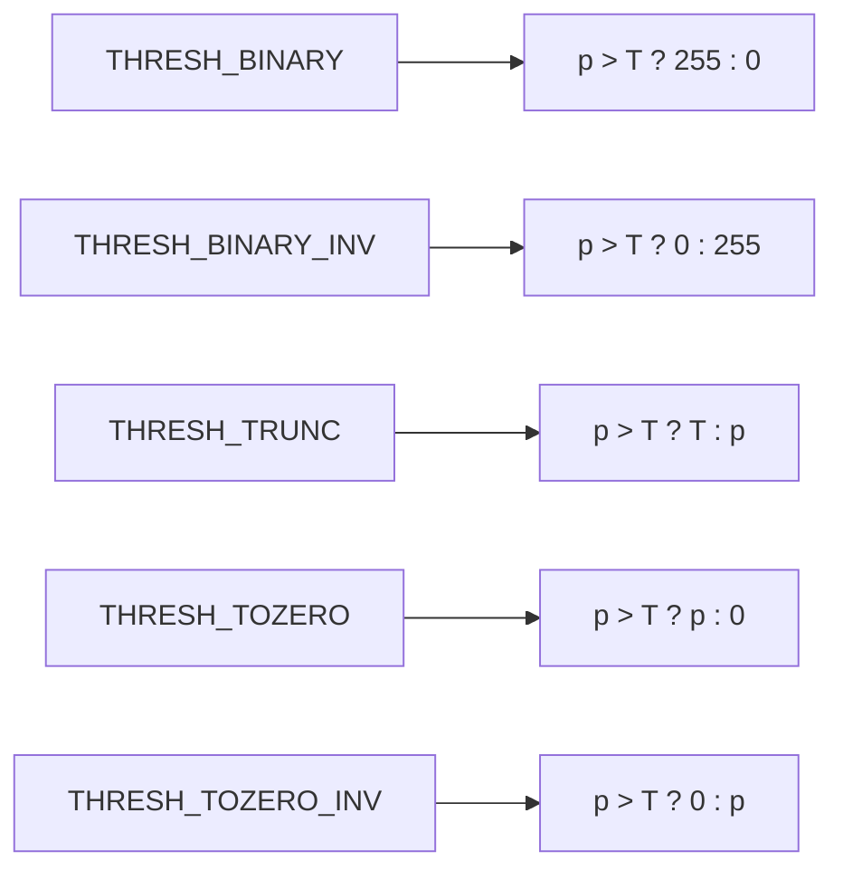
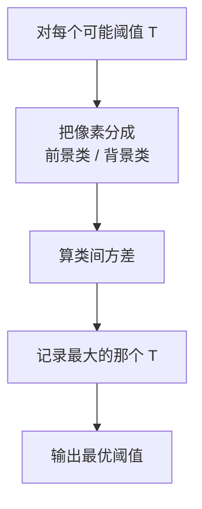
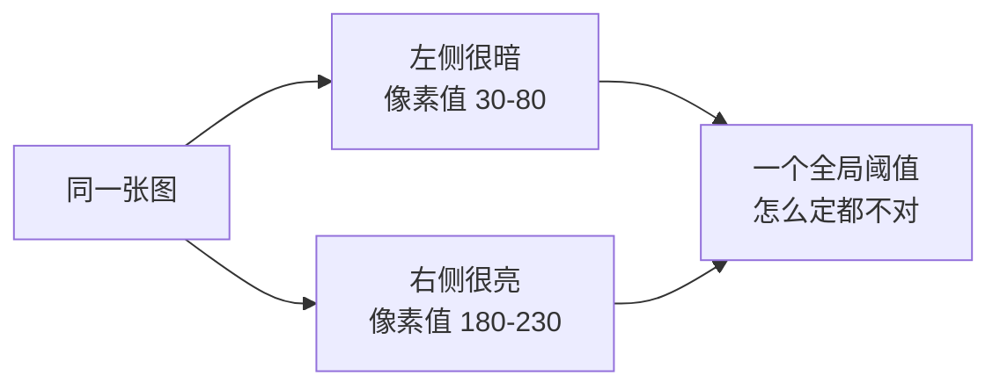
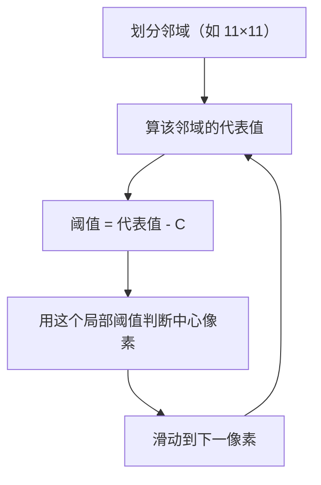
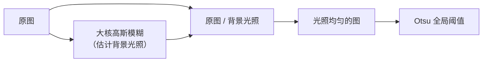
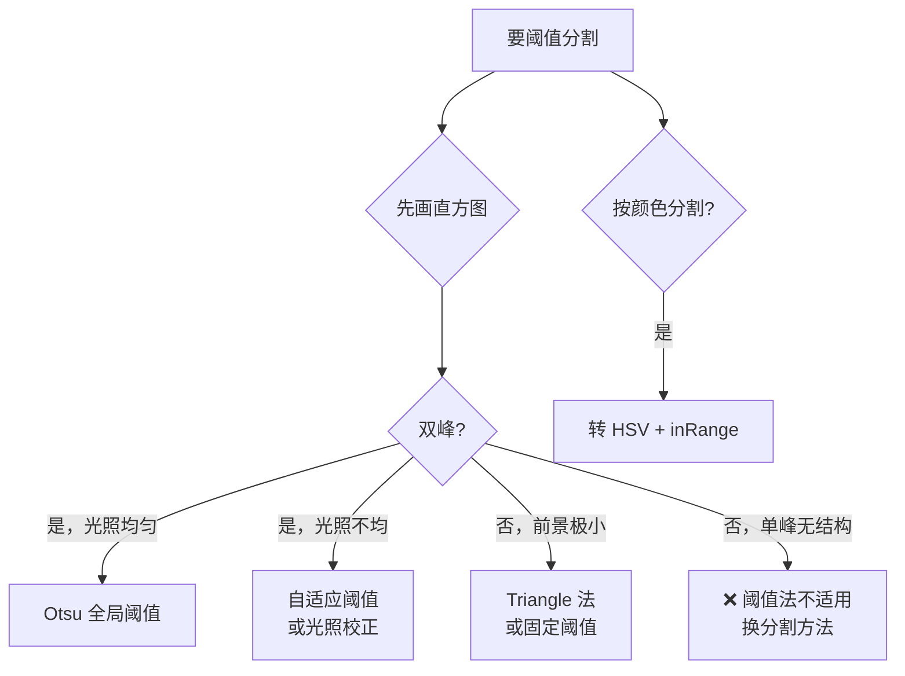

# 阈值分割

> **一句话**：定一条线，把图像分成「黑」和「白」。

## 为什么阈值分割是最常用的分割方法

**理由只有一个：简单**。

- 不需要训练
- 不需要参数搜索
- 一次判断就是一个像素的时间
- 结果可解释（就一个阈值）

**工业视觉里 60% 以上的分割任务用阈值法解决**。

## 灰度直方图：阈值法的出发点

**直方图**：统计每个亮度值有多少像素。


| 直方图形状 | 阈值法适用性 |
|---|---|
| **双峰**（前景背景各一峰） | ✅ 完美适用 |
| 单峰 | ❌ 说明目标和背景亮度接近 |
| 多峰 | ⚠️ 需多阈值 |
| 平缓无峰 | ❌ 不适用 |

::: tip 判据：先画直方图
**遇到阈值分割，第一步永远是画直方图**。

```python
import matplotlib.pyplot as plt
hist = cv2.calcHist([gray], [0], None, [256], [0, 256])
plt.plot(hist)
plt.show()
```

- **看到双峰** → 阈值法会很好用
- **看到单峰** → 别浪费时间调阈值了，换方法
:::

## ① 全局阈值

### 固定阈值

```python
ret, binary = cv2.threshold(gray, 127, 255, cv2.THRESH_BINARY)
```

| 参数 | 含义 |
|---|---|
| `127` | 阈值 T |
| `255` | 超过 T 时赋的值 |

**五种阈值类型**：



| 类型 | 效果 | 用途 |
|---|---|---|
| `BINARY` | 亮 = 白 | 常规 |
| `BINARY_INV` | 亮 = 黑 | **暗目标是缺陷**（工业） |
| `TRUNC` | 截断 | 抑制高光 |
| `TOZERO` | 暗的归零 | 保留亮部 |
| `TOZERO_INV` | 亮的归零 | 保留暗部 |

::: warning 工业里最常用的是 BINARY_INV
**缺陷（划痕、污点、缺料）通常是暗的**，所以要把暗的变成白（前景）：

```python
_, binary = cv2.threshold(gray, 0, 255, cv2.THRESH_BINARY_INV + cv2.THRESH_OTSU)
```
:::

### Otsu 大津法（自动阈值）

**核心思想**：遍历所有可能的阈值，选那个**让前景和背景"分得最开"**的。

### 怎么定义"分得最开"

用**类间方差**。Otsu 证明：**类间方差最大 ⟺ 类内方差最小**。



**数学表达**：

$$ \sigma_b^2(T) = \omega_0(T) \omega_1(T) [\mu_0(T) - \mu_1(T)]^2 $$

| 符号 | 含义 |
|---|---|
| $\omega_0, \omega_1$ | 两类的像素占比 |
| $\mu_0, \mu_1$ | 两类的平均灰度 |
| 目标 | **最大化** $\sigma_b^2$ |

**直观理解**：如果两类的平均值差得远，而且两类都不"太小"，这个阈值就好。

**使用**：

```python
# 阈值参数传 0，加 THRESH_OTSU 标志
ret, binary = cv2.threshold(gray, 0, 255, cv2.THRESH_BINARY + cv2.THRESH_OTSU)
print(f"Otsu 自动选的阈值：{ret}")
```

### Otsu 的适用边界

| 情况 | Otsu 表现 |
|---|---|
| 双峰直方图，峰间有明显谷底 | ✅ **接近最优** |
| 光照均匀 | ✅ 好 |
| 前景面积远小于背景（如小缺陷） | ⚠️ 一般（Otsu 假设两类面积相当） |
| 光照不均 | ❌ 差 |
| 单峰直方图 | ❌ 差 |

::: tip Otsu 失效的典型场景
**场景**：一张图里 99% 是背景，1% 是细小缺陷。

**问题**：Otsu 最大化类间方差时，倾向于把阈值放在"中间"，会**把大量背景也划成前景**。

**解决**：
- 用**固定阈值**（根据缺陷特性定）
- 用**局部阈值**
- 用**差分法**（与合格品图相减）
- 用 **triangle 法**（适合前景极小的情形）
:::

### Triangle 法（三角法）

**适用**：**前景占比极小**、直方图只有单峰和长尾。

**思路**：找到直方图峰值，从峰值向下画直线到最远端，找离这条线最远的直方图点作为阈值。

```python
ret, binary = cv2.threshold(gray, 0, 255, cv2.THRESH_BINARY + cv2.THRESH_TRIANGLE)
```

## ② 自适应阈值

### 为什么需要

**全局阈值的死穴：光照不均**。



**生活比方**：一张纸一半在灯光下一半在阴影里，用同一个标准判断"黑"和"白"必然错。

### 解决思路

**每个小区域各自算一个阈值**。



### 两种计算方式

| 方式 | 代表值算法 |
|---|---|
| `ADAPTIVE_THRESH_MEAN_C` | 邻域**均值** |
| `ADAPTIVE_THRESH_GAUSSIAN_C` | 邻域**高斯加权和** |

**区别**：高斯方式对噪声更鲁棒（中心权重更大）。

```python
binary = cv2.adaptiveThreshold(
    gray, 255,
    cv2.ADAPTIVE_THRESH_GAUSSIAN_C,
    cv2.THRESH_BINARY,
    blockSize=11,      # 邻域大小，奇数，必须 >= 3
    C=2                # 从代表值里减掉的常数
)
```

### 两个参数的直觉

| 参数 | 作用 | 调大 | 调小 |
|---|---|---|---|
| `blockSize` | 邻域大小 | 更平滑，适应大范围光照 | 更"细节敏感"，但也更容易把噪声当边缘 |
| `C` | 偏移量 | 更严格（前景更少） | 更宽松（前景更多） |

::: tip 怎么定 blockSize
**blockSize 应该大于你要检测的目标尺寸**。

- 检测文字笔画（2–3 px）→ blockSize = 11–15
- 检测大块区域（100+ px）→ blockSize = 51–101

**原则**：blockSize 要**大到能包含"背景+目标"**，否则局部阈值会被目标自身的影响污染。
:::

### 光照不均的替代方案

**方案 A：先做光照校正，再用全局阈值**



```python
# 光照校正（除法归一化）
background = cv2.GaussianBlur(gray, (101, 101), 0)
normalized = cv2.divide(gray, background, scale=255)
_, binary = cv2.threshold(normalized, 0, 255, cv2.THRESH_BINARY + cv2.THRESH_OTSU)
```

**方案 B：CLAHE 局部对比度增强后再阈值**

```python
clahe = cv2.createCLAHE(clipLimit=2.0, tileGridSize=(8, 8))
enhanced = clahe.apply(gray)
_, binary = cv2.threshold(enhanced, 0, 255, cv2.THRESH_BINARY + cv2.THRESH_OTSU)
```

| 方案 | 适用 |
|---|---|
| 自适应阈值 | 目标小、纹理细（文字、纹理） |
| 光照校正 + 全局 | 目标大、需保留整体形状 |
| CLAHE + 全局 | 对比度低但光照基本均匀 |

## ③ 多阈值与彩色分割

### 双阈值（区间阈值）

**需求**：只保留某个灰度区间的像素。

```python
# 保留 100-200 之间的像素
mask = cv2.inRange(gray, 100, 200)
```

### HSV 色彩分割

**需求**：按颜色分割（如提取红色物体）。

```python
hsv = cv2.cvtColor(img, cv2.COLOR_BGR2HSV)

# 红色在 HSV 里跨越 0 度，需两段
mask1 = cv2.inRange(hsv, (0, 100, 100), (10, 255, 255))
mask2 = cv2.inRange(hsv, (170, 100, 100), (180, 255, 255))
mask = mask1 | mask2
```

::: tip 为什么按颜色分割要用 HSV 而不是 RGB
**HSV 把"颜色"（H）和"亮度"（V）分开了**。

- RGB 里，一个红色物体在阴影下 R 值会大幅下降 → 阈值失效
- HSV 里，阴影主要影响 V，**H 基本不变** → 阈值稳定

**工业里的彩色物体检测，90% 用 HSV**。
:::

**常用 HSV 范围**（OpenCV 的 H 是 0–179）：

| 颜色 | H 范围 | S | V |
|---|---|---|---|
| 红 | 0–10, 170–180 | 100–255 | 100–255 |
| 橙 | 11–22 | 100–255 | 100–255 |
| 黄 | 23–33 | 100–255 | 100–255 |
| 绿 | 34–85 | 100–255 | 100–255 |
| 蓝 | 86–125 | 100–255 | 100–255 |
| 紫 | 126–155 | 100–255 | 100–255 |

## 阈值效果评估

| 指标 | 说明 |
|---|---|
| **IoU** | 与真值掩膜的交并比 |
| 误检率 | 背景被误判为前景的比例 |
| 漏检率 | 前景被误判为背景的比例 |
| 边界误差 | 分割边界的平均偏移 |

::: warning 不要只看 IoU
**小目标场景下 IoU 会很低，但可能完全可用**。

例：一个 10×10 的缺陷，如果分割出来是 8×8 且位置对，IoU = 64/100 = 0.64。看起来"不高"，但检测任务上完全够用。

**要从业务角度评估**——"漏检率"通常比 IoU 更重要。
:::

## 决策流程



## 参数速查

| 方法 | 参数 | 建议 |
|---|---|---|
| 固定阈值 | `thresh` | 先看直方图定 |
| Otsu | 无 | 传 0 + `THRESH_OTSU` |
| Triangle | 无 | 传 0 + `THRESH_TRIANGLE` |
| 自适应 | `blockSize` | 11–51（奇数） |
| 自适应 | `C` | 2–10 |
| CLAHE | `clipLimit` | 2.0–4.0 |
| CLAHE | `tileGridSize` | (8,8) |
| HSV | `lower/upper` | 按颜色表 |

## 常见踩坑

::: danger 坑 1：忘了灰度化
**现象**：`cv2.threshold` 报错或结果异常。

**根因**：`threshold` 只接受**单通道**图。

**解决**：`gray = cv2.cvtColor(img, cv2.COLOR_BGR2GRAY)`。

**例外**：如果确实要按颜色分割，用 `cv2.inRange`（它接受三通道，逐通道判断）。
:::

::: danger 坑 2：blockSize 是偶数
**现象**：OpenCV 报 `Assertion failed`。

**解决**：**必须奇数**且 ≥ 3。偶数会报错。

原因：奇数才有"中心像素"。
:::

::: danger 坑 3：自适应阈值的 blockSize 太小
**现象**：目标内部被挖空（目标中心被判成了背景）。

**根因**：blockSize 小于目标尺寸时，邻域全在目标内部，邻域均值就接近目标值，导致"目标像素 - 均值 ≈ 0"，被判为背景。

**解决**：**blockSize 必须大于目标尺寸**。
:::

::: danger 坑 4：Otsu 出来的阈值接近 0 或 255
**现象**：Otsu 返回的 `ret` 是 1 或者 254。

**根因**：图像几乎是纯色，或几乎没有前景。

**解决**：
- 检查输入图像（是否全黑/全白/几乎均匀）
- 检查是否忘了灰度化
- 检查图像是否真的包含目标
:::

::: danger 坑 5：彩色图直接二值化
**现象**：红蓝两个物体，明明人眼差别很大，二值化后混在一起。

**根因**：转灰度时，红色和蓝色可能灰值接近。

**解决**：用 **HSV 空间**分割，或**在特定通道上**处理（如只看 R 通道）。
:::

## 与其他分割方法的衔接

阈值分割的结果通常还要经过：


**阈值只是第一步**。真实项目里的完整链路是：

**阈值 → 形态学 → 连通域 → 筛选**，这一套组合能解决大部分工业检测需求。

## 相关链接

- [滤波与卷积](/branches/image-processing/filtering)
- [形态学操作](/branches/image-processing/morphology)
- [④ 图像分割分支](/branches/segmentation/)
- [工业缺陷检测案例](/cases/)
- [返回图像处理分支](/branches/image-processing/)
