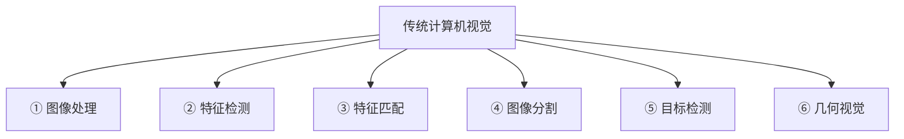
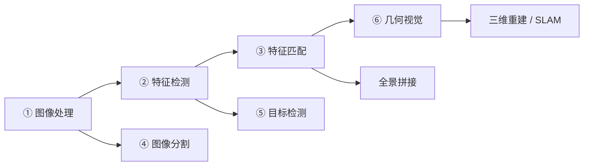
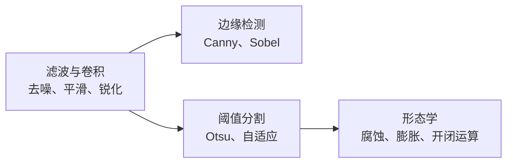
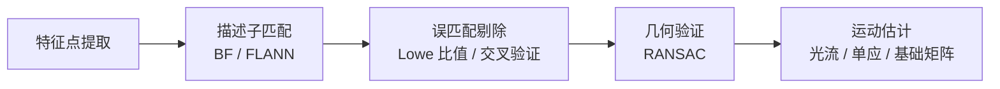
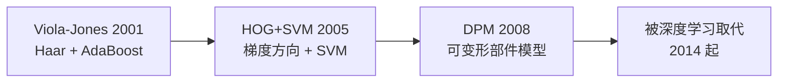
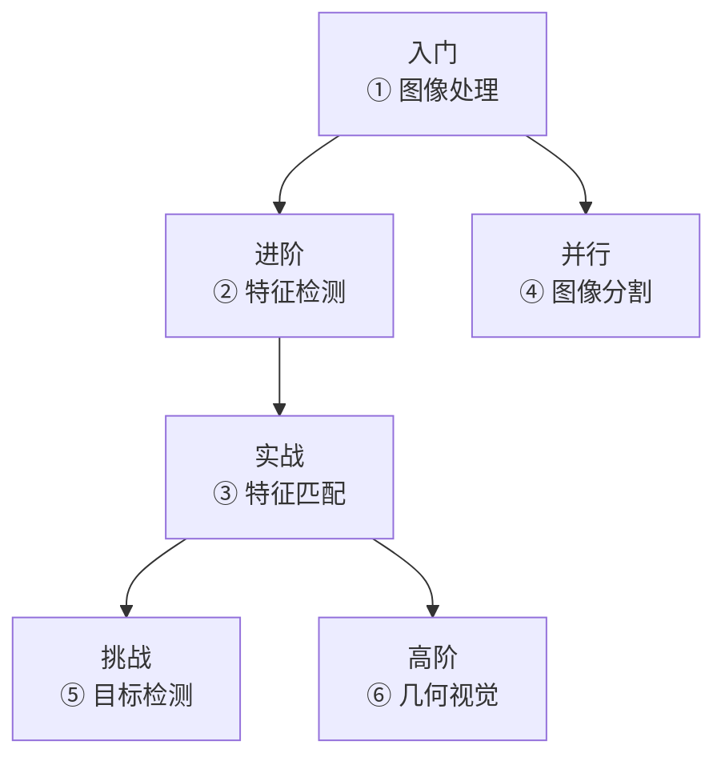
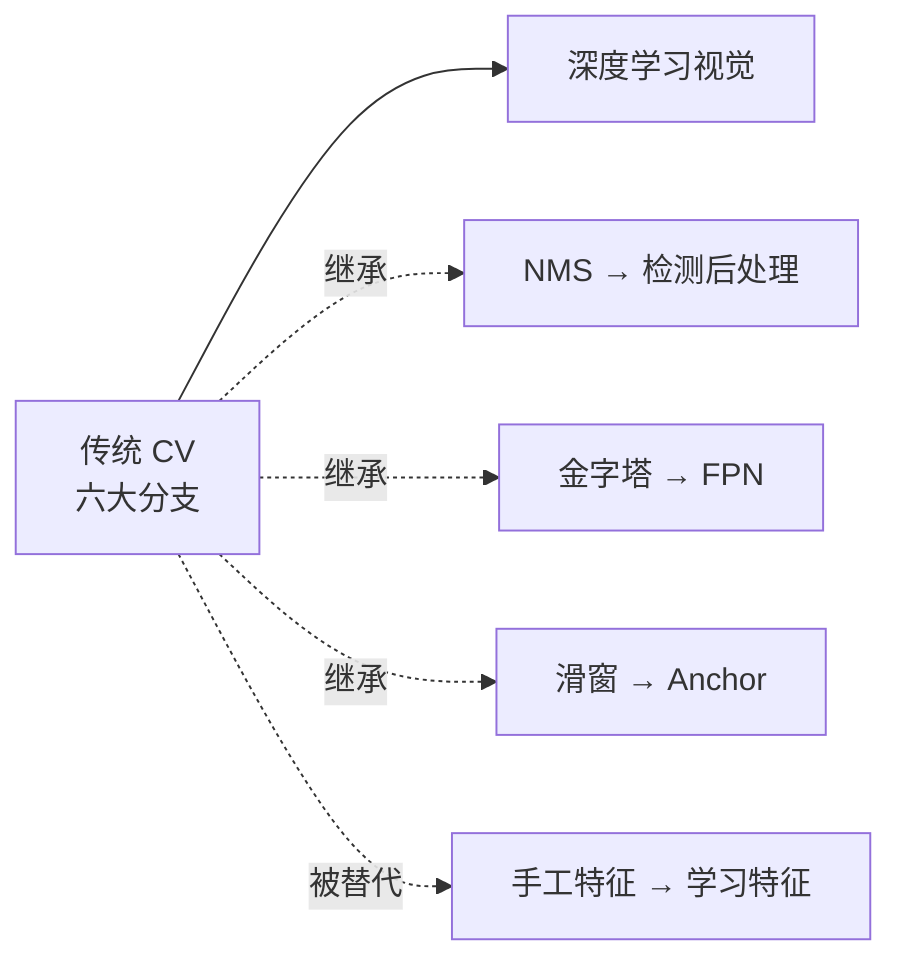

# 技术分支总览

> 传统 CV 的六大分支，按「从简单到复杂」的自然学习路径排列。每个分支都有完整的「论文 → 理论 → 实现 → 实战」档案。

## 六大分支

| 分支 | 学习难度 | 核心问题 | 代表算法 |
|---|---|---|---|
| ① 图像处理 | ⭐ | 怎么清洗和准备图像 | 高斯滤波、Otsu、形态学、Canny |
| ② 特征检测 | ⭐⭐ | 图像里哪些点值得记住 | Harris、SIFT、SURF、ORB |
| ③ 特征匹配 | ⭐⭐⭐ | 两张图怎么对上 | 描述子匹配、RANSAC、光流 |
| ④ 图像分割 | ⭐⭐⭐ | 怎么把目标抠出来 | Watershed、MeanShift、GrabCut |
| ⑤ 目标检测 | ⭐⭐⭐⭐ | 怎么在图中找到物体 | Viola-Jones、HOG+SVM、DPM |
| ⑥ 几何视觉 | ⭐⭐⭐⭐⭐ | 怎么从 2D 反推 3D | 标定、对极几何、立体、SFM |

## 分支之间的依赖关系

**关键理解**：

- **① 是所有分支的基础**：任何图像分析都从「清理图像」开始
- **② 和 ④ 都直接依赖 ①**：一个是找点，一个是找区域
- **③ 依赖 ②**：没有特征点，就没法匹配
- **⑤ 依赖 ②**：传统检测器用 ② 的手工特征
- **⑥ 依赖 ③**：几何计算需要匹配点对

## ① 图像处理

**核心问题**：怎么把原始图像变成「适合后续分析」的形式。

**主要内容**：

**典型应用**：图像预处理、文档扫描、工业质检前置步骤。

详见 [图像处理分支](/branches/image-processing/)。

## ② 特征检测

**核心问题**：图像里哪些位置「独特且稳定」，值得作为后续处理的基础。

**主要内容**：

| 类型 | 代表算法 |
|---|---|
| 边缘 | Canny、Sobel、Laplacian |
| 角点 | Harris、Shi-Tomasi、FAST |
| 斑点 | LoG、DoG |
| 完整特征 | SIFT、SURF、ORB、BRISK |

**典型应用**：图像匹配、三维重建、SLAM、图像检索。

详见 [特征检测分支](/branches/feature-detection/)。

## ③ 特征匹配

**核心问题**：两张图之间的对应关系是什么。

**主要内容**：

**典型应用**：全景拼接、图像检索、目标跟踪、视觉里程计。

详见 [特征匹配分支](/branches/feature-matching/)。

## ④ 图像分割

**核心问题**：把图像划分成有意义的区域，把目标从背景里分出来。

**主要内容**：

| 类型 | 代表算法 |
|---|---|
| 阈值类 | 全局阈值、自适应阈值、Otsu |
| 区域类 | 区域生长、分水岭 |
| 聚类类 | K-Means、MeanShift |
| 图论类 | GraphCut、GrabCut |

**典型应用**：背景替换、医学影像、工业缺陷区域提取。

详见 [图像分割分支](/branches/segmentation/)。

## ⑤ 目标检测

**核心问题**：图像里有没有目标，在哪，是什么。

**主要内容**：

**典型应用**：人脸检测、行人检测、车辆检测、工业质检。

详见 [目标检测分支](/branches/detection/)。

## ⑥ 几何视觉

**核心问题**：图像上的像素坐标，如何对应到真实的三维世界。

**主要内容**：

| 主题 | 核心内容 |
|---|---|
| 相机模型 | 针孔模型、内外参、畸变 |
| 相机标定 | 张正友标定法 |
| 对极几何 | 基础矩阵、本质矩阵、八点法 |
| 立体视觉 | 立体匹配、视差、深度 |
| 三维重建 | SFM、光束法平差 |

**典型应用**：三维重建、SLAM、AR/VR、自动驾驶。

详见 [几何视觉分支](/branches/geometry/)。

## 学习路径建议

**建议顺序**：

1. **先学 ① 图像处理**：这是所有 CV 的地基
2. **再学 ② 特征检测**：理解「什么是有用的图像信息」
3. **然后 ③ 特征匹配**：把「找点」升级到「建立对应」
4. **④ 可以并行学**：它相对独立，主要依赖 ①
5. **⑤ 和 ⑥ 是两条进阶路线**：⑤ 走向「识别」，⑥ 走向「测量与重建」

## 与深度学习的关系

**传统 CV 的六个分支，在深度学习时代**：

| 分支 | 现状 |
|---|---|
| ① 图像处理 | **仍大量使用**（预处理、后处理） |
| ② 特征检测 | 部分被 CNN 特征取代，但 ORB 在 SLAM 仍主流 |
| ③ 特征匹配 | 匹配思想保留，特征换成学习式（SuperPoint 等） |
| ④ 图像分割 | 主流被语义分割网络取代，但 GrabCut 仍常用 |
| ⑤ 目标检测 | **全面被深度学习取代** |
| ⑥ 几何视觉 | **核心方法仍在使用**（标定、BA、对极几何） |

详见 [传承脉络](/legacy/)。
