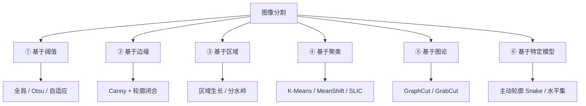
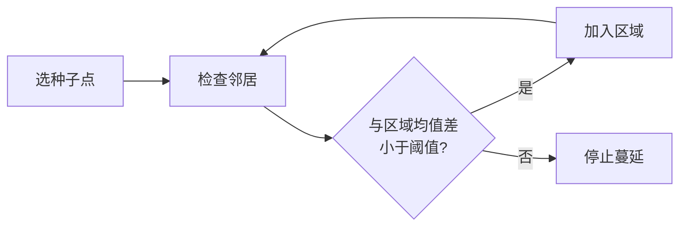
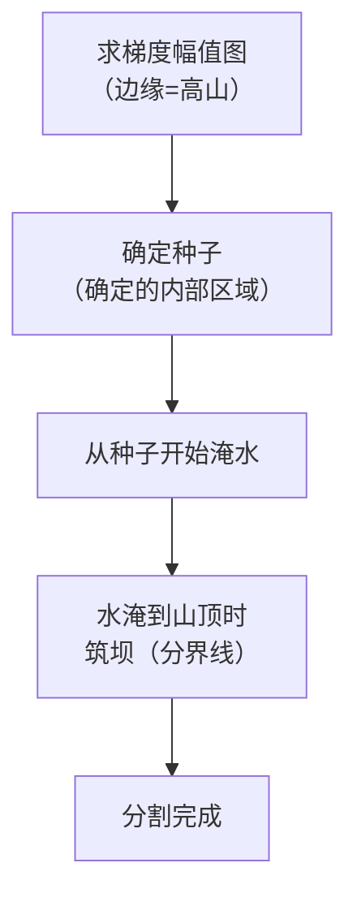
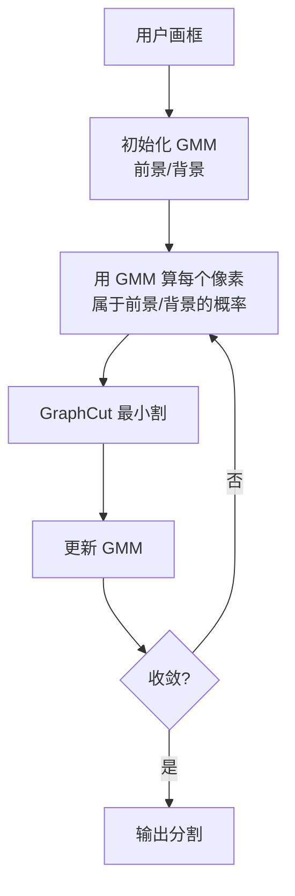
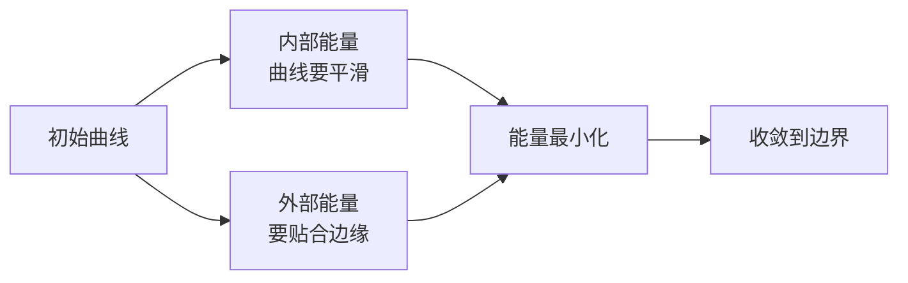
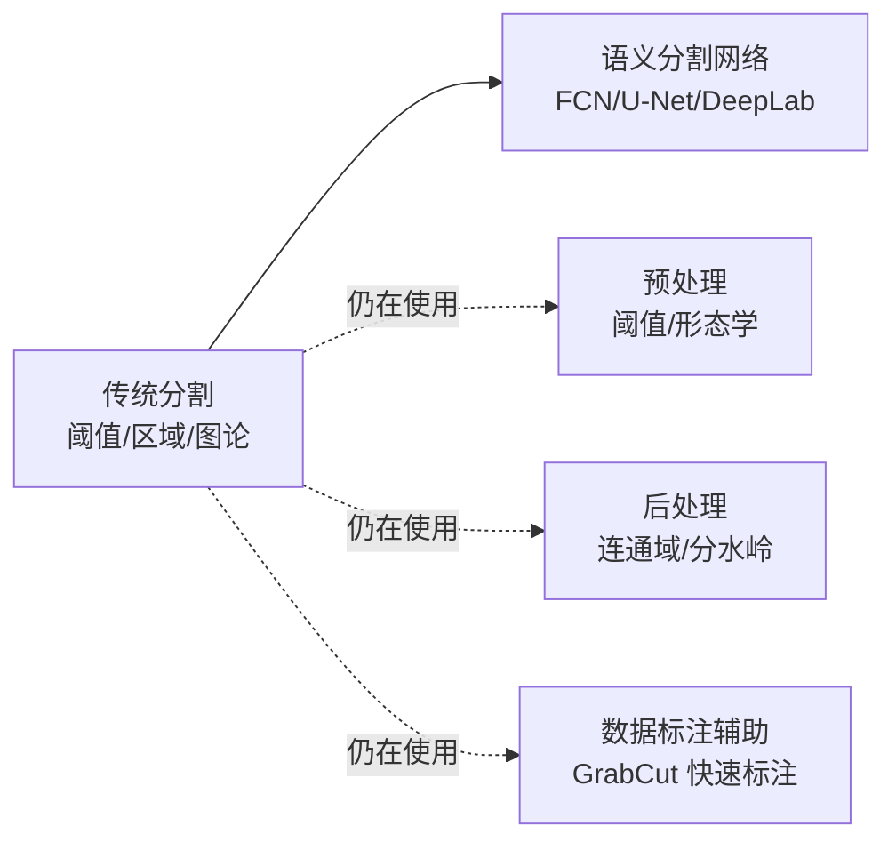

# ④ 图像分割

> **学习难度 ⭐⭐⭐** ｜ **一句话**：把图像切成语义上有意义的区域，把目标抠出来。

## 这个分支解决什么问题

上一分支在找「点」，这一分支在找**区域**。「哪些像素属于前景，哪些属于背景」——这是从像素到物体的第一步。

**图像分割 = 图像上的「圈地运动」**。它不关心这块地是房子还是草地（那是识别的事），它只关心「这块和那块不一样，应该分开」。

## 分割方法总谱系



## ① 阈值分割

### 全局阈值

**思路**：选一个亮度值 T，比它亮的算前景，暗的算背景。

**生活比方**：一张纸上有黑字。定一条线，比线黑的算字，比线白的算纸。

**缺点**：光照不均匀时，一边亮一边暗，一条线搞不定。

### Otsu 大津法（自动阈值）

**思路**：自动找一个「让前景和背景分得最开」的阈值。

**核心直觉**：把所有可能的阈值都试一遍，选那个「让类内方差最小、类间方差最大」的。


**适用**：图像直方图有**明显的双峰**（前景背景亮度差异明显）。

| 场景 | Otsu 效果 |
|---|---|
| 文档扫描 | ✅ 很好 |
| 白底黑字的标签 | ✅ 很好 |
| 光照不均的工业图 | ❌ 差，需先校正 |
| 目标背景亮度接近 | ❌ 差 |

### 自适应阈值

**思路**：不全局定一个 T，而是**每个小区域各自算一个 T**。


**两种计算方式**：

| 方式 | 说明 |
|---|---|
| `ADAPTIVE_THRESH_MEAN_C` | 邻域平均值 - C |
| `ADAPTIVE_THRESH_GAUSSIAN_C` | 邻域高斯加权和 - C |

```python
binary = cv2.adaptiveThreshold(
    gray, 255,
    cv2.ADAPTIVE_THRESH_GAUSSIAN_C,
    cv2.THRESH_BINARY,
    blockSize=11,   # 邻域大小，奇数
    C=2             # 常数，从均值里减掉
)
```

## ② 基于边缘的分割

**思路**：先找边缘，再把边缘连成封闭轮廓，轮廓内就是区域。


**问题**：边缘经常**不闭合**，这是最大痛点。所以通常配合形态学操作。

## ③ 基于区域的分割

### 区域生长

**思路**：选一个种子点，不断把「跟当前区域长得像」的邻居像素加进来。

**生活比方**：在图上滴一滴水，水沿着颜色相近的地方蔓延开。



**关键参数**：相似度阈值。太小→长不大，太大→漏出边界。

### 分水岭（Watershed）

**思路**：把图像想象成地形图，亮度 = 海拔。往地形里灌水，不同的水坑最终汇合的地方就是**分界线**。



**生活比方**：山谷里下暴雨，水从各个洼地涨起来。两个水坑快连上时，在水流交汇的山脊上修一道堤坝，把两个水坑隔开。

::: warning 分水岭的过分割问题
**现象**：直接对梯度图做分水岭，会碎成无数小区域（过分割）。

**根因**：噪声导致大量局部极小值。

**解决**：**基于标记的分水岭（marker-based）**
- 先人工或自动确定「确定是前景」和「确定是背景」的标记
- 只在标记之间做分水岭
- OpenCV 的 `cv2.watershed(img, markers)` 就要求传入 markers
:::

```python
# 标记分水岭的典型流程
# ① 求确定背景（腐蚀后确定是背景）
sure_bg = cv2.dilate(opening, kernel, iterations=3)
# ② 求确定前景（距离变换后远离边缘的部分）
dist = cv2.distanceTransform(opening, cv2.DIST_L2, 5)
_, sure_fg = cv2.threshold(dist, 0.7 * dist.max(), 255, 0)
# ③ 未知区域 = 背景 - 前景
unknown = cv2.subtract(sure_bg, np.uint8(sure_fg))
# ④ 标记
_, markers = cv2.connectedComponents(np.uint8(sure_fg))
markers = markers + 1
markers[unknown == 255] = 0
# ⑤ 分水岭
markers = cv2.watershed(img, markers)
```

## ④ 基于聚类的分割

### K-Means 颜色聚类

**思路**：把每个像素的 (R,G,B) 当成三维空间中的点，聚成 K 类。

**生活比方**：把一盒彩笔按颜色分成 K 堆。

```python
Z = img.reshape((-1, 3)).astype(np.float32)
criteria = (cv2.TERM_CRITERIA_EPS + cv2.TERM_CRITERIA_MAX_ITER, 10, 1.0)
_, labels, centers = cv2.kmeans(Z, K=3, None, criteria, 10, cv2.KMEANS_PP_CENTERS)
```

**局限**：只看颜色，不看空间位置 → 同一颜色分散在不同地方会被聚到一起。

### MeanShift（均值漂移）

**思路**：每个像素沿着「密度梯度」向上移动，最终收敛到同一个峰值的像素归为一类。

**优势**：**不需要预先指定类数 K**，而且**同时考虑颜色和空间位置**，所以分割块更连贯。

**生活比方**：一大群人，每个人往「周围人最密的方向」走，最后聚成几堆，每堆就是一个区域。

```python
# 参数：空间半径、颜色半径、最小区域大小
shifted = cv2.pyrMeanShiftFiltering(img, sp=10, sr=30)
```

| 参数 | 含义 | 建议 |
|---|---|---|
| `sp` | 空间窗口半径 | 10–20 |
| `sr` | 颜色窗口半径 | 20–40 |
| `minSize` | 最小区域 | 50–100 |

### SLIC 超像素

**思路**：把图像切成**大小均匀、颜色相近**的小块（超像素），作为后续处理的单元。

```python
# OpenCV 中通过 ximgproc 或 skimage
from skimage.segmentation import slic
segments = slic(img, n_segments=200, compactness=10)
```

**用途**：把 200 万像素降到 200 个超像素，后续处理快 1000 倍。

## ⑤ 基于图论的分割

### GraphCut

**思路**：把所有像素建成一个图，相邻像素连边。找一种「切断代价最小」的切法，把图分成前景和背景。

**生活比方**：一群人要分成两队，尽量让「好朋友」在同一队，切断的友谊最少。

### GrabCut（最实用的交互式分割）

**思路**：GraphCut 的工程化版本。用户画一个框，框内是「可能是前景」，框外是「确定是背景」。算法用 **高斯混合模型（GMM）** 建模颜色分布，**迭代**优化。



```python
mask = np.zeros(img.shape[:2], np.uint8)
bgdModel = np.zeros((1, 65), np.float64)
fgdModel = np.zeros((1, 65), np.float64)

# rect = (x, y, w, h)
cv2.grabCut(img, mask, rect, bgdModel, fgdModel, 5, cv2.GC_INIT_WITH_RECT)
# 处理结果
mask2 = np.where((mask == 2) | (mask == 0), 0, 1).astype('uint8')
result = img * mask2[:, :, np.newaxis]
```

**mask 的四个值**：

| 值 | 含义 |
|---|---|
| `GC_BGD` (0) | 确定背景 |
| `GC_FGD` (1) | 确定前景 |
| `GC_PR_BGD` (2) | 可能背景 |
| `GC_PR_FGD` (3) | 可能前景 |

::: tip 迭代细化
用 `GC_INIT_WITH_MASK` 模式可以**继续细化**：把部分结果标记为确定前景/背景，再次运行。
:::

## ⑥ 主动轮廓模型

### Snake（参数主动轮廓）

**思路**：给一条初始曲线，让它在「内部能量」（曲线要平滑）和「外部能量」（要贴合边缘）之间找到平衡，最终收缩到目标边界。

**生活比方**：一根有弹性的橡皮筋套在物体上，会自己收紧贴合物体轮廓。



**局限**：需要好的初始位置；对凹陷边界效果差。

### 水平集（Level Set）

**思路**：不用曲线参数，而用「高维曲面」的零水平集表示曲线。可以自然处理**拓扑变化**（一条线分裂成两条）。

**代表**：Chan-Vese 模型（不需要边缘，基于区域灰度）。

## 分割质量评估

| 指标 | 含义 |
|---|---|
| **IoU** | 交并比，交集/并集 |
| **Dice** | 2×交集/(面积和) |
| 边界 F1 | 边界匹配度 |
| 过分割率 | 一个目标被切成几块 |
| 欠分割率 | 几个目标被合成一块 |

## 场景选型速查

| 场景 | 首选方法 | 理由 |
|---|---|---|
| 文档二值化 | **Otsu / 自适应阈值** | 快、准 |
| 光照不均 | **自适应阈值** | 局部适应 |
| 医学影像（细胞） | **分水岭 + 标记** | 能分粘连细胞 |
| 交互式抠图 | **GrabCut** | 用户画框即可 |
| 背景替换 | **GrabCut + 边缘细化** | 效果可接受 |
| 颜色区域化 | **MeanShift** | 不需指定 K |
| 工业零件定位 | **阈值 + 形态学 + 连通域** | 最稳定 |
| 超像素预处理 | **SLIC** | 后续提速 |

## 常见踩坑

::: danger 坑 1：阈值分割在光照不均时失效
**现象**：一边黑一边白，一个阈值分不开。

**解决**：
1. **自适应阈值**
2. **先做光照校正**（如减背景、Retinex、CLAHE）
3. **分区域处理**
:::

::: danger 坑 2：分水岭过分割
**现象**：一个物体被切成几十块。

**解决**：**必须用标记分水岭**，且标记要选得干净（腐蚀够、距离变换阈值合适）。
:::

::: danger 坑 3：GrabCut 太慢
**现象**：大图上 GrabCut 要好几秒。

**解决**：
- 先**降分辨率**分割，再把结果上采样
- 缩小处理区域（只用 ROI）
- 限制迭代次数（3–5 次通常够了）
:::

::: danger 坑 4：形态学核选太大
**现象**：腐蚀后目标消失了，膨胀后目标粘成一片。

**解决**：核大小通常 3×3 或 5×5。宁可多迭代几次，也不要一次用大核。
:::

## 与深度学习的关系



| 传统方法 | 现状 |
|---|---|
| 阈值分割 | **仍大量使用**（预处理/后处理） |
| 形态学 | **仍大量使用** |
| 分水岭 | 仍用于分离粘连目标（如细胞） |
| GrabCut | 仍用于交互式抠图、标注提速 |
| 泛化分割 | 被深度学习取代 |

## 相关链接

- [① 图像处理分支](/branches/image-processing/)
- [③ 特征匹配分支](/branches/feature-matching/)
- [返回分支总览](/branches/)
